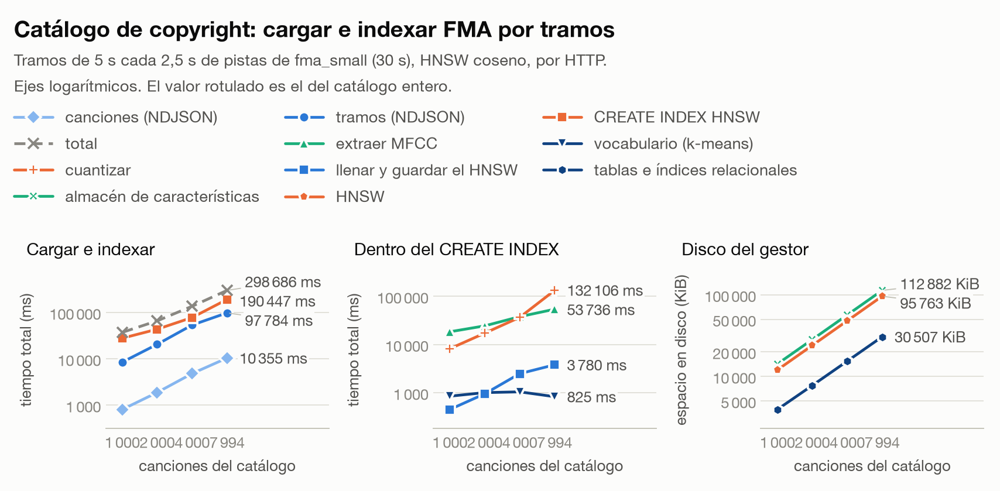

# Copyright en audio (Parte 5, opción C)

Detecta si una canción contiene fragmentos de otras. Este paquete, `songcheck`, trae por
ahora **el catálogo de canciones originales** (#75): las 8 000 pistas de `fma_small` del
Free Music Archive, cortadas en tramos de 5 s e indexadas en el gestor con el HNSW de la
Parte 4 sobre sus MFCC; el trabajo de carga que lo deja listo, y un API de lectura. La
detección llega en #76, la evaluación en #77 y la interfaz en #78. Como todo servicio de la
Parte 5, usa el gestor solo por su API REST ([`apps/README.md`](../README.md)).

El paquete se llama `songcheck` y no `copyright`, que es un nombre interno de Python.

| Módulo | Qué hace |
|---|---|
| [`windows.py`](src/songcheck/windows.py) | las ventanas de 5 s cada 2,5 s, las mismas en el catálogo y en la consulta |
| [`fma/tracks.py`](src/songcheck/fma/tracks.py) | las pistas de `fma_small` según `tracks.csv`, leído por rangos |
| [`fma/archive.py`](src/songcheck/fma/archive.py) | el índice de `fma_small.zip` y la descarga de cada pista por rangos, verificada |
| [`fma/prepare.py`](src/songcheck/fma/prepare.py) | el catálogo completo en disco y `catalog.csv` |
| [`catalog.py`](src/songcheck/catalog.py) | `catalog.csv`, el CRC-32 de una pista y la escritura atómica |
| [`schema.py`](src/songcheck/schema.py) | las tablas `cr_canciones` y `cr_segmentos` y sus índices |
| [`seed.py`](src/songcheck/seed.py) | el trabajo de carga: `python -m songcheck.seed` |
| [`api.py`](src/songcheck/api.py) | el API: `uvicorn --factory songcheck.api:create_app` |
| [`settings.py`](src/songcheck/settings.py) | la configuración, con el prefijo `COPYRIGHT_` |

## El catálogo en disco

`fma_small` son 8 000 fragmentos de 30 s en MP3, mil por cada uno de ocho géneros, en un
`.zip` de 7,7 GB. **No se baja el `.zip`**: con `appkit.ranges` se lee su índice del final,
que da el tamaño y el CRC-32 de cada pista, y después cada pista con una sola petición HTTP
`Range`. De `fma_metadata.zip` (358 MB) se lee solo `tracks.csv`: título, artista y género.

```bash
uv run python -m songcheck.fma --data-dir data/datasets          # solo el disco
```

```
<data-dir>/fma_small/
  pistas/<xxx>/<id>.mp3   el audio, tal como sale del .zip
  catalog.csv             track_id, title, artist, genre, duration_seconds, path,
                          size_bytes, crc32
```

- **Verificada.** `zipfile` comprueba el CRC-32 de cada pista al descomprimirla; una que
  llega con otro se rechaza (`TracksError`) y no se escribe.
- **Reanudable.** Cada pista se escribe con otro nombre y se renombra al terminar. Una que
  ya está en disco se da por buena solo si mide y suma lo que dice el índice; las demás se
  vuelven a pedir. `catalog.csv` es lo último que se escribe: si existe y todas sus pistas
  coinciden, una segunda ejecución no va a la red.
- **Tres pistas sin audio** (099134, 108925 y 133297 pesan menos de 2 KB) se dejan fuera
  antes de bajar nada, por el tamaño que anota el índice. El catálogo son **7 994
  canciones**.
- **Decodificada entera.** La duración de cada pista sale de decodificarla con libsndfile,
  la misma librería con que la lee el gestor (unos 20 ms por pista, en paralelo). La
  cabecera no basta: tres pistas (098565, 098567 y 098569) tienen una cabecera legible y un
  MP3 que se corta a mitad, y el `CREATE INDEX` fallaba con ellas. Quedan fuera del
  catálogo, anotadas en el log.

**Quién es dueño de la descarga.** La descarga del FMA vivía en `demos/descargar_fma.py`
(2 000 pistas para la demo de la Parte 4) sobre `benchmarks/remote.py`. Ahora el dueño es
el servicio, porque el catálogo completo es su dato de partida y un servicio no puede
importar nada del árbol del gestor: la lectura por rangos pasó a `appkit.ranges` (la usan
también los lugares de la Parte 2) y la del FMA a `songcheck.fma`. El guion de la demo
quedó en elegir su subconjunto y escribir su CSV, llamando a `songcheck.fma`; los dos usan
la misma carpeta `pistas/`, así que las 2 000 pistas de la demo no se vuelven a bajar.

## Las tablas en el gestor

| Tabla | Columnas | Índices |
|---|---|---|
| `cr_canciones` | `id` (el `track_id` de FMA), `titulo`, `artista`, `genero`, `duracion`, `ruta`, `busqueda` | B+ de la clave; invertido en `busqueda` (título y artista, analizador inglés) |
| `cr_segmentos` | `id`, `cancion`, `inicio`, `fin`, `ruta` (`pista.mp3#t=inicio,fin`) | B+ de la clave; **HNSW** coseno en `ruta` |

Cada tramo es una fila cuya ruta es un fragmento temporal de W3C Media Fragments: el
gestor la resuelve, decodifica cada pista una vez y describe cada tramo con sus MFCC en
bolsa de palabras auditivas (Parte 4, issue #74), sin cortar archivos en disco. El id de un
tramo es `id de la canción · 1000 + número de ventana`: dice de qué canción es y el rango de
la clave da los tramos de una canción.

Las tablas y el índice invertido son migraciones repetibles (`CREATE … IF NOT EXISTS`) que
aplica el API al arrancar. **El HNSW no**: el gestor entrena su vocabulario con las filas de
la tabla y no crea uno sobre una tabla vacía, así que lo crea el trabajo de carga después
de cargar los tramos.

## Las ventanas: 5 s cada 2,5 s

`SEGMENT_WINDOW_SECONDS = 5.0` y `SEGMENT_HOP_SECONDS = 2.5`, en
[`windows.py`](src/songcheck/windows.py). Viven como constantes del paquete y no en la
configuración de cada proceso: el catálogo se cortó con ellas y la detección (#76) tiene
que consultar con las mismas (`POST /media/segments` con `window` y `hop`), o los vecinos de
una ventana de la consulta serían tramos de otra duración. La regla de corte es la del
gestor: entran solo las ventanas que caben enteras y un audio más corto que una ventana es
una sola.

| | 5 s cada 2,5 s (elegida) | 10 s cada 5 s (la de omisión de `/media/segments`) |
|---|---:|---:|
| tramos por pista de FMA (29,96 a 30,00 s decodificadas) | 10 u 11 | 4 o 5 |
| tramos del catálogo (7 994 canciones) | 83 290 | 35 326 |
| copia más corta que llena entera una ventana del catálogo | 7,5 s | 15 s |
| desfase máximo entre una ventana de la consulta y la del catálogo más cercana | 1,25 s (75 % de solape) | 2,5 s (75 % de solape) |
| ventanas MFCC por tramo (salto de 10 ms) | 501 | 1 001 |

- **Granularidad.** Una copia de `L` segundos contiene entera alguna ventana del catálogo
  si `L ≥ ventana + salto`: con 5 s y 2,5 s basta un fragmento de 7,5 s, la duración típica
  de un sample; con 10 s y 5 s haría falta uno de 15 s, la mitad de una pista de FMA.
- **Tamaño del índice.** La mitad de ventana da el doble de filas: 83 290 tramos
  en vez de 35 326 (2,4 veces). Medido abajo: el HNSW y el almacén de características crecen en
  proporción, y el `CREATE INDEX` lo paga en los MFCC, no en el grafo.
- **El salto es media ventana** en las dos: cada instante cae en dos ventanas, y el
  desfase entre la consulta y el catálogo es como mucho un cuarto de ventana. Bajar más el
  salto daría más filas sin mejorar ese solape relativo.
- **Lo que no baja de 5 s.** El enunciado pide ventanas de 5 a 10 s; con menos de 5 s, un
  tramo tiene menos de 500 ventanas MFCC para llenar un histograma de 256 palabras.
- **La consulta.** Una canción de 3 min se consulta con 71 ventanas de 5 s cada 2,5 s,
  dentro de las 256 que admite el gestor por consulta (`max_segments`).

## El trabajo de carga

```bash
COPYRIGHT_ENGINE_URL=http://127.0.0.1:8000 COPYRIGHT_ENGINE_KEY=… \
COPYRIGHT_DATA_DIR=data/datasets uv run python -m songcheck.seed
```

1. deja el catálogo completo y verificado en disco (lo de arriba);
2. aplica las migraciones;
3. carga `cr_canciones` y `cr_segmentos` con la carga masiva NDJSON del cliente
   (`bulk_insert`), anotando el avance cada 10 000 filas;
4. crea el HNSW de los tramos con `CREATE INDEX IF NOT EXISTS`.

**Repetible y reanudable.** Una tabla que ya tiene todas sus filas no se toca. Una carga
cortada sigue después de la última fila confirmada: las filas van en orden de id y el
gestor confirma los lotes en orden, así que lo cargado es siempre un prefijo. Si una tabla
termina con otro número de filas que el catálogo, o el gestor rechaza un lote, el trabajo
falla diciendo cuál (`SeedError`). La segunda ejecución solo verifica las pistas y cuenta
filas (medido abajo).

| Variable | Para qué | Por omisión |
|---|---|---|
| `COPYRIGHT_ENGINE_URL`, `COPYRIGHT_ENGINE_KEY` | el gestor y la clave del servicio (las de `appkit`) | **obligatorias** |
| `COPYRIGHT_MIGRATION_KEY` | clave `admin` para el DDL y el `CREATE INDEX` | la de `ENGINE_KEY` |
| `COPYRIGHT_DATA_DIR` | carpeta de datasets tal como la ve el servicio | **obligatoria** |
| `COPYRIGHT_ENGINE_DATA_DIR` | la misma carpeta tal como la ve el gestor | `DATA_DIR` en absoluto |
| `COPYRIGHT_DOWNLOAD_THREADS` | pistas que se bajan a la vez | 4 |
| `COPYRIGHT_AUDIO_URL`, `COPYRIGHT_METADATA_URL` | los dos `.zip` del FMA | el servidor oficial |
| `COPYRIGHT_INDEX_TIMEOUT_SECONDS` | cuánto se espera el `CREATE INDEX` | 3 600 |

**El gestor tiene que poder leer el audio.** Las filas guardan rutas, y el gestor solo lee
archivos de su `MINIGESTOR_DATA_DIR` y de `MINIGESTOR_IMPORT_DIRS` (separadas por comas):
la carpeta de datasets tiene que estar ahí. En Docker el gestor monta los datasets en
`/app/data/datasets`, que ya está en su `MINIGESTOR_IMPORT_DIRS`; si el trabajo de carga
los ve en otra ruta, `COPYRIGHT_ENGINE_DATA_DIR=/app/data/datasets` hace que las rutas
guardadas sean las del gestor. El `CREATE INDEX` del catálogo entero dura minutos; el
gestor no lo corta por `MINIGESTOR_STATEMENT_TIMEOUT` (el plazo se mira entre fila y fila
de las consultas, no en la construcción de un índice), y el cliente lo espera hasta
`COPYRIGHT_INDEX_TIMEOUT_SECONDS`.

## El API

```bash
COPYRIGHT_ENGINE_URL=… COPYRIGHT_ENGINE_KEY=… \
uv run uvicorn --factory songcheck.api:create_app --port 8101
```

Lo arma `appkit.create_service_app`: `/health`, `/ready`, `X-Request-ID` y `Server-Timing`,
errores uniformes y las migraciones al arrancar.

| Ruta | Devuelve |
|---|---|
| `GET /songs?query=&genre=&limit=&offset=` | canciones: con `query`, las que mejor responden por BM25 sobre título y artista (con su `score`); sin ella, en orden de id; `genre` filtra por género exacto. `limit` de 1 a 100 (20) |
| `GET /songs/{id}` | una canción con los tramos con que está indexada; `404` si no está |
| `GET /catalog` | canciones, tramos, ventana y salto, si el HNSW ya existe y canciones por género |

## Docker

[`compose.yaml`](compose.yaml) monta la app como las demás (ver
[`apps/README.md`](../README.md#desplegar-una-app)) y lo incluye el compose raíz:

| Servicio | Qué es | Redes | Puertos |
|---|---|---|---|
| `copyright-api` | `uvicorn --factory songcheck.api:create_app`, imagen de `deploy/service` con `APP_DIR=copyright` y `APP_PACKAGE=songcheck` | `data`, `copyright` | — |
| `copyright-web` | la plantilla del kit web hasta #78, que reenvía `/api` a su API | `copyright` | 8101 / 8401 |
| `copyright-seed` (perfil `seed`) | `python -m songcheck.seed` con la imagen del API | `data` | — |
| `copyright-tunnel` (perfil `tunnel`) | una URL HTTPS temporal para la web | `copyright` | — |

**El audio no viaja en ninguna imagen.** La carpeta de datasets (`MINIGESTOR_DATASETS_DIR`,
por omisión `data/datasets`) entra de solo lectura en el gestor y en la carga, en la misma
ruta, `/app/data/datasets`, que ya está en `MINIGESTOR_IMPORT_DIRS` del gestor: las rutas que
guarda la carga son las que el gestor abre, sin `COPYRIGHT_ENGINE_DATA_DIR`. Como el montaje
es de solo lectura, el catálogo se baja antes en el anfitrión:

```bash
uv run python -m songcheck.fma --data-dir data/datasets      # 7,4 GB, una vez
python3 -m tools.compose_keys                                 # claves de cada servicio en .env
docker compose up --build --detach --wait
docker compose run --rm copyright-seed                        # repetible
curl http://localhost:8101/api/catalog
```

Para probar el despliegue sin bajar FMA, `songcheck.sample` escribe un catálogo de juguete
—cuatro melodías al azar de 12 s y su `catalog.csv`— con solo la biblioteca estándar:

```bash
PYTHONPATH=apps/copyright/src python3 -m songcheck.sample --data-dir data/datasets
```

Es lo que hace el trabajo `compose` de la CI: carga ese catálogo dos veces (la segunda no
carga nada) y consulta `/api/health`, `/api/ready`, `/api/catalog` y `/api/songs/2` por el
puerto 8101. Las claves salen de `tools/compose_keys.py`, donde la app ya está con el prefijo
`COPYRIGHT_`: el API atiende con `COPYRIGHT_ENGINE_KEY` (`write`) y migra y carga con
`COPYRIGHT_MIGRATION_KEY` (`admin`).

## Medido

Medido el 18-11-2026 en un Apple M4 Pro (12 núcleos), macOS, Python 3.12, con una conexión
doméstica y la máquina cargada por otros procesos (carga media de 21 a 37). Los datos crudos
están en [`benchmarks/results/copyright_catalogo.json`](../../benchmarks/results/copyright_catalogo.json)
y el detalle en el [§12 de `benchmarks/README.md`](../../benchmarks/README.md#12-catálogo-de-copyright--descargar-cargar-e-indexar-fma-por-tramos).



**El catálogo de verdad.** `python -m songcheck.seed` contra un gestor servido por uvicorn
en otro proceso (`api.main:app_from_environment`, datos en `data/copyright-engine/` del
checkout y `data/datasets` en `MINIGESTOR_IMPORT_DIRS`), con las pistas ya descargadas:

| Etapa | Primera ejecución | Segunda ejecución |
|---|---:|---:|
| verificar el catálogo en disco (7 994 CRC-32, 7,43 GiB) | 6,4 s | 6,1 s |
| `cr_canciones`: 7 994 filas por NDJSON | 8,4 s | 0,1 s |
| `cr_segmentos`: **83 290 tramos** por NDJSON | 92,4 s | 0,4 s |
| `CREATE INDEX ... USING HNSW` de los tramos | 141,3 s | 0,0 s (ya estaba) |
| **total del proceso** | **249 s** | **7,5 s** |

El gestor quedó con **240 MB** en disco. Un tramo se encuentra a sí mismo:
`SIMILAR_TO('…/000002.mp3#t=7.5,12.5', k = 3)` devuelve la canción 2 en 7,5 s (puntaje
1,0000) y sus dos vecinas solapadas, 5,0 s (0,951) y 10,0 s (0,910).

**La descarga** se midió aparte, con el experimento: 5 997 pistas (5,58 GiB) en 909,6 s, 6,6
MB/s con 8 conexiones; las otras 2 000 ya estaban (las de la demo) y solo se verificaron.

**Por tamaño de catálogo** (el experimento, con el gestor en el mismo proceso):

| Canciones | Tramos | Carga NDJSON | `CREATE INDEX` | de él, extraer MFCC | de él, cuantizar | Disco del gestor |
|---:|---:|---:|---:|---:|---:|---:|
| 1 000 | 10 422 | 9,3 s | 27,8 s | 18,3 s | 8,2 s | 29,4 MiB |
| 2 000 | 20 823 | 22,4 s | 43,4 s | 24,3 s | 17,2 s | 58,5 MiB |
| 4 000 | 41 650 | 58,3 s | 77,6 s | 37,7 s | 36,4 s | 116,9 MiB |
| 7 994 | 83 290 | 108,1 s | 190,4 s | 53,7 s | 132,1 s | 233,6 MiB |

- **Listo en unos 4 minutos sobre la descarga, y repetirlo cuesta 7,5 s**, casi todo en
  releer las pistas para comprobar su CRC-32: el trabajo de carga se puede correr en cada
  despliegue.
- **El índice lo pagan los MFCC y su cuantización**, no el grafo: el HNSW de 83 290 vectores
  se arma en 3,8 s y el vocabulario en 1 s. La extracción se reparte en 12 procesos y cada
  pista se decodifica una vez para sus 10 u 11 tramos; la cuantización corre en el proceso
  del gestor y con el catálogo entero es el 69 % del `CREATE INDEX`. Llevarla a los procesos
  de extracción es la mejora siguiente, del motor.
- **2,9 KiB por tramo** en disco, lineal: el gestor guarda rutas, no audio, así que el
  catálogo ocupa un 3 % de sus 7,43 GiB.
- Con 10 s cada 5 s habría 35 326 tramos en vez de 83 290: como el disco y el índice crecen
  en proporción a los tramos, la ventana elegida cuesta 2,4 veces más en los dos, a cambio
  de detectar copias de 7,5 s en vez de 15 s.

## Tests

```bash
uv run pytest apps/copyright -q     # ventanas, catálogo, descarga contra un FMA de juguete
uv run pytest tests/copyright -q    # carga y API contra el gestor real, en el mismo proceso
```

La descarga se prueba contra un servidor HTTP local que sirve un `.zip` de juguete por
rangos: qué pistas entran, que una segunda ejecución no hace ninguna petición, que solo se
vuelven a pedir las pistas que faltan o están dañadas y que una pista con otro CRC-32 se
rechaza. Los de `tests/copyright/` viven en el árbol del gestor porque construyen su
aplicación: cargan audios generados, comprueban que un tramo se encuentra a sí mismo por el
HNSW, que una segunda carga no cambia nada, que una carga cortada sigue donde quedó y que el
trabajo completo (`run_seed`, con el FMA de juguete y el gestor servido por uvicorn) se
puede repetir sin hacer nada.

## Licencias

Free Music Archive (Defferrard et al., *FMA: A Dataset for Music Analysis*, ISMIR 2017): los
metadatos son CC BY 4.0; cada pista conserva la licencia Creative Commons que eligió su
artista, anotada en `tracks.csv`.
