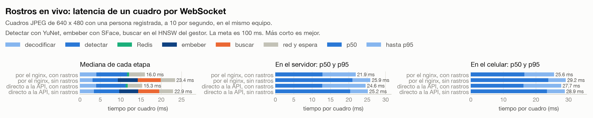
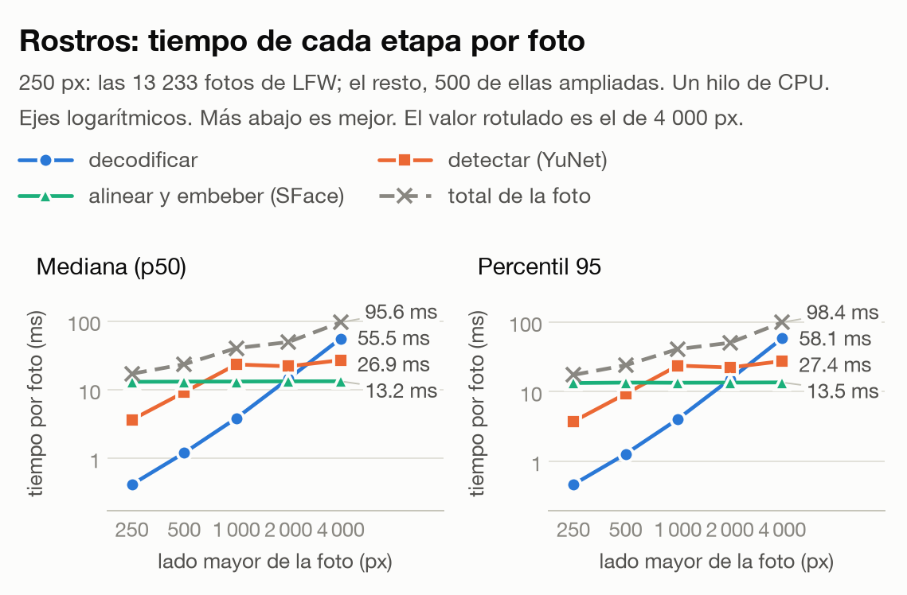
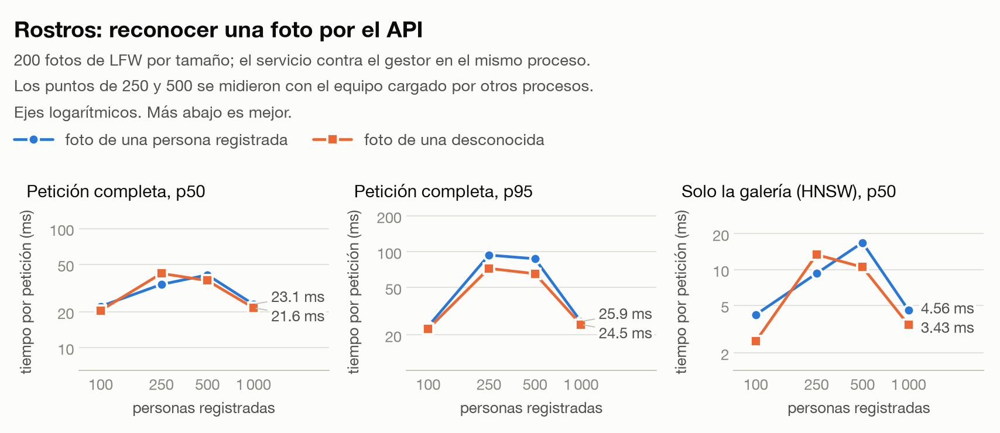

# Rostros (`faces`)

Servicio de la opción D del Anexo A: reconocimiento facial en vivo. Cualquiera se registra
desde su celular —con su consentimiento, en tres tomas guiadas— y se prueba al momento. Tiene
dos partes:

- el **pipeline del modelo**: de los bytes de una foto a los embeddings de sus rostros, con
  YuNet y SFace, y la descarga de los modelos y de LFW (#89);
- el **API** (`faces.api:create_app`): consentimiento, registro con controles de calidad,
  reconocimiento, consulta y borrado de un registro (#90). Guarda todo en el gestor —los
  embeddings en una columna `VECTOR(128)` con un HNSW coseno— y habla con él solo por
  [`minigestor_client`](../client/README.md), armado con [`appkit`](../kit/README.md);
- el **reconocimiento en vivo** por WebSocket (#91): cuadros de la cámara, rostros seguidos
  entre cuadros con sus rastros en Redis, contrapresión y límites;
- la **PWA del celular** (#93), [`web/`](web/README.md): consentimiento, registro guiado con
  el óvalo y las tres tomas automáticas, reconocimiento en vivo con cajas y latencia, y
  borrar mis datos.
Como todo servicio, no importa el código del gestor (ver [`apps/README.md`](../README.md)).

```
src/faces/
  config.py        PipelineConfig: tope de píxeles, lados de detección, umbrales de YuNet
  image.py         bytes → BGR de 8 bits: formatos aceptados, tope de píxeles, EXIF, canales
  detection.py     YuNet: caja, cinco puntos y confianza; escala de detección; «un solo rostro»
  recognition.py   SFace: alineación con los cinco puntos y embedding de norma 1
  pipeline.py      FacePipeline: decodificar → detectar → alinear → describir
  pose.py          giro, cabeceo e inclinación de la cabeza con los cinco puntos; la pose de una toma
  tracking.py      seguir rostros entre cuadros por IoU; identidades que caducan
  frames.py        un cuadro en un hilo: decodificar y detectar, y después embeber lo que falta
  quality.py       medidas de una toma y sus controles, cada uno con su mensaje
  shots.py         de una foto a una toma aceptada o rechazada, y a los rostros de una consulta
  enrollment.py    plan de poses, nombre, parecido con la galería y umbrales de coseno
  consent.py       el texto del consentimiento y su versión
  models.py        los dos modelos de OpenCV Zoo, fijados por commit y SHA-256
  lfw.py           LFW y sus pares oficiales: descarga, extracción y lectura de pliegues
  errors.py        InvalidImageError, ImageTooLargeError, NoFaceError, MultipleFacesError...
  __main__.py      python -m faces models | lfw
  api/
    app.py         create_app: el servicio de appkit con sus migraciones, servicios y purga
    settings.py    FacesSettings: variables FACES_*
    store.py       las tablas face_* y sus consultas con parámetros
    analysis.py    los pipelines de la réplica, uno por hilo
    gallery.py     buscar en el HNSW: reconocer y detectar duplicados
    enrollments.py el registro: consentimiento, tomas, terminar
    identification.py  reconocer los rostros de una foto
    people.py      ver y borrar un registro; borrar lo vencido
    routes.py      las rutas HTTP
    models.py      los cuerpos JSON
    errors.py      los errores del API, con su estado y su mensaje
    realtime/      el reconocimiento en vivo
      protocol.py  la cabecera de un cuadro y los mensajes JSON
      mailbox.py   la contrapresión: un solo cuadro en espera, el más nuevo
      tracks.py    los rastros de cada sesión en Redis, con TTL
      recognizer.py  un cuadro: detectar, rastros, embeber y buscar lo que falta, tiempos
      connection.py  una conexión: recibir, procesar el más nuevo, límites y cierre
      routes.py    WS /ws/recognize
```

## API

```bash
uvicorn --factory faces.api:create_app --host 0.0.0.0 --port 8000
```

| Ruta | Qué hace |
|---|---|
| `GET /consent` | el texto vigente del consentimiento, sus partes (qué se guarda, para qué, cuánto tiempo, derechos) y su `version` |
| `POST /enrollments` | `{display_name, consent: {version, accepted: true}}` → `201` con la sesión: su `enrollment_id`, las poses del plan, las que faltan, los intentos que quedan, cuándo vence y qué hacer ahora |
| `POST /enrollments/{id}/shots` | una foto (`multipart`, campo `image`) → `200` con `accepted: true` y la pose que cubrió, o `accepted: false` con `reason` y el `message` que dice qué corregir; siempre con las medidas de la toma (`quality`) y el estado de la sesión |
| `GET /enrollments/{id}` | el estado de la sesión |
| `DELETE /enrollments/{id}` | cancela: borra la sesión y sus tomas (`204`, también si ya no estaba) |
| `POST /enrollments/{id}/finish` | `201` con la persona creada y su `person_id`, el código para ver o borrar el registro |
| `POST /identify` | una foto → cada rostro, del más grande al más chico, con `known` (nombre y coseno), `unknown` (y el mejor coseno visto) o `too_small` |
| `GET /person` | con el código en la cabecera `X-Person-Id`: lo que se guarda de la persona, salvo sus embeddings (derecho de acceso) |
| `DELETE /person` | con el código en `X-Person-Id`: borra la persona y todos sus embeddings (`204`, también si ya no estaba) |
| `WS /ws/recognize` | el reconocimiento en vivo: ver *Reconocimiento en vivo* |
| `GET /health`, `GET /ready` | las sondas de `appkit`; sin Redis, con `degraded` (ver abajo) |

Cada respuesta lleva `X-Request-ID` y `Server-Timing` con las etapas `analisis` (decodificar,
detectar, medir y embeber), `sesion` (leer la sesión y sus tomas), `galeria` (el HNSW y los
nombres) y `guardar`. Los errores tienen la forma común `{error, kind, request_id}`; `error`
es un mensaje en español para la persona y `kind` lo que la interfaz usa para decidir:

| `kind` | Estado | Cuándo |
|---|---|---|
| `ConsentRequiredError` | 400 | sin consentimiento, o con `accepted: false`: no se guarda nada |
| `ConsentOutdatedError` | 409 | se aceptó otra versión del texto |
| `InvalidNameError` | 422 | nombre vacío, de más de 60 caracteres o con caracteres invisibles |
| `EnrollmentNotFoundError` | 404 | la sesión no existe, venció, se canceló o ya se terminó |
| `TooManyAttemptsError` | 429 | se gastaron los intentos de la sesión |
| `ShotInProgressError` | 409 | dos tomas de la misma sesión a la vez |
| `EnrollmentIncompleteError` | 409 | terminar sin todas las poses: dice cuáles faltan y qué hacer |
| `AlreadyEnrolledError` | 409 | «Ya estás registrado como «X»»: la sesión se descarta |
| `LookalikeError` | 409 | se parece demasiado a alguien registrado, sin decir a quién: la sesión se descarta |
| `UploadTooLargeError` | 413 | la foto pesa más de `FACES_MAX_UPLOAD_BYTES` |
| `TooManyPixelsError` | 413 | la foto declara más de `FACES_MAX_IMAGE_PIXELS` |
| `UnreadableImageError` | 400 | vacía, no es una imagen o está dañada |
| `PersonNotFoundError` | 404 | no hay un registro con ese código, o venció |
| `RequestValidationError` | 422 | `GET` o `DELETE /person` sin la cabecera `X-Person-Id` |

## El registro

```
GET /consent ─▶ POST /enrollments ─▶ POST …/shots (de frente) ─▶ …/shots (izquierda) ─▶ …/shots (derecha) ─▶ POST …/finish
                 nombre + versión      cada toma: aceptada con su pose, o rechazada con qué corregir        una transacción
```

1. La interfaz muestra el texto de `GET /consent` y la persona lo acepta. Sin el objeto
   `consent` con `accepted: true` y la versión vigente **no se crea nada** en el gestor.
2. `POST /enrollments` abre una sesión que vence a los `FACES_ENROLLMENT_TTL_SECONDS` (15
   minutos) y admite `FACES_MAX_SHOT_ATTEMPTS` (20) tomas, aceptadas o no.
3. Cada toma pasa por los controles de calidad (abajo). Si pasa, se clasifica su pose y se
   compara con el plan (`FACES_ENROLLMENT_POSES`, por omisión de frente, girada a la
   izquierda y a la derecha, en cualquier orden): una pose que ya está, una que el plan no
   pide o un giro a medio camino se rechazan con la guía de la que falta («Gira un poco la
   cabeza hacia tu izquierda»). Después se exige que sea **la misma persona** que las tomas
   anteriores (coseno de al menos `FACES_SESSION_THRESHOLD` con cada una: nadie completa el
   registro de otro) y que no esté ya registrada (ver *Duplicados*). Entonces se guarda su
   embedding en `face_tomas`, nunca la foto.
4. `POST …/finish` exige todas las poses del plan y, **en una sola transacción** del gestor,
   borra la sesión y sus tomas, vuelve a buscar duplicados (alguien pudo registrarse
   mientras tanto) y crea la persona con un embedding por toma. Si la sesión ya no está
   —otra petición la terminó o la canceló— la transacción se deshace y no se crea nadie: un
   registro se termina una sola vez.

Más de una cara en el cuadro no siempre es un error: un rostro de menos de la mitad del
ancho del más grande (`background_face_ratio`) es alguien al fondo, como un compañero en un
aula, y no cuenta. Dos personas de tamaño parecido sí: «Aparece más de un rostro».

## Controles de calidad

Cada toma se mide ([`quality.py`](src/faces/quality.py)) y se juzga con funciones puras,
cada una con su umbral en `QualityConfig` y su mensaje. El orden importa: primero lo que se
corrige con el entorno, después la pose; una foto oscura pierde bordes, así que la luz se
juzga antes que la nitidez, y en una foto oscura o borrosa los puntos de la pose no son
fiables. La cara se mide en el **recorte alineado** de 112 x 112 que ve SFace, sin las
esquinas de fondo (filas 25-95 %, columnas 20-80 %).

| Control | Medida | Rechaza si | `reason` | Mensaje |
|---|---|---|---|---|
| un rostro | rostros que no son fondo | 0 / más de 1 | `no_face` / `multiple_faces` | «No encontramos ningún rostro…» / «Aparece más de un rostro…» |
| encuadre | fracción de la caja fuera de la foto | > 0,02 | `face_cut_off` | «Tu cara se sale del cuadro. Aléjate un poco y céntrala…» |
| tamaño | ancho de la caja | < 80 px | `face_too_small` | «Tu cara se ve muy pequeña. Acércate…» |
| luz | gris medio de la cara | < 50 | `too_dark` | «Hay poca luz sobre tu cara…» |
| | gris medio / fracción ≥ 250 | > 200 / > 0,15 | `overexposed` | «Hay demasiada luz sobre tu cara…» |
| nitidez | varianza del laplaciano | < 40 | `blurry` | «La foto salió borrosa. Quédate quieto…» |
| pose | inclinación | > 15° | `head_tilted` | «Endereza la cabeza.» |
| | giro de lado | > 40° | `turned_too_far` | «Gira menos…» |
| | cabeceo | > 25° / < −25° | `looking_down` / `looking_up` | «Levanta…» / «Baja un poco la barbilla.» |
| plan | pose de la toma | ya cubierta / fuera del plan / entre 10° y 15° | `pose_already_taken` / `pose_not_in_plan` / `pose_unclear` | el motivo y qué pose toca |
| misma persona | coseno con cada toma anterior | < 0,363 | `different_person` | «Esta toma parece de otra persona…» |

**Cómo se eligieron.** Con las fotos de prueba transformadas (abajo) y con las medidas de
las 2 164 tomas de un solo rostro que el benchmark envió al registrar personas de LFW (fotos
de prensa de 250 px; percentiles en `rostros_servicio.json`, operación «medidas de las
tomas»):

- **Tamaño (80 px).** SFace ve el rostro a 112 x 112; con menos de 80 px el recorte se
  amplía más de 1,4 veces. En LFW el ancho de la caja tiene percentil 1 de 77 px y mediana
  94: se rechaza el 2 %. Una selfie a un brazo de distancia da unos 200 px; el retrato
  original de las pruebas, 65 px.
- **Luz (50 a 200).** El gris medio de la cara en LFW va de 74 (percentil 0,5) a 186
  (99,5): ninguna foto de prensa bien expuesta queda fuera. Oscurecer la selfie de prueba al
  25 % la deja por debajo de 50; aclararla un 50 % quema la piel.
- **Nitidez (40).** La varianza del laplaciano en LFW tiene percentil 1 de 42 y mediana 205;
  la selfie de prueba da de 600 a 800, y con un desenfoque gaussiano de radio 4 cae por
  debajo de 40. Con radio 2 (unos 60) todavía pasa: es una foto blanda pero útil.
- **Pose (40°, 25°, 15°).** En LFW el giro estimado va de −44° a 35° (percentiles 0,5 y
  99,5), el cabeceo de −18° a 22° y la inclinación de −13° a 15°.
- **Encuadre (0,02).** YuNet ajusta la caja de una cara cortada al borde y rara vez la deja
  salir; cortar la foto un 20 % por encima del mentón deja un 8 % de la caja afuera. Un
  corte por arriba (la frente) no se detecta: la caja se encoge. No afecta al embedding, que
  se alinea con ojos, nariz y boca.

**Qué se prueba con fotos.** Desenfocar, oscurecer, sobreexponer, girar la foto 35°
(inclinación), achicar el rostro, cortar la barbilla, la foto de grupo y una imagen gris se
rechazan cada una con su motivo y su mensaje exactos; una selfie con alguien chico al fondo
pasa. El giro y el cabeceo no se pueden simular deformando una foto de frente —YuNet ubica
los puntos donde esperaría una cara de frente—, así que se prueban con los cinco puntos de
una cara promedio girada en 3D, donde la estimación sale exacta.

## Pose de la cabeza

[`pose.py`](src/faces/pose.py) estima tres ángulos con los cinco puntos y una cara promedio
proyectada sin perspectiva: la **inclinación** es el ángulo de la línea de los ojos; con la
cara enderezada, el **cabeceo** sale de la altura de la nariz entre los ojos y la boca (de
frente queda al 57,4 % del camino, la mediana de LFW), y el **giro de lado** del corrimiento
de la nariz respecto del punto medio de los ojos, sabiendo cuánto sobresale (0,55 veces la
distancia entre los ojos) y cuánto le quitó el cabeceo. «Izquierda» es la de la persona: en
una foto sin espejar, su nariz se corre a la derecha de la imagen.

Una toma es **de frente** con un giro de hasta 10°, **girada** desde 15° y hasta 40°; entre
10° y 15° no es ni una ni otra, y se pide girar más o mirar de frente, para que las tomas
giradas aporten de verdad otra vista. Los límites están en `PoseLimits`.

## Duplicados y umbrales

Un coseno de SFace se compara contra umbrales distintos según la pregunta:

| Umbral | Valor | Pregunta | Por qué ese valor |
|---|---:|---|---|
| `FACES_SESSION_THRESHOLD` | 0,363 | ¿esta toma es de la misma persona que las anteriores? (1:1) | el de verificación que publica OpenCV para SFace; en los pares de LFW, un 0,17 % de falsos aceptados y un 1,2 % de falsos rechazos |
| `FACES_MATCH_THRESHOLD` | 0,45 | ¿quién de la galería es? (1:N) | con 1 000 personas registradas, 0,363 reconoce como alguien al 46,5 % de los desconocidos; 0,45 al 1,5 %, a costa de no reconocer al 5 % de los registrados (medido abajo) |
| `FACES_LOOKALIKE_THRESHOLD` | 0,45 | ¿se parece demasiado a alguien para registrarlo aparte? | el mismo que reconocer: por encima, el reconocimiento ya los confundiría. Bloqueó a 17 de 1 513 desconocidos (1,1 %) mientras la galería crecía hasta 1 000 personas |
| `FACES_DUPLICATE_THRESHOLD` | 0,50 | ¿ya está registrado? (y se dice como quién) | 4 de esos 1 513 desconocidos (0,26 %) pasaron 0,50; ninguno mientras la galería tenía menos de 250 personas |

La diferencia entre 1:1 y 1:N es el tamaño de la galería: un desconocido se compara con
todos, así que la probabilidad de que alguno pase el umbral crece con cada persona
registrada. Por eso el umbral de verificación de OpenCV no sirve para reconocer.

**Política.** Antes de guardar una toma, y otra vez al terminar, se buscan en el HNSW los
vecinos de cada toma del registro y se promedia, por persona, su mejor coseno con cada toma
(quien no salió entre los vecinos de una toma cuenta con el coseno del último vecino, una
cota superior). Promediar exige que todas las tomas se parezcan, no solo la mejor. Con la
persona más parecida:

- **≥ 0,50** → `409 AlreadyEnrolledError`: «Ya estás registrado como «X»», con su nombre;
- **entre 0,45 y 0,50** → `409 LookalikeError`: «Te pareces mucho a alguien que ya está
  registrado…», **sin** decir a quién, porque puede ser otra persona;
- debajo, se registra.

En los dos primeros casos la sesión y sus tomas se borran: no hay nada más que hacer con
ellas. Una persona vencida que aún no se borró no cuenta. Todos los umbrales son
configuración; #92 los calibrará con los pares de LFW a un FAR fijo.

**Dos registros que terminan a la vez.** La búsqueda de duplicados de `finish` corre dentro
de la transacción que crea a la persona, después de borrar la sesión: ese `DELETE` bloquea
`face_sesiones` en exclusiva hasta el final, así que dos `finish` se turnan, y el segundo
busca con el primero ya confirmado y recibe «Ya estás registrado». La búsqueda toma
`face_embeddings` y `face_personas` en modo compartido y las escrituras la suben a
exclusivo; dos transacciones nunca suben a la vez, porque las dos esperan primero por
`face_sesiones`. Toda transacción que toca la sesión y sus tomas borra en el mismo orden
(sesión, luego tomas), para que dos no se crucen los bloqueos. Un test termina dos sesiones
de la misma cara en paralelo: una crea la persona y la otra responde `409`.

## Estado de las sesiones

Una sesión de registro dura varias peticiones y el API corre en N réplicas (#72), así que
**su estado vive en el gestor**, en `face_sesiones` y `face_tomas`, y no en la memoria del
proceso: cualquier réplica atiende cualquier toma. Se descartaron:

- **tokens firmados sin estado**: el token tendría que llevar los embeddings de las tomas ya
  aceptadas —datos biométricos— al navegador y de vuelta, cifrados y con una clave que
  rotar; y no se podría revocar: un token de una sesión terminada serviría para registrarse
  otra vez hasta que venciera;
- **Redis** (que sí guarda los rastros del reconocimiento en vivo, sin datos biométricos):
  sería un segundo lugar con embeddings que borrar y vigilar, solo para unas pocas filas
  por registro.

En el gestor, la sesión se borra con todo lo demás —al cancelar, al terminar, al vencer—, y
terminarla es una transacción: consumir la sesión y crear la persona pasan juntos o no
pasan. El costo es una lectura y una escritura más por toma (`sesion` en `Server-Timing`).

| Tabla | Una fila por | Columnas | Índices |
|---|---|---|---|
| `face_personas` | persona registrada | `id`, `nombre`, `version_consentimiento`, `consentido_en`, `creado_en`, `expira_en` | clave primaria |
| `face_embeddings` | toma de una persona | `id`, `persona`, `toma`, `pose`, `embedding VECTOR(128)` y las medidas de la toma | `persona` (hash), `embedding` (HNSW coseno) |
| `face_sesiones` | registro a medias | las de `face_personas` e `intentos` | clave primaria |
| `face_tomas` | toma aceptada de un registro a medias | como `face_embeddings`, con `sesion` | `sesion` (hash) |

Los tiempos son segundos desde la época (`BIGINT`, UTC). Las tablas se crean con
migraciones `IF NOT EXISTS` al arrancar ([`store.py`](src/faces/api/store.py)).

## Reconocimiento en vivo

`WS /ws/recognize` (por la web, `/api/ws/recognize`: el nginx reenvía el cambio de
protocolo). El celular manda cuadros de su cámara y recibe, por cada uno, las cajas de los
rostros con su nombre o «desconocido», su rastro y lo que tardó cada etapa. No pide
credenciales, como el resto del servicio: la cámara es anónima y solo recibe nombres, nunca
el código de una persona; lo que limita su uso son los topes de abajo y el límite de
peticiones por IP del nginx, que cuenta la que abre la conexión.

### Protocolo

| Sentido | Mensaje | Contenido |
|---|---|---|
| celular → | binario | cabecera de 5 bytes —versión del protocolo (`1`, 1 byte) y número del cuadro (entero sin signo de 4 bytes, big-endian)— y la imagen, un JPEG reducido (u otro formato de los aceptados) |
| celular → | texto, opcional | `{"type": "hello", "session": "<32 hex>", "track_cache": true}`: retoma los rastros de una sesión anterior y elige si usarlos |
| ← servidor | `ready` | al conectarse y tras cada `hello`: `session` (guárdala para reconectarse), `track_cache` y los `limits` |
| ← servidor | `result` | `frame` (el número que mandó el celular), `faces` del más grande al más chico —`track`, `box`, `status` (`known`, `unknown`, `too_small`), `label` (el nombre, «desconocido» o «acércate»), `display_name`, `score`, `cached`—, `dropped` y `timings` |
| ← servidor | `error` | `frame` (o `null`), `kind` y `error`; la conexión sigue |

`timings` son milisegundos en el servidor: `wait` (de llegar a empezar), `decode`, `detect`,
`track` (leer y guardar los rastros en Redis), `embed`, `search` (el HNSW y el nombre en el
gestor) y `total`. Como el número del cuadro vuelve en la respuesta, el celular mide su
latencia sin relojes compartidos. Los errores de un cuadro son `InvalidFrameError` (sin
cabecera, otra versión o sin imagen), `FrameTooLargeError`, `TooManyPixelsError` y
`UnreadableImageError`; los de un texto, `InvalidMessageError`. Una cámara tapada o un
cuadro sin rostros da `faces: []`, no un error.

| Cierre | Código | Cuándo |
|---|---|---|
| réplica llena | `1013` (inténtalo más tarde) | ya atiende `FACES_STREAM_MAX_CONNECTIONS` conexiones: se acepta y se cierra, para que el celular sepa por qué |
| sin mensajes | `4408` | pasaron `FACES_STREAM_IDLE_TIMEOUT_SECONDS` sin ningún mensaje |
| fallo interno | `1011` | un error no previsto; queda en el log |

**Reconexión.** Si la conexión se corta, el celular abre otra —el nginx puede llevarla a
cualquier réplica— y manda `hello` con su `session`: sigue con los mismos rastros mientras
no pasen `FACES_TRACK_SESSION_TTL_SECONDS` sin cuadros. La sesión no va en la URL para no
quedar en ningún log.

### Contrapresión

Dos tareas por conexión: una lee el socket sin parar y deja cada cuadro en un único lugar
de espera; la otra toma el que haya, no antes de `1 / FACES_STREAM_MAX_FPS` desde el
anterior, y lo procesa. Si llega un cuadro mientras otro espera, **el viejo se descarta**
(`dropped` los cuenta) y nunca se encola: con una cola, si el celular manda más rápido de lo
que se procesa, cada respuesta llegaría más tarde que la anterior y las cajas dibujadas
quedarían cada vez más atrás de la cámara. Así, un cuadro tarda a lo sumo el que está en
curso más el suyo. Un test con un productor que manda 60 cuadros cada 5 ms contra un
procesamiento de 50 ms comprueba que se responde el último, que los demás se cuentan como
descartados y que ninguna respuesta tarda más de 200 ms.

### Rastros y caché en Redis

Cada rostro del cuadro se asigna al rastro cuya caja más se le solapa (IoU de al menos
`FACES_TRACK_MIN_IOU`, voraz y uno a uno) o abre uno nuevo. Un rastro con identidad vigente
—menos de `FACES_TRACK_VERIFY_SECONDS` desde que se buscó— **no se vuelve a embeber ni a
buscar**: se responde con esa identidad y `cached: true`. Pasado ese tiempo se verifica de
nuevo, así que alguien que se registra o se borra se nota en a lo sumo ese plazo. Un rastro
que deja de verse se guarda `FACES_TRACK_LOST_SECONDS`, por si el detector lo pierde un
cuadro. Rostros muy chicos para el embedding (`too_small`) tienen rastro pero no identidad.

Los rastros de una sesión viven en Redis, en la clave `faces:rastros:<sesión>`, como JSON
con un TTL de `FACES_TRACK_SESSION_TTL_SECONDS` que se renueva en cada cuadro: al cortarse
la conexión caducan solos. Se leen y se guardan **en cada cuadro** (0,5 ms medidos), no solo
al conectarse: Redis es la única copia, así que cualquier réplica retoma una sesión sin
conexiones pegajosas en el nginx, y sin Redis no hay ninguna caché escondida en memoria. Lo
guardado son cajas, el nombre que se muestra, un coseno y tiempos: **ni embeddings ni el
código** de la persona. El Redis del compose no tiene disco.

**Sin Redis.** Si Redis no responde, cada cuadro se reconoce entero —todos los rostros se
embeben y se buscan— y `track` sale `null`: el servicio sigue. El primer fallo va una vez
al log, Redis no se vuelve a probar hasta `FACES_REDIS_RETRY_SECONDS` después (para no
pagar su plazo, `FACES_REDIS_TIMEOUT_SECONDS`, en cada cuadro), y mientras tanto `/health`
y `/ready` responden con `"degraded": {"redis": "…"}` sin dejar de estar `ok` y `ready`. Es
[`appkit.OptionalRedis`](../kit/README.md#caché-en-redis). Sin `FACES_REDIS_URL` no hay
caché y tampoco es una degradación. Un cliente puede pedir cuadros sin rastros con
`"track_cache": false` en su `hello`: es lo que usa el benchmark para medir su efecto.

## Privacidad (Ley 29733)

Un rostro es un dato biométrico, y la Ley 29733 de Protección de Datos Personales lo cuenta
entre los **datos sensibles**: su tratamiento pide consentimiento previo, expreso, informado
y por escrito, y la persona tiene derecho a acceder a sus datos y a cancelarlos.

- **Consentimiento informado y versionado.** `GET /consent` dice qué se guarda (el nombre,
  un embedding por toma, la versión y fecha del consentimiento), qué no (las fotos), para
  qué y cuánto tiempo. La versión sale del propio texto con el plazo ya escrito: si cambia
  una palabra o el plazo, cambia la versión y un registro con la anterior se rechaza. Cada
  persona guarda la versión que aceptó y cuándo.
- **Sin fotos.** Una foto se analiza en memoria y se descarta: en el gestor solo hay
  números y texto (un test comprueba los tipos de columna de las cuatro tablas). De un
  embedding de SFace no se reconstruye la foto.
- **Acceso y borrado.** Al terminar, la persona recibe su `person_id` (128 bits al azar),
  que es la llave de `GET /person` y `DELETE /person`. El reconocimiento nunca lo devuelve:
  muestra el nombre, no el código. Borrar quita la persona y sus embeddings en una
  transacción, y es idempotente.
- **El código no queda en los logs.** Va en la cabecera `X-Person-Id`, no en la ruta: el log
  de acceso del servicio (`appkit.access`) y el del nginx escriben la ruta (`$uri`, sin la
  query string) y ninguna cabecera, así que quien lea los logs no puede ver ni borrar un
  registro. Se prefirió sacarlo de la ruta a enmascararlo en cada log: una ruta también
  queda en el historial del navegador, en el log de errores de nginx, en el túnel y en
  cualquier proxy que se sume, y enmascarar exigiría acordarse de cada uno. Lo prueban un
  test del log del servicio, otro del `log_format` del nginx y la CI, que pide y borra un
  registro por `:8104` y busca el código en los logs de `faces-web` y `faces-api`.
- **Caducidad.** Cada registro vence a los `FACES_RETENTION_DAYS` (30) días. Al vencer deja
  de reconocerse y de verse **en ese momento** (las consultas filtran por `expira_en`), y
  cada réplica corre cada `FACES_PURGE_INTERVAL_SECONDS` (5 minutos) un borrado de lo
  vencido —personas con sus embeddings y sesiones con sus tomas—; correrlo en varias
  réplicas a la vez no hace daño, porque cada borrado es idempotente. Se eligió la purga
  periódica más el filtro y no solo borrar al leer: un registro que nadie vuelve a consultar
  también se borra, y la lectura del reconocimiento no escribe.

## Configuración

Además de lo común de `appkit` (`FACES_ENGINE_URL`, `FACES_ENGINE_KEY`,
`FACES_MIGRATION_KEY`, `FACES_LOG_LEVEL`… ver [`kit/README.md`](../kit/README.md)):

| Variable | Para qué | Por omisión |
|---|---|---|
| `FACES_MODELS_DIR` | carpeta de YuNet y SFace | **obligatoria** |
| `FACES_RETENTION_DAYS` | días que dura un registro | `30` |
| `FACES_ENROLLMENT_TTL_SECONDS` | cuánto dura una sesión de registro | `900` |
| `FACES_MAX_SHOT_ATTEMPTS` | tomas por sesión, aceptadas o no | `20` |
| `FACES_ENROLLMENT_POSES` | el plan, en JSON: cuántas tomas y de qué pose | `["front", "left", "right"]` |
| `FACES_MAX_UPLOAD_BYTES` | tamaño máximo de una foto | `10485760` (10 MiB) |
| `FACES_MAX_IMAGE_PIXELS` | píxeles que puede declarar una foto | `50000000` |
| `FACES_MAX_QUERY_FACES` | rostros que busca `POST /identify` | `10` |
| `FACES_SEARCH_NEIGHBOURS` | vecinos que se piden al HNSW | `10` |
| `FACES_SESSION_THRESHOLD`, `FACES_MATCH_THRESHOLD`, `FACES_LOOKALIKE_THRESHOLD`, `FACES_DUPLICATE_THRESHOLD` | los umbrales de coseno | `0.363`, `0.45`, `0.45`, `0.5` |
| `FACES_ANALYSIS_WORKERS` | fotos que la réplica analiza a la vez | `2` |
| `FACES_PURGE_INTERVAL_SECONDS` | cada cuánto se borra lo vencido | `300` |
| `FACES_REDIS_URL` | el Redis de los rastros; sin ella, no hay caché de rastros | sin valor (el compose: `redis://redis:6379/1`) |
| `FACES_REDIS_TIMEOUT_SECONDS`, `FACES_REDIS_RETRY_SECONDS` | plazo de cada operación de Redis y cuánto se deja de probar tras un fallo | `0.1`, `5` |
| `FACES_STREAM_MAX_FRAME_BYTES`, `FACES_STREAM_MAX_FRAME_PIXELS` | tamaño máximo de un cuadro | `1048576` (1 MiB), `2073600` (Full HD) |
| `FACES_STREAM_MAX_FPS` | cuadros por segundo que procesa una conexión | `15` |
| `FACES_STREAM_IDLE_TIMEOUT_SECONDS` | sin mensajes por este tiempo, se cierra | `30` |
| `FACES_STREAM_MAX_CONNECTIONS` | conexiones de reconocimiento por réplica | `16` |
| `FACES_TRACK_MIN_IOU`, `FACES_TRACK_VERIFY_SECONDS`, `FACES_TRACK_LOST_SECONDS` | el seguimiento: solapamiento mínimo, cuánto vale una identidad, cuánto se guarda un rastro perdido | `0.3`, `2`, `1` |
| `FACES_TRACK_SESSION_TTL_SECONDS` | cuánto viven en Redis los rastros de una sesión sin cuadros | `60` |

Cada réplica carga `FACES_ANALYSIS_WORKERS` pipelines al arrancar y analiza las fotos en
hilos, sin detener el bucle de eventos; con todos ocupados, la siguiente espera turno.

## Docker

[`compose.yaml`](compose.yaml), incluido desde el raíz, levanta `faces-api` (redes `data`,
`faces` y `cache`, sin puertos, escalable con `--scale faces-api=N`) y `faces-web` en
`:8104` y `:8404` con HTTPS. La imagen del API trae los modelos verificados
([`docker-build.sh`](docker-build.sh)) y el compose fija `FACES_MODELS_DIR=/opt/app/models`.
Con dos pipelines y recién arrancada, una réplica usa unos 290 MiB; su tope es
`FACES_API_MEMORY` (1 GiB), por las fotos de celular de hasta 50 MP. La web es la PWA de
[`web/`](web/README.md), servida por la imagen común del kit; su nginx permite la cámara
(`camera=(self)`, y nada de micrófono ni ubicación), acepta
subidas de 11 MB (`FACES_WEB_MAX_BODY_SIZE`: una foto de 10 MiB y el multipart) y baja el
límite a 5 peticiones por segundo por IP con ráfaga de 20, porque cada foto cuesta CPU. No
hay carga inicial (`faces.seed`): el servicio arranca vacío y sus tablas las crean las
migraciones. La CI levanta el compose y, por `:8104`, comprueba las sondas, el
consentimiento, una toma aceptada de frente con un retrato de prueba, el reconocimiento de
la foto de grupo y el WebSocket: dos cuadros de un retrato por el nginx, con su respuesta y
su rastro guardado en Redis. La API usa el `redis` del compose (red `cache`, base 1) para
los rastros; si se cae, el reconocimiento en vivo sigue sin ellos.

```bash
python -m tools.compose_keys && deploy/certs.sh
docker compose up -d --build                     # http://localhost:8104, https://<ip>:8404
docker compose --profile tunnel up -d faces-tunnel && docker compose logs faces-tunnel | grep trycloudflare.com
```

## Pipeline

```
bytes ─▶ decode_image ─▶ detection_scale + YuNet ─▶ rostros por área ─▶ alignCrop ─▶ SFace ─▶ ‖·‖ = 1
         (Pillow)         (cv2.FaceDetectorYN)                          (112 x 112)   (128 dim)
```

| Etapa | Qué hace | Por qué así |
|---|---|---|
| Decodificar | Pillow abre la imagen solo si es JPEG, PNG, WebP, BMP, GIF o TIFF; rechaza la que **declara** más de `max_image_pixels` (50 M) antes de decodificarla; aplica la orientación EXIF; pasa el gris a tres canales, aplana la transparencia sobre blanco, toma el byte alto de 16 bits y el primer cuadro de un GIF | Pillow lee la cabecera antes de reservar memoria, así que una «bomba» de pocos bytes que promete gigapíxeles no llega a decodificarse; `cv2.imdecode` no permite ese tope por llamada y, para conservar el alfa, ignora el EXIF |
| Escalar | el lado mayor queda entre 320 y 640 px (`detection_scale`) | YuNet cuesta lo mismo con cualquier foto grande, y una foto chica ampliada a 320 px sí muestra su rostro (con 96 px de lado se encuentra; sin ampliar, no) |
| Detectar | YuNet 2023mar con confianza ≥ 0,9 y NMS a 0,3; las coordenadas vuelven a los píxeles de la foto original | caja y cinco puntos (ojos, punta de la nariz, comisuras), que es lo que necesita la alineación |
| Elegir | todos los rostros, del de mayor área al de menor; `ImageAnalysis.only_face()` exige exactamente uno | la búsqueda quiere a todos los de la foto y el registro, a una sola persona |
| Alinear | `alignCrop`: semejanza que lleva los cinco puntos a la plantilla de 112 x 112 de SFace, sobre la foto **original** | se pierde menos detalle que alineando sobre la imagen reducida para detectar |
| Embeber | SFace (pérdida de margen angular tipo ArcFace), 128 `float32` divididos por su norma | con norma 1, el producto punto es el coseno, que es la métrica del HNSW |

`FacePipeline` carga las dos redes al crearse y **no se comparte entre hilos** (OpenCV DNN
guarda el tamaño de la última entrada): cada hilo o proceso del servicio crea el suyo.

```python
from pathlib import Path
from faces import FacePipeline, PipelineConfig, locate_models

pipeline = FacePipeline(locate_models(Path("data/models/faces")), PipelineConfig())
analysis = pipeline.analyze(Path("foto.jpg").read_bytes())
for found in analysis.faces:            # del rostro más grande al más chico
    print(found.face.box, found.face.score, found.embedding.shape)   # (128,)
selfie = analysis.only_face()           # NoFaceError / MultipleFacesError
```

## Modelos y datos

| Archivo | Origen | Licencia | SHA-256 |
|---|---|---|---|
| `face_detection_yunet_2023mar.onnx` (227 KiB) | OpenCV Zoo, commit `48b10fa` | Apache 2.0 | `8f2383e4…2552fa4` |
| `face_recognition_sface_2021dec.onnx` (37 MiB) | OpenCV Zoo, commit `48b10fa` | Apache 2.0 | `0ba9fbfa…7c34e79` |
| `lfw.tgz` (172 MiB) | espejo de figshare que usa scikit-learn (archivo 5976018) | sin licencia explícita; uso de investigación | `055f7d9c…d8536c0` |
| `pairs.txt`, `pairsDevTrain.txt`, `pairsDevTest.txt` | figshare 5976006, 5976012, 5976009 | ídem | en [`lfw.py`](src/faces/lfw.py) |

Las sumas de los modelos son las de sus punteros de Git LFS en ese commit; las de LFW, las
que fija scikit-learn en `fetch_lfw_pairs`. Todo se baja con
[`appkit.download`](../kit/src/appkit/download.py): se reanuda si se corta y nunca da el
nombre final a un archivo con otra suma.

```bash
python -m faces models --salida data/models/faces   # o con FACES_MODELS_DIR definida
python -m faces lfw --salida data/datasets/lfw      # deja lfw/<Persona>/<Persona>_0001.jpg
```

`python -m faces models` es también lo que corre la imagen del servicio al construirse:
[`docker-build.sh`](docker-build.sh) es el paso propio de la app en
[`deploy/service/Dockerfile`](../../deploy/service/Dockerfile), que deja los modelos en
`/opt/app/models` (su compose fija `FACES_MODELS_DIR` ahí), de modo que el contenedor
arranca con los modelos verificados y sin red.

LFW se extrae en una carpeta aparte que se mueve al final, con el filtro `data` de
`tarfile` (sin rutas absolutas, enlaces ni `..`), y se comprueba que hay 13 233 fotos de
5 749 personas y que existen todas las que nombran los tres archivos de pares.

## Tests

```bash
uv run --no-sync python -m pytest -q apps/faces          # sin modelos: se saltan los que los usan
FACES_MODELS_DIR=data/models/faces uv run --no-sync python -m pytest -q apps/faces tests/faces
```

- [`tests/`](tests/) prueba el pipeline y las reglas sin el gestor: la pose contra los cinco
  puntos de una cara promedio girada en 3D (exacta con giro, cabeceo e inclinación, solos o
  juntos), cada control de calidad con sus umbrales y su mensaje, el plan de poses, el
  nombre, el parecido con la galería, el consentimiento y la configuración. Del
  reconocimiento en vivo, sin modelos: el IoU y el emparejamiento de rastros, identidades que
  caducan y rastros perdidos; los rastros en Redis (`fakeredis`: ida y vuelta, TTL, sin
  embeddings, Redis caído); y la conexión con un reconocedor de mentira: el protocolo, cada
  mensaje inválido sin cortar la conexión, la contrapresión con un productor rápido, el tope
  de cuadros por segundo, la espera agotada y la réplica llena.
- [`tests/faces/`](../../tests/faces/), en el árbol del gestor porque construye su API, prueba
  el servicio de punta a punta contra el **gestor real en el mismo proceso**, con un reloj
  que el test adelanta: consentimiento ausente, rechazado o de otra versión (y que no queda
  nada en el gestor), el nombre, el plan y su guía, tomas de otra persona, registrar →
  reconocer → borrar (y que las tablas quedan vacías y solo guardan números), «ya estás
  registrado como», «te pareces mucho» sin el nombre, terminar dos veces, dos sesiones de la
  misma cara que terminan a la vez, el código fuera de los logs, cancelar, sesiones e
  intentos que se acaban, registros que vencen y la purga, fotos demasiado pesadas, con
  demasiados píxeles, vacías o que no son imágenes, y las migraciones repetidas. En vivo,
  por el WebSocket: una persona registrada se reconoce, su rastro responde sin buscar y se
  verifica de nuevo al caducar; un desconocido; una cámara tapada; un cuadro con demasiados
  píxeles o que no es imagen; Redis caído (sin rastros y `/health` degradado), sin Redis
  configurado y sin rastros pedidos; y **dos réplicas con el mismo Redis**: una sesión que
  se reconecta a la otra sigue con su rastro sin volver a buscar.

Los que corren los modelos usan tres fotos de dominio público de la NASA
([`tests/fixtures/`](tests/fixtures/README.md)): un retrato, otro retrato de la misma
persona y una foto de grupo de siete. Cubren una foto sin rostro (gris y ruido), la de
varios (siete, ordenados por área), la girada por EXIF, en gris, con canal alfa, de 6 000 px
y de 96 px, además de bytes que no son imagen, un JPEG cortado, un formato no aceptado y
una cabecera que declara más píxeles que el tope. El embedding tiene norma 1; la misma
persona en dos fotos da un coseno de 0,74 a 0,83 y cualquier otra, menos de 0,18 (el umbral
que publica OpenCV para SFace es 0,363). Para el registro, una «selfie» es el retrato
recortado y ampliado a 570 x 660 (rostro de unos 190 px), y la foto de grupo da otras
personas —y a la propia Collins, comandante del STS-114— recortadas de la misma manera.

En la CI, `FACES_MODELS_DIR` está definida y los modelos se bajan con su suma antes de
pytest (y se guardan en la caché de Actions): un test que no los encuentre falla en vez de
saltarse.

## Rendimiento medido

### En vivo

Con [`benchmarks/faces_stream_benchmark.py`](../../benchmarks/faces_stream_benchmark.py)
contra el compose en el mismo equipo: cuadros JPEG de 640 x 480 con una persona registrada,
a 10 por segundo, 300 por pasada. Resultados crudos en
[`rostros_tiempo_real.json`](../../benchmarks/results/rostros_tiempo_real.json); análisis en
[`benchmarks/README.md`](../../benchmarks/README.md#15-rostros-en-vivo--latencia-por-cuadro-por-websocket).



| Camino | Rastros | p50 | p95 | Detectar p50 | Redis p50 | Embeber + buscar p50 |
|---|---|---:|---:|---:|---:|---:|
| nginx | con caché | 16,4 ms | 25,6 ms | 7,5 ms | 0,5 ms | 0 ms (285 de 300 del rastro) |
| nginx | sin caché | 23,8 ms | 29,2 ms | 6,2 ms | — | 10,5 ms |
| directo | con caché | 16,2 ms | 27,7 ms | 7,3 ms | 0,5 ms | 0 ms |
| directo | sin caché | 23,4 ms | 28,9 ms | 6,2 ms | — | 9,9 ms |

Muy por debajo de la meta de 100 ms. La caché de rastros quita un tercio de la mediana; el
nginx no se nota. Carga media del equipo de 5,2 a 7,8 durante la medida.

### El pipeline

Con [`benchmarks/faces_benchmark.py`](../../benchmarks/faces_benchmark.py), sobre las 13 233
fotos de LFW (250 x 250 px) y 500 de ellas ampliadas y vueltas a codificar en JPEG; un hilo
de OpenCV, Apple M4 Pro, OpenCV 5.0.0 y Pillow 13.0.0. Resultados crudos en
[`rostros.json`](../../benchmarks/results/rostros.json); análisis en
[`benchmarks/README.md`](../../benchmarks/README.md#7-reconocimiento-facial--latencia-del-pipeline-y-cobertura-en-lfw).



| Lado mayor | Decodificar p50 / p95 | Detectar p50 / p95 | Alinear y embeber p50 / p95 | Total p50 / p95 |
|---:|---:|---:|---:|---:|
| 250 px (LFW) | 0,41 / 0,46 ms | 3,6 / 3,7 ms | 13,0 / 13,3 ms | 17,0 / 17,4 ms |
| 500 px | 1,2 / 1,3 ms | 9,1 / 9,3 ms | 13,1 / 13,5 ms | 23,4 / 23,9 ms |
| 1 000 px | 3,8 / 4,0 ms | 23,3 / 23,6 ms | 13,1 / 13,4 ms | 40,2 / 40,7 ms |
| 2 000 px | 14,4 / 14,9 ms | 21,9 / 22,2 ms | 13,2 / 13,5 ms | 49,4 / 50,2 ms |
| 4 000 px | 55,5 / 58,1 ms | 26,9 / 27,4 ms | 13,2 / 13,5 ms | 95,6 / 98,4 ms |

**Cobertura del detector en LFW:** YuNet encuentra al menos un rostro en **13 221 de las
13 233 fotos (99,91 %)**; en 12 no encuentra ninguno, y en 1 033 (7,8 %) encuentra más de
uno, porque muchas fotos de LFW son de prensa y tienen a otras personas detrás. Por eso la
evaluación de LFW (#92) debe tomar el rostro que corresponde al centro de la foto y no
exigir uno solo.

- El **embedding** cuesta lo mismo con cualquier foto (13 ms): SFace siempre ve 112 x 112.
- La **detección** deja de crecer pasados los 640 px: YuNet ve siempre la foto reducida a
  ese lado, y lo que queda es reducirla. Reducir en dos pasos —un factor entero primero, por
  el camino rápido de `INTER_AREA`— bajó la detección de una foto de 4 000 px de 93,0 a
  26,9 ms y la de 2 000 px de 39,2 a 21,9 ms; el total de 4 000 px, de 161,9 a 95,6 ms.
- Con fotos de celular de 12 MP domina **decodificar**: 55 ms de los 96. Una foto de 500 a
  1 000 px, del tamaño de un cuadro de cámara, tarda de 23 a 40 ms con su rostro.

### El servicio

Con [`benchmarks/faces_service_benchmark.py`](../../benchmarks/faces_service_benchmark.py):
1 000 personas de LFW registradas **por el API**, una toma de frente cada una, contra el
gestor real en el mismo proceso (sin red: es el piso de lo que tardará con Docker). Cada
tiempo es una petición completa. Resultados crudos en
[`rostros_servicio.json`](../../benchmarks/results/rostros_servicio.json); análisis en
[`benchmarks/README.md`](../../benchmarks/README.md#11-servicio-de-rostros--registro-reconocimiento-y-conjunto-abierto).

| Petición (1 000 registradas) | p50 | p95 | Análisis p50 | Galería p50 |
|---|---:|---:|---:|---:|
| registrar una toma aceptada | 27,7 ms | 75,8 ms | 17,2 ms | 2,4 ms |
| registrar una toma rechazada | 23,2 ms | 56,6 ms | 17,1 ms | — |
| terminar el registro | 17,2 ms | 93,5 ms | — | 2,0 ms |
| reconocer a una persona registrada | 23,1 ms | 25,9 ms | 17,3 ms | 4,6 ms |
| reconocer a una desconocida | 21,6 ms | 24,5 ms | 17,1 ms | 3,4 ms |

Con 100 personas, reconocer tarda 22,2 y 20,5 ms: la galería (el HNSW y el nombre de la
persona) cuesta de 2 a 5 ms con cualquier tamaño medido, y el resto es analizar la foto.
Con 1 000 personas, el umbral de 0,45 acepta como alguien al 1,5 % de los desconocidos y
deja sin reconocer al 5 % de los registrados; el de OpenCV (0,363) aceptaría al 46,5 %.


