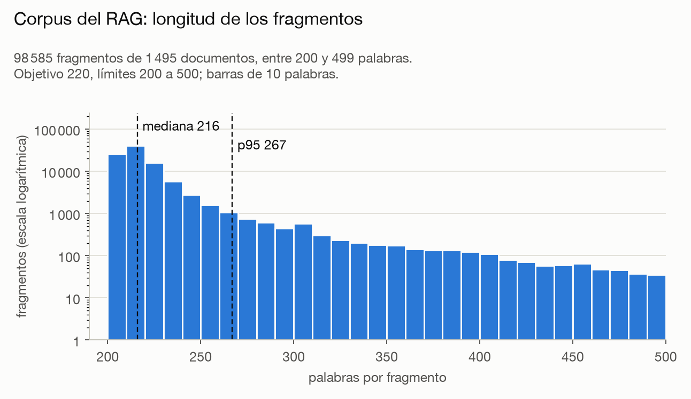

# RAG sobre papers

Servicio de la opción A del Anexo A: un chat que responde con papers y cita la página de
donde sale cada afirmación. El paquete `rag` tiene, por ahora, tres partes:

1. **El corpus** (`rag.corpus`, #84): baja los papers, saca su texto página por página, lo
   limpia y lo corta en fragmentos con su paper y su página.
2. **La ingesta** (`rag.seed`, #85): calcula el embedding de cada fragmento con
   multilingual-e5-small en ONNX y carga papers y fragmentos en el gestor, con un índice
   invertido en inglés (BM25) y un HNSW por coseno.
3. **La búsqueda** (`rag.api`, #85): `POST /search` en modo BM25, vectorial o híbrido (RRF),
   sobre la que se construyen las respuestas con Claude (#86).

```bash
uv sync --all-packages
uv run python -m rag.corpus build --data-dir data/datasets \
    --material Proyecto_Integrador_BD2.md --material docs/informe.pdf
uv run python -m rag.models --salida data/models/rag
RAG_ENGINE_URL=http://localhost:8000 RAG_ENGINE_KEY=… RAG_MIGRATION_KEY=… \
    RAG_MODELS_DIR=data/models/rag uv run python -m rag.seed --data-dir data/datasets
RAG_ENGINE_URL=… RAG_ENGINE_KEY=… RAG_MODELS_DIR=data/models/rag \
    uv run uvicorn --factory rag.api:create_app --port 8003
```

El corpus queda en `<data-dir>/rag_papers/`. La carpeta de datos sale de `--data-dir` o de
la variable `RAG_DATA_DIR`; nada de eso se versiona. Volver a correr cualquiera de los
comandos sigue desde donde quedó y no duplica nada.

# El corpus

## Qué papers entran

**arXiv, categorías cs.DB y cs.IR**, solo con una licencia que deje servir el PDF:

| Licencia | ¿Entra? | Por qué |
|---|---|---|
| CC BY, CC BY-SA, CC0 (y la antigua «public domain» de CC) | sí | permiten copiar, redistribuir y adaptar |
| arXiv non-exclusive license (la que se elige por omisión) | no | solo autoriza a arXiv a distribuir el paper |
| CC BY-NC, BY-NC-SA, BY-ND, BY-NC-ND | no | los fragmentos son una adaptación (ND) y la aplicación no tiene por qué ser no comercial (NC) |

El API Atom de arXiv no dice la licencia; **OAI-PMH sí**: el formato `arXiv` trae
`<license>`, los autores, el resumen, la fecha de envío y las categorías (la primera es la
principal). Por eso la metadata se cosecha de `https://oaipmh.arxiv.org/oai` con
`ListRecords`, un conjunto por categoría (`cs:cs:DB`, `cs:cs:IR`), desde una fecha
(`--from-date`, por omisión 2024-01-01; filtra por la última vez que cambió el registro).

De lo cosechado entran los papers cuya **categoría principal** es cs.DB o cs.IR (un paper
de aprendizaje automático que solo se lista también en cs.IR no entra), con licencia
aceptada, **del más reciente al más antiguo y alternando entre las dos categorías** hasta
`--papers` (por omisión 1 500). El orden es determinista: la misma cosecha da los mismos
papers.

Se respetan los términos de uso de arXiv: una petición a la vez, al menos 3 s entre una y
otra (también para los PDF, que se piden a `export.arxiv.org`, el espejo para acceso
programático; `--request-delay` y `--pdf-delay`), `Retry-After` ante un 429 o un 503 y un
agente que describe el programa sin datos personales.

**Material del curso.** `--material` agrega documentos propios: el enunciado
(`Proyecto_Integrador_BD2.md`) y el informe de las Partes 1 y 2 (`docs/informe.pdf`), que
son del curso y del autor del proyecto. Se copian a `rag_papers/curso/` para que la
aplicación los sirva igual que un paper. En un Markdown, la «página» es la sección: se
corta en cada encabezado.

## Cómo se procesa

1. **Cosecha** (`arxiv.py`): todas las páginas de `ListRecords` con su `resumptionToken`,
   un registro por paper aunque esté en las dos categorías. Se guarda en `cosecha.json`
   junto con la consulta; si la consulta no cambia, la corrida siguiente no vuelve a pedirla
   (`--reharvest` la fuerza).
2. **Descarga** (`fetch.py`): un PDF que ya está en `pdf/` no se vuelve a pedir; se escribe
   en `<id>.pdf.parcial` y se renombra al terminar, así que una descarga cortada no queda
   como un PDF válido. Si la respuesta no empieza con `%PDF-` (una página de error), se
   registra como falla.
3. **Extracción** (`extraction.py`, `cleaning.py`), en paralelo por procesos (`--workers`):
   texto por página con pypdf; NFKC (ligaduras, letras matemáticas) y pares sustitutos
   unidos; se borran las líneas del borde de la página que se repiten en al menos la mitad
   de las páginas (encabezados, pies, números de página, comparados con los dígitos
   igualados) y el sello lateral de arXiv; cada guion de fin de línea se deja o se quita
   según la evidencia del propio documento (ver abajo); los espacios se normalizan. **Un PDF
   dañado** (pypdf no puede leerlo) o **sin texto** (menos de 25 palabras por página: un
   escaneado) se registra en `fallas.jsonl` y se salta. El texto de cada documento se
   guarda en `paginas/<id>.json` con la huella del PDF y los parámetros de limpieza: solo se
   vuelve a extraer si alguno cambia.
4. **Fragmentos** (`chunking.py`): el documento se lee como una sola secuencia de
   oraciones, así que **ninguna oración se corta**, ni siquiera la que cruza un salto de
   página. Cada fragmento suma oraciones enteras hasta 220 palabras, sin bajar de 200 ni
   pasar de 500, y el siguiente repite las últimas oraciones del anterior (de 50 a 120
   palabras de solapamiento). Si el final del documento no llega a 200 palabras, el último
   fragmento toma oraciones del anterior. La única excepción a no cortar es una «oración»
   de más de 300 palabras (una tabla o una lista de referencias sin puntos), que se parte
   por palabras.
5. **Deduplicación** (`pipeline.py`): un PDF con la misma huella SHA-256 que otro ya
   aceptado no entra, y un fragmento cuyo texto ya está (mismo SHA-256) tampoco. Como la
   metadata y los fragmentos se reescriben enteros en cada corrida, volver a correr no
   duplica nada.

**Guiones de fin de línea** (`hyphenation.py`). Un paper de bases de datos está lleno de
compuestos que el PDF parte en el guion (`data-` / `driven`, `k-` / `nearest`), y también
de palabras partidas en sílabas (`exam-` / `ple`). Quitar siempre el guion convierte
`data-driven` en `datadriven`, que ni BM25 ni una cita encuentran; dejarlo siempre deja
`exam-ple`. Sin diccionario, la evidencia es el documento: las palabras que escribe
**enteras** en alguna línea (las que una línea parte no cuentan). Ante `X-` al final de
una línea y `Y` al empezar la siguiente, sin mayúsculas y en este orden:

1. si `X-Y` aparece entera en el documento, se deja el guion;
2. si `XY` aparece entera, se une;
3. si `X` e `Y` aparecen sueltas, con al menos 3 letras cada una, se deja el guion
   (`XY` no apareció: lo descartó la regla anterior). El mínimo evita que un prefijo que
   también es palabra (`in-` / `formation`, `de-` / `sign`) pase por compuesto;
4. si no hay evidencia, se deja el guion cuando `X` tiene dígitos (`2-dimensional`, un
   rango `10-20`), es una sola letra (`k-nearest`), es una sigla en mayúsculas (`B-tree`),
   ya traía un guion (`end-to-` / `end`) o `Y` no empieza en minúscula (`Smith-Jones`); si
   no, se une.

La decisión es determinista y la cuenta de cada regla queda en el manifiesto.

**Página de una cita.** Un fragmento guarda `page_start`, la página donde empieza su
primera oración, y `page_end`, la página donde termina la última. La cita abre el PDF en
`page_start`; el rango dice que el pasaje sigue en las páginas siguientes.

**Por qué 220 palabras.** El modelo de embeddings (multilingual-e5-small) trunca en 512
tokens. Medido con su tokenizador sobre 200 papers del corpus, el texto de estos papers
(fórmulas, tablas, siglas) da 1,9 tokens por palabra: con un objetivo de 300 palabras solo
el 50 % de los fragmentos entra entero en el modelo (mediana de 513 tokens); con 220, el
87 % (mediana de 394). El mínimo de 200 del enunciado deja poco margen hacia abajo, así
que 220 es el objetivo. El BM25 de la ingesta ve siempre el fragmento completo.

**Por qué 1 500 papers.** Con 220 palabras por fragmento, un paper de este corpus da una
mediana de 60 fragmentos (66 de media, por los apéndices largos): 1 500 papers son casi
100 000 fragmentos. multilingual-e5-small los calcula en CPU a 51 fragmentos por segundo
(medido sobre 3 000 fragmentos del corpus, Apple M4 Pro, 8 hilos de PyTorch), así que la
ingesta (#85) tarda unos 32 minutos (medida después con ONNX int8 y la máquina compartida:
43,9 min, ver [Medidas de la ingesta](#medidas-de-la-ingesta)); con 3 000 papers serían más
de una hora y 3 h de
descarga al ritmo que pide arXiv. Cien mil filas es además la escala más grande que ya se
midió en el gestor para HNSW, IVF y BM25 (Partes 3 y 4). `--papers` la cambia.

## Qué queda en disco

```
rag_papers/
  cosecha.json        la cosecha de arXiv: consulta, fecha y todos los registros
  pdf/<id>.pdf        los PDF (los identificadores antiguos, cs/0101001, como cs_0101001)
  curso/              el material del curso, copiado
  paginas/<id>.json   el texto limpio de cada página, con la huella del archivo
  papers.jsonl        un documento por línea
  fragmentos.jsonl    un fragmento por línea
  fallas.jsonl        lo que no entró y por qué
  manifest.json       consulta, parámetros, conteos, bytes, distribución y tiempos
```

`papers.jsonl`:

| Campo | Contenido |
|---|---|
| `paper_id` | identificador de arXiv (`2501.01234`) o `curso:<nombre>` |
| `source` | `arxiv` o `curso` |
| `title`, `authors`, `year`, `abstract` | metadata de arXiv (en el material del curso, la del propio archivo) |
| `primary_category`, `categories` | `cs.DB`, `cs.IR`… (`curso` para el material del curso) |
| `license` | URL de la licencia (`null` en el material del curso) |
| `url` | la página del paper en arXiv |
| `file_path`, `media_type` | el archivo relativo a `rag_papers/` y su tipo (`application/pdf` o `text/markdown`) |
| `sha256`, `bytes` | huella y tamaño del archivo |
| `pages`, `empty_pages`, `words` | páginas (o secciones), cuántas quedaron sin texto y palabras extraídas |
| `chunks` | cuántos fragmentos dio |

`fragmentos.jsonl`:

| Campo | Contenido |
|---|---|
| `chunk_id` | `<paper_id>#<ordinal>`, estable entre corridas |
| `paper_id`, `ordinal` | el documento y el orden del fragmento dentro de él |
| `page_start`, `page_end` | página donde empieza y donde termina (desde 1) |
| `words`, `text` | palabras y texto del fragmento |
| `sha256` | huella del texto, con la que se deduplica |

`fallas.jsonl` trae `paper_id`, `stage` (`descarga`, `extracción` o `duplicado`) y
`reason`.

## La corrida

Con los valores por omisión y el material del curso, el 18 de noviembre de 2026. Las cifras
son las del manifiesto, versionado en
[`benchmarks/results/rag_corpus.json`](../../benchmarks/results/rag_corpus.json).

| Paso | Cuántos |
|---|---|
| registros cosechados (cs.DB y cs.IR desde 2024-01-01, 15 peticiones OAI-PMH) | 17 931 |
| con categoría principal cs.DB o cs.IR | 11 502 |
| de esos, con licencia que permite redistribuir | 5 461 (47 %) |
| elegidos (750 de cada categoría) | 1 500 |
| PDF bajados | 1 493 |
| fallas de descarga (HTTP 404: sin PDF en arXiv) | 7 |
| PDF dañados o sin texto | 0 y 0 |
| papers repetidos (mismo PDF) | 0 |
| documentos del curso | 2 |
| **documentos en el corpus** | **1 495** |
| páginas (y sin texto) | 26 365 (19) |
| palabras | 15 833 823 |
| **fragmentos** | **98 585** |
| fragmentos repetidos, descartados | 34 |
| «oraciones» de más de 300 palabras partidas | 1 447 |

Licencias de los 11 502 papers en las dos categorías: CC BY 5 044, arXiv no exclusiva
4 679, CC BY-NC-ND 782, CC BY-NC-SA 579, CC BY-SA 339, CC0 78 y uno sin licencia. Entre
los 1 493 elegidos quedan 1 401 CC BY, 81 CC BY-SA y 11 CC0. Como se eligen del más
reciente hacia atrás, los de cs.DB se enviaron entre octubre de 2025 y noviembre de 2026, y
los de cs.IR (más numerosos), entre julio y noviembre de 2026.

**Guiones de fin de línea** en los 1 495 documentos: 181 059. Se unieron 154 441 (85 %):
121 863 porque la palabra entera aparece en el documento y 32 578 por la regla sin
evidencia. Se dejaron 26 618 (15 %): 17 365 porque el compuesto aparece entero, 5 980
porque sus dos partes aparecen como palabras y 3 273 por la regla sin evidencia (números,
letras sueltas, siglas, nombres). En una muestra de 40 papers los errores que quedan son
del tipo `per-formed` (la regla 3 con un prefijo de 3 letras) o `Textto` (la regla sin
evidencia ante `Text-` / `to`), raros frente a los miles de compuestos que antes perdían
el guion.

Un paper tiene una mediana de 14 páginas (el más largo, 256) y 60 fragmentos (el que más,
402). En disco: 2,8 GB de PDF, 168 MB de `fragmentos.jsonl` y 3 MB de `papers.jsonl`.

**Longitud de los fragmentos**, en palabras: mínimo 200, mediana 216, p95 267, máximo 499
y media 222. Todos están entre los límites; la cola larga son fragmentos que terminan en
una oración larga, típicamente una tabla.



**Tiempos** (Apple M4 Pro, 12 núcleos): la cosecha, 1,5 min; la descarga, 90 min
(1 494 peticiones, 3,6 s cada una: los 3 s de pausa más la transferencia); la extracción,
67 s en 12 procesos; la fragmentación, 3 s. Una segunda corrida sobre el mismo directorio
tarda 26 s: no baja ni extrae nada (solo vuelve a pedir los 7 PDF que faltan) y deja
`papers.jsonl` y `fragmentos.jsonl` iguales.

Para redibujar la figura desde el manifiesto (necesita el extra `plots`):

```bash
uv run python -m rag.corpus figure --manifest benchmarks/results/rag_corpus.json \
    --output benchmarks/figures/rag-fragmentos.png
```

# La ingesta en el gestor

El servicio usa el gestor como cualquier aplicación usa su base de datos: **solo por HTTP**,
con `minigestor_client` y `appkit`, y con sus tablas prefijadas `rag_`.

## Esquema

Las migraciones (`rag/schema.py`) son repetibles (`CREATE … IF NOT EXISTS`) y corren al
arrancar el API y al empezar la siembra, con la clave `admin` (`RAG_MIGRATION_KEY`):

| Tabla | Columnas | Índices |
|---|---|---|
| `rag_papers` | `paper_id` (clave), `source`, `title`, `authors` (separados por `; `), `year`, `abstract`, `primary_category`, `license`, `url`, `file_path`, `media_type`, `sha256`, `pages` | la clave primaria |
| `rag_chunks` | `chunk_id` (clave), `paper_id`, `ordinal`, `page_start`, `page_end`, `words`, `content` (`TEXT`), `embedding` (`VECTOR(384)`) | `rag_chunks_content`: `INVERTED (content) WITH (idioma = 'en')`; `rag_chunks_embedding`: `HNSW (embedding) WITH (metric = 'cosine', m = 16, ef_construction = 128)` |

Los dos índices se declaran **con la tabla vacía**: la primera carga masiva los difiere y el
gestor los construye de una vez al final (SPIMI y FAISS con todos los vectores), en vez de
mantenerlos fila a fila (#69).

## Embeddings: multilingual-e5-small en ONNX

| | |
|---|---|
| Modelo | [`intfloat/multilingual-e5-small`](https://huggingface.co/intfloat/multilingual-e5-small), licencia **MIT**, 118 M parámetros, 384 dimensiones, multilingüe (el vocabulario de XLM-R) |
| Revisión fijada | `614241f622f53c4eeff9890bdc4f31cfecc418b3` |
| fp32 | `onnx/model.onnx`, 470 268 510 bytes, SHA-256 `ca456c06b3a9505ddfd9131408916dd79290368331e7d76bb621f1cba6bc8665` |
| int8 | `onnx/model_qint8_avx512_vnni.onnx`, 118 346 824 bytes, SHA-256 `dd476dd0c2514e9b9be83aeb3853fac0763e0bdf4a71645407587d77c48a2d88` |
| Tokenizador | `tokenizer.json`, 17 082 730 bytes, SHA-256 `0b44a9d7b51c3c62626640cda0e2c2f70fdacdc25bbbd68038369d14ebdf4c39` |

Los dos ONNX los exportaron los autores del modelo en el mismo repositorio, así que la
licencia es la del modelo. `python -m rag.models --salida <carpeta> [--variante fp32
--variante int8]` los baja con `appkit.download` (reanudable, y un archivo con otra suma
nunca queda con el nombre final). Sin PyTorch ni `transformers`: **onnxruntime** corre el
modelo y **tokenizers** lee `tokenizer.json`.

La receta (`rag/embeddings.py`) es la de la tarjeta del modelo:

- **prefijos**: `passage: ` delante de cada fragmento y `query: ` delante de cada pregunta;
- **truncado a 512 tokens** (el tope del modelo), contando los especiales;
- **promedio** de la última capa sobre los tokens reales (máscara de atención), sin el relleno;
- **normalización L2**: el producto punto es el coseno, la métrica del HNSW.

Los fragmentos van en lotes de 32 (`RAG_EMBEDDING_BATCH_SIZE`) **ordenados por largo**
dentro de ventanas de 1 024: un lote junta secuencias parecidas y casi no calcula relleno, y
la memoria queda acotada por la ventana (la atención de un lote de 32 × 512 tokens ocupa
400 MB en float32).

**Verificado contra la implementación de referencia.** `tests/fixtures/e5_reference.json`
guarda los tokens y los vectores de cinco textos (dos preguntas, dos pasajes en inglés y en
español y uno de más de 512 tokens) calculados con `transformers` 5.23 y PyTorch 2.15 con la
receta de la tarjeta, en la misma revisión; `tests/fixtures/e5_reference.py` los regenera en
un entorno aparte (PyTorch no es dependencia del proyecto). Los tokens coinciden uno a uno;
los vectores fp32, con una diferencia máxima de 1,8·10⁻⁷ por componente (el test exige
menos de 10⁻⁵); los int8, con coseno de al menos 0,972 (el test exige 0,96).

## Caché de embeddings

`rag/embedding_cache.py` guarda cada vector por la **huella SHA-256 del texto** del
fragmento y por el **modelo** (nombre, revisión y precisión: `multilingual-e5-small@614241f622f5-int8`),
en dos archivos que solo crecen (`vectors.f32` y `keys.txt`) con `fsync` por lote. Volver a
sembrar —otro gestor, un volumen borrado— no pasa ningún fragmento por el modelo, y un
proceso muerto a mitad de un lote deja, al abrir, vectores sin huella que se recortan. Por
omisión vive en `<data-dir>/rag_papers/embeddings/` (`--cache-dir` o
`RAG_EMBEDDING_CACHE_DIR` la cambian); una caché completa se lee aunque la carpeta sea de
solo lectura.

## La siembra: `python -m rag.seed`

1. aplica las migraciones con la clave `admin`;
2. carga `rag_papers` desde `papers.jsonl`;
3. si a `rag_chunks` le faltan filas, calcula los embeddings que no están en la caché (el
   modelo solo se carga si falta alguno) con un log de avance (fragmentos por segundo y
   minutos que faltan);
4. carga `rag_chunks` con su vector por NDJSON (`bulk_insert`), sin tener nunca el corpus
   en memoria.

**Repetible y reanudable.** Una tabla con todas sus filas no se toca, así que una segunda
corrida no calcula ni carga nada. La carga masiva confirma lotes enteros y en el orden de
los archivos del corpus, que es estable: una cortada deja un prefijo, y la siguiente sigue
desde la fila siguiente a las que hay. Una tabla con más filas que el corpus, o un lote
rechazado, detienen la siembra con un error (`IngestError`). `--report` deja los conteos y
los tiempos en un JSON. La carga del corpus entero termina construyendo los dos índices;
`RAG_ENGINE_LOAD_TIMEOUT_SECONDS` sube el plazo del cliente si hiciera falta.

# La búsqueda: `POST /search`

`rag.api:create_app` arma el servicio con `appkit.create_service_app` (`/health`, `/ready`,
migraciones al arrancar, `X-Request-ID`, `Server-Timing`, logs JSON y errores uniformes) y
carga el modelo al arrancar. Sin estado: escala con réplicas.

```bash
curl -s localhost:8003/search -H 'content-type: application/json' \
    -d '{"query": "¿Cómo se estima la cardinalidad con aprendizaje?", "mode": "hybrid", "k": 5}'
```

| Campo | Qué es |
|---|---|
| `query` | la pregunta, de 1 a 1 000 caracteres |
| `mode` | `bm25`, `vector` o `hybrid` (por omisión) |
| `k` | fragmentos, de 1 a 50 (10 por omisión) |

Cada resultado trae `rank`, `chunk_id`, `paper` (`paper_id`, `title`, `authors`, `year`,
`url`, `file_path`, `media_type`, `license`), `page_start`, `page_end`, `text`, `score` (el
del modo) y `bm25` / `vector` con el puesto y el puntaje de cada método, o `null` si ese
método no lo trajo.

- **`bm25`**: `WHERE MATCH(content, $1) USING BM25`. La pregunta va en minúsculas y sin
  paréntesis: dentro de `MATCH`, `AND`, `OR`, `NOT` y los paréntesis son operadores.
- **`vector`**: el embedding de `query: <pregunta>` con `WHERE SIMILAR_TO(embedding, $1,
  k = $2) USING HNSW WITH ef_search = 128`; el puntaje es el coseno.
- **`hybrid`**: las dos listas, 50 fragmentos cada una, en paralelo, fusionadas con
  **Reciprocal Rank Fusion** (`rag/fusion.py`, `k = 60` del paper de Cormack et al.): cada
  lista suma `1/(60 + puesto)`. Solo cuentan los puestos: el BM25 no tiene techo y el coseno
  va de −1 a 1, y sumarlos exigiría normalizarlos. Los empates se resuelven por el mejor
  puesto y después por la clave.

`Server-Timing` separa `embedding`, `bm25`, `vector` y `papers` (la metadata de los papers
de los resultados, en una sola consulta con `IN`).

# Despliegue

`apps/rag/compose.yaml`, incluido desde el compose raíz (ver
[`apps/README.md`](../README.md#desplegar-una-app)):

| Servicio | Qué es |
|---|---|
| `papers-api` | la imagen de `deploy/service/Dockerfile` con el modelo int8 dentro (`apps/rag/docker-build.sh` lo baja y comprueba al construir; arranca sin red); redes `data`, `papers` y `cache`; 2 hilos de onnxruntime por réplica y 1 GiB |
| `papers-web` | por ahora la plantilla del kit web (#88 trae la suya), en `8103` / `8403`; 5 peticiones/s por IP con ráfaga de 10 |
| `papers-seed` | perfil `seed`: `python -m rag.seed` con el corpus montado de solo lectura (`PAPERS_DATASETS_DIR`, por omisión `data/datasets`) |
| `papers-tunnel` | perfil `tunnel`: una URL pública temporal para la web |

```bash
python3 -m tools.compose_keys                      # claves RAG_ENGINE_KEY y RAG_MIGRATION_KEY
docker compose up --build --detach --wait
docker compose run --rm papers-seed                # una vez; repetirla no hace nada
curl -s localhost:8103/api/search -H 'content-type: application/json' -d '{"query": "BM25"}'
```

Si los embeddings ya se calcularon fuera de Docker, están en el corpus montado:
`RAG_SEED_EMBEDDING_CACHE_DIR=/data/datasets/rag_papers/embeddings` hace que la siembra los
lea de ahí y solo cargue. Sin ella, los calcula en el `/tmp` del contenedor. La CI siembra el
corpus diminuto de los tests (`tests/fixtures/datasets/`) y busca por `:8103` en los tres modos.

# Medidas de la ingesta

`benchmarks/rag_ingest_benchmark.py` (ver [`benchmarks/README.md` §13](../../benchmarks/README.md#13-ingesta-del-rag--embeddings-e5-en-onnx-y-carga-con-bm25-y-hnsw)),
el 18 de noviembre de 2026, en un Apple M4 Pro (12 núcleos: 8 de rendimiento y 4 de
eficiencia), con el gestor en un **uvicorn aparte** (`app_from_environment`, como en Docker)
sobre `data/engine-rag/` y claves `write` y `admin`. Los JSON crudos están en
[`benchmarks/results/rag_ingesta.json`](../../benchmarks/results/rag_ingesta.json).

**Medido con contención.** Otros procesos pesados (tests y gestores de otros trabajos)
corrían en la misma máquina: la carga media fue 14,3 al empezar y 5,3 al terminar, con picos
de 51 durante la siembra, sobre 12 núcleos. Las cifras de tiempo son una **cota inferior** de
lo que da la máquina sola; las relaciones (int8 contra fp32, una etapa contra otra) se
midieron en las mismas condiciones.

**fp32 contra int8** (1 000 fragmentos repartidos por el corpus, mediana de 2 pasadas,
lotes de 32):

| Hilos | fp32 (fragmentos/s) | int8 (fragmentos/s) |
|---:|---:|---:|
| 1 | 16,5 | 12,8 |
| 2 | 25,7 | 24,2 |
| 4 | 31,2 | 38,0 |
| 8 | 39,6 | **45,3** |
| 12 | 26,8 | 27,4 |

Con los mismos 1 000 fragmentos, el vector int8 de cada uno tiene coseno 0,994 de media con
el fp32 (mínimo 0,977, percentil 5 0,988), y de los 10 vecinos de cada una de las 10
preguntas a mano dentro de la muestra coinciden 7,3 de media (de 3 a 9).

**Elegido: int8**, por omisión (`RAG_EMBEDDING_MODEL`). Con 4 y 8 hilos es un 22 % y un 14 %
más rápido, ocupa la cuarta parte (113 MiB contra 449 MiB: la imagen del API y la memoria de cada
réplica) y sus vectores están a coseno 0,99 de los de fp32. El costo es que el orden fino de
los vecinos cambia (7 de 10 en común): si la evaluación de #87 muestra que eso baja el
Recall@k, fp32 se usa cambiando la variable y volviendo a sembrar `rag_chunks`. Con 1 o 2
hilos fp32 es más rápido (la cuantización dinámica cuesta su paso extra), y con 12 los dos
caen: los 4 núcleos de eficiencia frenan a los demás y competían con la contención.

**La siembra del corpus entero** (int8, 8 hilos):

| Etapa | Tiempo | Cifras |
|---|---:|---|
| embeddings de 98 585 fragmentos | 2 565,6 s (42,8 min) | **38,4 fragmentos/s**; 12 330 truncados a 512 tokens (12,5 %) |
| carga de `rag_papers` | 0,25 s | 1 495 documentos |
| carga de `rag_chunks` con índices diferidos | 65,0 s | 98 585 filas; el gestor construye al final el invertido y el HNSW |
| **total** | **2 633,5 s (43,9 min)** | el 97 % es calcular embeddings |
| segunda corrida | 1,6 s | no calcula ni carga nada |

**La carga, etapa por etapa** (en otro gestor desechable, con los vectores ya en la caché;
figura `rag-ingesta.png`):

| Fragmentos | Carga NDJSON sin índices | Índice invertido (`CREATE INDEX`) | HNSW (`CREATE INDEX`) | Carga con los índices diferidos |
|---:|---:|---:|---:|---:|
| 1 000 | 0,37 s | 0,32 s | 0,07 s | 0,72 s |
| 10 000 | 4,19 s | 2,08 s | 0,32 s | 6,44 s |
| 98 585 | 44,3 s | 17,4 s | 5,4 s | 67,1 s |

Con el corpus entero, cargar las filas (sus 220 palabras de texto fuera de la fila y sus 384
componentes) es dos tercios del tiempo, SPIMI una cuarta parte y FAISS el resto; la carga
con los índices diferidos cuesta lo mismo que cargar y crear los dos índices después
(67,1 s contra 44,3 + 17,4 + 5,4 = 67,1 s).

**En el disco del gestor** (KiB):

| Tabla | Datos (heap y textos) | Clave primaria | Índice invertido | HNSW |
|---|---:|---:|---:|---:|
| `rag_chunks` | 362 420 | 11 764 | 98 368 | 162 640 |
| `rag_papers` | 3 836 | 168 | — | — |

En total 624 MiB; un fragmento ocupa 3,7 KiB en la tabla (el texto, los 1 536 bytes del
vector y la fila), 1,0 KiB en el índice invertido y 1,6 KiB en el HNSW.

**Preguntas a mano** (el primer fragmento de cada modo; la evaluación de verdad es #87). Las
búsquedas tardaron, vistas desde el cliente, 5–18 ms en BM25, 11–13 ms en vectorial (casi
todo el embedding de la pregunta) y 13–30 ms en híbrido:

| | Pregunta | BM25 | Vectorial | Híbrido |
|---|---|---|---|---|
| en | How do learned index structures replace B-trees? | Evaluating Learned Spatial Indexes, p. 4 | In-memory Multidimensional Indexing Using the skd-tree, p. 3 | BS-tree: A gapped data-parallel B-tree, p. 2 |
| en | approximate nearest neighbor search with HNSW graphs in vector databases | Amora: Communication-Efficient Private ANN…, p. 3 | Lossless Compression of Proximity Graph Indexes…, p. 2 | VectorMaton: Efficient Vector Search with Pattern…, p. 3 |
| en | text-to-SQL with large language models | Query Carefully: Detecting the Unanswerables in Text-to-SQL…, p. 2 | Both Ends Count! Just How Good are LLM Agents at…, p. 1 | ídem vectorial |
| en | cardinality estimation for query optimization with machine learning | Supervised and LLM-Augmented Cardinality Estimation…, p. 3 | ídem BM25, p. 1 | SemCEB: A Cardinality Estimation Benchmark…, p. 3 |
| en | evaluating hallucinations in retrieval-augmented generation | Enhancing Stock Market Information Retrieval with RAG…, p. 13 | Dual-Hypergraph Indexing: Bridging Knowledge Islands…, p. 1 | Guaranteeing Faithful Evidence Extraction in Speculative RAG…, p. 2 |
| es | ¿Cómo estiman la cardinalidad de una consulta los optimizadores con aprendizaje? | Minigestor de base de datos multimodal (informe), p. 1 | SynQL: A Controllable and Scalable Rule-Based Framework…, p. 23 | ídem vectorial |
| es | búsqueda aproximada de vecinos más cercanos en bases de datos vectoriales | Proyecto Integrador (enunciado), p. 10 | Minigestor de base de datos multimodal (informe), p. 5 | ídem vectorial |
| es | ¿Cómo se evalúan los sistemas de recomendación secuencial? | Proyecto Integrador (enunciado), p. 29 | Data Processing for Offline Evaluation in Recommender Systems, p. 138 | ídem vectorial |
| es | generar consultas SQL a partir de lenguaje natural con modelos de lenguaje | Minigestor de base de datos multimodal (informe), p. 1 | The Stochastic Shift: A New Evaluation Paradigm for Text-to-SQL, p. 4 | ídem vectorial |
| es | ¿Qué pide el proyecto integrador del curso de Base de Datos 2 sobre el R-Tree? | Minigestor de base de datos multimodal (informe), p. 1 | ídem | ídem |

En inglés los tres modos traen papers del tema. En español, **BM25 solo encuentra los dos
documentos del curso**, los únicos en español del corpus, aunque la pregunta sea sobre otro
tema; la búsqueda vectorial cruza el idioma y trae el paper en inglés que corresponde
(recomendación secuencial, texto a SQL), y la híbrida la sigue porque los dos documentos del
curso no aparecen en su lista. La de la cardinalidad en español no encuentra el paper de
estimación de cardinalidad en el primer puesto en ninguno de los modos.

**Conclusiones.**

- Calcular los embeddings es el 97 % de la ingesta: 43 min en CPU contra 65 s de carga e
  índices. Por eso la caché por huella del texto: una segunda siembra, o una en otro gestor,
  tarda segundos (1,6 s la segunda).
- Diferir los índices no ahorra nada frente a crearlos después con este volumen (67,1 s en
  los dos casos), pero la migración puede declararlos antes sin pagar de más y la tabla nunca
  queda sin índices a la vista.
- int8 es la variante del servicio: más rápida con los hilos que usa la siembra, cuatro veces
  más chica y a coseno 0,99 de fp32. Lo que cambia es el orden fino de los vecinos, y eso lo
  decide la evaluación de recuperación (#87).
- La búsqueda vectorial es la que hace posible preguntar en español a un corpus en inglés;
  BM25 aporta las coincidencias exactas (nombres de sistemas, siglas) en inglés. La híbrida
  junta las dos sin calibrar sus puntajes.

# Tests

`apps/rag/tests/` no usa la red: el OAI-PMH y el servidor de PDF son de mentira y los PDF
se escriben a mano en el test (`rag_pdf_factory.py`). Cubren el filtro de licencias, el
análisis de las respuestas OAI-PMH (registros borrados, `noRecordsMatch`, errores, token),
la pausa entre peticiones y los reintentos, los guiones de fin de línea, los encabezados
y pies repetidos, la página vacía, el PDF escaneado y el dañado, los límites de tamaño, el
solapamiento, que no se corte una oración, la página de cada fragmento, la deduplicación
al volver a correr y la reanudación después de una corrida cortada.

Los de la ingesta y la búsqueda:

- `test_rag_embeddings.py`: tokens y vectores contra la referencia de PyTorch (fp32 a 10⁻⁵,
  int8 con coseno ≥ 0,96), el promedio que ignora el relleno, la norma 1, el truncado a 512
  tokens, que los lotes ordenados por largo devuelvan los vectores en su orden y que una
  pregunta en español quede más cerca de su respuesta en inglés que de otra. Necesitan el
  modelo en `RAG_MODELS_DIR`; sin la variable se saltan, y la CI la define y baja las dos
  variantes antes (con caché).
- `test_rag_embedding_cache.py`, `test_rag_fusion.py`, `test_rag_models.py`,
  `test_rag_search_query.py`: la caché (vacía, un vector, reabrir, por modelo, repetidos,
  un proceso muerto a mitad, solo lectura), RRF (vacío, una lista, empates, `k`), los
  archivos del modelo y la pregunta como texto libre en `MATCH`.
- En [`tests/rag/`](../../tests/rag/), contra el gestor real servido por HTTP en el mismo
  proceso, con claves `write` y `admin` y un corpus diminuto (`tests/rag/rag_corpus.py`,
  versionado también en `tests/fixtures/datasets/` para la CI del compose): la siembra
  (todo entra con los índices diferidos, una segunda corrida no hace nada, la caché evita
  cargar el modelo, una carga cortada sigue donde quedó, una tabla con filas de más la
  detiene) y el API (salud, los tres modos, la cita con su paper y sus páginas,
  `Server-Timing`, las validaciones y, con el modelo real, preguntas en español que
  encuentran en modo vectorial el fragmento en inglés).

```bash
uv run python -m rag.models --salida data/models/rag --variante int8 --variante fp32
RAG_MODELS_DIR=data/models/rag uv run pytest apps/rag tests/rag -q
```
