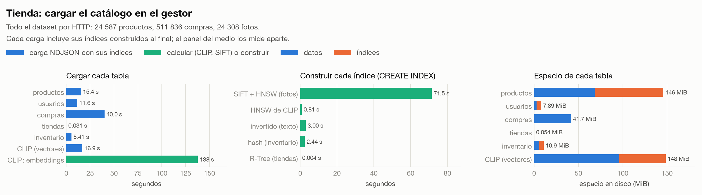
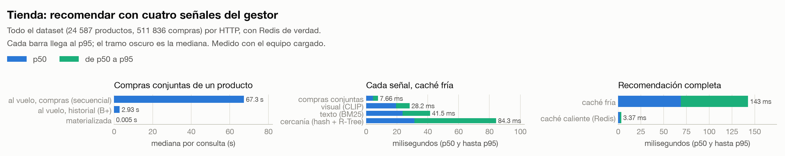

# Tienda con recomendaciones (Parte 5, opción B)

Una tienda de instrumentos musicales que recomienda combinando las cuatro clases de datos
del gestor: compras conjuntas (relacional), fotos (vectorial), descripciones (texto) y
stock en tiendas cercanas (espacial). Como todo servicio de la Parte 5, usa el gestor solo
por su API REST ([`apps/README.md`](../README.md)).

El paquete `shop` trae **el dataset** (#79): compras reales para que la evaluación del
recomendador (Hit@10, NDCG@10) sea honesta, fichas y fotos de los productos, y tiendas
reales de Lima; y **el catálogo en el gestor** (#80): el esquema, la carga, las dos
representaciones visuales (SIFT de la Parte 4 y CLIP en ONNX) y un API de lectura; y **el
recomendador** (#81): cuatro señales del gestor fundidas y explicadas, con caché en Redis.
La interfaz, **Cajón** (#83), vive en [`web/`](web/README.md); la evaluación llega en #82.

| Módulo | Qué hace |
|---|---|
| [`sources.py`](src/shop/dataset/sources.py) | URL, SHA-256 y tamaño de cada archivo publicado, en una revisión fija |
| [`transport.py`](src/shop/dataset/transport.py) | las peticiones de las fotos, con reintentos y espera creciente |
| [`catalog.py`](src/shop/dataset/catalog.py) | de una ficha JSON a un producto con columnas planas |
| [`interactions.py`](src/shop/dataset/interactions.py) | las compras, el 5-core y la partición por usuario |
| [`images.py`](src/shop/dataset/images.py) | fotos: bajar, reducir, recodificar, deduplicar y reanudar |
| [`stores.py`](src/shop/dataset/stores.py) | tiendas de Lima y su inventario sintético con semilla |
| [`prepare.py`](src/shop/dataset/prepare.py) | todo junto: tablas y manifiesto |
| [`clip/`](src/shop/clip/) | CLIP en ONNX: modelos fijados, preprocesado, tokenizador, las dos torres, caché y lotes |
| [`catalog/schema.py`](src/shop/catalog/schema.py) | las tablas e índices del catálogo, como migraciones repetibles |
| [`catalog/rows.py`](src/shop/catalog/rows.py) | de los CSV a las filas de la carga masiva |
| [`seed/`](src/shop/seed/) | `python -m shop.seed`: la carga, repetible y reanudable, y los pares de compras conjuntas |
| [`recommend/`](src/shop/recommend/) | las cuatro señales, la fusión, las explicaciones, las compras y la caché |
| [`api/`](src/shop/api/) | `shop.api:create_app`: ficha, búsquedas, tiendas cercanas, recomendaciones y compras |
| [`settings.py`](src/shop/settings.py) | la configuración `SHOP_*` del API y de la carga |

## Por qué Amazon Reviews 2023, instrumentos musicales

[Amazon Reviews 2023](https://amazon-reviews-2023.github.io/) (McAuley Lab, UCSD; Hou et
al., *Bridging Language and Items for Retrieval and Recommendation*, 2024) trae compras
verificadas con fecha y, para cada producto, título, precio, categoría, descripción y
fotos: todo lo que pide el enunciado, con usuarios de verdad. Su **5-core** (cada usuario y
cada producto con al menos 5 interacciones) es el conjunto estándar para evaluar
recomendadores. Tamaños medidos del 5-core de las categorías candidatas:

| Categoría | Interacciones | Usuarios | Productos |
|---|---:|---:|---:|
| **Musical_Instruments** | 511 836 | 57 439 | 24 587 |
| Industrial_and_Scientific | 412 947 | 50 985 | 25 848 |
| Video_Games | 814 586 | 94 762 | 25 612 |
| Baby_Products | 1 241 083 | 150 777 | 36 013 |

Las cuatro caen en el rango de 20 000 a 60 000 productos. Instrumentos musicales tiene
grupos visuales claros (guitarras, baterías, pedales, cables), lo que hace medible la señal
visual; su tamaño permite bajar todas las fotos, y una tienda de instrumentos en Lima es
verosímil.

## Preparar el dataset

Un comando baja y prepara todo. Necesita antes los lugares de Lima de la Parte 2
(`lugares_lima.csv`, ver el [README raíz](../../README.md#35-cargar-datos-desde-la-interfaz)):

```bash
uv sync --all-packages
.venv/bin/python -m demos.descargar_lugares --salida data/datasets/lugares_lima.csv \
    --recuadro -12.52 -77.20 -11.57 -76.62
uv run python -m shop.dataset prepare --data-dir data/datasets
```

| Argumento | Para qué | Por omisión |
|---|---|---|
| `--data-dir` | carpeta de datasets; el dataset queda en `<data-dir>/amazon_musical_instruments/` | `$SHOP_DATA_DIR` |
| `--places` | CSV de lugares de la Parte 2 | `<data-dir>/lugares_lima.csv` |
| `--max-side` | lado mayor de las fotos, en píxeles | 512 |
| `--jpeg-quality` | calidad JPEG de las fotos recodificadas | 85 |
| `--workers` | descargas de fotos simultáneas | 8 |
| `--seed` | semilla del inventario | 2023 |
| `--products-per-store` | productos distintos en stock por tienda | 1 000 |
| `--max-quantity` | unidades máximas de un producto en una tienda | 12 |

**Es reanudable.** Los archivos publicados se bajan con `appkit.download.fetch_verified`
([`apps/kit`](../README.md#descargas-de-modelos-y-datasets)): a un `.parcial` que sigue
desde su último byte si se corta, y solo toman su nombre final cuando miden y hashean lo
que publica el Hub. Cada foto se anota en `images.jsonl` al terminar; al volver a ejecutar, no se vuelve
a pedir ninguna que ya esté guardada y verifique su SHA-256, ni ninguna que falló sin
remedio (un 404, un archivo que no es imagen). Las que fallaron por la red, un 429 o un 5xx
se reintentan. Todo lo demás es determinista: una segunda ejecución no va a la red y deja
los mismos bytes (lo comprueba `test_shop_prepare.py`).

## Fuentes

Las URL apuntan a la revisión `2b6d039` del repositorio
[`McAuley-Lab/Amazon-Reviews-2023`](https://huggingface.co/datasets/McAuley-Lab/Amazon-Reviews-2023)
del Hugging Face Hub, con el SHA-256 y el tamaño que el Hub publica para cada archivo
(los `RemoteFile` de [`sources.py`](src/shop/dataset/sources.py)):

| Archivo | Ruta en el repositorio | Tamaño |
|---|---|---:|
| fichas | `raw/meta_categories/meta_Musical_Instruments.jsonl` | 632 MB |
| entrenamiento | `benchmark/5core/last_out/Musical_Instruments.train.csv` | 23,0 MB |
| validación | `benchmark/5core/last_out/Musical_Instruments.valid.csv` | 3,3 MB |
| prueba | `benchmark/5core/last_out/Musical_Instruments.test.csv` | 3,3 MB |

### La partición: `last_out`, no `timestamp`

El benchmark publica dos particiones del mismo 5-core. Se midieron las dos: tienen
exactamente las mismas 511 836 interacciones, pero reparten distinto.

| Partición | Entrenamiento | Validación | Prueba | Usuarios en prueba |
|---|---:|---:|---:|---:|
| `last_out` | 396 958 | 57 439 | 57 439 | 57 439 (todos) |
| `timestamp` | 427 957 | 41 284 | 42 595 | 13 198 |

`timestamp` corta en dos fechas globales (entrenamiento hasta el 11-08-2021, validación
hasta el 16-07-2022, prueba después), así que tres de cada cuatro usuarios no tienen
ninguna compra en la prueba. La evaluación que pide #79 deja fuera **la última compra de
cada usuario** como prueba y la anterior como validación: eso es `last_out`. Al preparar se
comprueba que cada usuario tenga exactamente una compra en validación y una en prueba, que
ninguna compra de entrenamiento sea posterior a la de validación ni esta a la de prueba, y
que todo usuario y todo producto siga teniendo al menos 5 interacciones; si algo no se
cumple, el comando falla en vez de escribir un dataset distinto del publicado.

## Qué deja

```
<data-dir>/amazon_musical_instruments/
  raw/                 los cuatro archivos publicados, tal cual
  images/<xx>/<sha256>.jpg
  images.jsonl         qué pasó con cada URL de foto (para reanudar)
  products.csv
  users.csv
  interactions.csv
  stores.csv
  inventory.csv
  manifest.json        fuentes, parámetros, conteos, y filas, bytes y SHA-256 de cada CSV
```

Los CSV tienen cabecera, van en UTF-8 y un valor que falta queda vacío, que es como el
gestor los carga con `CREATE TABLE ... FROM FILE`.

| Archivo | Columnas |
|---|---|
| `products.csv` | `product_id` (el `parent_asin`), `title`, `brand`, `department`, `category`, `category_path`, `price`, `average_rating`, `rating_count`, `features`, `description`, `image` (ruta relativa a la carpeta del dataset), `image_url` |
| `users.csv` | `user_id`, `interactions` |
| `interactions.csv` | `user_id`, `product_id`, `rating`, `timestamp_ms`, `purchased_at` (ISO 8601 en UTC), `split` (`train`, `valid` o `test`) |
| `stores.csv` | `store_id` (id de OpenStreetMap), `name`, `kind`, `location` (`POINT(lat, lon)`) |
| `inventory.csv` | `store_id`, `product_id`, `quantity` |

`interactions.csv` va ordenado por fecha (y, en un empate, por usuario y producto); los
demás, por su clave.

### Fichas

Las fichas traen de todo, y se aplanan sin inventar nada:

- **Precio**: un número positivo, o vacío. Un texto que es solo un número (`"$1,299.00"`)
  se convierte; uno como `"from 23.99"` es una cota, no un precio, y queda vacío.
- **Categorías**: `category_path` es el árbol completo (`Musical Instruments > Guitars >
  Electric Guitars`); `department`, el primer nivel bajo la raíz; `category`, la hoja.
  Algunas fichas empiezan sin la raíz (`Instrument Accessories > …`), otras cuelgan
  promociones del árbol («Prime Card Bonus») y otras no traen categoría: se conservan tal
  cual, con los campos vacíos cuando no hay nada.
- **Textos**: `features` son las viñetas separadas por ` | `; `description`, los párrafos
  de la descripción. Los espacios se normalizan y un párrafo repetido se queda una vez.
- **Marca**: el campo `store` de la ficha, o `details.Brand` si no viene.

### Fotos

Una por producto: la variante `MAIN` (o la primera, si ninguna lo es). Amazon publica cada
foto en `large` (unos 500 px de lado mayor y 28 kB) y en `hi_res` (unos 1 500 px y
170 kB, seis veces más); se baja **la menor que cubre `--max-side`**, así que con los
512 px por omisión, `large`. Cada foto se gira según su EXIF, se aplana sobre blanco si
tiene transparencia, se reduce (nunca se agranda) a 512 px de lado mayor y se recodifica
como JPEG RGB de calidad 85, sin metadatos. 512 px sobran para SIFT y para los 224 px que
ve CLIP (#80).

El archivo se llama como el SHA-256 de sus bytes: dos productos con la misma foto
comparten archivo (**deduplicación por contenido**), y comprobar que un archivo está sano
es volver a hashearlo. Solo se aceptan URL `http(s)`. Las descargas son `--workers` a la
vez (8), y cada foto se reintenta hasta 4 veces ante un corte, un 429 o un 5xx, esperando
2, 4 y 8 s. Una foto que no se pudo bajar **no detiene nada**: queda anotada con su motivo
y el producto queda sin foto (`image` vacía).

### Tiendas e inventario

Las tiendas son lugares **reales** de OpenStreetMap en Lima, los de la Parte 2. El extracto
de Geofabrik no distingue una tienda de música, así que se toman, con nombre, los rubros
donde en Lima se venden instrumentos, audio y accesorios: tiendas por departamentos,
centros comerciales, tiendas de cómputo, de video y tiendas generales.

**El inventario es lo único sintético del dataset.** Cada tienda tiene en stock 1 000
productos distintos, muestreados sin reemplazo con probabilidad proporcional a sus compras
de entrenamiento más uno (Efraimidis y Spirakis), con entre 1 y 12 unidades. Los pesos
salen solo del entrenamiento, para que el inventario no le cuente al recomendador nada de
la validación ni de la prueba. Cada tienda usa su propio generador, sembrado con la
semilla y su id: la misma semilla da el mismo inventario, y quitar una tienda no cambia el
de las demás.

## Conteos medidos

Medido el 18-11-2026 con los parámetros por omisión, en un MacBook con Python 3.12 y una
conexión doméstica. Las cifras salen de `manifest.json`, que el comando escribe en cada
ejecución.

| | Filas |
|---|---:|
| productos | 24 587 |
| usuarios | 57 439 |
| compras de entrenamiento | 396 958 |
| compras de validación | 57 439 |
| compras de prueba | 57 439 |
| compras en total | 511 836 |
| tiendas | 209 |
| filas de inventario | 209 000 |

Todos los productos del 5-core tienen ficha (ninguno queda fuera). De los 24 587:

- **fotos**: 24 580 tienen URL (7 no traen ninguna imagen) y las 24 580 se bajaron, **sin
  ningún fallo**. Se pidieron 24 309 URL distintas (271 productos repiten la URL de otro) y
  quedaron **24 308 archivos**: 272 productos comparten foto con otro (deduplicados), 271
  por URL y uno por contenido. Las fotos ocupan 734 MB, unos 30 kB cada una;
- **precio**: 16 482 lo traen; 8 105 no (8 103 nulos, un `0.0` y un `"from 23.99"`);
- **categoría**: 779 sin ninguna; 6 941 sin descripción, 91 sin marca y 3 sin título;
- **departamentos** con más productos: Instrument Accessories (11 519), Live Sound & Stage
  (2 710), Microphones & Accessories (2 284), Amplifiers & Effects (1 745), Studio
  Recording Equipment (1 528), Guitars (1 066) y Drums & Percussion (834).

Las 209 tiendas son 72 centros comerciales, 63 tiendas por departamentos, 62 tiendas de
cómputo, 6 tiendas de video y 6 tiendas generales. Su inventario reúne 1 359 506 unidades
de 23 910 productos distintos. Los 677 que no están en ninguna tienen en promedio 3,7
compras de entrenamiento (como mucho 17); los que sí, 16,5.

| En disco | Bytes |
|---|---:|
| `raw/` (los cuatro archivos publicados) | 661,6 MB |
| `images/` | 734,1 MB |
| los cinco CSV | 89,6 MB |
| `images.jsonl` | 4,9 MB |
| **total** | **1,49 GB** |

| CSV | Bytes |
|---|---:|
| `products.csv` | 34,6 MB |
| `users.csv` | 1,8 MB |
| `interactions.csv` | 48,1 MB |
| `stores.csv` | 16,5 kB |
| `inventory.csv` | 5,1 MB |

**Tiempo.** La primera ejecución tardó **959 s** (16 min), casi todo en las fotos (unas 30
por segundo con 8 descargas a la vez); las fichas ya estaban bajadas de una prueba
anterior, así que esa cifra no incluye sus 632 MB. Su memoria máxima fue de 414 MB. La
segunda ejecución tardó **10,6 s**: no pidió nada a la red, no añadió ninguna línea a
`images.jsonl` y dejó los cinco CSV y el manifiesto idénticos byte a byte.

## El catálogo en el gestor (#80)

La tienda guarda todo en el gestor y le habla solo por HTTP, con `minigestor_client` y
`appkit` ([`apps/README.md`](../README.md)). Cada una de las cuatro clases de datos del
gestor tiene su tabla e índice:

| Tabla | Organización e índices | Filas |
|---|---|---:|
| `shop_productos` | heap con B+ sobre `id`; **invertido en inglés** sobre `texto`; **HNSW de SIFT** sobre `imagen` | 24 587 |
| `shop_clip` | heap con B+ sobre `id`; **HNSW** (coseno) sobre `embedding VECTOR(512)` | 24 580 |
| `shop_usuarios` | heap con B+ sobre `id` | 57 439 |
| `shop_compras` | **archivo secuencial** por `id`, la posición de la compra en orden cronológico | 511 836 |
| `shop_tiendas` | heap con B+ sobre `id`; **R-Tree** sobre `ubicacion POINT` | 209 |
| `shop_inventario` | heap; **hash extendible** sobre `producto` | 209 000 |
| `shop_historial` (#81) | heap; **B+ no agrupado** sobre `usuario` y sobre `producto` | 511 836 |
| `shop_compras_conjuntas` (#81) | heap; **B+ no agrupado** sobre `producto`; materializada por la carga | 369 087 |

Decisiones:

- **Los productos no son un B+ agrupado**, sino un heap con el B+ de la clave: el gestor solo
  pone índices secundarios sobre un heap (las filas de un B+ agrupado se mueven al dividir
  un nodo), y esta tabla necesita el invertido y el de SIFT.
- **`texto` = título, viñetas y descripción.** El invertido cubre una columna, así que el
  texto que se busca se guarda junto (y `descripcion`, viñetas y párrafos, para mostrarlo).
  El idioma es el inglés de las fichas: `WITH (idioma = 'en')` elige el stemmer y las
  stopwords en inglés del gestor, que ya existían (la Parte 3 los trae para `es` y `en`), así
  que «guitars» encuentra «guitar» y «the» no cuenta.
- **Las compras van ordenadas por fecha** en el archivo secuencial: la clave es su posición
  cronológica (1, 2, 3…), porque el instante no es único (511 563 instantes distintos para
  511 836 compras) y la clave del secuencial sí. Llegan en ese orden, así que cada una va
  al final de la última página, sin desbordamiento ni reorganizaciones.
- **CLIP va en su propia tabla.** Así su carga, su índice y su caché se miden y se rehacen
  aparte, y una foto compartida por dos productos (272) se calcula una vez. Los siete
  productos sin foto no tienen fila en `shop_clip` y tienen `imagen` en `NULL`, que el índice
  de SIFT deja fuera.
- **Los índices que se construyen de una vez se crean con la tabla vacía** (en las
  migraciones), y la carga masiva los construye al final con todas las filas (#69): el
  invertido con SPIMI, el R-Tree con STR y el HNSW con todos los vectores. El de **SIFT** no
  puede: entrena su vocabulario con las fotos de la tabla, así que la carga lo crea después.

### CLIP en ONNX, sin PyTorch

| | |
|---|---|
| Modelo | CLIP ViT-B/32 de OpenAI, exportación a ONNX de Xenova ([`Xenova/clip-vit-base-patch32`](https://huggingface.co/Xenova/clip-vit-base-patch32), revisión `6b7c523`) |
| Licencia | MIT, la del modelo de OpenAI |
| Torre de imagen | `onnx/vision_model.onnx`, 351 685 709 bytes, SHA-256 `fd6e1402…b8270d7d40` |
| Torre de texto | `onnx/text_model.onnx`, 254 058 553 bytes, SHA-256 `3f6571f5…7bfada8cc` |
| Tokenizador | `tokenizer.json`, 2 224 119 bytes, SHA-256 `f7f3b7af…7f697a90cd` |
| Precisión | `float32`, sin cuantizar: el embedding es el del modelo publicado |

`python -m shop.clip models --salida data/models/shop` (o `$SHOP_MODELS_DIR`) los baja con
`appkit.download.fetch_verified`, que los acepta solo con el SHA-256 que publica el Hub (las
sumas completas están en [`models.py`](src/shop/clip/models.py)). Corren en onnxruntime.

- **Preprocesado** ([`preprocessing.py`](src/shop/clip/preprocessing.py)): RGB, lado menor a
  224 px con interpolación bicúbica, recorte central de 224 x 224 y normalización con la media
  y la desviación de cada canal de OpenAI. Es el `CLIPImageProcessor` de Hugging Face paso a
  paso; los tests comparan con sus valores (transformers 4.57.1) sobre cuatro imágenes
  sintéticas, con tolerancia 1e-5.
- **Tokenizador** ([`tokenizer.py`](src/shop/clip/tokenizer.py)): la librería `tokenizers`
  con el `tokenizer.json` del modelo, truncado a 77 tokens sin perder el `<|endoftext|>`. Los
  tests comparan los ids con el `CLIPTokenizer` en Python de Hugging Face, que implementa el
  BPE de OpenAI por su cuenta. Un lote se rellena con `<|endoftext|>`: la torre toma el
  embedding en el primero y su máscara causal impide que el relleno lo cambie (medido:
  diferencia máxima 3e-6).
- **Las dos torres** ([`encoder.py`](src/shop/clip/encoder.py)) dan 512 dimensiones con norma
  1, así que el producto punto es el coseno, la métrica del HNSW, y un texto se compara
  directamente con las fotos: eso es buscar fotos con palabras.
- **Caché** ([`cache.py`](src/shop/clip/cache.py)): un archivo de registros
  `SHA-256 de la foto + 512 float32` que solo crece, uno por modelo. Una foto que ya pasó por
  CLIP no vuelve a pasar; un registro cortado por una caída se descarta al abrir.
- **Lotes** ([`batches.py`](src/shop/clip/batches.py)): las fotos que faltan se decodifican
  y preprocesan en hilos y entran a la torre de a 32; en memoria nunca hay más que un lote
  (unos 20 MB de píxeles).

### Cargar el catálogo

```bash
uv run python -m shop.dataset prepare --data-dir data/datasets     # el dataset (#79)
uv run python -m shop.clip models --salida data/models/shop         # CLIP (577 MiB)
SHOP_ENGINE_URL=http://localhost:8000 SHOP_ENGINE_KEY=… SHOP_MIGRATION_KEY=… \
SHOP_DATA_DIR=data/datasets SHOP_MODELS_DIR=data/models/shop \
    uv run python -m shop.seed --informe carga.json
```

En orden: las migraciones (las mismas que aplica el API al arrancar), las cinco tablas por
carga masiva NDJSON, el `CREATE INDEX` de SIFT, y CLIP (embeddings con su caché y la carga de
`shop_clip`). Cada paso deja una línea de avance en el log, y `--informe` guarda sus tiempos.

- **Repetible.** Una tabla con todas las filas del manifiesto no se vuelve a cargar y un
  índice que existe no se vuelve a crear: la segunda ejecución tarda 0,27 s y no carga ni
  la torre de imagen.
- **Reanudable.** Cada lote de la carga se confirma por separado y las filas entran en el
  orden del CSV, así que una tabla a medias tiene exactamente sus primeras `n` filas; la
  siguiente ejecución envía desde la `n + 1`. Una tabla con más filas que el dataset detiene
  la carga en vez de adivinar.
- **El gestor tiene que poder leer las fotos.** La columna `imagen` guarda la ruta de cada
  foto **vista desde el gestor**, que es quien las abre para SIFT, y el gestor solo lee
  dentro de su directorio de datos y de `MINIGESTOR_IMPORT_DIRS`. Si el gestor ve la carpeta
  de datasets en otra ruta que la carga, `SHOP_ENGINE_DATA_DIR` le dice cuál; sin ella, la
  misma `SHOP_DATA_DIR`. En el compose los dos la montan en `/app/data/datasets`, que ya está
  entre los directorios de importación del gestor.
- **Clave `admin`.** La carga crea tablas e índices: usa `SHOP_MIGRATION_KEY` (o, sin ella,
  `SHOP_ENGINE_KEY`), con un plazo por petición de una hora (`SHOP_JOB_TIMEOUT_SECONDS`): la
  respuesta de una carga llega después de construir sus índices, y la del índice de SIFT,
  después de extraer las 24 308 fotos.

| Variable (`SHOP_`) | Para qué | Por omisión |
|---|---|---|
| `DATA_DIR` | carpeta de datasets; la tienda está en `<DATA_DIR>/amazon_musical_instruments/` | obligatoria |
| `MODELS_DIR` | carpeta de CLIP | obligatoria |
| `ENGINE_DATA_DIR` | la carpeta de datasets vista desde el gestor | `DATA_DIR` |
| `EMBEDDINGS_DIR` | caché de embeddings | `<dataset>/embeddings` |
| `CLIP_BATCH_SIZE` | fotos por pasada de la torre de imagen | 32 |
| `PREPROCESS_WORKERS` | hilos que decodifican y preparan las fotos | uno por núcleo |
| `CLIP_THREADS` | hilos de onnxruntime (0: los elige él) | 0 |
| `PROGRESS_ROWS` | cada cuántas filas se informa el avance | 50 000 |
| `JOB_TIMEOUT_SECONDS` | plazo de cada petición de la carga | 3 600 |

### El API

`uvicorn --factory shop.api:create_app`, hecha con `appkit.create_service_app`: `/health`,
`/ready`, migraciones al arrancar, `X-Request-ID` y `Server-Timing` (`clip` y `gestor`).
Carga las dos torres de CLIP al arrancar (`SHOP_MODELS_DIR`): la de texto para buscar fotos
con palabras y la de imagen para buscar con una foto; con las dos, el proceso ocupa unos
640 MiB (medido). Todo el texto del usuario viaja como parámetro (`$1`), nunca dentro del SQL.

| Ruta | Consulta del gestor |
|---|---|
| `GET /productos/{id}` | igualdad sobre el B+ de `id` |
| `GET /busqueda/texto?q=&limite=` | `MATCH(texto, $1) USING BM25` sobre el invertido en inglés; `q` admite `AND`, `OR`, `NOT` y paréntesis |
| `GET /busqueda/imagenes?q=&limite=` | el embedding de `q` con la torre de texto, y `SIMILAR_TO(embedding, $1, k = $2)` sobre el HNSW de CLIP |
| `GET /tiendas/cercanas?lat=&lon=&limite=` | `ORDER BY distancia(ubicacion, $1) LIMIT $2`, k vecinos con el R-Tree, en metros |
| `POST /busqueda/foto?limite=` (multipart, `foto`) | el embedding de la foto con la torre de imagen, y el mismo `SIMILAR_TO` sobre el HNSW de CLIP |
| `GET /productos/{id}/foto` | `imagen` por el B+ de `id`; la foto se sirve desde el dataset, con `Cache-Control` |
| `GET /productos/{id}/tiendas?lat=&lon=&limite=` | las tiendas con stock: el inventario por su hash (`producto = $1`) unido a las tiendas, por `distancia` |
| `GET /departamentos` | `GROUP BY departamento HAVING COUNT(*) >= $1`, una vez por proceso |
| `GET /usuarios` | los `SHOP_FEATURED_USERS` (12) clientes con más compras, una vez por proceso |
| `GET /usuarios/{id}/compras?limite=` | su historial en la partición del recomendador, por el B+ de `usuario` |

`limite` va de 1 a `SHOP_MAX_SEARCH_LIMIT` (100; por omisión `SHOP_SEARCH_LIMIT`, 10). Las
tres búsquedas aceptan además `departamento`, `precio_min` y `precio_max`, que van al `WHERE`
como parámetros (`api/filters.py`); un producto sin precio no pasa un filtro de precio. El
HNSW de CLIP no sabe de departamentos ni de precios (viven en `shop_productos`), así que con
un filtro se piden `SHOP_FILTERED_SEARCH_FACTOR` (10) veces más vecinos y el filtro va en el
`WHERE` de las fichas: un filtro muy estrecho puede devolver menos de `limite`. Las rutas del
recomendador están en [El recomendador](#el-recomendador-81).

**Las fotos.** La columna `imagen` guarda la ruta de la foto vista desde el gestor; el API no
la abre tal cual: toma solo su nombre, que tiene que ser un SHA-256 (así las guarda
`shop.dataset.images`), y la busca bajo `<SHOP_DATA_DIR>/amazon_musical_instruments/images/`.
Una ruta manipulada no sale de esa carpeta, y sin `SHOP_DATA_DIR` la ruta responde 404. Una
foto subida para buscar se acepta hasta `SHOP_PHOTO_MAX_BYTES` (8 MiB, `413`) y
`SHOP_PHOTO_MAX_PIXELS` (40 megapíxeles, `413`); lo que no es una imagen es un `400`
(`UnreadablePhotoError`). Se gira según su EXIF antes de pasar por CLIP.

**Los departamentos y los clientes destacados** recorren una tabla entera (un `GROUP BY` sobre
24 587 fichas tardó 3,2 s la primera vez) y solo cambian
con una carga nueva: cada proceso del API los pide la primera vez y los recuerda
(`api/facets.py`); la segunda petición tarda menos de 2 ms.

Medido en local con el catálogo entero (Apple M4 Pro, gestor en otro proceso), tres veces cada
una: buscar con una foto, 20 a 24 ms (CLIP 10 ms y el gestor 9 ms; la primera, 91 ms); fotos
por texto con filtro, 60 ms; texto con filtro, 16 ms; las tiendas con stock de un producto,
6 ms; la foto de un producto, 3 ms.

### Con Docker

[`compose.yaml`](compose.yaml), incluido desde el raíz, sigue «Desplegar una app» de
[`apps/README.md`](../README.md): `shop-api` (redes `data`, `shop` y `cache`, con la carpeta de
datasets montada de solo lectura para servir las fotos), `shop-web` en 8102 y 8402 (la
interfaz, [`web/`](web/README.md): su nginx admite 60 peticiones por segundo con ráfagas de
200 porque una ficha pide decenas de fotos, subidas de hasta 9 MB, la ubicación del navegador
y las teselas de OpenStreetMap en la CSP), `shop-seed` (perfil `seed`) y `shop-tunnel`
(perfil `tunnel`). [`docker-build.sh`](docker-build.sh) baja y
verifica CLIP al construir la imagen, que arranca sin red.

```bash
python -m tools.compose_keys                 # claves de cada servicio en .env
docker compose up --build --detach --wait
docker compose run --rm shop-seed            # carga data/datasets/amazon_musical_instruments
curl http://localhost:8102/api/productos/B07YM5ZHS9
```

`shop-seed` monta la carpeta de datasets de solo lectura en `/app/data/datasets`, la misma
ruta que el gestor; su caché de embeddings vive en el `tmpfs` del contenedor. La CI levanta
el compose, carga dos veces el dataset diminuto de los tests
([`tests/tiny_dataset.py`](tests/tiny_dataset.py)), lee un producto por el puerto 8102,
comprueba que la interfaz es la suya (con su CSP y su `Permissions-Policy`), baja la foto de
un producto y busca con ella.

### Tests

```bash
uv run pytest apps/shop -q     # CLIP, filas, caché; los del modelo con SHOP_MODELS_DIR
uv run pytest tests/shop -q    # la carga y el API contra el gestor real, en el mismo proceso
```

Los de [`tests/shop/`](../../tests/shop/) usan un dataset de cinco productos con fotos
sintéticas y una torre de imagen de mentira (la de verdad se prueba en `apps/shop`):
cargan todo, comprueban los `NULL`, el orden de las compras y una consulta de cada clase
(`MATCH`, `SIMILAR_TO` sobre SIFT y sobre CLIP, `distancia`), que los pares materializados
coinciden con el autojoin al vuelo, que una segunda carga no repite nada, que una carga cortada sigue en su fila siguiente, que la caché evita volver a
calcular CLIP y que sin el directorio de importación el gestor no lee las fotos. Los del
recomendador (`test_shop_recommendations_end_to_end.py`) prueban cada señal con su SQL, el
arranque en frío, la cercanía, SIFT, las recomendaciones de un usuario, una compra que suma
pares e invalida la caché (fakeredis) y un Redis que no responde; los de `apps/shop`, la
fusión, las frases y la caché por separado. Los del API (`test_shop_api_end_to_end.py`) cubren
además los filtros (y que su texto es un parámetro), buscar con una foto en JPEG y en PNG, los
rechazos de una foto vacía, que no es imagen, pesada o enorme, servir la foto de un producto
(y que una ruta manipulada no sale de la carpeta), las tiendas con stock, los departamentos,
los clientes destacados y su historial.

### Medido: cargar todo el dataset

`python -m benchmarks.shop_seed_benchmark` corre esta misma carga contra **un gestor de
verdad en otro proceso** (uvicorn, como en Docker; el directorio de datos fue
`data/tienda-gestor/` de este repositorio, vacío al empezar) y con la caché de embeddings
vacía. Apple M4 Pro (12 núcleos), macOS, Python 3.12; carga media de 8,7 al empezar, con
otros procesos en el equipo. Cifras crudas en
[`benchmarks/results/tienda_carga.json`](../../benchmarks/results/tienda_carga.json); una
ejecución anterior, igual salvo por el cálculo de la cola, dio las mismas cifras a un 3 %.



| Paso | Filas | Tiempo | Filas/s |
|---|---:|---:|---:|
| migraciones (10 sentencias) | | 0,04 s | |
| `shop_tiendas`, con su R-Tree al final | 209 | 0,03 s | 6 725 |
| `shop_productos`, con su invertido al final | 24 587 | 15,4 s | 1 593 |
| `shop_usuarios` | 57 439 | 11,6 s | 4 969 |
| `shop_compras` (secuencial) | 511 836 | 40,0 s | 12 787 |
| `shop_inventario`, con su hash fila a fila | 209 000 | 5,4 s | 38 603 |
| SIFT: `CREATE INDEX … USING HNSW (imagen)` | 24 580 fotos | 71,5 s | |
| CLIP: embeddings de las fotos distintas | 24 308 fotos | 137,8 s | 176 fotos/s |
| `shop_clip`, con su HNSW al final | 24 580 | 16,9 s | 1 455 |
| **total** | | **299,0 s** | |
| segunda ejecución | | 0,27 s | |

Cada índice por separado: el benchmark lo borra y lo vuelve a crear con su migración sobre
la tabla llena, por el mismo camino de construcción que usa la carga.

| Índice | Filas | `CREATE INDEX` |
|---|---:|---:|
| invertido en inglés (`texto`) | 24 587 | 3,00 s |
| HNSW de CLIP (512 dimensiones, coseno) | 24 580 | 0,81 s |
| hash extendible (`producto` del inventario) | 209 000 | 2,44 s |
| R-Tree (`ubicacion`) | 209 | 0,004 s |
| SIFT: extraer, vocabulario de 256 palabras, TF-IDF y HNSW | 24 580 | 71,5 s |

| Tabla | Datos | Índices | Total |
|---|---:|---:|---:|
| `shop_productos` | 68,6 MiB (heap 12,0 y textos 56,6) | 77,4 MiB: SIFT 60,2, invertido 16,4, B+ 0,8 | 146,0 MiB |
| `shop_clip` | 96,0 MiB | 52,4 MiB: HNSW 51,6, B+ 0,8 | 148,4 MiB |
| `shop_compras` | 41,7 MiB | — | 41,7 MiB |
| `shop_inventario` | 5,6 MiB | 5,3 MiB | 10,9 MiB |
| `shop_usuarios` | 2,8 MiB | 5,1 MiB | 7,9 MiB |
| `shop_tiendas` | 0,03 MiB | 0,02 MiB | 0,05 MiB |
| **el gestor entero** | | | **354,8 MiB** |

Conclusiones:

- **CLIP es casi la mitad de la carga** (138 de 299 s): 176 fotos por segundo con las dos
  torres en `float32` en la CPU. La caché lo vuelve un pago único: si el gestor pierde
  `shop_clip`, volver a cargarla lee 24 308 vectores del disco en lugar de pasar las fotos
  otra vez por CLIP (lo prueba `test_a_reseed_of_a_new_engine_reuses_the_embedding_cache`).
- **SIFT cuesta la mitad que CLIP en tiempo, y más en espacio de índice**: 71,5 s de
  `CREATE INDEX`, casi todo extraer SIFT de 24 580 fotos en 12 procesos, contra 138 s de
  embeddings más 0,8 s de HNSW. Su índice ocupa 60 MiB (el almacén de palabras de cada foto,
  32 MiB, más el HNSW), más que el HNSW de CLIP (52 MiB). Cuál de las dos señales recomienda
  mejor lo mide #82.
- **Construir al final paga**: el invertido de 24 587 fichas en 3,0 s y el HNSW de 24 580
  vectores en 0,8 s, de una vez, dentro de las cargas de 15,4 y 16,9 s.
- **El archivo secuencial carga rápido en orden**: 12 787 compras por segundo, porque cada
  una va al final de la última página. Es la tabla más grande y entra en 40 s.
- **`shop_clip` desperdicia la mitad de su heap**: una fila de 512 `float32` ocupa unos
  2 KiB y en una página de 4 KiB (la del gestor por omisión) cabe una sola, así que 24 580
  vectores (48 MiB) ocupan 96 MiB. Una página mayor (`page_size`, configurable) lo
  resolvería; no se cambió porque afecta a todo el gestor.
- **Lo que esta medida no dice**: es una sola ejecución, con otros procesos en el equipo, y
  el gestor y la carga en la misma máquina, sin red de por medio. En Docker en macOS el gestor
  corre en una máquina virtual y los tiempos serán otros.

## El recomendador (#81)

Cuatro señales, cada una **una consulta del gestor** cuyo SQL exacto viaja en la respuesta
(`senales[].sql` y `parametros`), y una fusión que las explica. Solo las compras de la
partición `train` (`SHOP_RECOMMENDATION_SPLIT`) alimentan el recomendador, para que la
evaluación de #82 sobre validación y prueba sea honesta; la partición es un parámetro de
cada consulta.

| Señal | Consulta | Índices |
|---|---|---|
| compras conjuntas | `SELECT otro, veces FROM shop_compras_conjuntas WHERE producto = $1 AND particion = $2 ORDER BY veces DESC, otro LIMIT $3` | B+ de `producto` |
| visual (CLIP) | `SELECT id, SIMILARITY_SCORE() AS puntaje FROM shop_clip WHERE SIMILAR_TO(embedding, $1, k = $2) USING HNSW` | HNSW (coseno) |
| visual (SIFT, `visual=sift`) | `SELECT id, SIMILARITY_SCORE() AS puntaje FROM shop_productos WHERE SIMILAR_TO(imagen, $1, k = $2) USING HNSW` | HNSW de la bolsa de palabras |
| texto | `SELECT id, SCORE() AS puntaje FROM shop_productos WHERE MATCH(texto, $1) USING BM25 ORDER BY puntaje DESC LIMIT $2`, con el título | invertido en inglés |
| cercanía | `SELECT i.producto, t.nombre, distancia(t.ubicacion, $1) AS metros FROM shop_inventario i JOIN shop_tiendas t ON i.tienda = t.id WHERE i.producto IN (...) AND distancia(t.ubicacion, $1) < $2 ORDER BY metros` | hash del inventario y R-Tree |

Para un usuario, las mismas sobre sus últimas `SHOP_USER_PROFILE_PRODUCTS` (10) compras de
entrenamiento: las compras conjuntas con `producto IN (...)` y `GROUP BY otro` (`SUM(veces)`),
CLIP con la media de sus embeddings y BM25 con sus títulos. El título va en minúsculas y sin
paréntesis, para que `MATCH` no lo lea como una consulta booleana. La ubicación llega en la
petición (`lat`, `lon`, `radio`): los usuarios del dataset no tienen una.

**La cercanía pone el inventario primero en el `JOIN`.** El planificador elige el camino de
acceso de cada tabla por su condición: así el inventario entra por su hash (`producto IN`) y
las tiendas por el R-Tree, en unos 9 ms. Con las tiendas primero, el inventario se recorre
entero: 2,2 s medidos para 12 tiendas a 3 km. Por eso la cercanía no propone candidatos:
refuerza los de las otras tres señales (saber qué hay cerca no dice qué le gusta a nadie).

### Compras conjuntas: al vuelo o materializadas

El autojoin de las compras con `GROUP BY` (el hash externo y el *grace hash join* de la
Parte 1) es la definición de «comprado junto con»:

```sql
SELECT b.producto AS otro, COUNT(*) AS veces FROM shop_compras a
JOIN shop_compras b ON a.usuario = b.usuario
WHERE a.producto = $1 AND a.particion = $2 AND b.particion = $2 AND b.producto <> $1
GROUP BY b.producto ORDER BY veces DESC, otro LIMIT $3
```

Sobre el dataset entero tarda 67,3 s por producto sobre `shop_compras`: el archivo
secuencial no admite índices secundarios y el planificador aplica el `WHERE` después del
`JOIN`, así que reúne 7,6 millones de filas.
Sobre `shop_historial`, las mismas compras en un heap con B+ sobre `usuario` y `producto`,
el lado izquierdo entra por el B+ pero el derecho se recorre entero: 2,9 s de mediana.
Ninguna cabe en una petición en línea.

El gestor no tiene `INSERT ... SELECT` ni `CREATE TABLE ... AS`, y una respuesta trae como
mucho 10 000 filas, así que la carga **materializa** los pares en `shop_compras_conjuntas`
con esa misma consulta por lotes de productos (`a.producto IN (...)`,
`HAVING COUNT(*) >= $2` y ordenada por producto y clientes): cada lote es un `GROUP BY` del
gestor cuyo resultado va directo a la carga masiva
([`seed/copurchases.py`](src/shop/seed/copurchases.py)).

- **Los lotes se arman por compras, no por productos** (`SHOP_COPURCHASE_CHUNK_BUYERS`,
  10 000): lo que crece es el `JOIN`, y un producto con 1 900 compradores pesa como cien de
  los comunes, así que va solo. Las compras por producto salen del dataset, que la carga ya
  lee: es solo una estimación para planear.
- **Un lote que no cabe en una respuesta, o que pasa del plazo de sentencia del gestor, se
  parte en dos** y se repite; un producto solo que pasa del plazo detiene la carga con un
  error que lo nombra y dice qué variable subir. Cada lote deja en el log sus productos, sus
  compras, sus pares y lo que tardó.
- **Se guardan los `SHOP_COPURCHASE_MAX_PARTNERS` (500) pares más fuertes de cada producto**,
  todo lo que el recomendador llega a pedir; como la consulta los ordena, un producto solo
  que no cabe en una respuesta conserva los mejores.
- **El índice es un B+, no un hash.** La primera versión usaba el hash extendible y la carga
  no terminó: con cientos de filas de una misma clave en una cubeta, el hash la parte por el
  primer bit que la separa de otra clave y duplica el directorio cada vez (400 claves
  repetidas 300 veces lo llevan a 2^18 entradas; con los pares del dataset llegó a 4 GB y el
  gestor quedó horas al 97 % de CPU). La clave compuesta del B+, `(valor, dirección)`, no se
  repite. Lo mismo vale para el historial.

Con soporte mínimo 2 (`SHOP_COPURCHASE_MIN_SUPPORT`) hay 406 668 pares (contados sobre
`interactions.csv`) y se guardan 369 087, en 793,6 s y 70 consultas; un par
comprado por un solo cliente es casi siempre casualidad y con soporte 1 serían 4,7 millones.
La consulta de cada petición queda en una búsqueda por el B+: 4,5 ms de mediana.

Cada lote tarda unos 12 s. Al principio tardaba 47 s, y `EXPLAIN ANALYZE` mostró por qué: el
`JOIN` llevaba 6 s y el filtro de encima 35 s, porque el `WHERE` se vuelve a evaluar sobre las
180 000 filas reunidas y el gestor comparaba cada una con las 747 opciones del `IN`. Ahora un
`IN` de textos literales se busca en un conjunto (`src/query/expressions.py`) y la
materialización entera bajó de 2 231 s a 793,6 s.

El costo es que la tabla es una foto: un producto que nadie compró con otro al menos dos
veces no tiene compras conjuntas (arranque en frío) aunque tenga compras. Una compra nueva
(`POST /usuarios/{id}/compras`) la mantiene en la misma transacción: suma un cliente a cada
par que ya estaba y crea con 1 los que no; si la carga había dejado fuera un par por el
soporte, ese 1 es una cota inferior hasta que se vuelva a calcular. `shop_materializaciones`
anota con qué partición, soporte y pares por producto se calculó: una carga repetida no la
recalcula y una con otros parámetros la rehace.

### Fusión y explicación

Cada señal se normaliza **por min-max** dentro de su lista y se multiplica por su peso
(`SHOP_COPURCHASE_WEIGHT` 0,4, `SHOP_VISUAL_WEIGHT` 0,25, `SHOP_TEXT_WEIGHT` 0,25,
`SHOP_NEARBY_WEIGHT` 0,1; #82 los ajusta en la validación). Se eligió min-max sobre una
fusión por rango (RRF) porque la distancia entre puntajes dice algo: un par de 120 clientes no
está «un puesto» por delante de uno de 3. La cercanía entra como `1 - metros / radio`, sin
normalizar, para que la tienda más cercana no valga lo mismo a 100 m que a 4 km. Sin compras
conjuntas, **arranque en frío**: su peso pasa a imagen y texto en proporción a los suyos. Se
excluyen el producto de partida y lo que el usuario ya compró en la partición (antes de
normalizar); un empate lo gana el producto que aparece en más señales y después el de menor
id. Cada recomendación trae `motivos`, uno por señal que aportó, de mayor a menor aporte:
«comprado junto con este producto por 12 clientes», «se ve parecido», «descripción
parecida», «en stock a 1,2 km en Centro Comercial Larcomar».

| Ruta | Qué hace |
|---|---|
| `GET /productos/{id}/recomendaciones?limite=&lat=&lon=&radio=&usuario=&visual=` | para quien mira un producto; con `usuario`, sin lo que ya compró; `visual` es `clip` (por omisión) o `sift` |
| `GET /usuarios/{id}/recomendaciones?limite=&lat=&lon=&radio=&visual=` | a partir de sus compras recientes de entrenamiento |
| `POST /usuarios/{id}/compras` `{"producto": "…"}` | registra la compra (compras, historial, contador del usuario y pares, en una transacción) e invalida la caché |

Las rutas siguen en español, como las de #80 y los campos de las respuestas.

### Caché en Redis

Cada respuesta se guarda (`SHOP_REDIS_URL`, TTL `SHOP_CACHE_TTL_SECONDS`, 600 s) con una clave
de ruta, parámetros, versión de los pesos y la **generación** del producto y del usuario de que
depende. Una compra suma 1 a la generación del usuario, del producto comprado y de los que el
usuario ya tenía (sus pares cambiaron): las claves viejas dejan de pedirse y caducan solas. A
diferencia de borrar claves, no hay carrera: una respuesta que se calculaba mientras llegó la
compra se guarda con la generación anterior y nadie la vuelve a leer. La cabecera `X-Cache`
dice `hit`, `miss` o `bypass`. Redis es opcional y lo maneja
[`appkit.OptionalRedis`](../kit/README.md#caché-en-redis): sin URL no hay caché, y si no
responde (plazo `SHOP_REDIS_TIMEOUT_SECONDS`, 0,25 s, sin reintentos) se contesta sin ella, se
avisa una vez en el log, `/health` y `/ready` lo muestran en `degraded` y no se vuelve a probar
hasta `SHOP_CACHE_RETRY_SECONDS` (5 s). La tienda solo pone las claves y las generaciones
([`recommend/cache.py`](src/shop/recommend/cache.py)). En el compose, `shop-api` está en la
red interna `cache` con el `redis` común.

### Medido: latencia

`python -m benchmarks.shop_recommend_benchmark` (ver
[`benchmarks/README.md`](../../benchmarks/README.md#16-recomendaciones-de-la-tienda--cuatro-señales-y-caché))
contra un gestor de verdad en otro proceso con el catálogo entero, la tienda en el mismo
proceso y un Redis de verdad en Docker. 100 productos al azar, con una ubicación en Lima;
cada uno se pide con la caché fría y otra vez caliente. Con otros procesos en el equipo (carga
media 10,2 al empezar y 7,6 al terminar): las cifras son una cota superior. Crudas
en
[`benchmarks/results/tienda_recomendaciones.json`](../../benchmarks/results/tienda_recomendaciones.json).



| Compras conjuntas de un producto | Consultas | p50 | p95 |
|---|---:|---:|---:|
| al vuelo sobre `shop_compras` (secuencial) | 1 | 67,3 s | 67,3 s |
| al vuelo sobre `shop_historial` (B+) | 5 | 2,9 s | 3,4 s |
| materializada (búsqueda por el B+) | 100 | 4,5 ms | 7,7 ms |
| materializar todos los pares en la carga | 70 | 793,6 s (una vez) | |

| Petición `GET /productos/{id}/recomendaciones` | Productos | p50 | p95 |
|---|---:|---:|---:|
| compras conjuntas (materializada) | 100 | 4,5 ms | 7,7 ms |
| visual, CLIP (embedding + HNSW) | 100 | 19,5 ms | 28,2 ms |
| texto, BM25 con el título | 100 | 23,6 ms | 41,5 ms |
| cercanía (hash + R-Tree, tras las otras) | 100 | 31,2 ms | 84,3 ms |
| **recomendación completa, caché fría** | 100 | 68,9 ms | 142,8 ms |
| **recomendación completa, caché caliente (Redis)** | 100 | 1,9 ms | 3,4 ms |

Lo que esta medida no dice: la calidad de las recomendaciones, que es #82, y el
comportamiento con varias réplicas a la vez.

## Licencias

- Amazon Reviews 2023: publicado por el McAuley Lab (UCSD) para investigación; las fichas
  y las fotos son de Amazon.com.
- Lugares de OpenStreetMap: ODbL, © colaboradores de OpenStreetMap.
- CLIP ViT-B/32 (OpenAI) y su exportación a ONNX (Xenova): MIT.
