# Comparación experimental

Todo lo que se reporta se **mide**. Cada script recibe sus parámetros por línea de comandos
—ningún tamaño ni número de repeticiones está escrito dentro del código—, imprime una tabla
Markdown y guarda los resultados crudos en [`results/`](results/). De esos JSON salen las
gráficas de [`figures/`](figures/) y todas las tablas de este documento.

```bash
.venv/bin/python -m benchmarks.storage_benchmark --sizes 1000 10000 100000 --queries 100
.venv/bin/python -m benchmarks.index_benchmark   --sizes 1000 10000 100000 --queries 100
.venv/bin/python -m benchmarks.spatial_benchmark --sizes 1000 10000 100000 --queries 100 \
    --points-file data/datasets/lugares_peru.csv
.venv/bin/python -m benchmarks.text_analyzer_benchmark --repetitions 5 \
    --input Proyecto_Integrador_BD2.md docs/latex/informe/*.tex
.venv/bin/python -m benchmarks.text_benchmark --corpus data/datasets/esci_es \
    --sizes 1000 10000 100000 --repetitions 5
.venv/bin/python -m benchmarks.multimedia_benchmark --images data/datasets/abo \
    --audio data/datasets/speech_commands --sizes 1000 10000 100000 --repetitions 3
.venv/bin/python -m benchmarks.plot              # redibuja todas las gráficas
```

Los datasets reales se descargan aparte, con un comando cada uno: los lugares de
OpenStreetMap ([`demos/`](../demos/README.md)), el corpus ESCI ([`esci/`](esci/README.md))
y las imágenes y el audio de la Parte 4 ([`multimedia/`](multimedia/README.md)).

### Con Docker

Los mismos comandos corren sin instalar Python ni PostgreSQL, en el perfil `bench` de
[`compose.yaml`](../compose.yaml):

- **`postgres`** es PostgreSQL 17 con PostGIS y pgvector ([`docker/postgres/Dockerfile`](../docker/postgres/Dockerfile)),
  para `linux/amd64` y `linux/arm64`. No publica ningún puerto.
- **`bench`** es la imagen del motor con los extras `postgres`, `plots`, `datasets` y `usearch`, y con
  `BENCH_POSTGRES_DSN` apuntando a `postgres`. Monta `benchmarks/` y `data/datasets/` desde
  el repositorio, así que los JSON, las gráficas y los datos descargados quedan en su sitio.

```bash
docker compose --profile bench run --rm bench python -m demos.descargar_lugares \
    --salida data/datasets/lugares_peru.csv
docker compose --profile bench run --rm bench python -m benchmarks.esci.download \
    --salida data/datasets/esci_es
docker compose --profile bench run --rm bench python -m benchmarks.esci.subsets \
    --corpus data/datasets/esci_es --sizes 1000 10000 100000 \
    --queries-per-bucket 50 --max-judged-share 0.5 --seed 20261104
docker compose --profile bench run --rm bench python -m benchmarks.multimedia.abo \
    --salida data/datasets/abo
docker compose --profile bench run --rm bench python -m benchmarks.multimedia.speech_commands \
    --salida data/datasets/speech_commands

docker compose --profile bench run --rm bench python -m benchmarks.spatial_benchmark \
    --sizes 1000 10000 100000 --queries 100 --points-file data/datasets/lugares_peru.csv
docker compose --profile bench run --rm bench python -m benchmarks.text_benchmark \
    --corpus data/datasets/esci_es --sizes 1000 10000 100000 --repetitions 5
docker compose --profile bench run --rm bench python -m benchmarks.multimedia_benchmark \
    --images data/datasets/abo --audio data/datasets/speech_commands --sizes 1000 10000 100000
docker compose --profile bench run --rm bench python -m benchmarks.plot

docker compose --profile bench down       # apaga PostgreSQL
```

- **Las cifras publicadas se midieron fuera de Docker**, con PostgreSQL 17.10 instalado en el
  equipo. El contenedor usa la configuración por omisión de PostgreSQL, igual que esa
  instalación: `shared_buffers` 128 MB, `work_mem` 4 MB y `maintenance_work_mem` 64 MB.
  **Salvo pgvector:** la instalación local no lo trae, así que el experimento multimedia
  corrió el gestor fuera de Docker y PostgreSQL con pgvector en el contenedor de la imagen
  `postgres` del perfil, con un puerto publicado solo para la medida (ver
  [5. Reproducirlo](#reproducirlo-2)).
- **Los tiempos dentro de Docker no se comparan con los publicados:** en macOS y Windows, el
  contenedor corre en una máquina virtual. El JSON guarda la versión del servidor
  (`postgres_server_version`), para saber de dónde salió cada medida.
- **En Linux,** conviene agregar `--user "$(id -u):$(id -g)"` a `run`, para que los archivos
  que escribe el contenedor en `benchmarks/` y `data/` queden a nombre del usuario.
- **Si los datos están en otra carpeta,** `MINIGESTOR_DATASETS_DIR` cambia la que se monta
  como `data/datasets/`.

| Argumento | Qué controla |
|---|---|
| `--sizes` | tamaños del conjunto de datos |
| `--queries` | consultas o borrados por medida |
| `--seed` | semilla del generador; misma semilla, mismos datos |
| `--page-size` | tamaño de página del motor (almacenamiento e índices) |
| `--radii-km`, `--neighbours` | radios y valores de `k` del experimento espacial |
| `--points-file` | CSV con una columna `POINT` del que tomar puntos reales (experimento espacial) |
| `--postgres-dsn` | conexión al PostgreSQL contra el que se mide GiST o GIN |
| `--corpus` | carpeta del corpus ESCI con sus subconjuntos (experimento de texto) |
| `--k`, `--k1`, `--b` | el `k` del top-k, de Precision@k y de Recall@k, y los parámetros de BM25 |
| `--postgres-configuration`, `--ts-rank-normalization` | diccionario de PostgreSQL y normalización de `ts_rank_cd` |
| `--input`, `--repetitions`, `--language` | textos, pasadas calientes e idioma de la medida del analizador de texto ([resultado](../src/text/README.md#velocidad-medida)); `--repetitions` y `--language` también en el de texto |
| `--queries` | en el experimento de texto, consultas por cubeta (por omisión, todas las del subconjunto) |
| `--images`, `--audio` | carpetas de ABO y de Speech Commands (experimento multimedia) |
| `--metrics`, `--ivf-probes`, `--ef-search` | métricas y esfuerzos que barre el experimento multimedia |
| `--threads`, `--workers` | hilos de FAISS, USearch y pgvector, y procesos que extraen las características |
| `--hnsw-m`, `--hnsw-ef-construction`, `--hnsw-ef-search`, `--vocabulary` | parámetros de HNSW y palabras del vocabulario |
| `--sql-sizes`, `--sql-metric` | tamaños y métrica en que el gestor se mide por SQL de punta a punta |
| `--gallery-metric`, `--gallery-cases`, `--gallery-neighbours` | qué galería se arma |
| `--build-repetitions` | construcciones de cada índice (texto y multimedia) |
| `--postgres-maintenance-work-mem` | memoria con la que pgvector construye sus índices |
| `--features-dir` | guarda las características y las reutiliza en la siguiente ejecución |
| `--output` | dónde dejar el JSON |

| Experimento | Qué compara | Gráficas |
|---|---|---|
| [1. Gestión de archivos](#1-gestión-de-archivos--heap-vs-secuencial) | heap file vs archivo secuencial | [almacenamiento](figures/almacenamiento.png) |
| [2. Indexación](#2-indexación--b-agrupado-vs-b-no-agrupado-vs-hash-extendible) | B+ agrupado vs B+ no agrupado vs hash extendible | [índices](figures/indices.png) |
| [3. Datos espaciales](#3-datos-espaciales--búsqueda-secuencial-vs-r-tree-vs-gist) | búsqueda secuencial vs R-Tree vs GiST de PostgreSQL | [radio](figures/espacial-radio.png), [k-NN](figures/espacial-knn.png), [índice](figures/espacial-indice.png), [nodos](figures/espacial-nodos.png) |
| [4. Búsqueda de texto](#4-búsqueda-de-texto--tf-idf--coseno-vs-bm25-vs-gin) | TF-IDF + coseno vs BM25 vs GIN de PostgreSQL | [consultas](figures/texto-consultas.png), [relevancia](figures/texto-relevancia.png), [índice](figures/texto-indice.png) |
| [5. Búsqueda por similitud](#5-búsqueda-por-similitud--ivf-vs-hnsw-y-euclidiana-vs-coseno) | IVF vs HNSW y euclidiana vs coseno, con FAISS, USearch y pgvector | [consultas](figures/multimedia-consulta.png), [curvas](figures/multimedia-curvas.png), [recall](figures/multimedia-recall.png), [clase](figures/multimedia-categoria.png), [características](figures/multimedia-caracteristicas.png), [índice](figures/multimedia-indice.png), [capas](figures/multimedia-capas.png), galerías de [imágenes](figures/multimedia-galeria-imagenes.png) y [audio](figures/multimedia-galeria-audio.png) |

**Cómo leer las gráficas.** Cada una es una fila de paneles, uno por operación, con el
número de filas en horizontal y una línea por técnica. Los dos ejes son logarítmicos: los
tamaños van de 1 000 a 100 000 y los tiempos cubren cuatro órdenes de magnitud, así que en
escala lineal solo se vería la técnica más lenta. En un eje logarítmico **la pendiente dice
cómo escala** la técnica: una línea plana no depende del tamaño y una a 45° crece en
proporción a él. El número junto al último punto es el valor con 100 000 filas. La
precisión y el recall, que son fracciones de 0 a 1, van en barras sobre un eje lineal.

## 1. Gestión de archivos — heap vs secuencial

`storage_benchmark.py` mide inserción, búsqueda y borrado por clave primaria, espacio en
disco y reorganización. Cada búsqueda y cada borrado es una operación aparte, como la de
un `WHERE id = k`: el heap, sin índice, recorre el archivo hasta dar con la clave. La
reorganización no se fuerza: se sigue borrando hasta que el desperdicio pasa del umbral
del 30 % y se mide el borrado que la dispara.

### Resultados medidos

Ejecución con `--sizes 1000 10000 100000 --queries 100`, páginas de 4 KB
(macOS, Python 3.12). Las búsquedas y los borrados son el total de 100 operaciones.

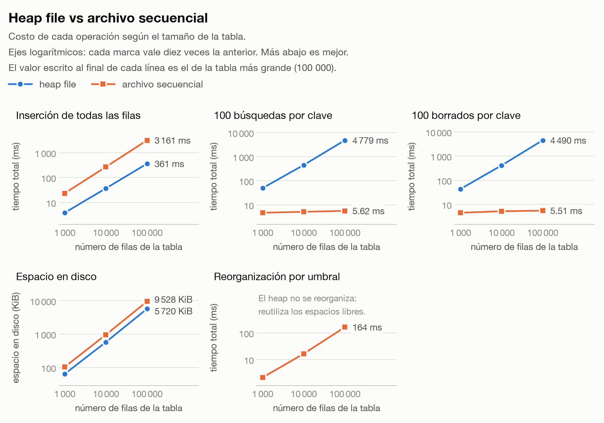

En los paneles de búsqueda y de borrado la línea del heap sube a 45° —crece en proporción
al tamaño— y la del secuencial es casi plana.

| Operación | Técnica | 1 000 | 10 000 | 100 000 |
|---|---|---:|---:|---:|
| Inserción (ms) | heap | **3.59** | **37.5** | **373** |
|  | secuencial | 23.9 | 273 | 3 182 |
| Búsqueda por clave (ms) | heap | 27.6 | 262 | 2 724 |
|  | secuencial | **4.32** | **4.73** | **5.63** |
| Borrado por clave (ms) | heap | 26.2 | 243 | 2 561 |
|  | secuencial | **4.79** | **5.02** | **5.48** |
| Espacio (KiB) | heap | **64.0** | **576** | **5 720** |
|  | secuencial | 104 | 960 | 9 528 |
| Reorganización (ms) | secuencial | 2.08 | 16.9 | 164 |

### Conclusiones

**Por clave, el secuencial gana en todos los tamaños.** El heap recorre de media la mitad
del archivo por cada clave, así que su tiempo crece lineal (27.6 → 262 → 2 724 ms
para 100 búsquedas), mientras que el secuencial hace una búsqueda binaria sobre sus páginas
y casi no se mueve (4.32 → 4.73 → 5.63 ms). Ya con 1 000 filas es
6.4 veces más rápido, y con 100 000 **busca 484 veces más
rápido**. Borrar cuesta casi lo mismo que buscar en las dos estructuras, porque es
encontrar la fila y marcarla: con 100 000 filas el secuencial borra 468 veces más
rápido.

El precio del orden se paga al escribir: insertar cuesta **8.5 veces más** en el
secuencial, porque cada inserción localiza la página y desplaza bytes dentro de ella, y cada
tanto se dispara una reorganización. También ocupa **1.7 veces más espacio**, y eso es
deliberado: el factor de llenado del 80 % deja hueco para que las inserciones futuras quepan
en su sitio en vez de irse al desbordamiento.

**La reorganización es lineal y poco frecuente.** Con 100 000 filas reescribir el archivo
tomó 164 ms, unos 2.2 µs por cada uno de los 75 055 registros que
quedaban, y solo ocurre cuando las lápidas y el desbordamiento pasan del 30 % de lo
guardado.

**Cuándo usar cada uno:** heap si se escribe mucho y se consulta siempre por índice;
secuencial si se consulta por clave o por rango y las escrituras son la minoría.

### Resumen: ventajas y desventajas

| | Heap file | Archivo secuencial |
|---|---|---|
| **Ventajas** | Inserción `O(1)`: va directo a la cabeza de la lista de libres · el menor espacio en disco · reutiliza los huecos de los borrados sin ningún trabajo diferido · sin coste oculto | Búsqueda y borrado por clave `O(log P)`: 484× más rápido con 100 000 filas · rangos y recorrido ordenado gratis, sin ordenar nada · el orden se mantiene siempre disponible |
| **Desventajas** | Búsqueda y borrado por valor `O(P)`: hay que recorrer el archivo · un rango o un `ORDER BY` obligan a ordenar aparte · inútil sin un índice encima | Inserción 8.5× más lenta: localiza la página y desplaza bytes · 1.7× más espacio por el factor de llenado del 80 % · reorganizaciones que congelan el archivo cuando el desperdicio pasa del 30 % · el desbordamiento degrada la búsqueda hasta que se reorganiza |
| **Se elige cuando** | Carga masiva, tablas que siempre se consultan por índice, orden de lectura irrelevante | Consultas por rango o por clave frecuentes, escrituras minoritarias, necesidad de recorrer en orden |

## 2. Indexación — B+ agrupado vs B+ no agrupado vs hash extendible

`index_benchmark.py` mide construcción, igualdad, rango, recorrido ordenado, espacio
adicional y un ciclo de borrados e inserciones sobre el 10 % de las filas. Las tres
técnicas hacen el mismo trabajo: guardar las filas y encontrarlas. El B+ agrupado las
guarda en sus hojas; el no agrupado y el hash guardan direcciones y tienen **su propio
heap**, así que su construcción y su ciclo de borrados e inserciones incluyen escribir y
borrar las filas en él. Sus búsquedas **incluyen el salto al heap**, y el JSON guarda
además la misma búsqueda sin él (`solo_indice_ms`) para separar los dos costes.

### Resultados medidos

Mismos parámetros. Las consultas son el total de 100.

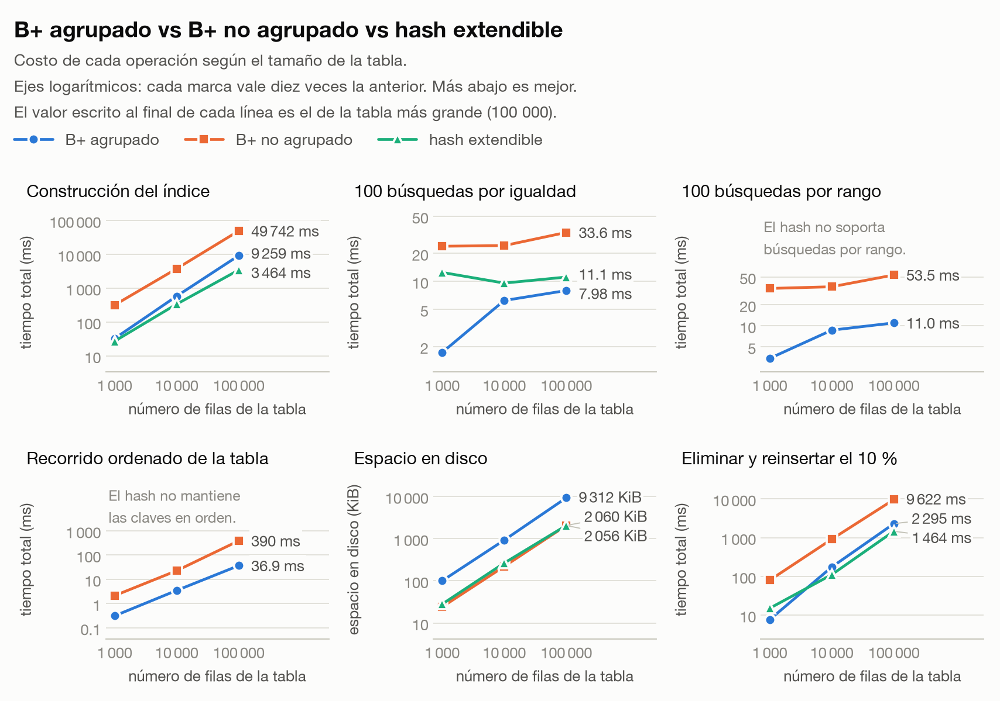

En los paneles de rango y de recorrido ordenado falta una línea: el hash no puede hacer
ninguna de las dos cosas.

| Operación | Técnica | 1 000 | 10 000 | 100 000 |
|---|---|---:|---:|---:|
| Construcción (ms) | B+ agrupado | 20.4 | 302 | 4 428 |
|  | B+ no agrupado | 179 | 2 094 | 25 920 |
|  | hash extendible | **11.1** | **135** | **1 317** |
| Igualdad (ms) | B+ agrupado | **1.20** | **3.04** | **4.06** |
|  | B+ no agrupado | 12.3 | 12.3 | 16.1 |
|  | hash extendible | 4.58 | 3.48 | 4.29 |
| Rango (ms) | B+ agrupado | **2.49** | **4.48** | **5.47** |
|  | B+ no agrupado | 20.9 | 21.7 | 27.0 |
| | hash extendible | — | — | **no soportado** |
| Recorrido ordenado (ms) | B+ agrupado | **0.25** | **2.50** | **31.8** |
|  | B+ no agrupado | 1.79 | 18.9 | 199 |
| | hash extendible | — | — | **no soportado** |
| Espacio (KiB) | B+ agrupado | 108 | 956 | 9 356 |
|  | B+ no agrupado | **24.0** | **220** | **2 040** |
|  | hash extendible | 28.0 | 264 | 2 056 |
| Inserción/borrado (ms) | B+ agrupado | **4.75** | 87.2 | 1 129 |
|  | B+ no agrupado | 44.4 | 478 | 5 047 |
|  | hash extendible | 5.32 | **45.0** | **531** |

Las celdas «no soportado» **no son un cero de rendimiento, son una limitación de la
técnica**: el hash destruye el orden, así que no hay forma de resolver un rango ni un
`ORDER BY` con él.

### Conclusiones

**En una búsqueda por igualdad cuesta el índice, no el salto al heap.** El agrupado
responde 100 igualdades en 4.06 ms con 100 000 filas y el hash en 4.29 ms; sin ir al heap, el hash
tarda 4.00 ms, lo mismo que el agrupado. El salto a la fila es como mucho un 7 % del tiempo en
los dos índices secundarios: una lectura de una página que casi siempre está en el buffer
pool. Lo que pesa es leer la cubeta o el nodo y decodificar sus entradas en Python. Por eso
el B+ no agrupado es el más lento (16.1 ms, 16.0 sin el heap): sus claves compuestas
`(valor, dirección)` llenan nodos de unas 300 entradas, y cada nodo que lee se decodifica
entero.

**El salto al heap sí pesa cuando hay muchos resultados.** En el recorrido ordenado de
100 000 filas el agrupado tarda 31.8 ms y el no agrupado 199 ms, 6.3 veces más. De esos,
79.0 ms son recorrer sus propias hojas y 120 ms, 100 000 lecturas sueltas del heap en el
orden de la clave y no en el físico.

**El espacio va al revés.** El agrupado ocupa 9 356 KiB porque guarda las filas; los otros
dos rondan 2 040 KiB porque solo guardan direcciones. Por eso solo puede haber un índice
agrupado por tabla y tantos secundarios como haga falta.

**El hash es el más rápido para escribir.** Construye en 1.3 s contando su heap, 20 veces menos
que el B+ no agrupado, porque insertar es calcular la cubeta y escribir en ella. En el ciclo
de borrados e inserciones también gana con 10 000 y 100 000 filas (0.5 s contra 1.1 s del
agrupado con 100 000). Con 1 000 filas el agrupado es algo más rápido (4.75 contra
5.32 ms): el hash paga al borrar lo que cuesta mantenerse compacto, porque funde cada
cubeta holgada con su gemela y reduce el directorio, y con pocas filas eso es casi todo.

**Cuándo usar cada uno:** agrupado para la clave primaria de la tabla; hash para columnas
que solo se consultan por igualdad; B+ no agrupado cuando además hacen falta rangos sobre
una columna que no es la de agrupamiento.

### Resumen: ventajas y desventajas

| | B+ agrupado | B+ no agrupado | Hash extendible |
|---|---|---|---|
| **Ventajas** | La fila está en la hoja: **sin salto al heap** · el mejor en igualdad (4.06 ms) y en rango (5.47 ms) · recorrido ordenado 6.3× más rápido que el no agrupado · un solo archivo que es índice y datos a la vez | Ocupa 4.6× menos que el agrupado porque solo guarda direcciones · **varios por tabla**, uno por columna que interese · admite rangos y orden · admite valores repetidos con clave compuesta `(valor, dirección)` | Igualdad en `O(1)`: dos accesos, uno al directorio y uno a la cubeta, sea cual sea el tamaño · **construcción 20× más rápida** que el B+ no agrupado (1.3 s vs 25.9 s) · crecer solo duplica el directorio, sin tocar las cubetas · al borrar funde cubetas y encoge el directorio |
| **Desventajas** | Ocupa 9 356 KiB porque guarda las filas · **solo puede haber uno por tabla**: los datos solo pueden estar ordenados de una forma · las hojas son grandes, así que caben menos entradas por página y el árbol crece en altura | Paga un **salto al heap por cada resultado**, que pesa cuando son muchos: con 100 000 filas el recorrido ordenado tarda 199 ms frente a 31.8 ms del agrupado · el más lento en construirse por el coste de decodificar claves compuestas | **No admite rangos ni `ORDER BY`**: el hash destruye el orden · con pocas filas, borrar es más caro que en el B+ porque funde cubetas y encoge el directorio · claves muy repetidas no se pueden repartir y degeneran en cadenas de desbordamiento |
| **Se elige cuando** | Es la clave primaria de la tabla y las consultas por ella dominan | Hace falta un índice secundario y las consultas incluyen rangos u orden | La columna solo se consulta por igualdad y se carga mucho de una vez |

## Cómo leer los tiempos de construcción

El B+ no agrupado tarda 25.9 s en construirse con 100 000 filas: 5.9 veces más que el
agrupado y 20 veces más que el hash, y los tres cuentan ya el escribir las filas: el
agrupado en sus hojas, los otros dos en su heap. El motivo está en la implementación, no en
la estructura. Su clave es compuesta `(valor, dirección)`, ocupa 14 bytes en vez de 8, y por
eso en cada nodo caben casi 300 entradas en vez de 59. Cada vez que se lee un nodo,
**deserializar decodifica esas 300 claves compuestas en Python**, aunque la búsqueda binaria
solo vaya a mirar ocho.

Es el precio de tener los nodos como objetos legibles en vez de operar directamente sobre
los bytes de la página. La alternativa —comparar claves serializadas sin decodificarlas—
sería más rápida y bastante menos clara. Merece la pena contarlo como lo que es: **una
consecuencia medida de una decisión de diseño**, no un defecto de la estructura.

## 3. Datos espaciales — búsqueda secuencial vs R-Tree vs GiST

`spatial_benchmark.py` responde las mismas consultas, sobre los mismos puntos, con tres
técnicas:

| Técnica | Qué es |
|---|---|
| **búsqueda secuencial** | el motor sin índice: recorre la tabla y mide la distancia a cada punto |
| **R-Tree** | el motor con el índice `RTREE` de [`src/index/rtree/`](../src/index/rtree/README.md) |
| **GiST (PostgreSQL)** | PostgreSQL 17 con PostGIS 3.6, columna `geography` e índice GiST |

Las consultas son las del enunciado: por radio de 1, 5 y 10 km, y los `k` vecinos más
cercanos con `k` = 10, 50 y 100. Las dos técnicas del motor se miden con el mismo SQL de
punta a punta (`SELECT id FROM puntos WHERE distancia(…) < r` y
`… ORDER BY distancia(…) LIMIT k`); GiST, con `ST_DWithin` y el operador `<->`.

**Los puntos son reales.** Con `--points-file` el experimento toma sus puntos de un CSV con
una columna `POINT`: aquí, los lugares con nombre del Perú en OpenStreetMap —colegios,
restaurantes, farmacias, bancos— que descarga
[`demos/descargar_lugares.py`](../demos/README.md). De ellos se sacan muestras de 1 000,
10 000 y 100 000 puntos distintos, y los centros de las consultas caen junto a puntos de la
muestra. Importa que sean reales: están repartidos como la gente, apretados en las ciudades
y con grandes zonas vacías, que es justo donde un índice espacial tiene algo que descartar.
Sin ese argumento se generan puntos sintéticos sobre Lima, que no necesitan descargar nada.

### Antes de medir: ¿responden lo mismo?

Un índice que acelera cambiando la respuesta no es una comparación. Por eso:

- el experimento **aborta** si el R-Tree devuelve filas distintas de las del recorrido;
- a PostGIS se le pide la distancia **sobre la esfera** (`ST_DWithin(…, false)`), el mismo
  modelo que Haversine, porque por omisión mide sobre el elipsoide y discrepa hasta un 0.5 %;
- cada medida de GiST anota cuántas de sus consultas coincidieron con el motor.

Resultado: **las 1 800 consultas coinciden, fila por fila** (100 de cada uno de los 6 tipos,
en los 3 tamaños), y PostgreSQL confirma con `EXPLAIN` que usa el índice en todas.

### Consultas por radio

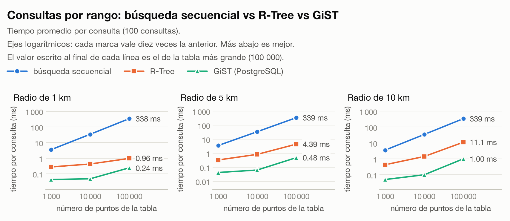

Tiempo medio por consulta, en milisegundos:

| Radio | Técnica | 1 000 | 10 000 | 100 000 | Filas devueltas (100 000) |
|---|---|---:|---:|---:|---:|
| 1 km | búsqueda secuencial | 3.52 | 33.8 | 338 | 64.1 |
|  | R-Tree | 0.27 | 0.42 | 0.96 | |
|  | GiST | **0.043** | **0.048** | **0.24** | |
| 5 km | búsqueda secuencial | 3.51 | 33.9 | 339 | 544 |
|  | R-Tree | 0.33 | 0.82 | 4.39 | |
|  | GiST | **0.042** | **0.063** | **0.48** | |
| 10 km | búsqueda secuencial | 3.55 | 34.3 | 339 | 1 577 |
|  | R-Tree | 0.42 | 1.40 | 11.1 | |
|  | GiST | **0.050** | **0.099** | **1.00** | |

### Vecinos más cercanos

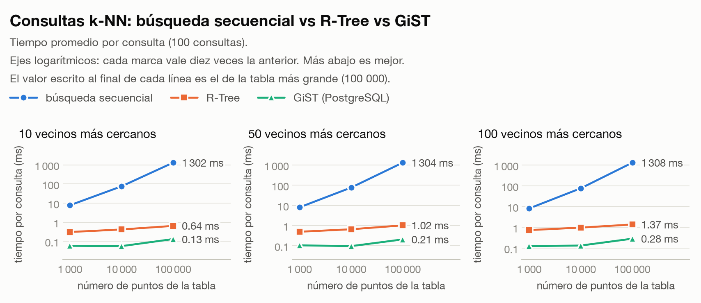

Tiempo medio por consulta, en milisegundos:

| k | Técnica | 1 000 | 10 000 | 100 000 |
|---|---|---:|---:|---:|
| 10 | búsqueda secuencial | 5.82 | 70.2 | 1 171 |
|  | R-Tree | 0.33 | 0.44 | 0.57 |
|  | GiST | **0.059** | **0.058** | **0.12** |
| 50 | búsqueda secuencial | 5.85 | 71.1 | 1 173 |
|  | R-Tree | 0.54 | 0.70 | 0.86 |
|  | GiST | **0.095** | **0.097** | **0.19** |
| 100 | búsqueda secuencial | 5.94 | 73.7 | 1 170 |
|  | R-Tree | 0.79 | 1.14 | 1.31 |
|  | GiST | **0.12** | **0.14** | **0.26** |

### Por qué: los nodos que abre cada consulta

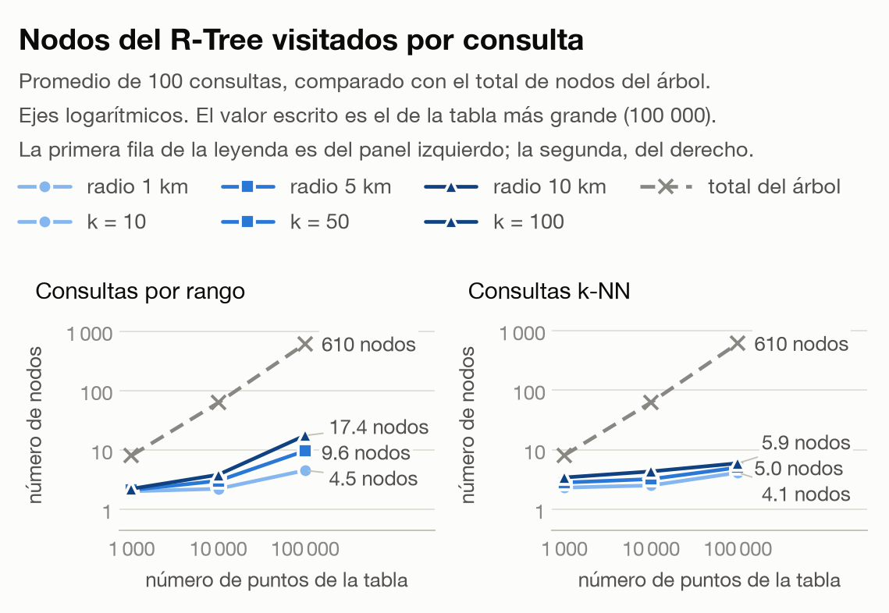

El plan de ejecución dice cuántos nodos del R-Tree visitó cada búsqueda. Media sobre 100
consultas:

| Consulta | 1 000 puntos (7 nodos) | 10 000 (61 nodos) | 100 000 (606 nodos) |
|---|---:|---:|---:|
| radio 1 km | 2.00 | 2.20 | 4.30 |
| radio 5 km | 2.10 | 2.90 | 9.40 |
| radio 10 km | 2.30 | 3.80 | 16.9 |
| k-NN, k = 10 | 2.30 | 2.40 | 3.90 |
| k-NN, k = 50 | 2.90 | 3.20 | 4.80 |
| k-NN, k = 100 | 3.40 | 4.20 | 5.80 |

Esta es la gráfica que explica las dos anteriores. El árbol se multiplica por 87 (de 7 a
606 nodos) y el k-NN pasa de abrir 2.30 nodos a abrir 3.90.

### Construcción, espacio y memoria

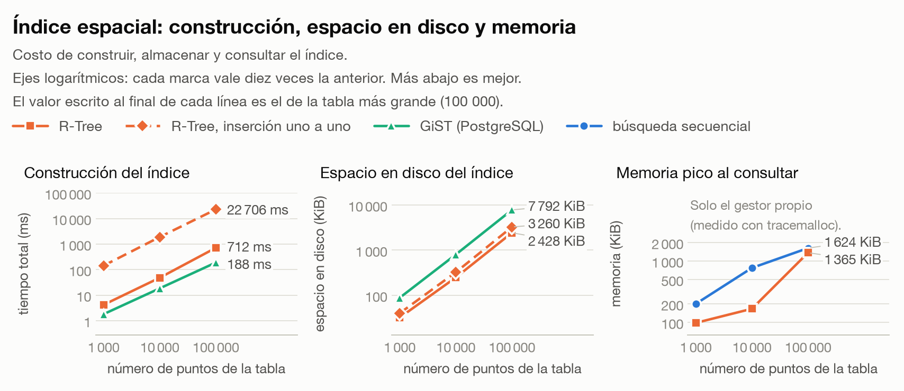

| Medida | Técnica | 1 000 | 10 000 | 100 000 |
|---|---|---:|---:|---:|
| Construcción (ms) | R-Tree, carga masiva (STR) | 3.46 | 40.6 | 544 |
|  | R-Tree, inserción uno a uno | 145 | 1 854 | 22 549 |
|  | GiST | **1.47** | **18.8** | **188** |
| Espacio del índice (KiB) | R-Tree, carga masiva | **32.0** | **248** | **2 428** |
|  | R-Tree, inserción uno a uno | 40.0 | 324 | 3 260 |
|  | GiST | 88.0 | 808 | 7 760 |
| Memoria pico al consultar (KiB) | búsqueda secuencial | 200 | 772 | 1 468 |
|  | R-Tree | **98.2** | **167** | **1 365** |

`CREATE INDEX … USING RTREE` usa la carga masiva; la inserción uno a uno es lo que cuesta
mantener el índice cuando las filas llegan después. La búsqueda secuencial no tiene índice
que construir ni que almacenar. La memoria es la de Python, medida con `tracemalloc`; la de
PostgreSQL no es comparable desde fuera y no se reporta.

### Conclusiones

**El recorrido secuencial crece con la tabla; el índice, con la respuesta.** La búsqueda
secuencial tarda lo mismo pida un radio de 1 km o de 10 (338 y 339 ms con 100 000 puntos),
porque siempre mide la distancia a todos. El R-Tree tarda 0.96 ms para 1 km y 11.1 ms para
10 km: lo que le cuesta son las 64.1 o las 1 577 filas que tiene que devolver.

**Cuanto más selectiva la consulta, más gana el índice.** Con 100 000 puntos, el R-Tree es
351 veces más rápido que el recorrido para 1 km, 77 veces para 5 km y 31 para 10 km,
donde cada consulta devuelve ya el 1.6 % de la tabla.

**En el k-NN la diferencia es de tres órdenes de magnitud.** Sin índice no hay forma de
saber cuáles son los 10 más cercanos sin medir los 100 000 y ordenarlos: 1 171 ms. El
R-Tree abre los nodos del más cercano al más lejano y se detiene al tener diez: 0.57 ms,
**2 042 veces menos**. Y casi no depende del tamaño: de 1 000 a 100 000 puntos el recorrido
se multiplica por 201 y el R-Tree por 1.7.

**GiST es entre 4.0 y 14 veces más rápido que el R-Tree, y escala igual.** La distancia entre
las dos líneas es constante en las gráficas: la misma pendiente, desplazada. GiST está
escrito en C y lleva décadas de optimización; este R-Tree es Python y deserializa cada nodo
que abre. Lo que el experimento compara es **el algoritmo**, y ahí las dos estructuras se
comportan igual y el recorrido no.

**La carga masiva es 41 veces más rápida que insertar y deja un árbol mejor.** 0.5 s
frente a 22.5 s con 100 000 puntos, 606 nodos en vez de 814 y un 26 % menos de espacio.
GiST construye en 0.2 s.

**El índice propio ocupa 3.2 veces menos que el de PostGIS:** 2 428 KiB frente a 7 760. Las
hojas de este R-Tree guardan el punto en 22 bytes; `geography` indexa cajas en tres
dimensiones.

**La memoria al consultar es parecida en las dos técnicas del motor** (1 468 KiB el recorrido y
1 365 KiB el R-Tree con 100 000 puntos). El R-Tree necesita tener a la vez las direcciones
que devuelve el índice, porque las ordena por página antes de ir al heap para leer cada
página una sola vez.

### Resumen: ventajas y desventajas

| | Búsqueda secuencial | R-Tree (propio) | GiST (PostgreSQL) |
|---|---|---|---|
| **Ventajas** | Sin índice que construir, almacenar ni mantener · coste predecible: siempre el mismo · suficiente en tablas pequeñas: 3.51 ms por radio con 1 000 puntos | k-NN en `O(log N + k)`: 0.57 ms con 100 000 puntos · por radio, hasta 351× más rápido que recorrer · el índice más compacto de los tres · una sola estructura para las dos métricas | El más rápido en todo, entre 4.0 y 14 veces · construye 100 000 puntos en 0.2 s · maduro, concurrente y con recuperación ante fallos |
| **Desventajas** | Crece en proporción a la tabla · el k-NN obliga a medir y ordenar todo: 1.2 s con 100 000 puntos · no aprovecha que la consulta sea selectiva | Hay que mantenerlo: insertar uno a uno cuesta 0.23 ms por punto · gana menos cuanto mayor es la parte de la tabla que devuelve la consulta | Es un sistema entero, no una estructura: hay que instalarlo, cargarlo y consultarlo por red · su índice ocupa 3.2× más |
| **Se elige cuando** | La tabla es pequeña (con 1 000 puntos responde en 3.51 a 5.94 ms) o la consulta devuelve una parte grande de las filas | Consultas selectivas —un barrio, los `k` más cercanos— sobre muchos puntos | Hay un PostgreSQL disponible y el rendimiento manda |

### Reproducirlo

```bash
.venv/bin/pip install -e ".[postgres,plots]"
.venv/bin/python -m demos.descargar_lugares --salida data/datasets/lugares_peru.csv
createdb minigestor_bench                       # el experimento crea ahí la extensión PostGIS
export BENCH_POSTGRES_DSN="dbname=minigestor_bench"
.venv/bin/python -m benchmarks.spatial_benchmark --sizes 1000 10000 100000 --queries 100 \
    --points-file data/datasets/lugares_peru.csv
```

Tarda unos 15 minutos, casi todos en el recorrido secuencial de 100 000 puntos. En
PostgreSQL solo usa tablas temporales, que desaparecen al cerrar la conexión. Sin
`BENCH_POSTGRES_DSN` mide las dos técnicas del motor y omite GiST; sin `--points-file`, usa
puntos sintéticos. El extracto de OpenStreetMap es el del día de la descarga, así que las
cifras de otra ejecución pueden diferir ligeramente de las publicadas.

El tiempo de GiST se mide desde el cliente e incluye el viaje por el socket local, que el
motor propio no paga porque corre en el mismo proceso. Aun así es el más rápido.

## 4. Búsqueda de texto — TF-IDF + coseno vs BM25 vs GIN

`text_benchmark.py` responde las mismas consultas, sobre los mismos productos, con tres
técnicas:

| Técnica | Qué es |
|---|---|
| **TF-IDF + coseno** | `Ranker.top_k` con SMART lnc.ltc sobre el índice invertido de [`src/index/inverted/`](../src/index/inverted/README.md) |
| **BM25** | el **mismo** índice y el mismo `Ranker`, con `k1` = 1.2 y `b` = 0.75 |
| **GIN (PostgreSQL)** | PostgreSQL 17.10: columna `tsvector` generada con `to_tsvector('spanish', texto)`, índice GIN sobre ella y orden con `ts_rank_cd` |

**El corpus es real.** Fichas de producto de Amazon en español, del Shopping Queries
Dataset (ESCI), con los subconjuntos de 1 000, 10 000 y 100 000 productos que describe
[`esci/README.md`](esci/README.md). Las consultas son búsquedas reales de la tienda, en
tres cubetas por su número de palabras (1, 3 y 5 o más): 8 por cubeta con 1 000 productos y
50 con 10 000 y 100 000. Un producto es **relevante** si un anotador lo calificó como exacto
(E); Precision@10 y Recall@10 se calculan contra esos juicios.

**Cómo se pregunta a cada uno.**

- El motor se mide a nivel del índice: `Ranker.top_k(consulta, método, 10)` sobre el índice
  abierto, sin pasar por el SQL. Un mismo índice sirve a los dos rankings, así que entre
  ellos solo cambia la fórmula.
- A PostgreSQL se le pregunta por SQL desde el cliente, con el viaje por el socket local
  incluido. La consulta es el **OR** de sus términos, como en el motor:
  `plainto_tsquery` analiza el texto igual que `to_tsvector` y une los lexemas con `&`, y
  el experimento cambia cada ` & ` por ` | ` (un lexema no contiene espacios, así que no
  se toca nada más). Se ordena con `ts_rank_cd(vector, consulta)` con la normalización por
  omisión (0), y a igual puntaje por el orden de carga, como el motor.
- PostgreSQL planifica cada consulta con su texto (`plan_cache_mode = force_custom_plan`):
  con un plan genérico la consulta deja de ser una constante y `ts_rank_cd` la vuelve a
  calcular por cada fila. Con `enable_seqscan = off` se mide el índice, y `EXPLAIN` confirma
  que se usa en las 324 consultas.
- Los dos tienen la misma caché propia: el buffer pool del motor son 2 048 páginas de
  4 KB (8 MiB) y la tabla temporal de PostgreSQL usa `temp_buffers` = 8 MB, el valor por
  omisión. Lo que no cabe, los dos lo leen de la caché de archivos del sistema.
- **Construir** empieza en los dos con los textos ya cargados: en el motor, una lista en
  memoria; en PostgreSQL, la tabla. Cuenta el análisis del texto y el índice: en el motor,
  `InvertedIndex.build`; en PostgreSQL, calcular la columna `tsvector` y `CREATE INDEX`.

Cada consulta se repite 5 veces y cada índice se construye 3; cuenta la vez más
rápida, porque el equipo era compartido y otro proceso solo puede sumar tiempo. Todas las
repeticiones están en el JSON. Apple M4 Pro, macOS, Python 3.12.

### Antes de medir: ¿qué candidatos ve cada uno?

Un candidato es un producto que contiene algún término de la consulta. Los dos analizadores
usan el stemmer Snowball del español, pero no cortan el texto igual, así que sus candidatos
no tienen por qué coincidir. El experimento compara los dos conjuntos de cada consulta:

| Productos | Candidatos idénticos | Términos idénticos | Jaccard medio | En los dos | Solo el motor | Solo GIN |
|---:|---:|---:|---:|---:|---:|---:|
| 1 000 | 15 / 24 | 24 / 24 | 0.98 | 1 914 | 148 | 35 |
| 10 000 | 48 / 150 | 135 / 150 | 0.90 | 111 866 | 29 408 | 4 568 |
| 100 000 | 37 / 150 | 135 / 150 | 0.89 | 1 103 340 | 294 767 | 45 072 |

Las raíces coinciden en 135 de las 150 consultas: lo que cambia es **dónde se corta una
palabra**. El motor corta entre letras y cifras y en los puntos; PostgreSQL deja «ps4»,
«5ghz» o «m.zuiko» como una sola palabra. Y las listas de stopwords no son iguales: «si» lo
es para el motor y no para PostgreSQL. Las consultas con más diferencia, con 100 000
productos:

| Consulta | Términos del motor | Términos de GIN | Solo el motor | Solo GIN |
|---|---|---|---:|---:|
| x10sdv | `10 sdv x` | `x10sdv` | 41 251 | 0 |
| nintengo 2ds new xl lapiz | `2 ds lapiz new ninteng xl` | `2ds lapiz new ninteng xl` | 33 334 | 7 |
| 200x50 rueda patinete sin cámara de aire | `200 50 air cam patinet rued x` | `200x50 air cam patinet rued` | 29 606 | 3 |
| ps4 terror vr | `4 ps terror vr` | `ps4 terror vr` | 23 678 | 0 |
| repetidor wifi 5ghz | `5 ghz repetidor wifi` | `5ghz repetidor wifi` | 20 126 | 0 |
| si tienes un papa mago | `mag pap` | `mag pap si` | 42 | 18 812 |

Cortar «ps4» en `ps` y `4` hace que la consulta encuentre todo producto con un 4. Por eso
el motor tiene más candidatos: con 100 000 productos, el 96 % de los de GIN están
también en el motor, y el 21 % de los del motor son solo suyos. La diferencia es del
analizador, no del índice.

### Tiempo de consulta

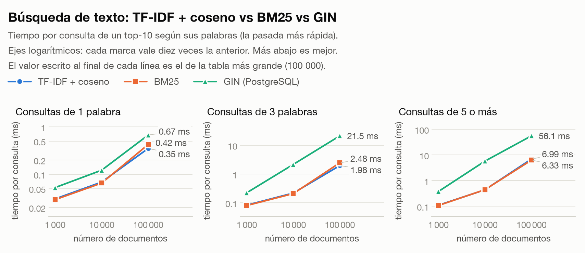

Tiempo por consulta, en milisegundos:

| Palabras | Técnica | 1 000 | 10 000 | 100 000 |
|---|---|---:|---:|---:|
| 1 palabra | TF-IDF + coseno | 0.019 | **0.047** | 0.24 |
|  | BM25 | **0.019** | 0.049 | **0.23** |
|  | GIN | 0.082 | 0.096 | 0.64 |
| 3 palabras | TF-IDF + coseno | **0.062** | 0.17 | 1.24 |
|  | BM25 | 0.070 | **0.17** | **0.95** |
|  | GIN | 0.23 | 1.82 | 19.3 |
| 5 o más | TF-IDF + coseno | **0.087** | **0.36** | 2.99 |
|  | BM25 | 0.10 | 0.38 | **2.69** |
|  | GIN | 0.39 | 4.82 | 51.7 |

### Dónde se va el tiempo

El motor recorre las listas de postings de los términos y suma en un acumulador por
documento. PostgreSQL usa el GIN para saber qué filas coinciden, y luego lee el `tsvector`
de cada una y calcula `ts_rank_cd`. El `EXPLAIN ANALYZE` separa las dos partes:

| Palabras | Postings leídos (1 000) | (10 000) | (100 000) | Candidatos del motor (100 000) | Filas de GIN (100 000) | GIN: índice (ms) | GIN: ejecución completa (ms) |
|---|---:|---:|---:|---:|---:|---:|---:|
| 1 palabra | 9 | 176 | 1 620 | 1 464 | 235 | 0.009 | 0.39 |
| 3 palabras | 130 | 915 | 8 781 | 8 203 | 6 986 | 0.39 | 19.7 |
| 5 o más | 206 | 2 252 | 21 911 | 18 296 | 15 747 | 1.12 | 51.7 |

### Relevancia

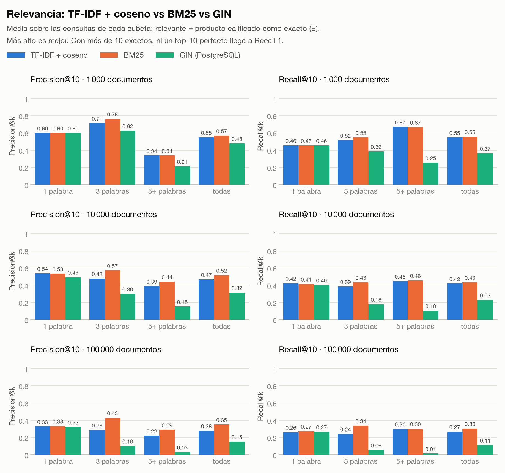

Precision@10, media por cubeta; en negrita, la mejor de cada tamaño:

| Productos | Técnica | 1 palabra | 3 palabras | 5 o más | Todas |
|---:|---|---:|---:|---:|---:|
| 1 000 | TF-IDF + coseno | **0.60** | 0.71 | **0.34** | 0.55 |
|  | BM25 | **0.60** | **0.76** | **0.34** | **0.57** |
|  | GIN | **0.60** | 0.62 | 0.21 | 0.48 |
| 10 000 | TF-IDF + coseno | **0.54** | 0.48 | 0.39 | 0.47 |
|  | BM25 | 0.53 | **0.57** | **0.44** | **0.52** |
|  | GIN | 0.49 | 0.30 | 0.15 | 0.32 |
| 100 000 | TF-IDF + coseno | 0.33 | 0.29 | 0.22 | 0.28 |
|  | BM25 | **0.33** | **0.43** | **0.29** | **0.35** |
|  | GIN | 0.32 | 0.10 | 0.03 | 0.15 |

Recall@10:

| Productos | Técnica | 1 palabra | 3 palabras | 5 o más | Todas |
|---:|---|---:|---:|---:|---:|
| 1 000 | TF-IDF + coseno | **0.46** | 0.52 | **0.67** | 0.55 |
|  | BM25 | **0.46** | **0.55** | 0.67 | **0.56** |
|  | GIN | **0.46** | 0.39 | 0.25 | 0.37 |
| 10 000 | TF-IDF + coseno | **0.42** | 0.39 | 0.45 | 0.42 |
|  | BM25 | 0.41 | **0.43** | **0.46** | **0.43** |
|  | GIN | 0.40 | 0.18 | 0.10 | 0.23 |
| 100 000 | TF-IDF + coseno | 0.26 | 0.24 | 0.30 | 0.27 |
|  | BM25 | **0.27** | **0.34** | **0.30** | **0.30** |
|  | GIN | 0.27 | 0.06 | 0.01 | 0.11 |

Con 100 000 productos cada consulta tiene en promedio 13.2 productos exactos, así que ni
un top 10 perfecto llega siempre a un Recall@10 de 1.

### Construcción, espacio y memoria

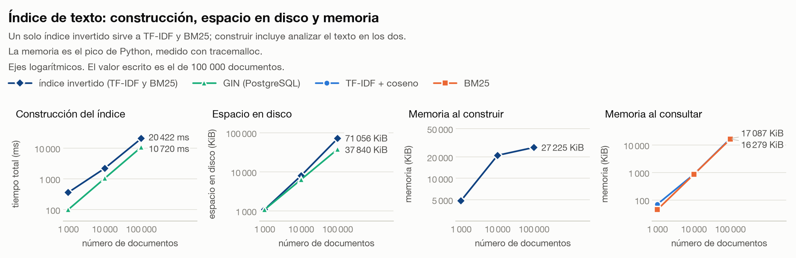

| Medida | Técnica | 1 000 | 10 000 | 100 000 |
|---|---|---:|---:|---:|
| Construcción (ms) | índice invertido (SPIMI) | 303 | 1 578 | 13 660 |
|  | GIN, total | **100** | **1 054** | **10 984** |
|  | GIN: columna `tsvector` | 79.0 | 816 | 8 402 |
|  | GIN: `CREATE INDEX` | 21.4 | 238 | 2 582 |
| Espacio del índice (KiB) | índice invertido (SPIMI) | 1 088 | 7 968 | 71 056 |
|  | GIN | **1 080** | **6 360** | **37 840** |
|  | GIN: columna `tsvector` | 1 136 | 11 641 | 117 420 |
| Memoria pico al construir (KiB) | índice invertido (SPIMI) | 3 976 | 17 978 | 24 934 |
| Memoria pico al consultar (KiB) | TF-IDF + coseno | 70.2 | 718 | 16 957 |
|  | BM25 | **46.1** | **503** | **10 754** |

El espacio del índice invertido son sus cuatro archivos: con 100 000 productos, léxico
4 624 KiB, términos 1 020, postings 61 696 y documentos 1 868. El de GIN es
`pg_relation_size` del índice; la columna `tsvector` va aparte porque está en la tabla,
pero el ranking la necesita. La memoria es la de Python, medida con `tracemalloc` en una
construcción aparte; la de PostgreSQL no se puede medir igual desde fuera y no se reporta.

### Conclusiones

**BM25 es el más relevante, en los tres tamaños.** Su Precision@10 media es 0.57, 0.52 y
0.35, frente a 0.55, 0.47 y 0.28 de TF-IDF. Con una palabra las tres técnicas casi
empatan (a lo sumo 0.040 de diferencia): con un solo término, ordenar es contar
cuántas veces aparece y en cuánto texto. La ventaja de BM25 está en las consultas largas:
con 100 000 productos gana por 0.14 con 3 palabras y por 0.07 con 5 o más. Satura la
frecuencia de cada término (`k1`), así que un producto no gana por repetir una palabra, y
pesa más el que contiene varios términos distintos.

**GIN no ordena: encuentra.** El índice dice qué filas contienen algún término; el orden lo
pone `ts_rank_cd`, que con la normalización por omisión no divide por la longitud del
documento, y un texto largo que repite los términos suma más. Con 10 000 productos su
Precision@10 con 3 palabras es 0.30 y con 100 000 baja a 0.10: 2.9 veces menos, cuando
BM25 baja 1.3 veces. Con 5 o más palabras queda en 0.03. Es la parte del
experimento que más depende de una opción: `--ts-rank-normalization` la cambia.

**El motor responde antes que PostgreSQL con 3 palabras o más**, y la tabla de arriba dice
por qué. Con 100 000 productos y 5 o más palabras, el GIN encuentra las
15 747 filas en 1.12 ms, el 2.2 % de la ejecución; el resto es leer el `tsvector` de cada fila
y puntuarla, unos 3.3 µs por fila. El motor tiene la frecuencia de cada término dentro
del posting y la longitud de cada documento en memoria: puntuar le cuesta unos
123 ns por posting con BM25 y 136 con TF-IDF. GIN es C y el motor Python, pero la
diferencia no está en el lenguaje sino en lo que cada uno guarda en el índice: GIN está
hecho para responder qué filas coinciden, no para ordenarlas. Con una palabra hay pocas filas
que leer y la distancia se acorta (2.8 veces con 100 000 productos, frente a
20 con 3 palabras).

**El tiempo del motor sigue a los postings que lee.** De 10 000 a 100 000 productos, una
consulta de 5 o más palabras lee 9.7 veces más postings y BM25 tarda 7.0 veces más: el
costo de una consulta es recorrer sus listas, y crece con ellas, no con el tamaño de la colección.

**GIN construye más rápido y ocupa menos.** Con 100 000 productos, PostgreSQL calcula la
columna y crea el índice en 11.0 s; el motor tarda 13.7 s, 1.2 veces más, la mayor parte
analizando el texto en Python (lo mide el [README del índice](../src/index/inverted/README.md#medido-con-esci)). El índice GIN ocupa 37.0 MiB y el invertido 69.4 MiB
(1.9 veces más): GIN comprime sus listas, y el motor guarda los postings sin
comprimir, 8 bytes cada uno, para decodificarlos en C; son el 87 % de sus archivos.
Pero el ranking de GIN necesita además la columna `tsvector`, que ocupa 115 MiB.

**La memoria de SPIMI está acotada.** Con 100 000 productos la construcción escribe
9 bloques y los mezcla en 2 pasadas; diez veces más documentos que con 10 000 cuestan
1.4 veces la memoria (17.6 MiB y 24.3 MiB).

### Resumen: ventajas y desventajas

| | TF-IDF + coseno | BM25 | GIN (PostgreSQL) |
|---|---|---|---|
| **Ventajas** | Sin parámetros que ajustar · la norma del documento se calcula al indexar y no cambia · empata con BM25 en consultas de una palabra | El más relevante: Precision@10 de 0.35 con 100 000 productos · satura la frecuencia y normaliza por longitud · el mismo índice y las mismas listas que TF-IDF | Construye 1.2 veces más rápido · índice 1.9 veces más chico · maduro, transaccional y concurrente |
| **Desventajas** | Pierde frente a BM25 en consultas largas: 0.22 contra 0.29 con 5 o más palabras · el idf solo pesa en la consulta | Dos parámetros (`k1`, `b`) que dependen del corpus · necesita la longitud de cada documento a mano en memoria | No ordena por sí mismo: `ts_rank_cd` relee el `tsvector` de cada fila, 19 veces más lento que BM25 con 5 o más palabras · con la normalización por omisión prefiere textos largos: Precision@10 de 0.15 · el ranking necesita además la columna `tsvector` (115 MiB) |
| **Se elige cuando** | Consultas cortas o un corpus donde no hay con qué ajustar `k1` y `b` | Búsqueda por relevancia en general, sobre todo con consultas de varias palabras | Hace falta filtrar por palabras dentro de un PostgreSQL y el orden importa poco |

### Reproducirlo

```bash
.venv/bin/pip install -e ".[postgres,plots,datasets]"
.venv/bin/python -m benchmarks.esci.download --salida data/datasets/esci_es
.venv/bin/python -m benchmarks.esci.subsets --corpus data/datasets/esci_es \
    --sizes 1000 10000 100000 --queries-per-bucket 50 --max-judged-share 0.5 --seed 20261104
export BENCH_POSTGRES_DSN="dbname=minigestor_bench"
.venv/bin/python -m benchmarks.text_benchmark --corpus data/datasets/esci_es \
    --sizes 1000 10000 100000 --repetitions 5 --build-repetitions 3
```

Tarda unos seis minutos, casi todo en construir el índice de 100 000 productos (tres veces,
y una cuarta con `tracemalloc`). El experimento no escribe los subconjuntos: si falta uno,
dice qué comando lo crea. En PostgreSQL solo usa tablas temporales. Sin
`BENCH_POSTGRES_DSN` mide TF-IDF y BM25 y omite GIN.

## 5. Búsqueda por similitud — IVF vs HNSW y euclidiana vs coseno

`multimedia_benchmark.py` responde las mismas consultas, sobre los mismos vectores, con
estas técnicas:

| Técnica | Qué es |
|---|---|
| **búsqueda exacta (gestor)** | `FlatIndex` de [`src/index/vector/`](../src/index/vector/README.md): compara contra todos; es lo que hace el plan sin un índice de la métrica pedida |
| **IVF (gestor)** | `IVFIndex` de [`src/index/ivf/`](../src/index/ivf/README.md): `IndexIVFFlat` de FAISS con √N listas y √listas `probes`, más la capa del gestor |
| **HNSW (gestor)** | `HNSWIndex` de [`src/index/hnsw/`](../src/index/hnsw/README.md): `IndexHNSWFlat` de FAISS con `M` 16, `ef_construction` 64 y `ef_search` 40 |
| **IVF y HNSW (FAISS directo)** | las mismas estructuras de FAISS con los mismos parámetros, sin el gestor |
| **HNSW (USearch)** | USearch 2.26 en `float32` con el mismo `M`, `ef_construction` y `ef` (el HNSW que usa DuckDB) |
| **ivfflat y hnsw (pgvector)** | pgvector 0.8.7 en PostgreSQL 17.11: `ivfflat` con las mismas listas y `probes`; `hnsw` con `m` 16 y `ef_construction` 64 |
| **IVF y HNSW (gestor, SQL)** | `CREATE INDEX ... USING HNSW | IVF (ruta)` y `SIMILAR_TO('consulta.jpg', k = 10)` de punta a punta |

**Los datos son reales.** Fotos de producto de ABO (la clase es la categoría del producto)
y clips de un segundo de Speech Commands (la clase es la palabra), en los subconjuntos
anidados de 1 000, 10 000 y 100 000 objetos que describe
[`multimedia/README.md`](multimedia/README.md). Las 500 consultas de cada dataset **no están
en la base**: en el audio, ni siquiera su hablante.

**Todas las técnicas comparan los mismos vectores.** Cada colección pasa una vez por el
camino de `CREATE INDEX`: SIFT (imágenes) o MFCC (audio), un vocabulario de 256 palabras con
k-means sobre una muestra de 2 000 objetos, conteos y TF-IDF. Hay **un vocabulario por
tamaño**, como lo construiría el gestor sobre esa tabla, así que entre tamaños cambian los
vectores, no solo cuántos hay. Por SQL, `CREATE INDEX` extrae por su cuenta con el mismo
camino y llega a los mismos vectores: con 1 000 objetos su Recall@10 es idéntico al del
índice que construye el experimento. Con más, difiere un poco por cómo llena el índice (ver
[Cuánto cuesta cada capa del gestor](#cuánto-cuesta-cada-capa-del-gestor)).

**Qué se mide.**

- **Recall@10** contra la búsqueda exacta, calculada aparte con numpy en `float64`, sin
  ninguna de las bibliotecas que se comparan. Un vecino cuenta si su puntaje exacto llega al
  décimo mejor: dos fotos con el mismo vector empatan y vale cualquiera.
- **Vecinos de su clase@10**: qué parte de los 10 vecinos es de la categoría o la palabra de
  la consulta. Mide la **representación**, no el índice, y es lo que separa a la euclidiana
  del coseno: con la búsqueda exacta, las dos tienen Recall@10 de 1.
- **Tiempo por consulta**: cada consulta se responde 3 veces y cuenta su mediana; se
  reportan la mediana (p50) y el percentil 95 entre las 500. A pgvector se le pregunta
  desde el cliente, con el viaje incluido, y `EXPLAIN ANALYZE` da además el tiempo dentro
  del servidor.
- **Construcción**: cada etapa de las características por separado y cada índice desde los
  vectores ya calculados, mediana de 3 construcciones. **Memoria**: lo que ocupa la
  estructura de cada biblioteca (`serialize_index` de FAISS, `memory_usage` de USearch,
  `pg_relation_size` del índice), y aparte los objetos de Python que retiene la capa del
  gestor. **Disco**: el archivo que guarda cada uno.
- **Curvas de recall contra latencia**: `probes` de 1 a 128 e `ef_search` de 10 a 320.

**Un hilo.** FAISS, USearch y pgvector construyen y buscan con un hilo
(`--threads 1`; en pgvector, `max_parallel_maintenance_workers` 0), para comparar
algoritmos y no repartos de núcleos. La extracción sí usa los 12 procesos del gestor.

**Dónde corrió.** Apple M4 Pro (12 núcleos), macOS, Python 3.12, FAISS 1.15.1. El equipo
estaba compartido con otro trabajo (carga media de 6 a 16 durante la medida, guardada en el
JSON). **pgvector corrió en Docker:** la instalación local de PostgreSQL no lo trae, así que
PostgreSQL 17.11 con pgvector corrió en la imagen del perfil `bench`, con un puerto publicado
solo para la medida, `shared_buffers` de 1 GB y `maintenance_work_mem` de 1 GB para que el
grafo quepa al construir. En macOS el contenedor corre en una máquina virtual: sus tiempos
incluyen ese costo, y el del servidor se reporta aparte.

### Antes de medir: ¿qué tan buena es la representación?

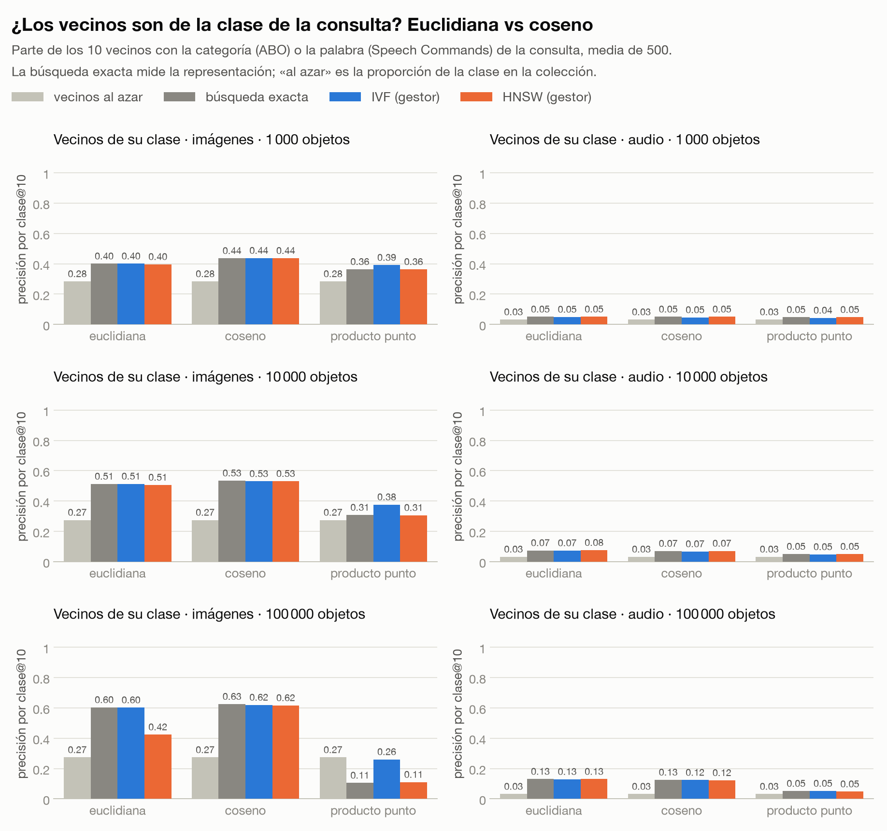

Vecinos de su clase@10 de la **búsqueda exacta**, frente a elegir 10 vecinos al azar:

| Dataset | Objetos | Al azar | Euclidiana | Coseno | Producto punto |
|---|---:|---:|---:|---:|---:|
| Imágenes | 1 000 | 0.28 | 0.40 | **0.44** | 0.36 |
|  | 10 000 | 0.27 | 0.51 | **0.53** | 0.31 |
|  | 100 000 | 0.27 | 0.60 | **0.63** | 0.11 |
| Audio | 1 000 | 0.03 | **0.050** | **0.050** | 0.047 |
|  | 10 000 | 0.03 | **0.074** | 0.070 | 0.050 |
|  | 100 000 | 0.03 | **0.131** | 0.126 | 0.052 |

- **En imágenes el coseno gana en los tres tamaños**, por 0.02 a 0.04. Una foto con pocos
  descriptores tiene un histograma con pocos valores grandes y una norma alta; la
  euclidiana la aleja de todo, el coseno solo mira hacia dónde apunta.
- **En audio, euclidiana y coseno empatan** (0.131 y 0.126 con 100 000): todos los clips duran
  un segundo y dan 101 descriptores, así que sus vectores tienen normas parecidas y las dos
  métricas ordenan casi igual.
- **El producto punto empeora con el tamaño** hasta quedar por **debajo del azar** en
  imágenes (0.11 frente a 0.27): sobre TF-IDF sin normalizar premia la norma, y con más
  objetos aparecen más fotos de norma alta que salen primero para cualquier consulta.
- **El audio es la parte difícil.** Con 100 000 clips, 1.3 de cada 10 vecinos dicen la misma
  palabra, 4 veces el azar pero lejos de las imágenes: la bolsa de palabras pierde el orden de
  los sonidos, y «left» y «right» comparten casi todo.

### Tiempo por consulta

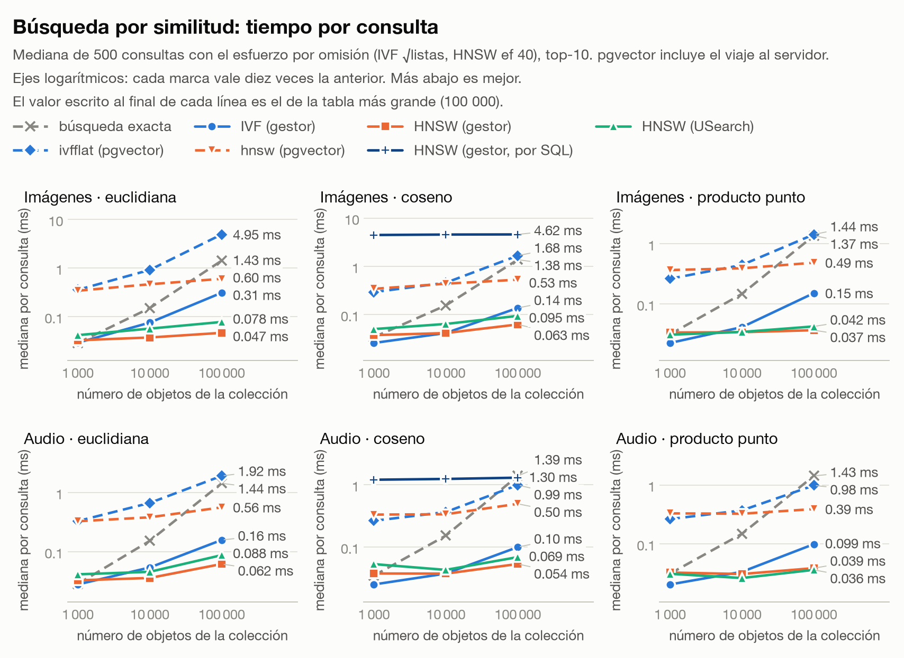

Con 100 000 objetos y el esfuerzo por omisión (IVF 18 de 316 listas, HNSW `ef` 40), en
milisegundos; Recall@10 entre paréntesis:

| Técnica | Imágenes, euclidiana | Imágenes, coseno | Audio, euclidiana | Audio, coseno |
|---|---:|---:|---:|---:|
| búsqueda exacta (gestor) | 1.43 (1.00) | 1.38 (1.00) | 1.44 (1.00) | 1.39 (1.00) |
| IVF (gestor) | 0.31 (0.987) | 0.14 (0.974) | 0.16 (0.983) | 0.10 (0.994) |
| HNSW (gestor) | **0.047** (0.538) | **0.063** (0.927) | **0.062** (0.984) | **0.054** (0.969) |
| HNSW (USearch) | 0.078 (0.892) | 0.095 (0.930) | 0.088 (0.985) | 0.069 (0.958) |
| ivfflat (pgvector) | 4.95 (0.991) | 1.68 (0.969) | 1.92 (0.986) | 0.99 (0.996) |
| hnsw (pgvector) | 0.60 (0.947) | 0.53 (0.953) | 0.56 (0.990) | 0.50 (0.986) |
| HNSW (gestor, SQL) | — | 4.62 (0.935) | — | 1.30 (0.960) |

Y por tamaño, con el coseno (p50 en ms):

| Técnica | Imágenes 1 000 | 10 000 | 100 000 | Audio 1 000 | 10 000 | 100 000 |
|---|---:|---:|---:|---:|---:|---:|
| búsqueda exacta (gestor) | 0.034 | 0.156 | 1.38 | 0.035 | 0.153 | 1.39 |
| IVF (gestor) | **0.026** | **0.042** | 0.14 | **0.025** | **0.038** | 0.10 |
| HNSW (gestor) | 0.038 | **0.042** | **0.063** | 0.038 | **0.038** | **0.054** |
| HNSW (USearch) | 0.050 | 0.064 | 0.095 | 0.053 | 0.043 | 0.069 |
| ivfflat (pgvector) | 0.29 | 0.46 | 1.68 | 0.27 | 0.37 | 0.99 |
| hnsw (pgvector) | 0.34 | 0.44 | 0.53 | 0.33 | 0.34 | 0.50 |

- **La búsqueda exacta crece en proporción** (de 0.034 a 1.38 ms, 41 veces para 100 veces
  más objetos) y **HNSW casi no se mueve** (0.038 a 0.063 ms): con 100 000 objetos es 22
  veces más rápido que la exacta. IVF crece como √N: sondea 5 de 25 listas con 1 000, 10 de
  100 con 10 000 y 18 de 316 con 100 000, y cada lista es más larga.
- **Con 1 000 objetos la exacta compite**: 0.034 ms frente a 0.038 de HNSW, sin perder nada.
- **pgvector paga el viaje**: con `hnsw` y el coseno, 0.53 ms en el cliente y 0.31 ms en el
  servidor. Parte de la diferencia con FAISS es la máquina virtual de Docker.
- **IVF es más lento con la euclidiana** (0.31 frente a 0.14 ms en imágenes, con las mismas 18
  listas): sin normalizar, k-means junta muchos vectores en las listas del centro, y las que
  se sondean son más largas. En `ivfflat` la diferencia es mayor (4.95 frente a 1.68 ms).

### Recall contra latencia

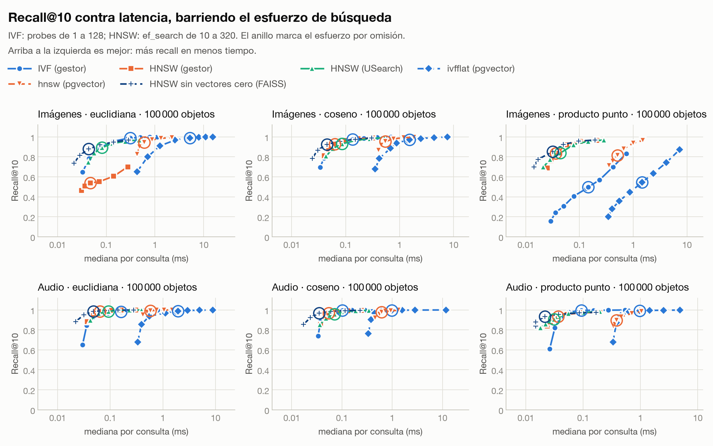

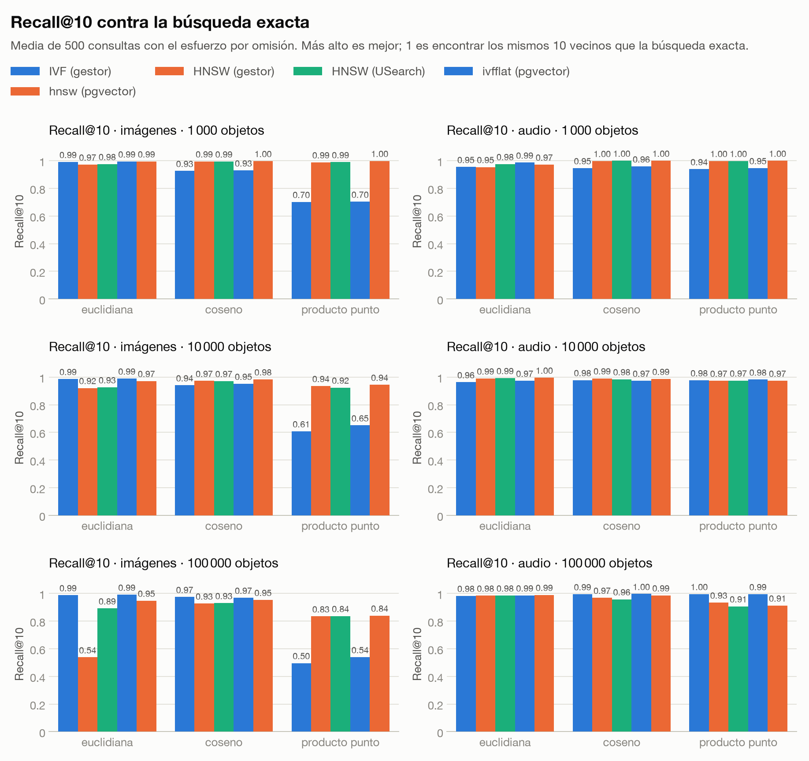

El esfuerzo más chico del barrido que llega a un Recall@10 de 0.95, con 100 000 objetos y el
coseno:

| Técnica | Imágenes: esfuerzo | ms | recall | Audio: esfuerzo | ms | recall |
|---|---:|---:|---:|---:|---:|---:|
| IVF (gestor) | 16 probes | 0.124 | 0.971 | 4 probes | **0.046** | 0.958 |
| HNSW (gestor) | ef 80 | **0.098** | 0.963 | ef 40 | 0.054 | 0.969 |
| HNSW (USearch) | ef 80 | 0.147 | 0.963 | ef 40 | 0.069 | 0.958 |
| ivfflat (pgvector) | 16 probes | 1.53 | 0.963 | 4 probes | 0.454 | 0.972 |
| hnsw (pgvector) | ef 40 | 0.532 | 0.953 | ef 20 | 0.422 | 0.961 |

- **HNSW gana en imágenes y IVF en audio.** En imágenes, IVF necesita 16 listas para 0.95 y
  HNSW llega con `ef` 80 en menos tiempo; en audio basta sondear 4 de 316 listas, porque los
  clips se agrupan bien. Por eso no hay un ganador único: depende de cómo se reparten los
  vectores.
- **Con el esfuerzo por omisión HNSW queda corto con 100 000 imágenes** (0.927 con el coseno):
  `ef` 40 alcanza con 1 000 objetos (0.995) y no con 100 000. Subirlo a 80 cuesta 0.035 ms y
  llega a 0.963.
- **FAISS y USearch hacen el mismo grafo:** a igual `ef`, su recall casi coincide (0.927 y
  0.930), y FAISS responde en la mitad del tiempo (0.043 frente a 0.095 ms).
- **pgvector necesita menos `ef` para el mismo recall** (0.953 con `ef` 40, donde FAISS da
  0.927), pero cada consulta cuesta 0.5 ms por lo menos.

#### Un caso aparte: HNSW, la euclidiana y los vectores cero

Con la euclidiana y 100 000 imágenes, **el HNSW de FAISS se queda en un Recall@10 de 0.538**
con `ef` 40, y ni con `ef` 320 pasa de 0.70; USearch, con el mismo grafo, llega a 0.892 y
pgvector a 0.947. La causa son **294 fotos de las que SIFT no saca ningún descriptor**: su
vector es el cero, los 294 son idénticos, y en la euclidiana el origen está cerca de todo.
El experimento mide el mismo HNSW sin esos vectores (`HNSW (FAISS, sin vectores cero)`):

| `ef_search` | 10 | 20 | 40 | 80 | 160 | 320 |
|---|---:|---:|---:|---:|---:|---:|
| HNSW con los vectores cero | 0.462 | 0.507 | 0.538 | 0.552 | 0.605 | 0.700 |
| HNSW sin los vectores cero | 0.737 | 0.816 | **0.878** | 0.919 | 0.949 | 0.968 |
| HNSW (USearch), con ellos | 0.746 | 0.838 | 0.892 | 0.934 | 0.956 | 0.969 |

Quitarlos devuelve a FAISS a la altura de USearch. En el audio no hay ningún vector cero y
en el coseno el cero queda lejos de todo (su coseno es 0), así que ahí no cambia nada. El
gestor guarda hoy los vectores cero en su HNSW: con la euclidiana conviene dejarlos fuera del
grafo y responderlos con la búsqueda exacta, que es lo que pierde menos.

### De archivos a vectores: lo que cuesta cada etapa

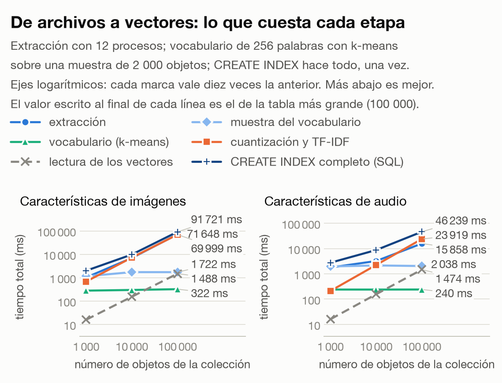

En segundos:

| Etapa | Imágenes 1 000 | 10 000 | 100 000 | Audio 1 000 | 10 000 | 100 000 |
|---|---:|---:|---:|---:|---:|---:|
| extracción (12 procesos) | 1.02 | 6.94 | 71.7 | 1.78 | 3.21 | 15.9 |
| muestra del vocabulario | 1.15 | 1.73 | 1.72 | 1.96 | 2.15 | 2.04 |
| vocabulario (k-means) | 0.28 | 0.30 | 0.32 | 0.24 | 0.24 | 0.24 |
| cuantización y TF-IDF (1 hilo) | 0.68 | 7.26 | 70.0 | 0.21 | 2.24 | 23.9 |
| lectura de los vectores | 0.01 | 0.15 | 1.50 | 0.01 | 0.16 | 1.50 |
| `CREATE INDEX ... USING HNSW` completo | 1.9 | 9.7 | 90.6 | 2.7 | 8.1 | 45.2 |
| `CREATE INDEX ... USING IVF` completo | 1.8 | 9.7 | 85.4 | 2.4 | 7.6 | 40.1 |

- **Construir el índice es lo de menos.** Con 100 000 fotos, `CREATE INDEX` tarda 90.6 s, y el
  HNSW sobre los vectores ya calculados, 5.4 s: el 94 % es extraer y cuantizar.
- **Cuantizar cuesta tanto como extraer**: 16.9 millones de descriptores SIFT contra 256
  palabras son 16.9 millones de búsquedas del centroide más cercano, y aquí FAISS corre con un
  hilo mientras la extracción usa 12 procesos. Es el primer lugar donde mirar al optimizar.
- **El vocabulario no crece con la colección**: la muestra son siempre 2 000 objetos y 65 536
  descriptores, y k-means tarda 0.3 s en los tres tamaños.
- **La consulta**: extraer una foto cuesta 3.97 ms y llevarla a vector 0.27 ms; un clip, 1.18
  y 0.09 ms.

### Construcción, memoria y disco de los índices

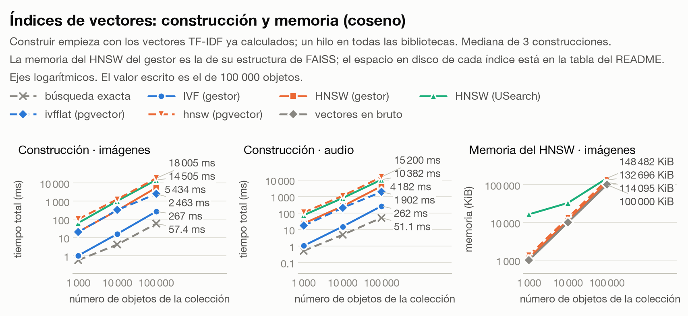

Con 100 000 objetos y el coseno; construcción en segundos, el resto en MiB:

| Técnica | Construir imágenes | Construir audio | Memoria | Disco | Python del gestor |
|---|---:|---:|---:|---:|---:|
| búsqueda exacta (gestor) | **0.057** | **0.051** | — | 98.4 | 7.0 |
| IVF (gestor) | 0.27 | 0.26 | — | 100.3 | 7.0 |
| IVF (FAISS directo) | 0.25 | 0.25 | 98.7 | — | — |
| HNSW (gestor) | 5.43 | 4.18 | — | 112.3 | 11.9 |
| HNSW (FAISS directo) | 5.39 | 4.23 | 111.4 | — | — |
| HNSW (USearch) | 14.5 | 10.4 | 145.0 | 111.8 | — |
| ivfflat (pgvector) | 2.46 | 1.90 | 112.7 | 112.7 | — |
| hnsw (pgvector) | 18.0 | 15.2 | 129.6 | 129.6 | — |

Como referencia, los 100 000 vectores de 256 `float32` ocupan 97.7 MiB, el almacén de
características del gestor (heap y hash de la Parte 1) 132.3 MiB y la tabla de pgvector 111.9
MiB.

- **IVF construye 20 veces más rápido que HNSW** (0.27 frente a 5.43 s): entrena k-means con
  316 centroides y reparte; HNSW inserta cada vector buscando sus vecinos en el grafo.
- **HNSW de FAISS es el más rápido de los tres HNSW**: 5.4 s, frente a 14.5 s de USearch y
  18.0 s de pgvector, todos con un hilo y el mismo `M` y `ef_construction`.
- **El grafo cuesta un 14 % sobre los vectores** (111.4 frente a 97.7 MiB en FAISS): `M` 16
  son 32 vecinos de 4 bytes por nodo en el nivel 0. IVF solo añade los centroides y los
  identificadores (98.7 MiB). USearch reporta 145 MiB porque reserva capacidad por adelantado:
  en disco ocupa 111.8.
- **La capa del gestor retiene 7 a 12 MiB de Python** para 100 000 filas: el conjunto de
  identificadores vivos y, en HNSW, la fila de cada nodo.

### Cuánto cuesta cada capa del gestor

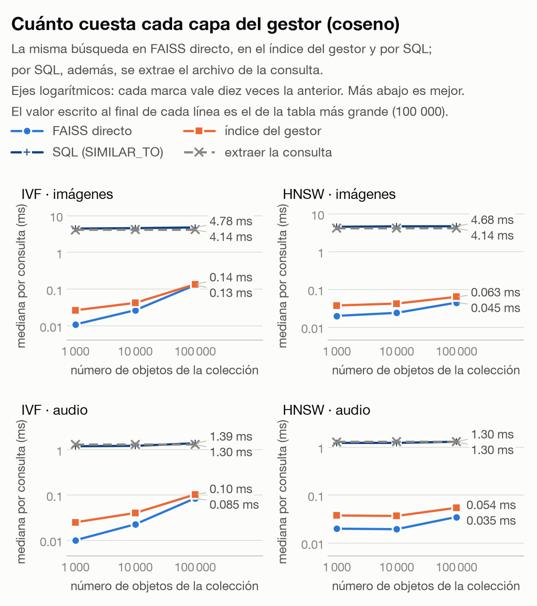

Con 100 000 objetos y el coseno, mediana en ms:

| Capa | IVF imágenes | HNSW imágenes | IVF audio | HNSW audio |
|---|---:|---:|---:|---:|
| FAISS directo | 0.124 | 0.043 | 0.085 | 0.034 |
| índice del gestor (`VectorIndex.search`) | 0.138 | 0.063 | 0.100 | 0.054 |
| extraer la consulta y llevarla a vector | 4.23 | 4.23 | 1.28 | 1.28 |
| `SIMILAR_TO` por SQL, todo incluido | 4.85 | 4.62 | 1.44 | 1.30 |

- **La capa del índice suma 0.015 a 0.020 ms** por consulta: validar y normalizar la consulta,
  y convertir los resultados en filas.
- **Por SQL, el IVF no es el mismo.** `CREATE INDEX` llena el índice de vectores desde el
  almacén en lotes de 4 096 filas, y `IVFIndex` entrena sus listas con el primero: con 10 000
  clips queda con 64 listas y 8 `probes` en vez de 100 y 10 (comprobado con su `describe`).
  Por eso su Recall@10 con 100 000 imágenes es 0.965 y no 0.974, y su consulta, 4.85 ms
  frente a 4.62 del HNSW. El HNSW por SQL inserta los mismos vectores por lotes y su grafo
  sale algo distinto (0.935 frente a 0.927). Arreglarlo es cosa del gestor, no del experimento.
- **Por SQL, el 92 % del tiempo es extraer la consulta.** Con una foto, `SIMILAR_TO` tarda
  4.62 ms, y extraerla y llevarla a vector, 4.23: analizar el SQL, planificar, buscar y leer
  las 10 filas cabe en lo que queda, unos 0.3 ms. Con un clip, extraerlo cuesta 1.28 ms de
  los 1.30, y el resto se pierde en lo que varía la medida.

### Galería de aciertos y errores

El HNSW del gestor con el coseno y 100 000 objetos: arriba, las consultas con más vecinos de
su clase (cada una de una clase distinta); abajo, las que menos. En imágenes, en promedio el
62 % de los 10 vecinos es de la categoría de la consulta; en audio, el 12 %.


Los aciertos son casi duplicados: la misma funda para otros modelos de celular, la misma
cortina en otro color, soportes de televisor fotografiados igual. Algunos errores lo son solo
para la etiqueta: unos marcadores clasificados como «safety supply» encuentran marcadores
(«marking pen»). Otros son formas parecidas sin relación: una pieza didáctica circular
encuentra sillas de oficina, y una bandeja de cocina, muebles con rejillas.

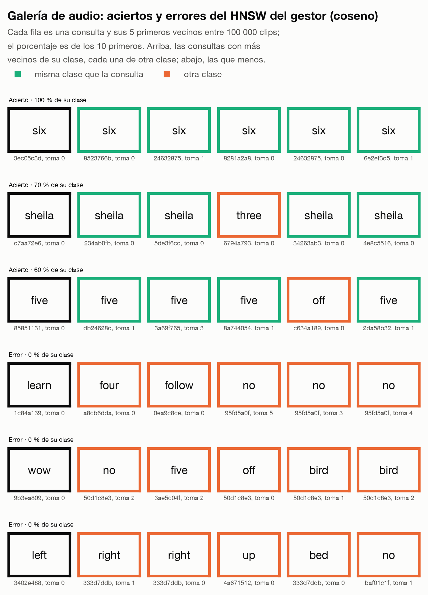

En audio los errores son de sonido: «left» encuentra «right», «learn» encuentra «four» y
«follow». La bolsa de palabras auditivas sabe qué sonidos hay, no en qué orden.

### Conclusiones

**IVF contra HNSW.** HNSW es el más rápido por consulta y el que menos crece: con 100 000
objetos responde en 0.054 a 0.063 ms, 22 a 26 veces antes que la búsqueda exacta. Pero su
recall cae con el tamaño a `ef` fijo (0.995, 0.972 y 0.927 en imágenes con el coseno) y
construir le cuesta 20 veces lo que a IVF. IVF, con sus √listas, sube de recall con el tamaño
(0.926, 0.940 y 0.974) y es el más preciso por omisión, a cambio de unas consultas el doble de
lentas (0.14 ms). En audio, donde los clips se agrupan bien, IVF con 4 listas ya da 0.958 en
0.046 ms y gana la curva.

**Euclidiana contra coseno.** El coseno es la métrica para estos vectores: da vecinos más
parecidos en imágenes (0.63 frente a 0.60 de su clase con 100 000), empata en audio, hace
más rápido a IVF (0.14 frente a 0.31 ms) y evita el problema del vector cero en el grafo de
FAISS. El producto punto sobre TF-IDF sin normalizar no sirve: queda por debajo del azar en
imágenes.

**Las bibliotecas.** Con los mismos parámetros, FAISS y USearch construyen grafos de calidad
parecida; FAISS construye 2.7 veces más rápido y responde en la mitad del tiempo. pgvector
encuentra un poco más con el mismo `ef` y es la opción si los datos ya viven en PostgreSQL,
pero cada consulta cuesta al menos 0.5 ms desde el cliente y construir su HNSW, 3.3 veces lo
de FAISS.

**El gestor.** Su capa suma unos 0.02 ms por consulta sobre FAISS, y por SQL lo que domina
es extraer el archivo de la consulta: 4 ms de los 4.6 de una foto. Al construir, el 94 % es
extraer y cuantizar, no el índice.

### Tabla comparativa y recomendaciones

| | Búsqueda exacta | IVF (gestor) | HNSW (gestor) | HNSW (USearch) | pgvector |
|---|---|---|---|---|---|
| **Consulta, 100 000 (coseno)** | 1.38 ms | 0.14 ms | 0.063 ms | 0.095 ms | `hnsw` 0.53 ms, `ivfflat` 1.68 ms |
| **Recall@10 por omisión** | 1 | 0.974 imágenes, 0.994 audio | 0.927 imágenes, 0.969 audio | 0.930, 0.958 | `hnsw` 0.953, 0.986 |
| **Construir 100 000** | 0.06 s | 0.27 s | 5.4 s | 14.5 s | `hnsw` 18.0 s, `ivfflat` 2.5 s |
| **Memoria sobre los vectores** | ninguna | +1 % | +14 % | +14 % en disco | `hnsw` +33 % |
| **Ventajas** | Exacta, sin parámetros, sin construir | Construye en segundos; recall alto y que sube con el tamaño; borra de verdad | La consulta más rápida y la que menos crece | Mismo grafo que FAISS, embebible (DuckDB) | Transaccional y junto a los datos; más recall con el mismo `ef` |
| **Desventajas** | Crece en proporción: 41 veces de 1 000 a 100 000 | Más lento con la euclidiana; el recall depende de cómo se reparten los vectores | Construir es caro; recall cae con el tamaño a `ef` fijo; el vector cero rompe el grafo en la euclidiana | 2.7 veces más lento al construir que FAISS | Medio milisegundo de viaje; `ivfflat` lento con la euclidiana (4.95 ms) |
| **Se elige cuando** | Hasta unos 10 000 objetos, o con un filtro que deja pocas filas | La colección cambia mucho o se reconstruye seguido; se pide recall alto | Colecciones grandes y estables, con `ef` 80 en vez de 40 | Se quiere un HNSW sin FAISS | Los vectores ya están en PostgreSQL |

**Recomendaciones para el gestor**, que salen de estas cifras: usar el **coseno** por
omisión (ya lo es); subir `ef_search` por omisión a 80 con colecciones de 100 000 (0.963 en
0.098 ms); **no meter los vectores cero en el HNSW** y responderlos con la búsqueda exacta;
cuantizar con todos los hilos de FAISS, que es la mitad de `CREATE INDEX`; y que
`CREATE INDEX ... USING IVF` entrene sus listas con todos los vectores y no con el primer lote.

**Lo que este experimento no dice.**

- Los tiempos son de un hilo. Con varios, FAISS reparte la cuantización y la construcción del
  HNSW, y pgvector construye en paralelo; aquí no se midió.
- pgvector corrió en Docker y las demás técnicas fuera: su tiempo en el servidor está en el
  JSON, pero ni ese número está libre de la máquina virtual.
- Un vocabulario de 256 palabras es chico: más palabras separarían mejor las clases, sobre
  todo en audio, a cambio de vectores más largos. Este experimento lo deja fijo.
- La regla de las listas es la de FAISS (√N). pgvector recomienda filas / 1 000 (100 con
  100 000) y un `probes` de √listas; aquí `ivfflat` usa las mismas 316 listas que el gestor
  para comparar la misma estructura.
- El producto punto no es una distancia: un HNSW construido con él no tiene las garantías del
  grafo, y su recall (0.834 en imágenes) lo refleja.

### Reproducirlo

```bash
.venv/bin/pip install -e ".[postgres,plots,usearch]"
.venv/bin/python -m benchmarks.multimedia.abo --salida data/datasets/abo
.venv/bin/python -m benchmarks.multimedia.speech_commands --salida data/datasets/speech_commands

# PostgreSQL con pgvector, de la imagen del perfil bench, solo mientras se mide
docker compose --profile bench build postgres
docker run --rm -d --name minigestor-pgvector -p 127.0.0.1:55432:5432 \
    -e POSTGRES_HOST_AUTH_METHOD=trust -e POSTGRES_DB=minigestor_bench \
    minigestor-postgres -c shared_buffers=1GB
export BENCH_POSTGRES_DSN="host=127.0.0.1 port=55432 dbname=minigestor_bench user=postgres"

.venv/bin/python -m benchmarks.multimedia_benchmark --images data/datasets/abo \
    --audio data/datasets/speech_commands --sizes 1000 10000 100000 \
    --repetitions 3 --build-repetitions 3 --postgres-maintenance-work-mem 1GB \
    --features-dir data/bench-multimedia
docker stop minigestor-pgvector
```

Tarda unos 30 minutos: 9 en extraer y cuantizar (dos pasadas por colección, una solo para
medir la extracción), 6 en los `CREATE INDEX` por SQL y el resto en construir cada índice 3
veces y barrer los esfuerzos. Con `--features-dir`, las características quedan en
`data/` (unos 300 MB) y la siguiente ejecución las reutiliza: el JSON lo anota
(`reutilizadas`). Sin `BENCH_POSTGRES_DSN` se omite pgvector, y sin `usearch` instalado, USearch.
Todo corre también dentro del perfil `bench` de Docker, más lento.

## Gráficas

`plot.py` lee los JSON de `results/` y redibuja todas las imágenes de `figures/`:

```bash
.venv/bin/pip install -e ".[plots]"
.venv/bin/python -m benchmarks.plot
```

Qué se dibuja está declarado en `FIGURES`, al principio del módulo: una figura por
comparación y un panel por operación. Los colores son tres tonos comprobados para que se
distingan también con daltonismo, y cada técnica lleva además su propio marcador (círculo,
cuadrado, triángulo), así que las gráficas se leen igual impresas en gris. Los valores de
todas las gráficas están en las tablas de este documento.

## Reproducibilidad

Misma semilla ⇒ mismos datos ⇒ resultados comparables entre ejecuciones. Los benchmarks
trabajan sobre un directorio temporal que se borra al terminar, así que no ensucian los
datos del gestor. Los JSON de `results/` y las imágenes de `figures/` se versionan junto al
código: son las cifras y las gráficas que cita este documento.
