# Comparación experimental

Todo lo que se reporta se **mide**. Cada script recibe sus parámetros por línea de comandos
—ningún tamaño ni número de repeticiones está escrito dentro del código—, imprime una tabla
Markdown y guarda los resultados crudos en [`results/`](results/). De esos JSON salen las
gráficas de [`figures/`](figures/) y todas las tablas de este documento.

```bash
.venv/bin/python -m benchmarks.storage_benchmark --sizes 1000 10000 100000 --queries 100
.venv/bin/python -m benchmarks.index_benchmark   --sizes 1000 10000 100000 --queries 100
.venv/bin/python -m benchmarks.spatial_benchmark --sizes 1000 10000 100000 --queries 100 \
    --points-file data/datasets/lugares_peru.csv
.venv/bin/python -m benchmarks.text_analyzer_benchmark --repetitions 5 \
    --input Proyecto_Integrador_BD2.md docs/latex/informe/*.tex
.venv/bin/python -m benchmarks.text_benchmark --corpus data/datasets/esci_es \
    --sizes 1000 10000 100000 --repetitions 5
.venv/bin/python -m benchmarks.multimedia_benchmark --images data/datasets/abo \
    --audio data/datasets/speech_commands --sizes 1000 10000 100000 --repetitions 3
.venv/bin/python -m benchmarks.vector_benchmark --sizes 1000 10000 100000
.venv/bin/python -m benchmarks.faces_benchmark --lfw data/datasets/lfw/lfw \
    --models data/models/faces --sides 500 1000 2000 4000 --sample 500 --threads 1
.venv/bin/python -m benchmarks.segments_benchmark --tracks-directory data/datasets/fma_small/pistas
.venv/bin/python -m benchmarks.ingest_benchmark --sizes 1000 10000 50000
.venv/bin/python -m benchmarks.shop_seed_benchmark --data-dir data/datasets \
    --models data/models/shop --engine-data-dir data/tienda-gestor
.venv/bin/python -m benchmarks.faces_service_benchmark --lfw data/datasets/lfw/lfw \
    --models data/models/faces --people 1000 --checkpoints 100 250 500 1000 --queries 200 \
    --thresholds 0.363 0.4 0.45 0.5 0.55
.venv/bin/python -m benchmarks.copyright_catalog_benchmark --data-dir data/datasets \
    --sizes 1000 2000 4000 8000 --threads 8
.venv/bin/python -m benchmarks.faces_stream_benchmark --api-url http://127.0.0.1:<web>/api \
    --target nginx=ws://127.0.0.1:<web>/api/ws/recognize \
    --target directo=ws://127.0.0.1:<api>/ws/recognize --frames 300 --warmup 20 --fps 10
.venv/bin/python -m benchmarks.faces_evaluation_benchmark --lfw data/datasets/lfw \
    --models data/models/faces --fars 0.01 0.001 0.0001 0.00001 \
    --thresholds 0.363 0.45 0.47 0.5 --gallery-size 1000 --target-fpir 0.01
.venv/bin/python -m benchmarks.faces_cache_benchmark --api-url http://127.0.0.1:<web>/api \
    --url ws://127.0.0.1:<web>/api/ws/recognize --speeds 0 16 32 40 48 56 64 96 \
    --frames 200 --warmup 20 --fps 10
.venv/bin/python -m benchmarks.copyright_evaluation_benchmark \
    --engine-dir data/copyright-engine --data-dir data/datasets
.venv/bin/python -m benchmarks.plot              # redibuja todas las gráficas
```

Los datasets reales se descargan aparte, con un comando cada uno: los lugares de
OpenStreetMap ([`demos/`](../demos/README.md)), el corpus ESCI ([`esci/`](esci/README.md))
y las imágenes y el audio de la Parte 4 ([`multimedia/`](multimedia/README.md)).

### Con Docker

Los mismos comandos corren sin instalar Python ni PostgreSQL, en el perfil `bench` de
[`compose.yaml`](../compose.yaml):

- **`postgres`** es PostgreSQL 17 con PostGIS y pgvector ([`deploy/postgres/Dockerfile`](../deploy/postgres/Dockerfile)),
  para `linux/amd64` y `linux/arm64`. No publica ningún puerto.
- **`bench`** es la imagen del motor con los extras `postgres`, `plots`, `datasets` y `usearch`, y con
  `BENCH_POSTGRES_DSN` apuntando a `postgres`. Monta `benchmarks/` y `data/datasets/` desde
  el repositorio, así que los JSON, las gráficas y los datos descargados quedan en su sitio.

```bash
docker compose --profile bench run --rm bench python -m demos.descargar_lugares \
    --salida data/datasets/lugares_peru.csv
docker compose --profile bench run --rm bench python -m benchmarks.esci.download \
    --salida data/datasets/esci_es
docker compose --profile bench run --rm bench python -m benchmarks.esci.subsets \
    --corpus data/datasets/esci_es --sizes 1000 10000 100000 \
    --queries-per-bucket 50 --max-judged-share 0.5 --seed 20261104
docker compose --profile bench run --rm bench python -m benchmarks.multimedia.abo \
    --salida data/datasets/abo
docker compose --profile bench run --rm bench python -m benchmarks.multimedia.speech_commands \
    --salida data/datasets/speech_commands

docker compose --profile bench run --rm bench python -m benchmarks.spatial_benchmark \
    --sizes 1000 10000 100000 --queries 100 --points-file data/datasets/lugares_peru.csv
docker compose --profile bench run --rm bench python -m benchmarks.text_benchmark \
    --corpus data/datasets/esci_es --sizes 1000 10000 100000 --repetitions 5
docker compose --profile bench run --rm bench python -m benchmarks.multimedia_benchmark \
    --images data/datasets/abo --audio data/datasets/speech_commands --sizes 1000 10000 100000
docker compose --profile bench run --rm bench python -m benchmarks.plot

docker compose --profile bench down       # apaga PostgreSQL
```

- **Las cifras publicadas se midieron fuera de Docker**, con PostgreSQL 17.10 instalado en el
  equipo. El contenedor usa la configuración por omisión de PostgreSQL, igual que esa
  instalación: `shared_buffers` 128 MB, `work_mem` 4 MB y `maintenance_work_mem` 64 MB.
  **Salvo pgvector:** la instalación local no lo trae, así que el experimento multimedia
  corrió el gestor fuera de Docker y PostgreSQL con pgvector en el contenedor de la imagen
  `postgres` del perfil, con un puerto publicado solo para la medida (ver
  [5. Reproducirlo](#reproducirlo-2)).
- **Los tiempos dentro de Docker no se comparan con los publicados:** en macOS y Windows, el
  contenedor corre en una máquina virtual. El JSON guarda la versión del servidor
  (`postgres_server_version`), para saber de dónde salió cada medida.
- **En Linux,** conviene agregar `--user "$(id -u):$(id -g)"` a `run`, para que los archivos
  que escribe el contenedor en `benchmarks/` y `data/` queden a nombre del usuario.
- **Si los datos están en otra carpeta,** `MINIGESTOR_DATASETS_DIR` cambia la que se monta
  como `data/datasets/`.

| Argumento | Qué controla |
|---|---|
| `--sizes` | tamaños del conjunto de datos |
| `--queries` | consultas o borrados por medida |
| `--seed` | semilla del generador; misma semilla, mismos datos |
| `--page-size` | tamaño de página del motor (almacenamiento e índices) |
| `--radii-km`, `--neighbours` | radios y valores de `k` del experimento espacial |
| `--points-file` | CSV con una columna `POINT` del que tomar puntos reales (experimento espacial) |
| `--postgres-dsn` | conexión al PostgreSQL contra el que se mide GiST o GIN |
| `--corpus` | carpeta del corpus ESCI con sus subconjuntos (experimento de texto) |
| `--k`, `--k1`, `--b` | el `k` del top-k, de Precision@k y de Recall@k, y los parámetros de BM25 |
| `--postgres-configuration`, `--ts-rank-normalization` | diccionario de PostgreSQL y normalización de `ts_rank_cd` |
| `--input`, `--repetitions`, `--language` | textos, pasadas calientes e idioma de la medida del analizador de texto ([resultado](../src/text/README.md#velocidad-medida)); `--repetitions` y `--language` también en el de texto |
| `--queries` | en el experimento de texto, consultas por cubeta (por omisión, todas las del subconjunto) |
| `--images`, `--audio` | carpetas de ABO y de Speech Commands (experimento multimedia) |
| `--metrics`, `--ivf-probes`, `--ef-search` | métricas y esfuerzos que barre el experimento multimedia |
| `--threads`, `--workers` | hilos de FAISS, USearch y pgvector, y procesos que extraen las características |
| `--hnsw-m`, `--hnsw-ef-construction`, `--hnsw-ef-search`, `--vocabulary` | parámetros de HNSW y palabras del vocabulario |
| `--sql-sizes`, `--sql-metrics` | tamaños y métricas en que el gestor se mide por SQL de punta a punta |
| `--gallery-metric`, `--gallery-cases`, `--gallery-neighbours` | qué galería se arma |
| `--build-repetitions` | construcciones de cada índice (texto y multimedia) |
| `--postgres-maintenance-work-mem` | memoria con la que pgvector construye sus índices |
| `--features-dir` | guarda las características y las reutiliza en la siguiente ejecución |
| `--data-dir`, `--models`, `--engine-data-dir`, `--embeddings-dir` | carpeta de datasets, de CLIP, del gestor y de la caché de embeddings (carga de la tienda) |
| `--clip-batch-size`, `--preprocess-workers` | fotos por pasada de CLIP e hilos que las preparan |
| `--fars`, `--gallery-size`, `--target-fpir`, `--embeddings-cache` | FAR a los que se busca el TAR, galería y tasa de desconocidos aceptados con que se calibra el umbral de reconocer, y dónde guardar los embeddings de LFW (rostros en LFW) |
| `--speeds`, `--fps` | velocidades del rostro y cuadros por segundo de la caché de rastros |
| `--output` | dónde dejar el JSON |

| Experimento | Qué compara | Gráficas |
|---|---|---|
| [1. Gestión de archivos](#1-gestión-de-archivos--heap-vs-secuencial) | heap file vs archivo secuencial | [almacenamiento](figures/almacenamiento.png) |
| [2. Indexación](#2-indexación--b-agrupado-vs-b-no-agrupado-vs-hash-extendible) | B+ agrupado vs B+ no agrupado vs hash extendible | [índices](figures/indices.png) |
| [3. Datos espaciales](#3-datos-espaciales--búsqueda-secuencial-vs-r-tree-vs-gist) | búsqueda secuencial vs R-Tree vs GiST de PostgreSQL | [radio](figures/espacial-radio.png), [k-NN](figures/espacial-knn.png), [índice](figures/espacial-indice.png), [nodos](figures/espacial-nodos.png) |
| [4. Búsqueda de texto](#4-búsqueda-de-texto--tf-idf--coseno-vs-bm25-vs-gin) | TF-IDF + coseno vs BM25 vs GIN de PostgreSQL | [consultas](figures/texto-consultas.png), [relevancia](figures/texto-relevancia.png), [índice](figures/texto-indice.png) |
| [5. Búsqueda por similitud](#5-búsqueda-por-similitud--ivf-vs-hnsw-y-euclidiana-vs-coseno) | IVF vs HNSW y euclidiana vs coseno, con FAISS, USearch y pgvector | [consultas](figures/multimedia-consulta.png), [curvas](figures/multimedia-curvas.png), [recall](figures/multimedia-recall.png), [clase](figures/multimedia-categoria.png), [características](figures/multimedia-caracteristicas.png), [índice](figures/multimedia-indice.png), [capas](figures/multimedia-capas.png), galerías de [imágenes](figures/multimedia-galeria-imagenes.png) y [audio](figures/multimedia-galeria-audio.png) |
| [6. Columnas `VECTOR(n)`](#6-columnas-vectorn--hnsw-e-ivf-por-sql) | HNSW vs IVF vs búsqueda exacta por SQL sobre 100 000 vectores de 384 dimensiones | [SQL](figures/vectores-sql.png), [recall](figures/vectores-recall.png), [curvas](figures/vectores-curvas.png) |
| [7. Reconocimiento facial](#7-reconocimiento-facial--latencia-del-pipeline-y-cobertura-en-lfw) | decodificar, detectar (YuNet) y embeber (SFace) según el tamaño de la foto; cobertura del detector en LFW | [latencia](figures/rostros-latencia.png) |
| [8. Tramos de audio](#8-tramos-de-audio-y-consulta-por-segmentos) | consulta por segmentos con una decodificación vs un `SIMILAR_TO` por ventana; índice de tramos vs pistas enteras | [consulta](figures/segmentos-consulta.png), [índice](figures/segmentos-indice.png) |
| [9. Carga masiva](#9-carga-masiva--ndjson-contra-insert-con-parámetros-por-http) | NDJSON vs `INSERT` con parámetros por HTTP; cuándo construir un índice | [ingesta](figures/ingesta.png) |
| [10. Carga de la tienda](#10-carga-de-la-tienda--el-catálogo-entero-con-sift-y-clip) | tiempo de cada tabla e índice, SIFT vs CLIP, y espacio del catálogo de Amazon en el gestor | [carga](figures/tienda-carga.png) |
| [11. Servicio de rostros](#11-servicio-de-rostros--registro-reconocimiento-y-conjunto-abierto) | registrar una toma y reconocer por el API según el tamaño de la galería; umbrales de coseno 1:N y duplicados falsos con LFW | [reconocer](figures/rostros-servicio-reconocer.png), [conjunto abierto](figures/rostros-servicio-conjunto-abierto.png) |
| [12. Catálogo de copyright](#12-catálogo-de-copyright--descargar-cargar-e-indexar-fma-por-tramos) | descargar fma_small por rangos, cargar 83 290 tramos por NDJSON y construir su HNSW, según el tamaño del catálogo; disco del gestor | [catálogo](figures/copyright-catalogo.png) |
| [13. Ingesta del RAG](#13-ingesta-del-rag--embeddings-e5-en-onnx-y-carga-con-bm25-y-hnsw) | multilingual-e5-small fp32 vs int8 en ONNX por hilos; siembra de 98 585 fragmentos y cada etapa de la carga (NDJSON, índice invertido, HNSW) | [embeddings](figures/rag-embeddings.png), [carga](figures/rag-ingesta.png) |
| [14. Detección de copyright](#14-detección-de-copyright--latencia-de-post-detections-y-casos-de-control) | latencia de `POST /detections` por duración de la subida y sus etapas; puntajes de copias enteras, tramos de 15 y 7,5 s y pistas no catalogadas frente al umbral | [latencia](figures/copyright-deteccion.png), [etapas](figures/copyright-deteccion-etapas.png), [puntajes](figures/copyright-deteccion-puntajes.png) |
| [15. Rostros en vivo](#15-rostros-en-vivo--latencia-por-cuadro-por-websocket) | un cuadro de punta a punta por WebSocket, por el nginx o directo a la API, con y sin la caché de rastros en Redis, con cada etapa | [en vivo](figures/rostros-tiempo-real.png) |
| [16. Recomendaciones de la tienda](#16-recomendaciones-de-la-tienda--cuatro-señales-y-caché) | compras conjuntas al vuelo vs materializadas; latencia p50/p95 de cada señal y de la recomendación con caché fría y caliente | [recomendaciones](figures/tienda-recomendaciones.png) |
| [16. Evaluación de la detección de copyright](#16-evaluación-de-la-detección-de-copyright--remixes-con-la-verdad-conocida) | precisión, recall, F1, curva ROC e IoU de la detección sobre 400 remixes generados con la verdad conocida, sin distorsión y con ruido, MP3, pasa bajos, volumen, tempo y tono; umbral elegido, recall por largo del fragmento y otras definiciones del puntaje | [ROC](figures/copyright-evaluacion-roc.png), [detección](figures/copyright-evaluacion-deteccion.png), [IoU](figures/copyright-evaluacion-iou.png), [largo](figures/copyright-evaluacion-largo.png) |
| [18. Rostros en LFW](#18-rostros-en-lfw--verificación-identificación-latencia-y-caché) | verificación con el protocolo de LFW (exactitud por pliegues, TAR a FAR fijo, ROC) y umbrales calibrados; identificación en el gestor, HNSW vs búsqueda exacta; p99 de cada etapa; aciertos de la caché de rastros según la velocidad del rostro | [verificación](figures/rostros-evaluacion-verificacion.png), [identificación](figures/rostros-evaluacion-identificacion.png), [latencia](figures/rostros-evaluacion-latencia.png), [caché](figures/rostros-cache.png) |
| [19. Evaluación del RAG](#19-evaluación-del-rag--recuperación-de-preguntas-en-español-y-respuestas-con-claude) | Recall@5, Recall@10 y MRR de BM25, vectorial e híbrido con 45 preguntas en español de fragmentos conocidos, por categoría y criterio de acierto; respuestas simuladas para probar el camino (la calidad con Claude, pendiente de la clave) | [recuperación](figures/rag-evaluacion-recuperacion.png), [criterio](figures/rag-evaluacion-relevancia.png) |

**Cómo leer las gráficas.** Cada una es una fila de paneles, uno por operación, con el
número de filas en horizontal y una línea por técnica. Los dos ejes son logarítmicos: los
tamaños van de 1 000 a 100 000 y los tiempos cubren cuatro órdenes de magnitud, así que en
escala lineal solo se vería la técnica más lenta. En un eje logarítmico **la pendiente dice
cómo escala** la técnica: una línea plana no depende del tamaño y una a 45° crece en
proporción a él. El número junto al último punto es el valor con 100 000 filas. La
precisión y el recall, que son fracciones de 0 a 1, van en barras sobre un eje lineal.

## 1. Gestión de archivos — heap vs secuencial

`storage_benchmark.py` mide inserción, búsqueda y borrado por clave primaria, espacio en
disco y reorganización. Cada búsqueda y cada borrado es una operación aparte, como la de
un `WHERE id = k`: el heap, sin índice, recorre el archivo hasta dar con la clave. La
reorganización no se fuerza: se sigue borrando hasta que el desperdicio pasa del umbral
del 30 % y se mide el borrado que la dispara.

### Resultados medidos

Ejecución con `--sizes 1000 10000 100000 --queries 100`, páginas de 4 KB
(macOS, Python 3.12). Las búsquedas y los borrados son el total de 100 operaciones.

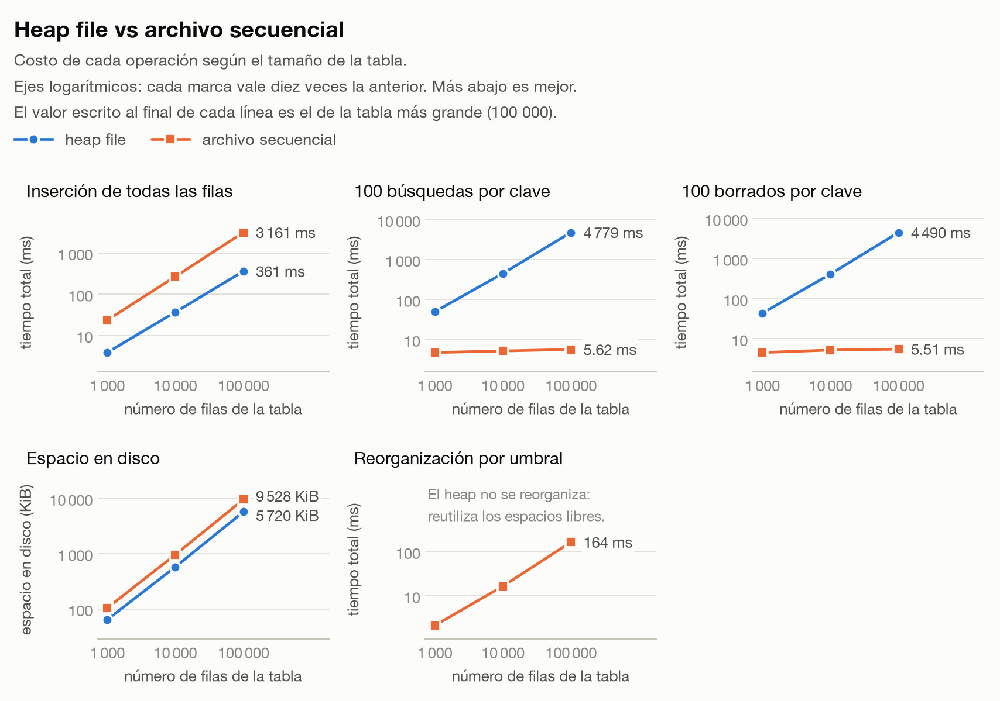

En los paneles de búsqueda y de borrado la línea del heap sube a 45° —crece en proporción
al tamaño— y la del secuencial es casi plana.

| Operación | Técnica | 1 000 | 10 000 | 100 000 |
|---|---|---:|---:|---:|
| Inserción (ms) | heap | **3.59** | **37.5** | **373** |
|  | secuencial | 23.9 | 273 | 3 182 |
| Búsqueda por clave (ms) | heap | 27.6 | 262 | 2 724 |
|  | secuencial | **4.32** | **4.73** | **5.63** |
| Borrado por clave (ms) | heap | 26.2 | 243 | 2 561 |
|  | secuencial | **4.79** | **5.02** | **5.48** |
| Espacio (KiB) | heap | **64.0** | **576** | **5 720** |
|  | secuencial | 104 | 960 | 9 528 |
| Reorganización (ms) | secuencial | 2.08 | 16.9 | 164 |

### Conclusiones

**Por clave, el secuencial gana en todos los tamaños.** El heap recorre de media la mitad
del archivo por cada clave, así que su tiempo crece lineal (27.6 → 262 → 2 724 ms
para 100 búsquedas), mientras que el secuencial hace una búsqueda binaria sobre sus páginas
y casi no se mueve (4.32 → 4.73 → 5.63 ms). Ya con 1 000 filas es
6.4 veces más rápido, y con 100 000 **busca 484 veces más
rápido**. Borrar cuesta casi lo mismo que buscar en las dos estructuras, porque es
encontrar la fila y marcarla: con 100 000 filas el secuencial borra 468 veces más
rápido.

El precio del orden se paga al escribir: insertar cuesta **8.5 veces más** en el
secuencial, porque cada inserción localiza la página y desplaza bytes dentro de ella, y cada
tanto se dispara una reorganización. También ocupa **1.7 veces más espacio**, y eso es
deliberado: el factor de llenado del 80 % deja hueco para que las inserciones futuras quepan
en su sitio en vez de irse al desbordamiento.

**La reorganización es lineal y poco frecuente.** Con 100 000 filas reescribir el archivo
tomó 164 ms, unos 2.2 µs por cada uno de los 75 055 registros que
quedaban, y solo ocurre cuando las lápidas y el desbordamiento pasan del 30 % de lo
guardado.

**Cuándo usar cada uno:** heap si se escribe mucho y se consulta siempre por índice;
secuencial si se consulta por clave o por rango y las escrituras son la minoría.

### Resumen: ventajas y desventajas

| | Heap file | Archivo secuencial |
|---|---|---|
| **Ventajas** | Inserción `O(1)`: va directo a la cabeza de la lista de libres · el menor espacio en disco · reutiliza los huecos de los borrados sin ningún trabajo diferido · sin coste oculto | Búsqueda y borrado por clave `O(log P)`: 484× más rápido con 100 000 filas · rangos y recorrido ordenado gratis, sin ordenar nada · el orden se mantiene siempre disponible |
| **Desventajas** | Búsqueda y borrado por valor `O(P)`: hay que recorrer el archivo · un rango o un `ORDER BY` obligan a ordenar aparte · inútil sin un índice encima | Inserción 8.5× más lenta: localiza la página y desplaza bytes · 1.7× más espacio por el factor de llenado del 80 % · reorganizaciones que congelan el archivo cuando el desperdicio pasa del 30 % · el desbordamiento degrada la búsqueda hasta que se reorganiza |
| **Se elige cuando** | Carga masiva, tablas que siempre se consultan por índice, orden de lectura irrelevante | Consultas por rango o por clave frecuentes, escrituras minoritarias, necesidad de recorrer en orden |

## 2. Indexación — B+ agrupado vs B+ no agrupado vs hash extendible

`index_benchmark.py` mide construcción, igualdad, rango, recorrido ordenado, espacio
adicional y un ciclo de borrados e inserciones sobre el 10 % de las filas. Las tres
técnicas hacen el mismo trabajo: guardar las filas y encontrarlas. El B+ agrupado las
guarda en sus hojas; el no agrupado y el hash guardan direcciones y tienen **su propio
heap**, así que su construcción y su ciclo de borrados e inserciones incluyen escribir y
borrar las filas en él. Sus búsquedas **incluyen el salto al heap**, y el JSON guarda
además la misma búsqueda sin él (`solo_indice_ms`) para separar los dos costes.

### Resultados medidos

Mismos parámetros. Las consultas son el total de 100.

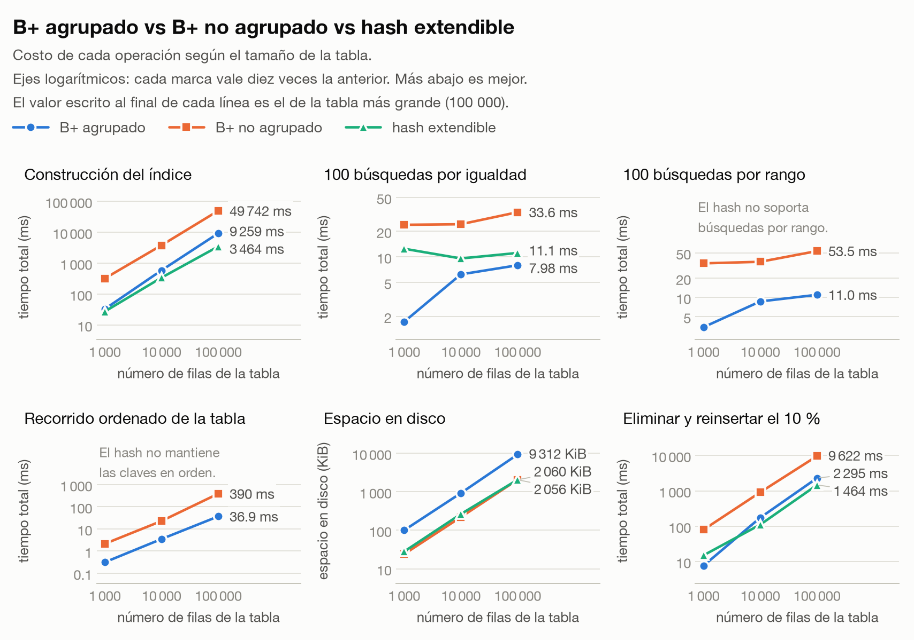

En los paneles de rango y de recorrido ordenado falta una línea: el hash no puede hacer
ninguna de las dos cosas.

| Operación | Técnica | 1 000 | 10 000 | 100 000 |
|---|---|---:|---:|---:|
| Construcción (ms) | B+ agrupado | 20.4 | 302 | 4 428 |
|  | B+ no agrupado | 179 | 2 094 | 25 920 |
|  | hash extendible | **11.1** | **135** | **1 317** |
| Igualdad (ms) | B+ agrupado | **1.20** | **3.04** | **4.06** |
|  | B+ no agrupado | 12.3 | 12.3 | 16.1 |
|  | hash extendible | 4.58 | 3.48 | 4.29 |
| Rango (ms) | B+ agrupado | **2.49** | **4.48** | **5.47** |
|  | B+ no agrupado | 20.9 | 21.7 | 27.0 |
| | hash extendible | — | — | **no soportado** |
| Recorrido ordenado (ms) | B+ agrupado | **0.25** | **2.50** | **31.8** |
|  | B+ no agrupado | 1.79 | 18.9 | 199 |
| | hash extendible | — | — | **no soportado** |
| Espacio (KiB) | B+ agrupado | 108 | 956 | 9 356 |
|  | B+ no agrupado | **24.0** | **220** | **2 040** |
|  | hash extendible | 28.0 | 264 | 2 056 |
| Inserción/borrado (ms) | B+ agrupado | **4.75** | 87.2 | 1 129 |
|  | B+ no agrupado | 44.4 | 478 | 5 047 |
|  | hash extendible | 5.32 | **45.0** | **531** |

Las celdas «no soportado» **no son un cero de rendimiento, son una limitación de la
técnica**: el hash destruye el orden, así que no hay forma de resolver un rango ni un
`ORDER BY` con él.

### Conclusiones

**En una búsqueda por igualdad cuesta el índice, no el salto al heap.** El agrupado
responde 100 igualdades en 4.06 ms con 100 000 filas y el hash en 4.29 ms; sin ir al heap, el hash
tarda 4.00 ms, lo mismo que el agrupado. El salto a la fila es como mucho un 7 % del tiempo en
los dos índices secundarios: una lectura de una página que casi siempre está en el buffer
pool. Lo que pesa es leer la cubeta o el nodo y decodificar sus entradas en Python. Por eso
el B+ no agrupado es el más lento (16.1 ms, 16.0 sin el heap): sus claves compuestas
`(valor, dirección)` llenan nodos de unas 300 entradas, y cada nodo que lee se decodifica
entero.

**El salto al heap sí pesa cuando hay muchos resultados.** En el recorrido ordenado de
100 000 filas el agrupado tarda 31.8 ms y el no agrupado 199 ms, 6.3 veces más. De esos,
79.0 ms son recorrer sus propias hojas y 120 ms, 100 000 lecturas sueltas del heap en el
orden de la clave y no en el físico.

**El espacio va al revés.** El agrupado ocupa 9 356 KiB porque guarda las filas; los otros
dos rondan 2 040 KiB porque solo guardan direcciones. Por eso solo puede haber un índice
agrupado por tabla y tantos secundarios como haga falta.

**El hash es el más rápido para escribir.** Construye en 1.3 s contando su heap, 20 veces menos
que el B+ no agrupado, porque insertar es calcular la cubeta y escribir en ella. En el ciclo
de borrados e inserciones también gana con 10 000 y 100 000 filas (0.5 s contra 1.1 s del
agrupado con 100 000). Con 1 000 filas el agrupado es algo más rápido (4.75 contra
5.32 ms): el hash paga al borrar lo que cuesta mantenerse compacto, porque funde cada
cubeta holgada con su gemela y reduce el directorio, y con pocas filas eso es casi todo.

**Cuándo usar cada uno:** agrupado para la clave primaria de la tabla; hash para columnas
que solo se consultan por igualdad; B+ no agrupado cuando además hacen falta rangos sobre
una columna que no es la de agrupamiento.

### Resumen: ventajas y desventajas

| | B+ agrupado | B+ no agrupado | Hash extendible |
|---|---|---|---|
| **Ventajas** | La fila está en la hoja: **sin salto al heap** · el mejor en igualdad (4.06 ms) y en rango (5.47 ms) · recorrido ordenado 6.3× más rápido que el no agrupado · un solo archivo que es índice y datos a la vez | Ocupa 4.6× menos que el agrupado porque solo guarda direcciones · **varios por tabla**, uno por columna que interese · admite rangos y orden · admite valores repetidos con clave compuesta `(valor, dirección)` | Igualdad en `O(1)`: dos accesos, uno al directorio y uno a la cubeta, sea cual sea el tamaño · **construcción 20× más rápida** que el B+ no agrupado (1.3 s vs 25.9 s) · crecer solo duplica el directorio, sin tocar las cubetas · al borrar funde cubetas y encoge el directorio |
| **Desventajas** | Ocupa 9 356 KiB porque guarda las filas · **solo puede haber uno por tabla**: los datos solo pueden estar ordenados de una forma · las hojas son grandes, así que caben menos entradas por página y el árbol crece en altura | Paga un **salto al heap por cada resultado**, que pesa cuando son muchos: con 100 000 filas el recorrido ordenado tarda 199 ms frente a 31.8 ms del agrupado · el más lento en construirse por el coste de decodificar claves compuestas | **No admite rangos ni `ORDER BY`**: el hash destruye el orden · con pocas filas, borrar es más caro que en el B+ porque funde cubetas y encoge el directorio · claves muy repetidas no se pueden repartir y degeneran en cadenas de desbordamiento |
| **Se elige cuando** | Es la clave primaria de la tabla y las consultas por ella dominan | Hace falta un índice secundario y las consultas incluyen rangos u orden | La columna solo se consulta por igualdad y se carga mucho de una vez |

## Cómo leer los tiempos de construcción

El B+ no agrupado tarda 25.9 s en construirse con 100 000 filas: 5.9 veces más que el
agrupado y 20 veces más que el hash, y los tres cuentan ya el escribir las filas: el
agrupado en sus hojas, los otros dos en su heap. El motivo está en la implementación, no en
la estructura. Su clave es compuesta `(valor, dirección)`, ocupa 14 bytes en vez de 8, y por
eso en cada nodo caben casi 300 entradas en vez de 59. Cada vez que se lee un nodo,
**deserializar decodifica esas 300 claves compuestas en Python**, aunque la búsqueda binaria
solo vaya a mirar ocho.

Es el precio de tener los nodos como objetos legibles en vez de operar directamente sobre
los bytes de la página. La alternativa —comparar claves serializadas sin decodificarlas—
sería más rápida y bastante menos clara. Merece la pena contarlo como lo que es: **una
consecuencia medida de una decisión de diseño**, no un defecto de la estructura.

## 3. Datos espaciales — búsqueda secuencial vs R-Tree vs GiST

`spatial_benchmark.py` responde las mismas consultas, sobre los mismos puntos, con tres
técnicas:

| Técnica | Qué es |
|---|---|
| **búsqueda secuencial** | el motor sin índice: recorre la tabla y mide la distancia a cada punto |
| **R-Tree** | el motor con el índice `RTREE` de [`src/index/rtree/`](../src/index/rtree/README.md) |
| **GiST (PostgreSQL)** | PostgreSQL 17 con PostGIS 3.6, columna `geography` e índice GiST |

Las consultas son las del enunciado: por radio de 1, 5 y 10 km, y los `k` vecinos más
cercanos con `k` = 10, 50 y 100. Las dos técnicas del motor se miden con el mismo SQL de
punta a punta (`SELECT id FROM puntos WHERE distancia(…) < r` y
`… ORDER BY distancia(…) LIMIT k`); GiST, con `ST_DWithin` y el operador `<->`.

**Los puntos son reales.** Con `--points-file` el experimento toma sus puntos de un CSV con
una columna `POINT`: aquí, los lugares con nombre del Perú en OpenStreetMap —colegios,
restaurantes, farmacias, bancos— que descarga
[`demos/descargar_lugares.py`](../demos/README.md). De ellos se sacan muestras de 1 000,
10 000 y 100 000 puntos distintos, y los centros de las consultas caen junto a puntos de la
muestra. Importa que sean reales: están repartidos como la gente, apretados en las ciudades
y con grandes zonas vacías, que es justo donde un índice espacial tiene algo que descartar.
Sin ese argumento se generan puntos sintéticos sobre Lima, que no necesitan descargar nada.

### Antes de medir: ¿responden lo mismo?

Un índice que acelera cambiando la respuesta no es una comparación. Por eso:

- el experimento **aborta** si el R-Tree devuelve filas distintas de las del recorrido;
- a PostGIS se le pide la distancia **sobre la esfera** (`ST_DWithin(…, false)`), el mismo
  modelo que Haversine, porque por omisión mide sobre el elipsoide y discrepa hasta un 0.5 %;
- cada medida de GiST anota cuántas de sus consultas coincidieron con el motor.

Resultado: **las 1 800 consultas coinciden, fila por fila** (100 de cada uno de los 6 tipos,
en los 3 tamaños), y PostgreSQL confirma con `EXPLAIN` que usa el índice en todas.

### Consultas por radio

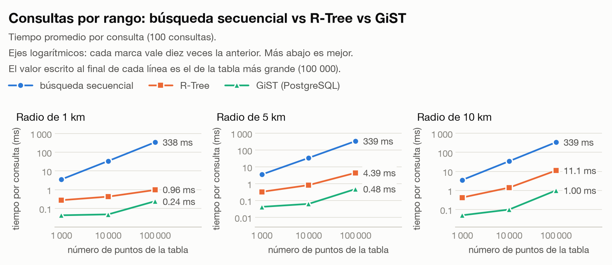

Tiempo medio por consulta, en milisegundos:

| Radio | Técnica | 1 000 | 10 000 | 100 000 | Filas devueltas (100 000) |
|---|---|---:|---:|---:|---:|
| 1 km | búsqueda secuencial | 3.52 | 33.8 | 338 | 64.1 |
|  | R-Tree | 0.27 | 0.42 | 0.96 | |
|  | GiST | **0.043** | **0.048** | **0.24** | |
| 5 km | búsqueda secuencial | 3.51 | 33.9 | 339 | 544 |
|  | R-Tree | 0.33 | 0.82 | 4.39 | |
|  | GiST | **0.042** | **0.063** | **0.48** | |
| 10 km | búsqueda secuencial | 3.55 | 34.3 | 339 | 1 577 |
|  | R-Tree | 0.42 | 1.40 | 11.1 | |
|  | GiST | **0.050** | **0.099** | **1.00** | |

### Vecinos más cercanos

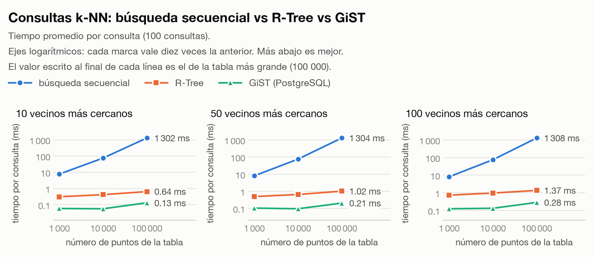

Tiempo medio por consulta, en milisegundos:

| k | Técnica | 1 000 | 10 000 | 100 000 |
|---|---|---:|---:|---:|
| 10 | búsqueda secuencial | 5.82 | 70.2 | 1 171 |
|  | R-Tree | 0.33 | 0.44 | 0.57 |
|  | GiST | **0.059** | **0.058** | **0.12** |
| 50 | búsqueda secuencial | 5.85 | 71.1 | 1 173 |
|  | R-Tree | 0.54 | 0.70 | 0.86 |
|  | GiST | **0.095** | **0.097** | **0.19** |
| 100 | búsqueda secuencial | 5.94 | 73.7 | 1 170 |
|  | R-Tree | 0.79 | 1.14 | 1.31 |
|  | GiST | **0.12** | **0.14** | **0.26** |

### Por qué: los nodos que abre cada consulta

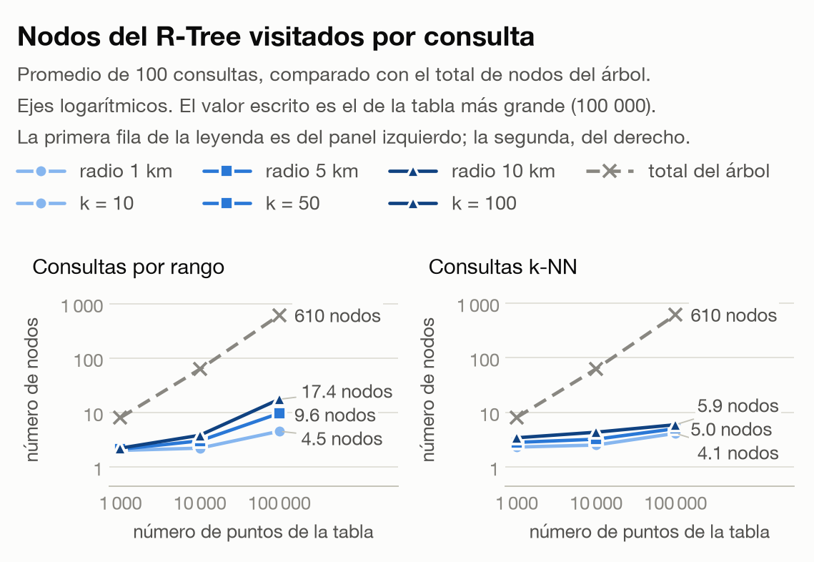

El plan de ejecución dice cuántos nodos del R-Tree visitó cada búsqueda. Media sobre 100
consultas:

| Consulta | 1 000 puntos (7 nodos) | 10 000 (61 nodos) | 100 000 (606 nodos) |
|---|---:|---:|---:|
| radio 1 km | 2.00 | 2.20 | 4.30 |
| radio 5 km | 2.10 | 2.90 | 9.40 |
| radio 10 km | 2.30 | 3.80 | 16.9 |
| k-NN, k = 10 | 2.30 | 2.40 | 3.90 |
| k-NN, k = 50 | 2.90 | 3.20 | 4.80 |
| k-NN, k = 100 | 3.40 | 4.20 | 5.80 |

Esta es la gráfica que explica las dos anteriores. El árbol se multiplica por 87 (de 7 a
606 nodos) y el k-NN pasa de abrir 2.30 nodos a abrir 3.90.

### Construcción, espacio y memoria

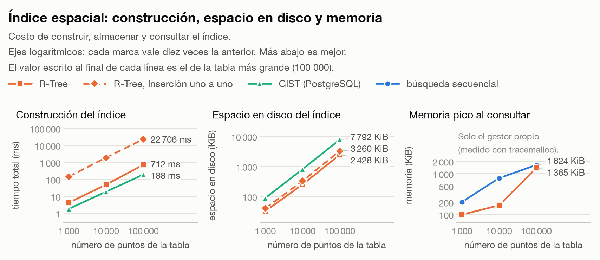

| Medida | Técnica | 1 000 | 10 000 | 100 000 |
|---|---|---:|---:|---:|
| Construcción (ms) | R-Tree, carga masiva (STR) | 3.46 | 40.6 | 544 |
|  | R-Tree, inserción uno a uno | 145 | 1 854 | 22 549 |
|  | GiST | **1.47** | **18.8** | **188** |
| Espacio del índice (KiB) | R-Tree, carga masiva | **32.0** | **248** | **2 428** |
|  | R-Tree, inserción uno a uno | 40.0 | 324 | 3 260 |
|  | GiST | 88.0 | 808 | 7 760 |
| Memoria pico al consultar (KiB) | búsqueda secuencial | 200 | 772 | 1 468 |
|  | R-Tree | **98.2** | **167** | **1 365** |

`CREATE INDEX … USING RTREE` usa la carga masiva; la inserción uno a uno es lo que cuesta
mantener el índice cuando las filas llegan después. La búsqueda secuencial no tiene índice
que construir ni que almacenar. La memoria es la de Python, medida con `tracemalloc`; la de
PostgreSQL no es comparable desde fuera y no se reporta.

### Conclusiones

**El recorrido secuencial crece con la tabla; el índice, con la respuesta.** La búsqueda
secuencial tarda lo mismo pida un radio de 1 km o de 10 (338 y 339 ms con 100 000 puntos),
porque siempre mide la distancia a todos. El R-Tree tarda 0.96 ms para 1 km y 11.1 ms para
10 km: lo que le cuesta son las 64.1 o las 1 577 filas que tiene que devolver.

**Cuanto más selectiva la consulta, más gana el índice.** Con 100 000 puntos, el R-Tree es
351 veces más rápido que el recorrido para 1 km, 77 veces para 5 km y 31 para 10 km,
donde cada consulta devuelve ya el 1.6 % de la tabla.

**En el k-NN la diferencia es de tres órdenes de magnitud.** Sin índice no hay forma de
saber cuáles son los 10 más cercanos sin medir los 100 000 y ordenarlos: 1 171 ms. El
R-Tree abre los nodos del más cercano al más lejano y se detiene al tener diez: 0.57 ms,
**2 042 veces menos**. Y casi no depende del tamaño: de 1 000 a 100 000 puntos el recorrido
se multiplica por 201 y el R-Tree por 1.7.

**GiST es entre 4.0 y 14 veces más rápido que el R-Tree, y escala igual.** La distancia entre
las dos líneas es constante en las gráficas: la misma pendiente, desplazada. GiST está
escrito en C y lleva décadas de optimización; este R-Tree es Python y deserializa cada nodo
que abre. Lo que el experimento compara es **el algoritmo**, y ahí las dos estructuras se
comportan igual y el recorrido no.

**La carga masiva es 41 veces más rápida que insertar y deja un árbol mejor.** 0.5 s
frente a 22.5 s con 100 000 puntos, 606 nodos en vez de 814 y un 26 % menos de espacio.
GiST construye en 0.2 s.

**El índice propio ocupa 3.2 veces menos que el de PostGIS:** 2 428 KiB frente a 7 760. Las
hojas de este R-Tree guardan el punto en 22 bytes; `geography` indexa cajas en tres
dimensiones.

**La memoria al consultar es parecida en las dos técnicas del motor** (1 468 KiB el recorrido y
1 365 KiB el R-Tree con 100 000 puntos). El R-Tree necesita tener a la vez las direcciones
que devuelve el índice, porque las ordena por página antes de ir al heap para leer cada
página una sola vez.

### Resumen: ventajas y desventajas

| | Búsqueda secuencial | R-Tree (propio) | GiST (PostgreSQL) |
|---|---|---|---|
| **Ventajas** | Sin índice que construir, almacenar ni mantener · coste predecible: siempre el mismo · suficiente en tablas pequeñas: 3.51 ms por radio con 1 000 puntos | k-NN en `O(log N + k)`: 0.57 ms con 100 000 puntos · por radio, hasta 351× más rápido que recorrer · el índice más compacto de los tres · una sola estructura para las dos métricas | El más rápido en todo, entre 4.0 y 14 veces · construye 100 000 puntos en 0.2 s · maduro, concurrente y con recuperación ante fallos |
| **Desventajas** | Crece en proporción a la tabla · el k-NN obliga a medir y ordenar todo: 1.2 s con 100 000 puntos · no aprovecha que la consulta sea selectiva | Hay que mantenerlo: insertar uno a uno cuesta 0.23 ms por punto · gana menos cuanto mayor es la parte de la tabla que devuelve la consulta | Es un sistema entero, no una estructura: hay que instalarlo, cargarlo y consultarlo por red · su índice ocupa 3.2× más |
| **Se elige cuando** | La tabla es pequeña (con 1 000 puntos responde en 3.51 a 5.94 ms) o la consulta devuelve una parte grande de las filas | Consultas selectivas —un barrio, los `k` más cercanos— sobre muchos puntos | Hay un PostgreSQL disponible y el rendimiento manda |

### Reproducirlo

```bash
uv sync --all-packages --extra postgres --extra plots
.venv/bin/python -m demos.descargar_lugares --salida data/datasets/lugares_peru.csv
createdb minigestor_bench                       # el experimento crea ahí la extensión PostGIS
export BENCH_POSTGRES_DSN="dbname=minigestor_bench"
.venv/bin/python -m benchmarks.spatial_benchmark --sizes 1000 10000 100000 --queries 100 \
    --points-file data/datasets/lugares_peru.csv
```

Tarda unos 15 minutos, casi todos en el recorrido secuencial de 100 000 puntos. En
PostgreSQL solo usa tablas temporales, que desaparecen al cerrar la conexión. Sin
`BENCH_POSTGRES_DSN` mide las dos técnicas del motor y omite GiST; sin `--points-file`, usa
puntos sintéticos. El extracto de OpenStreetMap es el del día de la descarga, así que las
cifras de otra ejecución pueden diferir ligeramente de las publicadas.

El tiempo de GiST se mide desde el cliente e incluye el viaje por el socket local, que el
motor propio no paga porque corre en el mismo proceso. Aun así es el más rápido.

## 4. Búsqueda de texto — TF-IDF + coseno vs BM25 vs GIN

`text_benchmark.py` responde las mismas consultas, sobre los mismos productos, con tres
técnicas:

| Técnica | Qué es |
|---|---|
| **TF-IDF + coseno** | `Ranker.top_k` con SMART lnc.ltc sobre el índice invertido de [`src/index/inverted/`](../src/index/inverted/README.md) |
| **BM25** | el **mismo** índice y el mismo `Ranker`, con `k1` = 1.2 y `b` = 0.75 |
| **GIN (PostgreSQL)** | PostgreSQL 17.10: columna `tsvector` generada con `to_tsvector('spanish', texto)`, índice GIN sobre ella y orden con `ts_rank_cd` |

**El corpus es real.** Fichas de producto de Amazon en español, del Shopping Queries
Dataset (ESCI), con los subconjuntos de 1 000, 10 000 y 100 000 productos que describe
[`esci/README.md`](esci/README.md). Las consultas son búsquedas reales de la tienda, en
tres cubetas por su número de palabras (1, 3 y 5 o más): 8 por cubeta con 1 000 productos y
50 con 10 000 y 100 000. Un producto es **relevante** si un anotador lo calificó como exacto
(E); Precision@10 y Recall@10 se calculan contra esos juicios.

**Cómo se pregunta a cada uno.**

- El motor se mide a nivel del índice: `Ranker.top_k(consulta, método, 10)` sobre el índice
  abierto, sin pasar por el SQL. Un mismo índice sirve a los dos rankings, así que entre
  ellos solo cambia la fórmula.
- A PostgreSQL se le pregunta por SQL desde el cliente, con el viaje por el socket local
  incluido. La consulta es el **OR** de sus términos, como en el motor:
  `plainto_tsquery` analiza el texto igual que `to_tsvector` y une los lexemas con `&`, y
  el experimento cambia cada ` & ` por ` | ` (un lexema no contiene espacios, así que no
  se toca nada más). Se ordena con `ts_rank_cd(vector, consulta)` con la normalización por
  omisión (0), y a igual puntaje por el orden de carga, como el motor.
- PostgreSQL planifica cada consulta con su texto (`plan_cache_mode = force_custom_plan`):
  con un plan genérico la consulta deja de ser una constante y `ts_rank_cd` la vuelve a
  calcular por cada fila. Con `enable_seqscan = off` se mide el índice, y `EXPLAIN` confirma
  que se usa en las 324 consultas.
- Los dos tienen la misma caché propia: el buffer pool del motor son 2 048 páginas de
  4 KB (8 MiB) y la tabla temporal de PostgreSQL usa `temp_buffers` = 8 MB, el valor por
  omisión. Lo que no cabe, los dos lo leen de la caché de archivos del sistema.
- **Construir** empieza en los dos con los textos ya cargados: en el motor, una lista en
  memoria; en PostgreSQL, la tabla. Cuenta el análisis del texto y el índice: en el motor,
  `InvertedIndex.build`; en PostgreSQL, calcular la columna `tsvector` y `CREATE INDEX`.

Cada consulta se repite 5 veces y cada índice se construye 3; cuenta la vez más
rápida, porque el equipo era compartido y otro proceso solo puede sumar tiempo. Todas las
repeticiones están en el JSON. Apple M4 Pro, macOS, Python 3.12.

### Antes de medir: ¿qué candidatos ve cada uno?

Un candidato es un producto que contiene algún término de la consulta. Los dos analizadores
usan el stemmer Snowball del español, pero no cortan el texto igual, así que sus candidatos
no tienen por qué coincidir. El experimento compara los dos conjuntos de cada consulta:

| Productos | Candidatos idénticos | Términos idénticos | Jaccard medio | En los dos | Solo el motor | Solo GIN |
|---:|---:|---:|---:|---:|---:|---:|
| 1 000 | 15 / 24 | 24 / 24 | 0.98 | 1 914 | 148 | 35 |
| 10 000 | 48 / 150 | 135 / 150 | 0.90 | 111 866 | 29 408 | 4 568 |
| 100 000 | 37 / 150 | 135 / 150 | 0.89 | 1 103 340 | 294 767 | 45 072 |

Las raíces coinciden en 135 de las 150 consultas: lo que cambia es **dónde se corta una
palabra**. El motor corta entre letras y cifras y en los puntos; PostgreSQL deja «ps4»,
«5ghz» o «m.zuiko» como una sola palabra. Y las listas de stopwords no son iguales: «si» lo
es para el motor y no para PostgreSQL. Las consultas con más diferencia, con 100 000
productos:

| Consulta | Términos del motor | Términos de GIN | Solo el motor | Solo GIN |
|---|---|---|---:|---:|
| x10sdv | `10 sdv x` | `x10sdv` | 41 251 | 0 |
| nintengo 2ds new xl lapiz | `2 ds lapiz new ninteng xl` | `2ds lapiz new ninteng xl` | 33 334 | 7 |
| 200x50 rueda patinete sin cámara de aire | `200 50 air cam patinet rued x` | `200x50 air cam patinet rued` | 29 606 | 3 |
| ps4 terror vr | `4 ps terror vr` | `ps4 terror vr` | 23 678 | 0 |
| repetidor wifi 5ghz | `5 ghz repetidor wifi` | `5ghz repetidor wifi` | 20 126 | 0 |
| si tienes un papa mago | `mag pap` | `mag pap si` | 42 | 18 812 |

Cortar «ps4» en `ps` y `4` hace que la consulta encuentre todo producto con un 4. Por eso
el motor tiene más candidatos: con 100 000 productos, el 96 % de los de GIN están
también en el motor, y el 21 % de los del motor son solo suyos. La diferencia es del
analizador, no del índice.

### Tiempo de consulta

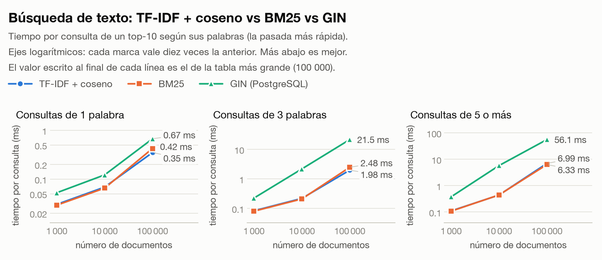

Tiempo por consulta, en milisegundos:

| Palabras | Técnica | 1 000 | 10 000 | 100 000 |
|---|---|---:|---:|---:|
| 1 palabra | TF-IDF + coseno | 0.019 | **0.047** | 0.24 |
|  | BM25 | **0.019** | 0.049 | **0.23** |
|  | GIN | 0.082 | 0.096 | 0.64 |
| 3 palabras | TF-IDF + coseno | **0.062** | 0.17 | 1.24 |
|  | BM25 | 0.070 | **0.17** | **0.95** |
|  | GIN | 0.23 | 1.82 | 19.3 |
| 5 o más | TF-IDF + coseno | **0.087** | **0.36** | 2.99 |
|  | BM25 | 0.10 | 0.38 | **2.69** |
|  | GIN | 0.39 | 4.82 | 51.7 |

### Dónde se va el tiempo

El motor recorre las listas de postings de los términos y suma en un acumulador por
documento. PostgreSQL usa el GIN para saber qué filas coinciden, y luego lee el `tsvector`
de cada una y calcula `ts_rank_cd`. El `EXPLAIN ANALYZE` separa las dos partes:

| Palabras | Postings leídos (1 000) | (10 000) | (100 000) | Candidatos del motor (100 000) | Filas de GIN (100 000) | GIN: índice (ms) | GIN: ejecución completa (ms) |
|---|---:|---:|---:|---:|---:|---:|---:|
| 1 palabra | 9 | 176 | 1 620 | 1 464 | 235 | 0.009 | 0.39 |
| 3 palabras | 130 | 915 | 8 781 | 8 203 | 6 986 | 0.39 | 19.7 |
| 5 o más | 206 | 2 252 | 21 911 | 18 296 | 15 747 | 1.12 | 51.7 |

### Relevancia

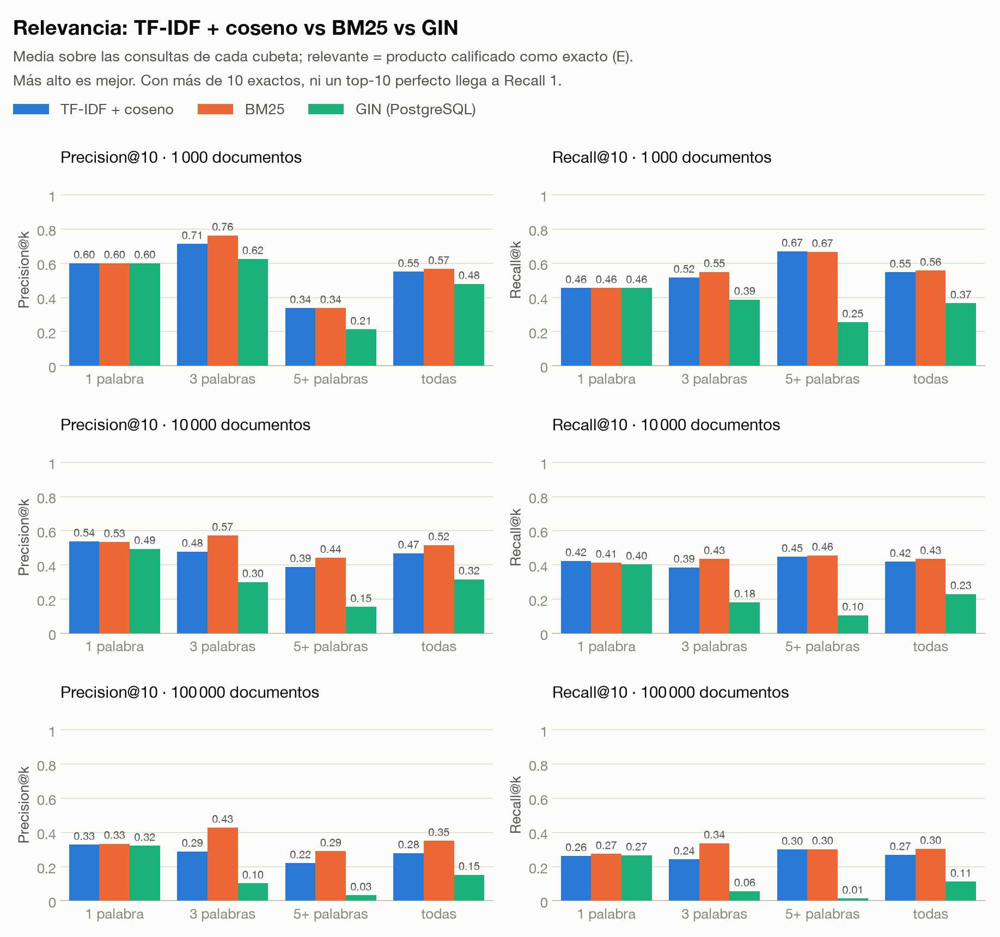

Precision@10, media por cubeta; en negrita, la mejor de cada tamaño:

| Productos | Técnica | 1 palabra | 3 palabras | 5 o más | Todas |
|---:|---|---:|---:|---:|---:|
| 1 000 | TF-IDF + coseno | **0.60** | 0.71 | **0.34** | 0.55 |
|  | BM25 | **0.60** | **0.76** | **0.34** | **0.57** |
|  | GIN | **0.60** | 0.62 | 0.21 | 0.48 |
| 10 000 | TF-IDF + coseno | **0.54** | 0.48 | 0.39 | 0.47 |
|  | BM25 | 0.53 | **0.57** | **0.44** | **0.52** |
|  | GIN | 0.49 | 0.30 | 0.15 | 0.32 |
| 100 000 | TF-IDF + coseno | 0.33 | 0.29 | 0.22 | 0.28 |
|  | BM25 | **0.33** | **0.43** | **0.29** | **0.35** |
|  | GIN | 0.32 | 0.10 | 0.03 | 0.15 |

Recall@10:

| Productos | Técnica | 1 palabra | 3 palabras | 5 o más | Todas |
|---:|---|---:|---:|---:|---:|
| 1 000 | TF-IDF + coseno | **0.46** | 0.52 | **0.67** | 0.55 |
|  | BM25 | **0.46** | **0.55** | 0.67 | **0.56** |
|  | GIN | **0.46** | 0.39 | 0.25 | 0.37 |
| 10 000 | TF-IDF + coseno | **0.42** | 0.39 | 0.45 | 0.42 |
|  | BM25 | 0.41 | **0.43** | **0.46** | **0.43** |
|  | GIN | 0.40 | 0.18 | 0.10 | 0.23 |
| 100 000 | TF-IDF + coseno | 0.26 | 0.24 | 0.30 | 0.27 |
|  | BM25 | **0.27** | **0.34** | **0.30** | **0.30** |
|  | GIN | 0.27 | 0.06 | 0.01 | 0.11 |

Con 100 000 productos cada consulta tiene en promedio 13.2 productos exactos, así que ni
un top 10 perfecto llega siempre a un Recall@10 de 1.

### Construcción, espacio y memoria

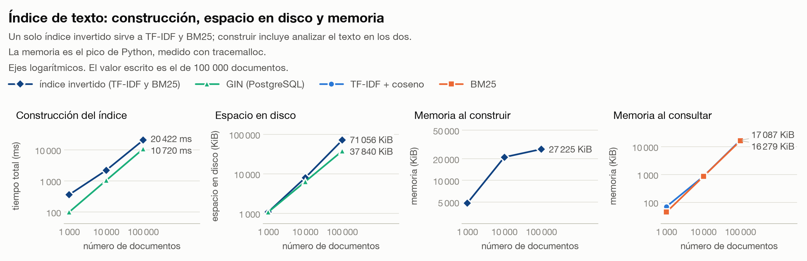

| Medida | Técnica | 1 000 | 10 000 | 100 000 |
|---|---|---:|---:|---:|
| Construcción (ms) | índice invertido (SPIMI) | 303 | 1 578 | 13 660 |
|  | GIN, total | **100** | **1 054** | **10 984** |
|  | GIN: columna `tsvector` | 79.0 | 816 | 8 402 |
|  | GIN: `CREATE INDEX` | 21.4 | 238 | 2 582 |
| Espacio del índice (KiB) | índice invertido (SPIMI) | 1 088 | 7 968 | 71 056 |
|  | GIN | **1 080** | **6 360** | **37 840** |
|  | GIN: columna `tsvector` | 1 136 | 11 641 | 117 420 |
| Memoria pico al construir (KiB) | índice invertido (SPIMI) | 3 976 | 17 978 | 24 934 |
| Memoria pico al consultar (KiB) | TF-IDF + coseno | 70.2 | 718 | 16 957 |
|  | BM25 | **46.1** | **503** | **10 754** |

El espacio del índice invertido son sus cuatro archivos: con 100 000 productos, léxico
4 624 KiB, términos 1 020, postings 61 696 y documentos 1 868. El de GIN es
`pg_relation_size` del índice; la columna `tsvector` va aparte porque está en la tabla,
pero el ranking la necesita. La memoria es la de Python, medida con `tracemalloc` en una
construcción aparte; la de PostgreSQL no se puede medir igual desde fuera y no se reporta.

### Conclusiones

**BM25 es el más relevante, en los tres tamaños.** Su Precision@10 media es 0.57, 0.52 y
0.35, frente a 0.55, 0.47 y 0.28 de TF-IDF. Con una palabra las tres técnicas casi
empatan (a lo sumo 0.040 de diferencia): con un solo término, ordenar es contar
cuántas veces aparece y en cuánto texto. La ventaja de BM25 está en las consultas largas:
con 100 000 productos gana por 0.14 con 3 palabras y por 0.07 con 5 o más. Satura la
frecuencia de cada término (`k1`), así que un producto no gana por repetir una palabra, y
pesa más el que contiene varios términos distintos.

**GIN no ordena: encuentra.** El índice dice qué filas contienen algún término; el orden lo
pone `ts_rank_cd`, que con la normalización por omisión no divide por la longitud del
documento, y un texto largo que repite los términos suma más. Con 10 000 productos su
Precision@10 con 3 palabras es 0.30 y con 100 000 baja a 0.10: 2.9 veces menos, cuando
BM25 baja 1.3 veces. Con 5 o más palabras queda en 0.03. Es la parte del
experimento que más depende de una opción: `--ts-rank-normalization` la cambia.

**El motor responde antes que PostgreSQL con 3 palabras o más**, y la tabla de arriba dice
por qué. Con 100 000 productos y 5 o más palabras, el GIN encuentra las
15 747 filas en 1.12 ms, el 2.2 % de la ejecución; el resto es leer el `tsvector` de cada fila
y puntuarla, unos 3.3 µs por fila. El motor tiene la frecuencia de cada término dentro
del posting y la longitud de cada documento en memoria: puntuar le cuesta unos
123 ns por posting con BM25 y 136 con TF-IDF. GIN es C y el motor Python, pero la
diferencia no está en el lenguaje sino en lo que cada uno guarda en el índice: GIN está
hecho para responder qué filas coinciden, no para ordenarlas. Con una palabra hay pocas filas
que leer y la distancia se acorta (2.8 veces con 100 000 productos, frente a
20 con 3 palabras).

**El tiempo del motor sigue a los postings que lee.** De 10 000 a 100 000 productos, una
consulta de 5 o más palabras lee 9.7 veces más postings y BM25 tarda 7.0 veces más: el
costo de una consulta es recorrer sus listas, y crece con ellas, no con el tamaño de la colección.

**GIN construye más rápido y ocupa menos.** Con 100 000 productos, PostgreSQL calcula la
columna y crea el índice en 11.0 s; el motor tarda 13.7 s, 1.2 veces más, la mayor parte
analizando el texto en Python (lo mide el [README del índice](../src/index/inverted/README.md#medido-con-esci)). El índice GIN ocupa 37.0 MiB y el invertido 69.4 MiB
(1.9 veces más): GIN comprime sus listas, y el motor guarda los postings sin
comprimir, 8 bytes cada uno, para decodificarlos en C; son el 87 % de sus archivos.
Pero el ranking de GIN necesita además la columna `tsvector`, que ocupa 115 MiB.

**La memoria de SPIMI está acotada.** Con 100 000 productos la construcción escribe
9 bloques y los mezcla en 2 pasadas; diez veces más documentos que con 10 000 cuestan
1.4 veces la memoria (17.6 MiB y 24.3 MiB).

### Resumen: ventajas y desventajas

| | TF-IDF + coseno | BM25 | GIN (PostgreSQL) |
|---|---|---|---|
| **Ventajas** | Sin parámetros que ajustar · la norma del documento se calcula al indexar y no cambia · empata con BM25 en consultas de una palabra | El más relevante: Precision@10 de 0.35 con 100 000 productos · satura la frecuencia y normaliza por longitud · el mismo índice y las mismas listas que TF-IDF | Construye 1.2 veces más rápido · índice 1.9 veces más chico · maduro, transaccional y concurrente |
| **Desventajas** | Pierde frente a BM25 en consultas largas: 0.22 contra 0.29 con 5 o más palabras · el idf solo pesa en la consulta | Dos parámetros (`k1`, `b`) que dependen del corpus · necesita la longitud de cada documento a mano en memoria | No ordena por sí mismo: `ts_rank_cd` relee el `tsvector` de cada fila, 19 veces más lento que BM25 con 5 o más palabras · con la normalización por omisión prefiere textos largos: Precision@10 de 0.15 · el ranking necesita además la columna `tsvector` (115 MiB) |
| **Se elige cuando** | Consultas cortas o un corpus donde no hay con qué ajustar `k1` y `b` | Búsqueda por relevancia en general, sobre todo con consultas de varias palabras | Hace falta filtrar por palabras dentro de un PostgreSQL y el orden importa poco |

### Reproducirlo

```bash
uv sync --all-packages --extra postgres --extra plots --extra datasets
.venv/bin/python -m benchmarks.esci.download --salida data/datasets/esci_es
.venv/bin/python -m benchmarks.esci.subsets --corpus data/datasets/esci_es \
    --sizes 1000 10000 100000 --queries-per-bucket 50 --max-judged-share 0.5 --seed 20261104
export BENCH_POSTGRES_DSN="dbname=minigestor_bench"
.venv/bin/python -m benchmarks.text_benchmark --corpus data/datasets/esci_es \
    --sizes 1000 10000 100000 --repetitions 5 --build-repetitions 3
```

Tarda unos seis minutos, casi todo en construir el índice de 100 000 productos (tres veces,
y una cuarta con `tracemalloc`). El experimento no escribe los subconjuntos: si falta uno,
dice qué comando lo crea. En PostgreSQL solo usa tablas temporales. Sin
`BENCH_POSTGRES_DSN` mide TF-IDF y BM25 y omite GIN.

## 5. Búsqueda por similitud — IVF vs HNSW y euclidiana vs coseno

`multimedia_benchmark.py` responde las mismas consultas, sobre los mismos vectores, con
estas técnicas:

| Técnica | Qué es |
|---|---|
| **búsqueda exacta (gestor)** | `FlatIndex` de [`src/index/vector/`](../src/index/vector/README.md): compara contra todos; es lo que hace el plan sin un índice de la métrica pedida |
| **IVF (gestor)** | `IVFIndex` de [`src/index/ivf/`](../src/index/ivf/README.md): `IndexIVFFlat` de FAISS con √N listas y √listas `probes`, más la capa del gestor |
| **HNSW (gestor)** | `HNSWIndex` de [`src/index/hnsw/`](../src/index/hnsw/README.md): `IndexHNSWFlat` de FAISS con `M` 16, `ef_construction` 64 y `ef_search` 40 |
| **IVF y HNSW (FAISS directo)** | las mismas estructuras de FAISS con los mismos parámetros, sin el gestor |
| **HNSW (USearch)** | USearch 2.26 en `float32` con el mismo `M`, `ef_construction` y `ef` (el HNSW que usa DuckDB) |
| **ivfflat y hnsw (pgvector)** | pgvector 0.8.7 en PostgreSQL 17.11: `ivfflat` con las mismas listas y `probes`; `hnsw` con `m` 16 y `ef_construction` 64 |
| **IVF y HNSW (gestor, SQL)** | `CREATE INDEX ... USING HNSW | IVF (ruta)` y `SIMILAR_TO('consulta.jpg', k = 10)` de punta a punta |

**Los datos son reales.** Fotos de producto de ABO (la clase es la categoría del producto)
y clips de un segundo de Speech Commands (la clase es la palabra), en los subconjuntos
anidados de 1 000, 10 000 y 100 000 objetos que describe
[`multimedia/README.md`](multimedia/README.md). Las 500 consultas de cada dataset **no están
en la base**: en el audio, ni siquiera su hablante.

**Todas las técnicas comparan los mismos vectores.** Cada colección pasa una vez por el
camino de `CREATE INDEX`: SIFT (imágenes) o MFCC (audio), un vocabulario de 256 palabras con
k-means sobre una muestra de 2 000 objetos, conteos y TF-IDF. Hay **un vocabulario por
tamaño**, como lo construiría el gestor sobre esa tabla, así que entre tamaños cambian los
vectores, no solo cuántos hay. Por SQL, `CREATE INDEX` extrae por su cuenta con el mismo
camino y llega a los mismos vectores: en audio, su Recall@10 es idéntico al del índice que
construye el experimento en los tres tamaños y las dos métricas. En imágenes difiere porque
el gestor deja fuera del índice los vectores cero (ver
[Un caso aparte](#un-caso-aparte-hnsw-la-euclidiana-y-los-vectores-cero)).

**Qué se mide.**

- **Recall@10** contra la búsqueda exacta, calculada aparte con numpy en `float64`, sin
  ninguna de las bibliotecas que se comparan. Un vecino cuenta si su puntaje exacto llega al
  décimo mejor: dos fotos con el mismo vector empatan y vale cualquiera.
- **Vecinos de su clase@10**: qué parte de los 10 vecinos es de la categoría o la palabra de
  la consulta. Mide la **representación**, no el índice, y es lo que separa a la euclidiana
  del coseno: con la búsqueda exacta, las dos tienen Recall@10 de 1.
- **Tiempo por consulta**: cada consulta se responde 3 veces y cuenta su mediana; se
  reportan la mediana (p50) y el percentil 95 entre las 500. A pgvector se le pregunta
  desde el cliente, con el viaje incluido, y `EXPLAIN ANALYZE` da además el tiempo dentro
  del servidor.
- **Construcción**: cada etapa de las características por separado y cada índice desde los
  vectores ya calculados, mediana de 3 construcciones. **Memoria**: lo que ocupa la
  estructura de cada biblioteca (`serialize_index` de FAISS, `memory_usage` de USearch,
  `pg_relation_size` del índice), y aparte los objetos de Python que retiene la capa del
  gestor. **Disco**: el archivo que guarda cada uno.
- **Curvas de recall contra latencia**: `probes` de 1 a 128 e `ef_search` de 10 a 320.
- **Por SQL**, con el coseno y con la euclidiana: `CREATE INDEX` de punta a punta, con las
  listas, los `probes` y los vectores cero que dice su `describe`, y cada `SIMILAR_TO`.

**Un hilo.** FAISS, USearch y pgvector construyen y buscan con un hilo
(`--threads 1`; en pgvector, `max_parallel_maintenance_workers` 0), para comparar
algoritmos y no repartos de núcleos. La extracción sí usa los 12 procesos del gestor.

**Dónde corrió.** Apple M4 Pro (12 núcleos), macOS, Python 3.12, FAISS 1.15.1, después de
los arreglos de #64. El equipo estaba compartido con otro trabajo (carga media de 2 a 21
durante la medida, guardada en el JSON). **Las características se reutilizaron** de la
ejecución anterior con `--features-dir` (el JSON lo anota: `reutilizadas`): extraer,
muestrear, entrenar el vocabulario y cuantizar no cambiaron, así que esos cuatro tiempos son
los medidos entonces con el mismo código; todo lo demás se midió de nuevo. **pgvector corrió en Docker:** la instalación local de PostgreSQL no lo trae, así que
PostgreSQL 17.11 con pgvector corrió en la imagen del perfil `bench`, con un puerto publicado
solo para la medida, `shared_buffers` de 1 GB y `maintenance_work_mem` de 1 GB para que el
grafo quepa al construir. En macOS el contenedor corre en una máquina virtual: sus tiempos
incluyen ese costo, y el del servidor se reporta aparte.

### Antes de medir: ¿qué tan buena es la representación?

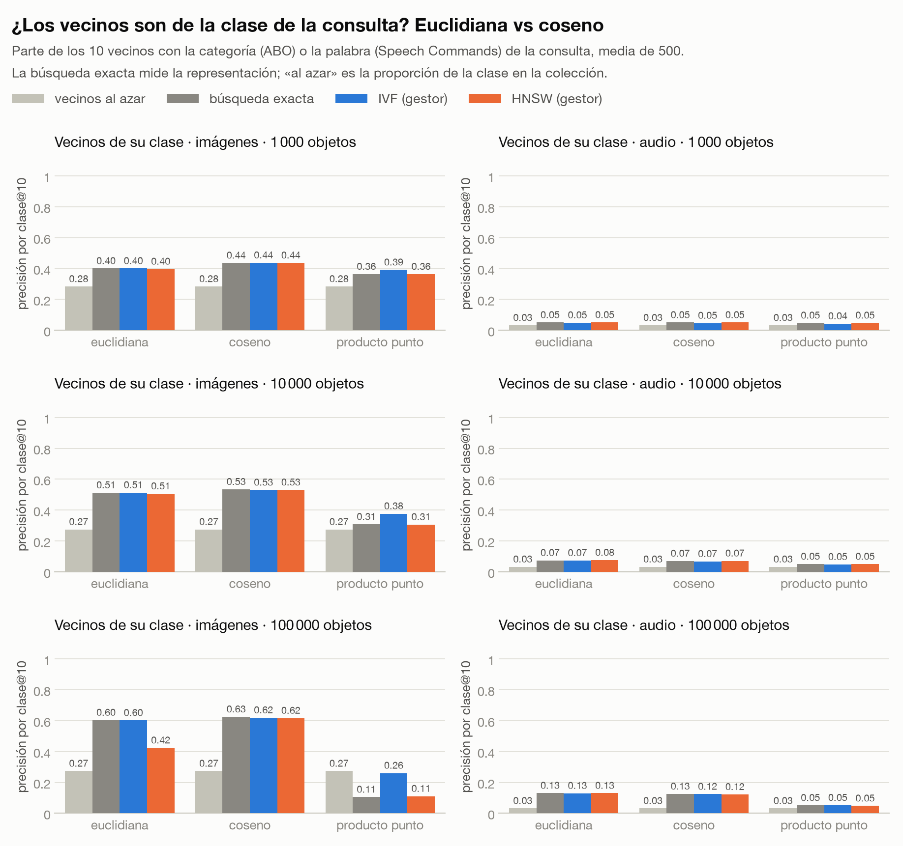

Vecinos de su clase@10 de la **búsqueda exacta**, frente a elegir 10 vecinos al azar:

| Dataset | Objetos | Al azar | Euclidiana | Coseno | Producto punto |
|---|---:|---:|---:|---:|---:|
| Imágenes | 1 000 | 0.28 | 0.40 | **0.44** | 0.36 |
|  | 10 000 | 0.27 | 0.51 | **0.53** | 0.31 |
|  | 100 000 | 0.27 | 0.60 | **0.63** | 0.11 |
| Audio | 1 000 | 0.03 | **0.050** | **0.050** | 0.047 |
|  | 10 000 | 0.03 | **0.074** | 0.070 | 0.050 |
|  | 100 000 | 0.03 | **0.131** | 0.126 | 0.052 |

- **En imágenes el coseno gana en los tres tamaños**, por 0.02 a 0.04. Una foto con pocos
  descriptores tiene un histograma con pocos valores grandes y una norma alta; la
  euclidiana la aleja de todo, el coseno solo mira hacia dónde apunta.
- **En audio, euclidiana y coseno empatan** (0.131 y 0.126 con 100 000): todos los clips duran
  un segundo y dan 101 descriptores, así que sus vectores tienen normas parecidas y las dos
  métricas ordenan casi igual.
- **El producto punto empeora con el tamaño** hasta quedar por **debajo del azar** en
  imágenes (0.11 frente a 0.27): sobre TF-IDF sin normalizar premia la norma, y con más
  objetos aparecen más fotos de norma alta que salen primero para cualquier consulta.
- **El audio es la parte difícil.** Con 100 000 clips, 1.3 de cada 10 vecinos dicen la misma
  palabra, 4 veces el azar pero lejos de las imágenes: la bolsa de palabras pierde el orden de
  los sonidos, y «left» y «right» comparten casi todo.

### Tiempo por consulta

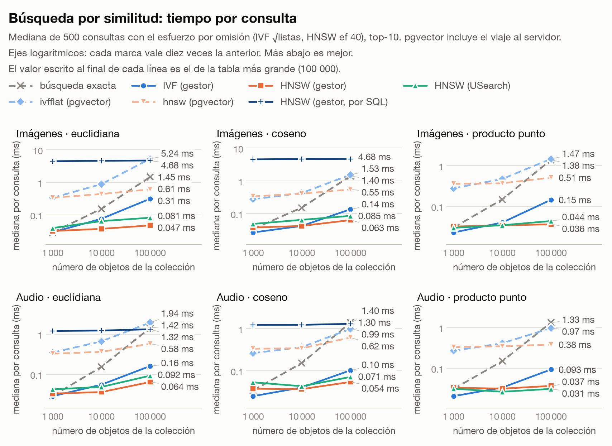

Con 100 000 objetos y el esfuerzo por omisión (IVF 18 de 316 listas, HNSW `ef` 40), en
milisegundos; Recall@10 entre paréntesis:

| Técnica | Imágenes, euclidiana | Imágenes, coseno | Audio, euclidiana | Audio, coseno |
|---|---:|---:|---:|---:|
| búsqueda exacta (gestor) | 1.45 (1.00) | 1.40 (1.00) | 1.42 (1.00) | 1.40 (1.00) |
| IVF (gestor) | 0.31 (0.987) | 0.14 (0.974) | 0.16 (0.983) | 0.10 (0.994) |
| HNSW (gestor) | **0.047** (0.538) | **0.063** (0.927) | **0.064** (0.984) | **0.054** (0.969) |
| HNSW (USearch) | 0.081 (0.892) | 0.085 (0.930) | 0.092 (0.985) | 0.071 (0.958) |
| ivfflat (pgvector) | 5.24 (0.990) | 1.53 (0.972) | 1.94 (0.987) | 0.99 (0.994) |
| hnsw (pgvector) | 0.61 (0.945) | 0.55 (0.953) | 0.58 (0.990) | 0.62 (0.979) |
| HNSW (gestor, SQL) | 4.68 (0.880) | 4.68 (0.925) | 1.32 (0.984) | 1.30 (0.969) |
| IVF (gestor, SQL) | 4.90 (0.987) | 4.78 (0.975) | 1.46 (0.983) | 1.39 (0.994) |

Y por tamaño, con el coseno (p50 en ms):

| Técnica | Imágenes 1 000 | 10 000 | 100 000 | Audio 1 000 | 10 000 | 100 000 |
|---|---:|---:|---:|---:|---:|---:|
| búsqueda exacta (gestor) | 0.034 | 0.152 | 1.40 | 0.034 | 0.153 | 1.40 |
| IVF (gestor) | **0.027** | **0.042** | 0.14 | **0.025** | 0.040 | 0.10 |
| HNSW (gestor) | 0.038 | **0.042** | **0.063** | 0.038 | **0.037** | **0.054** |
| HNSW (USearch) | 0.049 | 0.065 | 0.085 | 0.053 | 0.043 | 0.071 |
| ivfflat (pgvector) | 0.27 | 0.43 | 1.53 | 0.26 | 0.37 | 0.99 |
| hnsw (pgvector) | 0.34 | 0.41 | 0.55 | 0.33 | 0.34 | 0.62 |

- **La búsqueda exacta crece en proporción** (de 0.034 a 1.40 ms, 41 veces para 100 veces
  más objetos) y **HNSW casi no se mueve** (0.038 a 0.063 ms): con 100 000 objetos es 22
  veces más rápido que la exacta. IVF crece como √N: sondea 5 de 25 listas con 1 000, 10 de
  100 con 10 000 y 18 de 316 con 100 000, y cada lista es más larga.
- **Con 1 000 objetos la exacta compite**: 0.034 ms frente a 0.038 de HNSW, sin perder nada.
- **pgvector paga el viaje**: con `hnsw` y el coseno, 0.55 ms en el cliente y 0.28 ms en el
  servidor. Parte de la diferencia con FAISS es la máquina virtual de Docker.
- **IVF es más lento con la euclidiana** (0.31 frente a 0.14 ms en imágenes, con las mismas 18
  listas): sin normalizar, k-means junta muchos vectores en las listas del centro, y las que
  se sondean son más largas. En `ivfflat` la diferencia es mayor (5.24 frente a 1.53 ms).

### Recall contra latencia

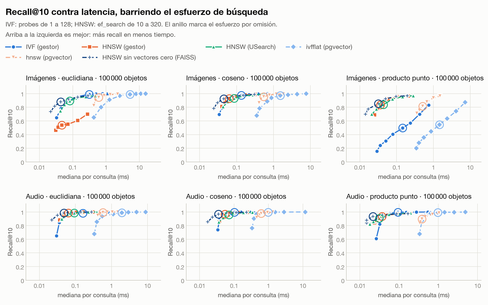

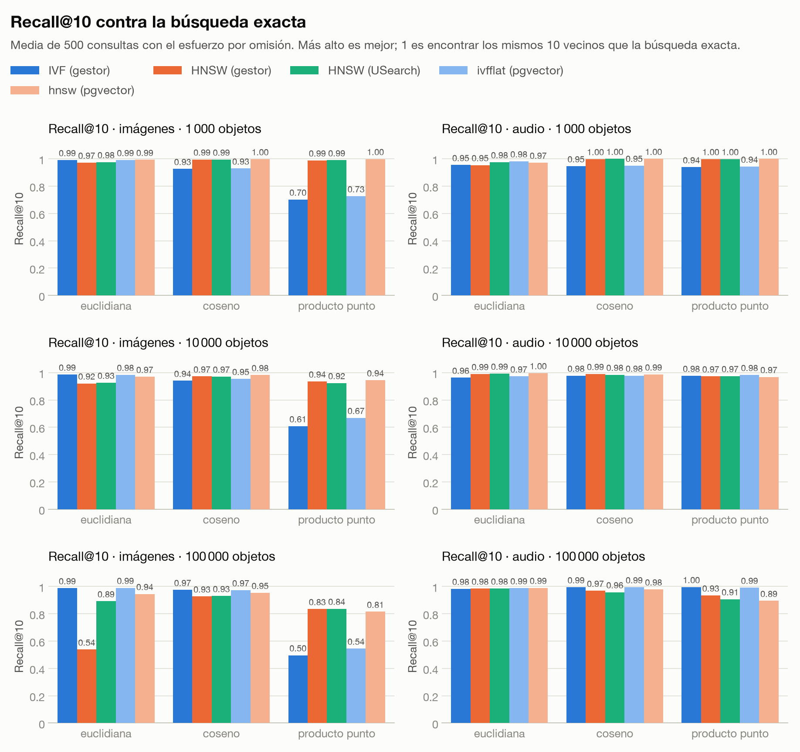

El esfuerzo más chico del barrido que llega a un Recall@10 de 0.95, con 100 000 objetos y el
coseno:

| Técnica | Imágenes: esfuerzo | ms | recall | Audio: esfuerzo | ms | recall |
|---|---:|---:|---:|---:|---:|---:|
| IVF (gestor) | 16 probes | 0.125 | 0.971 | 4 probes | **0.045** | 0.958 |
| HNSW (gestor) | ef 80 | **0.098** | 0.963 | ef 40 | 0.054 | 0.969 |
| HNSW (USearch) | ef 80 | 0.155 | 0.963 | ef 40 | 0.071 | 0.958 |
| ivfflat (pgvector) | 16 probes | 1.40 | 0.968 | 4 probes | 0.448 | 0.967 |
| hnsw (pgvector) | ef 40 | 0.546 | 0.953 | ef 20 | 0.559 | 0.956 |

- **HNSW gana en imágenes y IVF en audio.** En imágenes, IVF necesita 16 listas para 0.95 y
  HNSW llega con `ef` 80 en menos tiempo; en audio basta sondear 4 de 316 listas, porque los
  clips se agrupan bien. Por eso no hay un ganador único: depende de cómo se reparten los
  vectores.
- **Con el esfuerzo por omisión HNSW queda corto con 100 000 imágenes** (0.927 con el coseno):
  `ef` 40 alcanza con 1 000 objetos (0.995) y no con 100 000. Subirlo a 80 cuesta 0.035 ms y
  llega a 0.963.
- **FAISS y USearch hacen el mismo grafo:** a igual `ef`, su recall casi coincide (0.927 y
  0.930), y FAISS responde en la mitad del tiempo (0.045 frente a 0.085 ms).
- **pgvector necesita menos `ef` para el mismo recall** (0.953 con `ef` 40, donde FAISS da
  0.927), pero cada consulta cuesta 0.5 ms por lo menos.

#### Un caso aparte: HNSW, la euclidiana y los vectores cero

Con la euclidiana y 100 000 imágenes, **el HNSW de FAISS se queda en un Recall@10 de 0.538**
con `ef` 40, y ni con `ef` 320 pasa de 0.70; USearch, con el mismo grafo, llega a 0.892 y
pgvector a 0.947. La causa son **294 fotos de las que SIFT no saca ningún descriptor**: su
vector es el cero, los 294 son idénticos, y en la euclidiana el origen está cerca de todo.
El experimento mide el mismo HNSW sin esos vectores (`HNSW (FAISS, sin vectores cero)`):

| `ef_search` | 10 | 20 | 40 | 80 | 160 | 320 |
|---|---:|---:|---:|---:|---:|---:|
| HNSW con los vectores cero | 0.462 | 0.507 | 0.538 | 0.552 | 0.605 | 0.700 |
| HNSW sin los vectores cero | 0.737 | 0.816 | **0.878** | 0.919 | 0.949 | 0.968 |
| HNSW (USearch), con ellos | 0.746 | 0.838 | 0.892 | 0.934 | 0.956 | 0.969 |

Quitarlos devuelve a FAISS a la altura de USearch. En el audio no hay ningún vector cero y
en el coseno el cero queda lejos de todo (su coseno es 0), así que ahí casi no cambia nada.

**Arreglado en #64.** El índice de similitud del gestor (`SimilarityIndex`, el que crea
`CREATE INDEX` y usa `SIMILAR_TO`) ya **no guarda los vectores cero en el índice de
vectores**: los lleva aparte y los mezcla con el resultado con su puntaje exacto (0 con el
coseno y el producto punto, `1 / (1 + ‖q‖)` con la euclidiana). Por SQL, con 100 000
imágenes y la euclidiana, el HNSW del gestor pasa así de un Recall@10 de 0.538 a **0.880**
(`ef` 40, 4.68 ms con la extracción), y la parte de vecinos de su clase de 0.424 a 0.586.
Las filas «HNSW (gestor)» del resto de esta sección miden `HNSWIndex` directamente, que
recibe los vectores que se le den y sigue con los ceros: así se ve el efecto. Lo que obtiene
quien usa el gestor es la fila «HNSW (gestor, SQL)».

### De archivos a vectores: lo que cuesta cada etapa

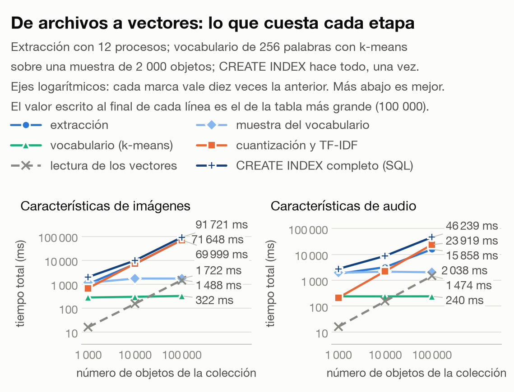

En segundos:

| Etapa | Imágenes 1 000 | 10 000 | 100 000 | Audio 1 000 | 10 000 | 100 000 |
|---|---:|---:|---:|---:|---:|---:|
| extracción (12 procesos) | 1.02 | 6.94 | 71.6 | 1.78 | 3.21 | 15.9 |
| muestra del vocabulario | 1.15 | 1.73 | 1.72 | 1.96 | 2.15 | 2.04 |
| vocabulario (k-means) | 0.28 | 0.30 | 0.32 | 0.24 | 0.24 | 0.24 |
| cuantización y TF-IDF (1 hilo) | 0.68 | 7.26 | 70.0 | 0.21 | 2.24 | 23.9 |
| lectura de los vectores | 0.02 | 0.15 | 1.49 | 0.02 | 0.16 | 1.47 |
| `CREATE INDEX ... USING HNSW` completo, coseno | 2.0 | 9.8 | 91.7 | 2.8 | 8.8 | 46.2 |
| `CREATE INDEX ... USING HNSW` completo, euclidiana | 1.9 | 9.7 | 89.9 | 2.4 | 7.7 | 48.4 |
| `CREATE INDEX ... USING IVF` completo, coseno | 1.9 | 9.5 | 85.5 | 2.4 | 7.7 | 41.1 |
| `CREATE INDEX ... USING IVF` completo, euclidiana | 1.9 | 9.6 | 86.6 | 2.4 | 7.6 | 41.8 |

- **Construir el índice es lo de menos.** Con 100 000 fotos, `CREATE INDEX` tarda 91.7 s, y el
  HNSW sobre los vectores ya calculados, 5.6 s: el 94 % es extraer y cuantizar.
- **Cuantizar cuesta tanto como extraer**: 16.9 millones de descriptores SIFT contra 256
  palabras son 16.9 millones de búsquedas del centroide más cercano, y aquí FAISS corre con un
  hilo mientras la extracción usa 12 procesos. Es el primer lugar donde mirar al optimizar.
- **El vocabulario no crece con la colección**: la muestra son siempre 2 000 objetos y 65 536
  descriptores, y k-means tarda 0.3 s en los tres tamaños.
- **La consulta**: extraer una foto cuesta 3.88 ms y llevarla a vector 0.27 ms; un clip, 1.21
  y 0.09 ms.

### Construcción, memoria y disco de los índices

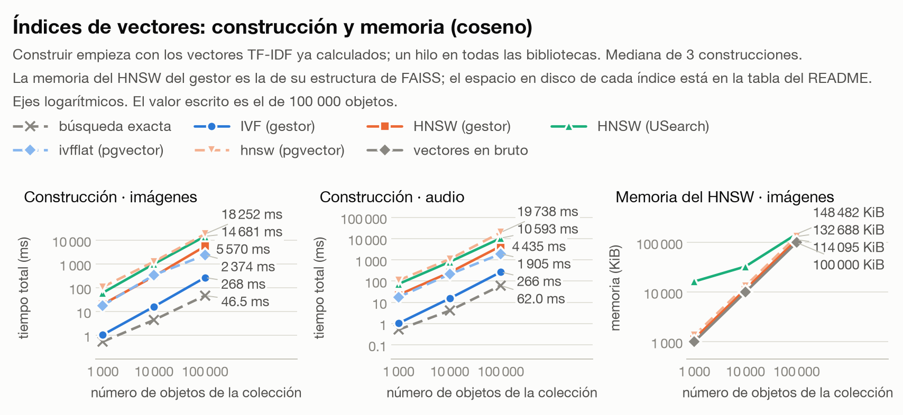

Con 100 000 objetos y el coseno; construcción en segundos, el resto en MiB:

| Técnica | Construir imágenes | Construir audio | Memoria | Disco | Python del gestor |
|---|---:|---:|---:|---:|---:|
| búsqueda exacta (gestor) | **0.046** | **0.062** | — | 98.4 | 7.0 |
| IVF (gestor) | 0.27 | 0.27 | — | 100.3 | 7.0 |
| IVF (FAISS directo) | 0.25 | 0.25 | 98.7 | — | — |
| HNSW (gestor) | 5.57 | 4.43 | — | 112.3 | 11.9 |
| HNSW (FAISS directo) | 5.49 | 4.39 | 111.4 | — | — |
| HNSW (USearch) | 14.7 | 10.6 | 145.0 | 111.8 | — |
| ivfflat (pgvector) | 2.37 | 1.91 | 112.8 | 112.8 | — |
| hnsw (pgvector) | 18.3 | 19.7 | 129.6 | 129.6 | — |

Como referencia, los 100 000 vectores de 256 `float32` ocupan 97.7 MiB, el almacén de
características del gestor (heap y hash de la Parte 1) 132.3 MiB y la tabla de pgvector 111.9
MiB.

- **IVF construye 21 veces más rápido que HNSW** (0.27 frente a 5.57 s): entrena k-means con
  316 centroides y reparte; HNSW inserta cada vector buscando sus vecinos en el grafo.
- **HNSW de FAISS es el más rápido de los tres HNSW**: 5.5 s, frente a 14.7 s de USearch y
  18.3 s de pgvector, todos con un hilo y el mismo `M` y `ef_construction`.
- **El grafo cuesta un 14 % sobre los vectores** (111.4 frente a 97.7 MiB en FAISS): `M` 16
  son 32 vecinos de 4 bytes por nodo en el nivel 0. IVF solo añade los centroides y los
  identificadores (98.7 MiB). USearch reporta 145 MiB porque reserva capacidad por adelantado:
  en disco ocupa 111.8.
- **La capa del gestor retiene 7 a 12 MiB de Python** para 100 000 filas: el conjunto de
  identificadores vivos y, en HNSW, la fila de cada nodo.

### Cuánto cuesta cada capa del gestor

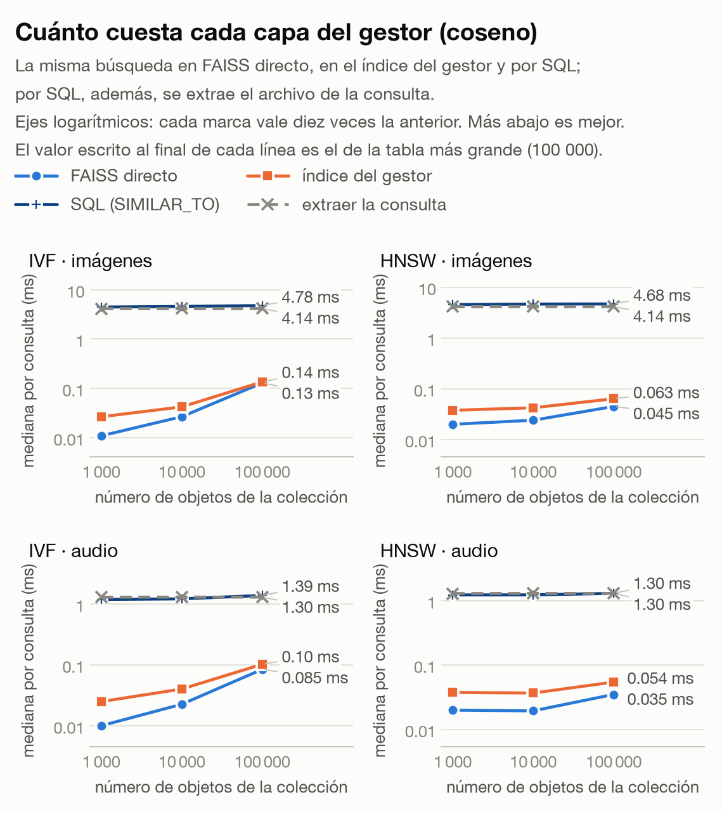

Con 100 000 objetos y el coseno, mediana en ms:

| Capa | IVF imágenes | HNSW imágenes | IVF audio | HNSW audio |
|---|---:|---:|---:|---:|
| FAISS directo | 0.129 | 0.045 | 0.085 | 0.035 |
| índice del gestor (`VectorIndex.search`) | 0.136 | 0.063 | 0.103 | 0.054 |
| extraer la consulta y llevarla a vector | 4.14 | 4.14 | 1.30 | 1.30 |
| `SIMILAR_TO` por SQL, todo incluido | 4.78 | 4.68 | 1.39 | 1.30 |

- **La capa del índice suma menos de 0.02 ms** por consulta (de 0.007 a 0.019): validar y
  normalizar la consulta,
  y convertir los resultados en filas.
- **Por SQL, el IVF es el mismo (arreglado en #64).** Antes, `CREATE INDEX` llenaba el índice
  de vectores en lotes de 4 096 filas e `IVFIndex` entrenaba sus listas con el primero: con
  10 000 clips quedaba con 64 listas y 8 `probes` en vez de 100 y 10, y con 100 000 imágenes
  su Recall@10 era 0.965. Ahora añade todos los vectores de una vez: su `describe` dice 25,
  100 y 316 listas con 5, 10 y 18 `probes`, como el IVF del experimento, y su Recall@10 con
  100 000 imágenes es 0.975. En audio coincide con el del experimento en todo (0.994 con
  100 000 y el coseno); en imágenes difiere un poco porque entrena sin los 294 vectores cero.
  El HNSW por SQL también recibe sus vectores de una vez: en audio es el mismo grafo que el
  del experimento, y en imágenes, el del HNSW sin vectores cero (0.925 con el coseno).
- **Por SQL, el 88 % del tiempo es extraer la consulta.** Con una foto, `SIMILAR_TO` tarda
  4.68 ms, y extraerla y llevarla a vector, 4.14: analizar el SQL, planificar, buscar y leer
  las 10 filas cabe en lo que queda, unos 0.5 ms. Con un clip, extraerlo cuesta 1.30 ms de
  los 1.30, y el resto se pierde en lo que varía la medida.

### Galería de aciertos y errores

El HNSW del gestor con el coseno y 100 000 objetos: arriba, las consultas con más vecinos de
su clase (cada una de una clase distinta); abajo, las que menos. En imágenes, en promedio el
62 % de los 10 vecinos es de la categoría de la consulta; en audio, el 12 %.


Los aciertos son casi duplicados: la misma funda para otros modelos de celular, la misma
cortina en otro color, soportes de televisor fotografiados igual. Algunos errores lo son solo
para la etiqueta: unos marcadores clasificados como «safety supply» encuentran marcadores
(«marking pen»). Otros son formas parecidas sin relación: una pieza didáctica circular
encuentra sillas de oficina, y una bandeja de cocina, muebles con rejillas.

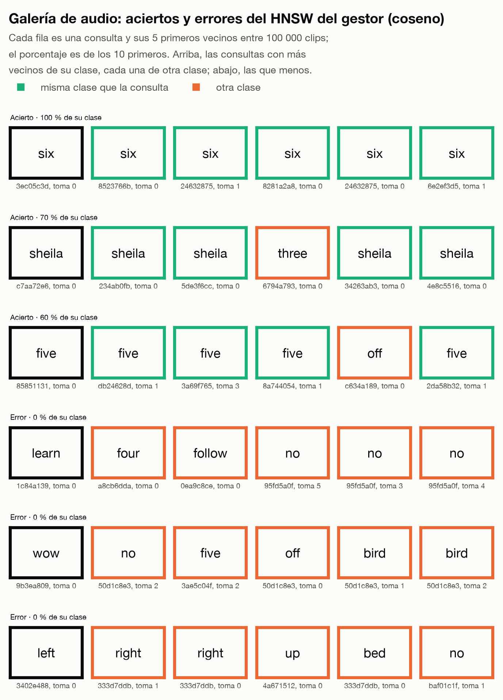

En audio los errores son de sonido: «left» encuentra «right», «learn» encuentra «four» y
«follow». La bolsa de palabras auditivas sabe qué sonidos hay, no en qué orden.

### Conclusiones

**IVF contra HNSW.** HNSW es el más rápido por consulta y el que menos crece: con 100 000
objetos responde en 0.054 a 0.063 ms, 22 a 26 veces antes que la búsqueda exacta. Pero su
recall cae con el tamaño a `ef` fijo (0.995, 0.972 y 0.927 en imágenes con el coseno) y
construir le cuesta 21 veces lo que a IVF. IVF, con sus √listas, sube de recall con el tamaño
(0.926, 0.940 y 0.974) y es el más preciso por omisión, a cambio de unas consultas el doble de
lentas (0.14 ms). En audio, donde los clips se agrupan bien, IVF con 4 listas ya da 0.958 en
0.045 ms y gana la curva.

**Euclidiana contra coseno.** El coseno es la métrica para estos vectores: da vecinos más
parecidos en imágenes (0.63 frente a 0.60 de su clase con 100 000), empata en audio, hace
más rápido a IVF (0.14 frente a 0.31 ms) y no sufre el problema del vector cero en el grafo
de FAISS, que el gestor ya evita igual (#64). El producto punto sobre TF-IDF sin normalizar no sirve: queda por debajo del azar en
imágenes.

**Las bibliotecas.** Con los mismos parámetros, FAISS y USearch construyen grafos de calidad
parecida; FAISS construye 2.7 veces más rápido y responde en la mitad del tiempo. pgvector
encuentra un poco más con el mismo `ef` y es la opción si los datos ya viven en PostgreSQL,
pero cada consulta cuesta al menos 0.5 ms desde el cliente y construir su HNSW, 3.3 veces lo
de FAISS.

**El gestor.** Su capa suma menos de 0.02 ms por consulta sobre FAISS, y por SQL lo que
domina es extraer el archivo de la consulta: 4.1 ms de los 4.7 de una foto. Al construir, el 94 % es
extraer y cuantizar, no el índice.

### Tabla comparativa y recomendaciones

| | Búsqueda exacta | IVF (gestor) | HNSW (gestor) | HNSW (USearch) | pgvector |
|---|---|---|---|---|---|
| **Consulta, 100 000 (coseno)** | 1.40 ms | 0.14 ms | 0.063 ms | 0.085 ms | `hnsw` 0.55 ms, `ivfflat` 1.53 ms |
| **Recall@10 por omisión** | 1 | 0.974 imágenes, 0.994 audio | 0.927 imágenes, 0.969 audio | 0.930, 0.958 | `hnsw` 0.953, 0.979 |
| **Construir 100 000** | 0.05 s | 0.27 s | 5.6 s | 14.7 s | `hnsw` 18.3 s, `ivfflat` 2.4 s |
| **Memoria sobre los vectores** | ninguna | +1 % | +14 % | +14 % en disco | `hnsw` +33 % |
| **Ventajas** | Exacta, sin parámetros, sin construir | Construye en segundos; recall alto y que sube con el tamaño; borra de verdad | La consulta más rápida y la que menos crece | Mismo grafo que FAISS, embebible (DuckDB) | Transaccional y junto a los datos; más recall con el mismo `ef` |
| **Desventajas** | Crece en proporción: 41 veces de 1 000 a 100 000 | Más lento con la euclidiana; el recall depende de cómo se reparten los vectores | Construir es caro; recall cae con el tamaño a `ef` fijo; el vector cero rompe el grafo en la euclidiana si no se deja fuera, como hace el gestor desde #64 | 2.7 veces más lento al construir que FAISS | Medio milisegundo de viaje; `ivfflat` lento con la euclidiana (5.24 ms) |
| **Se elige cuando** | Hasta unos 10 000 objetos, o con un filtro que deja pocas filas | La colección cambia mucho o se reconstruye seguido; se pide recall alto | Colecciones grandes y estables, con `ef` 80 en vez de 40 | Se quiere un HNSW sin FAISS | Los vectores ya están en PostgreSQL |

**Recomendaciones para el gestor**, que salen de estas cifras:

- **Hechas en #64:** dejar los vectores cero fuera del índice de vectores y responderlos con
  su puntaje exacto (por SQL, el HNSW con la euclidiana pasa de 0.538 a 0.880 con 100 000
  imágenes), y entrenar el IVF de `CREATE INDEX` con todos los vectores (316 listas con
  100 000 en vez de 64; Recall@10 de 0.965 a 0.975).
- **Pendientes:** subir `ef_search` por omisión a 80 con colecciones de 100 000 (0.963 en
  0.098 ms) y cuantizar con todos los hilos de FAISS, que es la mitad de `CREATE INDEX`. El
  coseno ya es la métrica por omisión.

**Lo que este experimento no dice.**

- Los tiempos son de un hilo. Con varios, FAISS reparte la cuantización y la construcción del
  HNSW, y pgvector construye en paralelo; aquí no se midió.
- pgvector corrió en Docker y las demás técnicas fuera: su tiempo en el servidor está en el
  JSON, pero ni ese número está libre de la máquina virtual.
- Un vocabulario de 256 palabras es chico: más palabras separarían mejor las clases, sobre
  todo en audio, a cambio de vectores más largos. Este experimento lo deja fijo.
- La regla de las listas es la de FAISS (√N). pgvector recomienda filas / 1 000 (100 con
  100 000) y un `probes` de √listas; aquí `ivfflat` usa las mismas 316 listas que el gestor
  para comparar la misma estructura.
- El producto punto no es una distancia: un HNSW construido con él no tiene las garantías del
  grafo, y su recall (0.834 en imágenes) lo refleja.

### Reproducirlo

```bash
uv sync --all-packages --extra postgres --extra plots --extra usearch
.venv/bin/python -m benchmarks.multimedia.abo --salida data/datasets/abo
.venv/bin/python -m benchmarks.multimedia.speech_commands --salida data/datasets/speech_commands

# PostgreSQL con pgvector, de la imagen del perfil bench, solo mientras se mide
docker compose --profile bench build postgres
docker run --rm -d --name minigestor-pgvector -p 127.0.0.1:55432:5432 \
    -e POSTGRES_HOST_AUTH_METHOD=trust -e POSTGRES_DB=minigestor_bench \
    minigestor-postgres -c shared_buffers=1GB
export BENCH_POSTGRES_DSN="host=127.0.0.1 port=55432 dbname=minigestor_bench user=postgres"

.venv/bin/python -m benchmarks.multimedia_benchmark --images data/datasets/abo \
    --audio data/datasets/speech_commands --sizes 1000 10000 100000 \
    --repetitions 3 --build-repetitions 3 --postgres-maintenance-work-mem 1GB \
    --sql-metrics cosine euclidean --features-dir data/bench-multimedia
docker stop minigestor-pgvector
```

La medida publicada tardó 1 h 36 min reutilizando las características, con el equipo
cargado (carga media de hasta 21). La anterior, desde cero y solo con el coseno por SQL,
tardó 32 min: 9 en extraer y cuantizar (dos pasadas por colección, una solo para medir la
extracción), 6 en los `CREATE INDEX` por SQL y el resto en construir cada índice 3 veces y
barrer los esfuerzos. Medir también la euclidiana por SQL suma dos `CREATE INDEX` más por
tamaño y dataset. Con `--features-dir`, las características quedan en `data/` (unos 300 MB)
y la siguiente ejecución las reutiliza: el JSON lo anota (`reutilizadas`). Sin `BENCH_POSTGRES_DSN` se omite pgvector, y sin `usearch` instalado, USearch.
Todo corre también dentro del perfil `bench` de Docker, más lento.

## 6. Columnas `VECTOR(n)` — HNSW e IVF por SQL

`vector_benchmark.py` mide lo que pagará un servicio de la Parte 5 que guarde los
embeddings de un modelo en una columna `VECTOR(384)` —la dimensión de
multilingual-e5-small, el del RAG— y los busque con `SIMILAR_TO(emb, $1, k = 10)`, todo por
SQL: analizar, planificar, buscar en el índice y leer las filas.

**Los vectores son sintéticos, y se dice.** Vectores uniformes en 384 dimensiones están
todos casi a la misma distancia de todos: ningún índice aproximado los separa y el recall
medido sería el de un caso patológico, no el de embeddings. La colección sale de una
**mezcla de gaussianas normalizada** ([`vectors/mixture.py`](vectors/mixture.py)), con
semilla fija: 1 000 centros al azar en la esfera unitaria con pesos de una Dirichlet(1)
(temas grandes y chicos), alrededor de cada uno una variación en un subespacio propio de 24
direcciones (dispersión 1,0) más un ruido chico en todas (0,5), y cada vector normalizado a
norma 1, como los de E5 o CLIP que se comparan con el coseno. El coseno medio entre dos
vectores al azar es ~0 y el del décimo vecino de una consulta, ~0,6. **Las cifras de recall
dependen de esa distribución**: con embeddings reales cambian, y el experimento se repite
sobre ellos con `--clusters`, `--intrinsic-dimension`, `--spread` y `--noise` o, mejor, con
los del servicio cuando existan. Los tamaños son subconjuntos anidados de la misma
colección; las 500 consultas salen de la misma mezcla con otra semilla y no están en la
tabla.

**Qué se mide**, sobre `vectores (id INT PRIMARY KEY, parte INT, emb VECTOR(384))` con un
índice hash en `parte`:

- **Construcción**: `CREATE INDEX ... USING HNSW | IVF (emb) WITH (metric = 'cosine')` con
  los parámetros por omisión (`M` 16, `ef_construction` 64, `ef_search` 40; IVF con √N
  listas y √listas `probes`), y lo que ocupa el índice en disco. La tabla se carga antes,
  fila a fila (`Table.insert`), y se reporta aparte.
- **Consulta**: cada `SIMILAR_TO` se responde 3 veces y cuenta su mediana; de las 500 salen
  la mediana (p50) y el percentil 95. **Recall@10** contra la búsqueda exacta calculada
  aparte con numpy en `float64` (un vecino cuenta si su puntaje llega al décimo).
- **Búsqueda exacta por SQL**: la misma consulta con `WITH METRIC = dot`, que el índice no
  ordena y por eso compara contra todas las filas. Con vectores de norma 1 el producto punto
  ordena igual que el coseno, así que su Recall@10 es 1. La primera consulta arma la búsqueda
  exacta leyendo la tabla: es su «construcción».
- **Con filtro**: `AND parte = p`, que deja el 10 % de las filas por el índice hash; el
  filtro va dentro de la búsqueda (100 consultas).
- **Curvas** de recall contra latencia con 100 000 vectores: `ef_search` de 10 a 320 y
  `probes` de 1 a 128.

**Dónde corrió.** Apple M4 Pro (12 núcleos), macOS, Python 3.12, FAISS 1.16.0, un hilo de
FAISS (`--threads 1`), carga media de 2,9 a 3,5 durante la medida (en el JSON). Tardó 2 min
34 s, casi todo en cargar la tabla.

### Resultados medidos

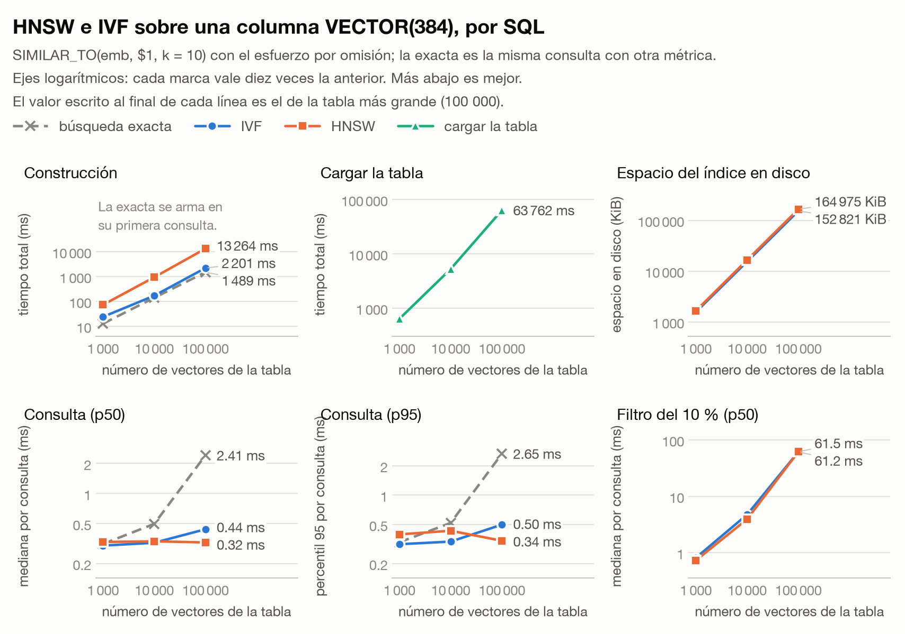

Con 100 000 vectores de 384 dimensiones:

| Técnica | Construcción | Disco | Consulta p50 | Consulta p95 | Recall@10 | Con filtro p50 | Recall@10 con filtro |
|---|---:|---:|---:|---:|---:|---:|---:|
| búsqueda exacta (SQL) | 1,49 s (1.ª consulta) | — | 2,41 ms | 2,65 ms | 1,000 | — | — |
| IVF (316 listas, 18 probes) | **2,20 s** | 149 MiB | 0,44 ms | 0,50 ms | **0,977** | 61,2 ms | **0,952** |
| HNSW (`M` 16, `ef` 40) | 13,26 s | 161 MiB | **0,33 ms** | **0,34 ms** | 0,971 | 61,5 ms | 0,890 |

| Vectores | Cargar la tabla | HNSW: construir · p50 · Recall@10 | IVF: construir · p50 · Recall@10 | Exacta: p50 |
|---:|---:|---|---|---:|
| 1 000 | 0,64 s | 0,07 s · 0,33 ms · 0,928 | 0,02 s · 0,30 ms · 0,514 | 0,31 ms |
| 10 000 | 5,3 s | 0,94 s · 0,33 ms · 0,957 | 0,17 s · 0,32 ms · 0,897 | 0,50 ms |
| 100 000 | 63,8 s | 13,3 s · 0,33 ms · 0,971 | 2,20 s · 0,44 ms · 0,977 | 2,41 ms |

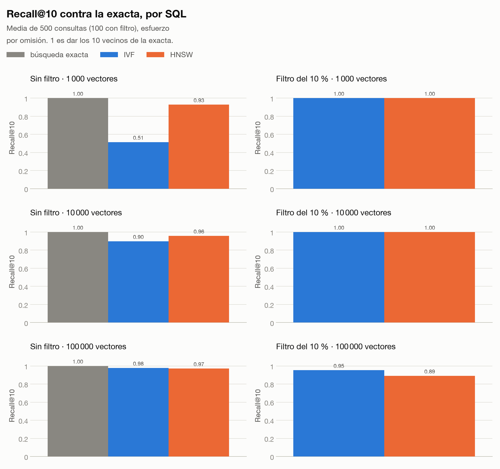

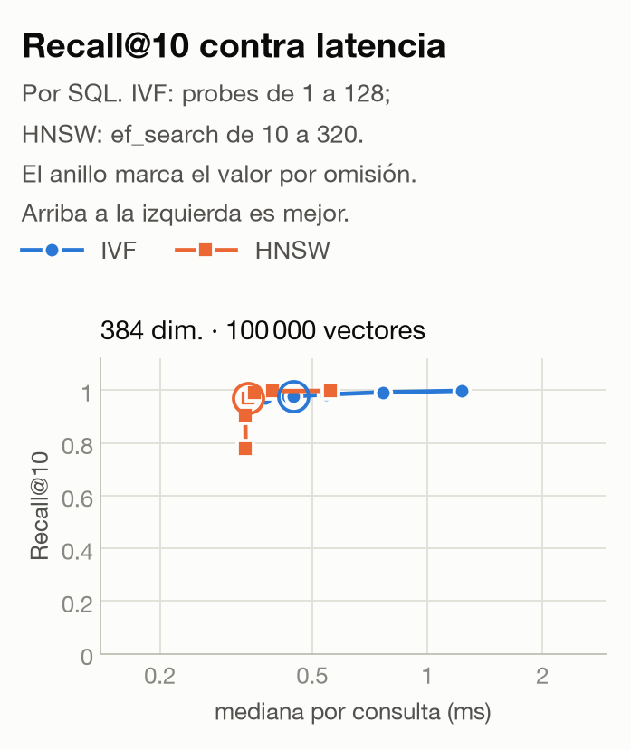

| `ef_search` (HNSW) | 10 | 20 | **40** | 80 | 160 | 320 |
|---|---:|---:|---:|---:|---:|---:|
| p50 (ms) | 0,34 | 0,33 | 0,34 | 0,35 | 0,39 | 0,56 |
| Recall@10 | 0,777 | 0,904 | 0,971 | 0,991 | 0,997 | 0,998 |

| `probes` (IVF) | 1 | 2 | 4 | 8 | 16 | **18** | 32 | 64 | 128 |
|---|---:|---:|---:|---:|---:|---:|---:|---:|---:|
| p50 (ms) | 0,33 | 0,33 | 0,35 | 0,38 | 0,43 | 0,45 | 0,54 | 0,77 | 1,23 |
| Recall@10 | 0,935 | 0,954 | 0,960 | 0,970 | 0,976 | 0,977 | 0,984 | 0,992 | 0,998 |

### Antes de medir: el filtro costaba 185 ms

La primera medida con 100 000 vectores daba **185 ms** por consulta con filtro (p95 195),
75 veces la búsqueda exacta sin filtro. El perfil (`cProfile` y `EXPLAIN ANALYZE`) mostró
que el filtro ya iba por el índice hash de `parte`, pero que de cada una de las 10 000
candidatas `VectorSearchScan` decodificaba la fila entera para evaluar `parte = 3`, con sus
384 componentes, y `VectorCodec.from_slots` los convertía uno a uno a `float` aunque `struct`
ya los devuelve así: el 65 % del tiempo. Dos arreglos, cada uno en su commit:

- `VectorCodec.from_slots` devuelve la tupla de `struct` tal cual;
- el filtro previo lee de cada fila solo las columnas que nombra (`Table.unpack_columns`).

Con 20 000 vectores la consulta con filtro pasó de 30 a 16 ms con el primero y a 7 ms con
los dos; con 100 000, de **185 a 61 ms**. Lo que queda, medido con el perfil: el 57 % es
leer las 10 000 filas de 10 000 páginas distintas del heap (dos filas de 1,5 KiB por página
de 4 KiB, con un buffer pool de 2 048 páginas, así que casi todas vienen del sistema
operativo) y el 20 % es volver a evaluar `parte = 3` en filas que el índice hash ya
garantiza. Evitarlo pide un filtro que se responda **solo con el índice**, sin leer las
filas, que es un cambio del planificador y queda fuera de esta medida. Con 10 000 vectores
(1 000 filas en el filtro, la búsqueda exacta) la consulta con filtro tarda 3,9 ms.

### Conclusiones

- **Por SQL, una consulta cuesta lo mismo con 1 000 que con 100 000 vectores**: 0,33 ms con
  HNSW. Analizar el SQL, planificar, convertir el parámetro JSON en vector y leer las 10
  filas pesa más que la búsqueda en el grafo. La exacta sí crece con la tabla: 2,41 ms con
  100 000, siete veces el HNSW, y crecería en proporción.
- **IVF construye 6 veces más rápido** (2,2 frente a 13,3 s) y con estos vectores llega al
  mismo recall (0,977 frente a 0,971): los grupos de la mezcla coinciden bien con sus listas.
  Con 1 000 vectores y 25 listas, en cambio, su recall es 0,51: hay más temas (1 000) que
  listas, y 5 `probes` no alcanzan. Con datos reales conviene medir antes de elegir.
- **HNSW es más estable en la cola**: su p95 queda a 0,02 ms de su mediana; el de IVF
  depende del tamaño de las listas que toque.
- **Con un filtro del 10 % el recall baja** —0,95 IVF, 0,89 HNSW con 100 000—: FAISS filtra
  durante la búsqueda con un `IDSelector`, y en HNSW el grafo se recorre por nodos que el
  filtro descarta con el mismo `ef`. Subir `ef_search` en esas consultas lo compensa. Con
  1 000 filas o menos en el filtro la búsqueda es exacta (`vector_exact_filter_rows`), y el
  recall es 1.
- **El índice ocupa lo que los vectores**: 161 MiB el HNSW y 149 MiB el IVF, frente a 146
  MiB de 100 000 × 384 `float32`; el grafo suma un 10 %. Es un derivado: se reescribe al
  cerrar, no en cada `COMMIT`.
- **Cargar la tabla es lo lento** (64 s para 100 000 filas fila a fila, con su índice de
  clave primaria y el hash): la carga masiva se mide en la sección 9.

### La Parte 4 después del cambio

El índice de rutas de la Parte 4 y el de `VECTOR(n)` comparten ahora el mantenimiento del
índice de vectores (`IndexedVectors`), así que el `SIMILAR_TO` por SQL de la sección 5 pasa
por código nuevo. Se volvió a medir una parte representativa —10 000 objetos, coseno, con
las características ya extraídas (`--features-dir`)— y se comparó con el JSON publicado:

| 10 000 objetos, coseno | Publicado | Después del cambio |
|---|---:|---:|
| HNSW por SQL, imágenes: p50 · Recall@10 | 4,65 ms · 0,9728 | 4,62 ms · 0,9728 |
| IVF por SQL, imágenes: p50 · Recall@10 | 4,58 ms · 0,9518 | 4,62 ms · 0,9518 |
| HNSW por SQL, audio: p50 · Recall@10 | 1,23 ms · 0,9908 | 1,27 ms · 0,9906 |
| IVF por SQL, audio: p50 · Recall@10 | 1,22 ms · 0,9780 | 1,21 ms · 0,9780 |
| `CREATE INDEX` HNSW, imágenes · audio | 9,78 s · 8,75 s | 10,03 s · 8,62 s |
| `CREATE INDEX` IVF, imágenes · audio | 9,47 s · 7,72 s | 9,46 s · 7,35 s |

Mismas listas, `probes` y vectores cero (29 en imágenes) y el mismo recall; los tiempos
quedan dentro de un 3 % arriba o abajo, lo que varía la medida en un equipo compartido. El
0,9906 del HNSW de audio es el mismo que da el índice del gestor sin SQL en esa corrida: el
grafo de FAISS no sale idéntico entre construcciones.

### Reproducirlo

```bash
.venv/bin/python -m benchmarks.vector_benchmark --sizes 1000 10000 100000
.venv/bin/python -m benchmarks.plot
```

Sin datasets que descargar ni PostgreSQL. `--dimension`, `--clusters`,
`--intrinsic-dimension`, `--spread`, `--noise` y `--seed` cambian la colección;
`--queries`, `--filter-queries`, `--repetitions`, `--ef-search` y `--probes`, la medida.

## 7. Reconocimiento facial — latencia del pipeline y cobertura en LFW

El servicio de rostros ([`apps/faces`](../apps/faces/README.md)) convierte cada foto en
embeddings en tres etapas: **decodificar** (Pillow, con la orientación EXIF y los canales),
**detectar** (llevar la foto a un lado de 320 a 640 px y correr YuNet) y **alinear y
embeber** el rostro de mayor área (`alignCrop` y SFace). Se mide cada etapa por separado,
foto por foto, con un hilo de OpenCV:

- las **13 233 fotos de LFW** en su tamaño (250 x 250 px), que dan también la cobertura;
- **500 de ellas** elegidas al azar (semilla 20261118), ampliadas a 500, 1 000, 2 000 y
  4 000 px de lado y vueltas a codificar en JPEG de calidad 92, para ver el costo de una foto
  de cámara. Ampliar y codificar no entra en el tiempo.

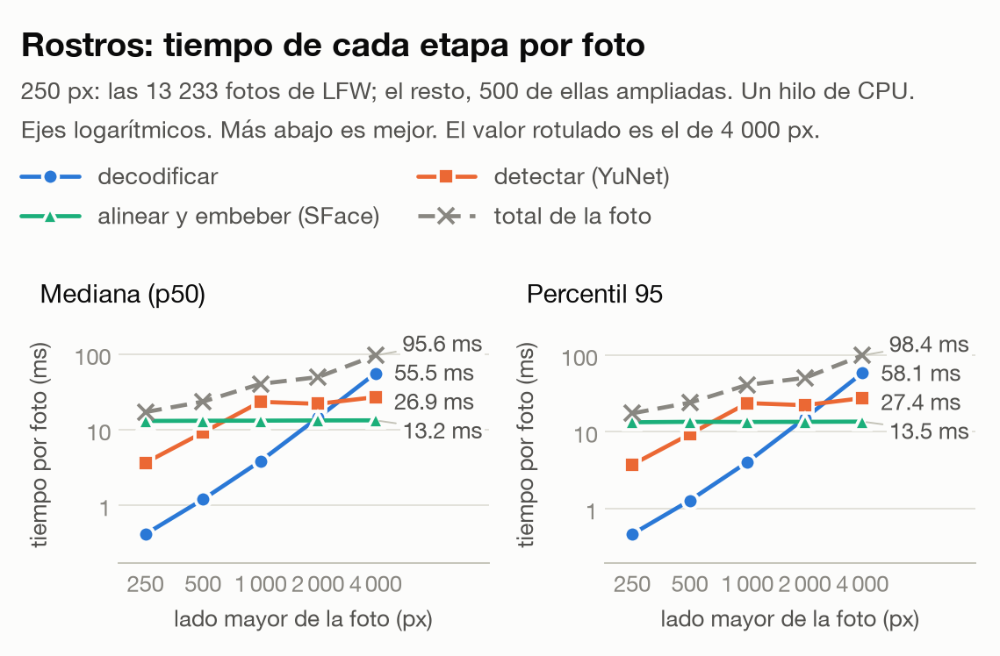

| Lado mayor | Fotos | Decodificar p50 / p95 | Detectar p50 / p95 | Alinear y embeber p50 / p95 | Total p50 / p95 |
|---:|---:|---:|---:|---:|---:|
| 250 px | 13 233 | 0,41 / 0,46 ms | 3,63 / 3,72 ms | 12,99 / 13,27 ms | 17,03 / 17,36 ms |
| 500 px | 500 | 1,19 / 1,27 ms | 9,14 / 9,28 ms | 13,07 / 13,46 ms | 23,40 / 23,88 ms |
| 1 000 px | 500 | 3,82 / 4,02 ms | 23,27 / 23,59 ms | 13,11 / 13,39 ms | 40,20 / 40,66 ms |
| 2 000 px | 500 | 14,38 / 14,95 ms | 21,87 / 22,16 ms | 13,20 / 13,45 ms | 49,42 / 50,17 ms |
| 4 000 px | 500 | 55,52 / 58,06 ms | 26,87 / 27,37 ms | 13,23 / 13,54 ms | 95,61 / 98,44 ms |

| Cobertura de YuNet en LFW | Fotos |
|---|---:|
| con al menos un rostro | 13 221 (99,91 %) |
| sin ningún rostro | 12 |
| con más de un rostro | 1 033 (7,8 %) |

### Conclusiones

- **Embeber cuesta lo mismo con cualquier foto** (13,0 a 13,2 ms): SFace siempre recibe el
  recorte alineado de 112 x 112. Con un rostro por foto es el piso del pipeline.
- **Detectar deja de crecer pasados los 640 px**, porque YuNet ve siempre la foto reducida a
  ese lado; de 500 a 1 000 px sube de 9 a 23 ms porque la red pasa de 500 a 640 px y se
  suma la reducción. La primera versión reducía de una vez con `INTER_AREA`, que con un
  factor fraccionario cae al camino lento de OpenCV: detectar en una foto de 4 000 px
  tardaba 93,0 ms y en una de 2 000, 39,2. Reducir primero por el mayor factor entero y
  después el resto lo dejó en 26,9 y 21,9 ms (el total de 4 000 px, de 161,9 a 95,6 ms),
  con una diferencia media de un nivel de gris en la imagen reducida.
- **Con fotos de 12 MP domina decodificar** (55 de 96 ms). Los cuadros de cámara del uso en
  vivo son de 500 a 1 000 px: 23 a 40 ms por foto, por debajo de la meta de 100 ms del epic
  antes de buscar en el índice.
- **La dispersión es mínima:** el p95 queda a menos de un 5 % de la mediana al detectar, al
  embeber y en el total, porque cada red hace siempre el mismo trabajo para un mismo tamaño
  de entrada; decodificar varía algo más (12 % en las fotos de 250 px, que tardan menos de
  medio milisegundo).
- **YuNet encuentra rostro en el 99,91 % de LFW** con el umbral de confianza de OpenCV Zoo
  (0,9). En el 7,8 % encuentra más de uno: son fotos de prensa con otras personas detrás.
  La verificación de LFW tendrá que elegir el rostro del centro, no el de mayor área a
  ciegas ni exigir uno solo.

**Lo que esta medida no dice.** Es un hilo de un Apple M4 Pro (carga media 6,3 al empezar,
con otros procesos en el equipo); con más hilos OpenCV reparte la red, y en el servidor de
Docker la cifra será otra. Las fotos ampliadas no tienen más detalle que la original de
250 px: miden el costo de su tamaño, no la precisión con fotos grandes. La exactitud de la
verificación con los pares de LFW y el umbral del conjunto abierto se miden en la sección 18.

## 8. Tramos de audio y consulta por segmentos

`segments_benchmark.py` mide lo que añade el issue #74 para la detección de copyright
(Parte 5, opción C): filas que son **tramos** de una pista (`pista.mp3#t=10,20`, W3C Media
Fragments) y la **consulta por segmentos** de una canción subida (`POST /media/segments`).
Todo corre por el motor real, sobre las primeras 200 pistas de FMA (`fma_small`, MP3 de
30 s) por ruta, con ventanas de 10 s cada 5 s, `k` = 5 y el HNSW por omisión (coseno).

**Qué se compara.**

- **Consultar una canción.** `POST /media/segments` sube la canción una vez, la decodifica
  una vez, describe cada ventana y las busca todas en un solo lote de FAISS. Sin él, un
  cliente subiría la canción con `POST /media/queries` y lanzaría un
  `SIMILAR_TO('cancion#t=a,b', k = 5)` por ventana: una petición, una decodificación de su
  tramo y una búsqueda por ventana. Las canciones son pistas del catálogo pegadas hasta durar
  30, 60, 120 y 180 s, en MP3 a 44,1 kHz; se consultan contra una tabla de 898 tramos (las
  ventanas de 10 s cada 5 s que caben en cada una de las 200 pistas). Mediana de 3; el tiempo
  es el del cliente, con HTTP (`TestClient`) incluido.
- **Indexar tramos.** `CREATE INDEX ... USING HNSW` sobre las pistas enteras frente a la
  misma colección cortada en tramos, con un proceso de extracción; y la extracción sola de
  esos tramos, en un proceso, leyendo cada uno su rango frente a una decodificación por
  pista (lo que hace el índice).

**Dónde corrió.** Apple M4 Pro (12 núcleos), macOS, Python 3.12; la carga media al empezar
era de 18 (terminaba otra medida) y bajó durante la corrida. Una corrida anterior con la
máquina libre dio las mismas cifras a ±4 %.

### Resultados medidos

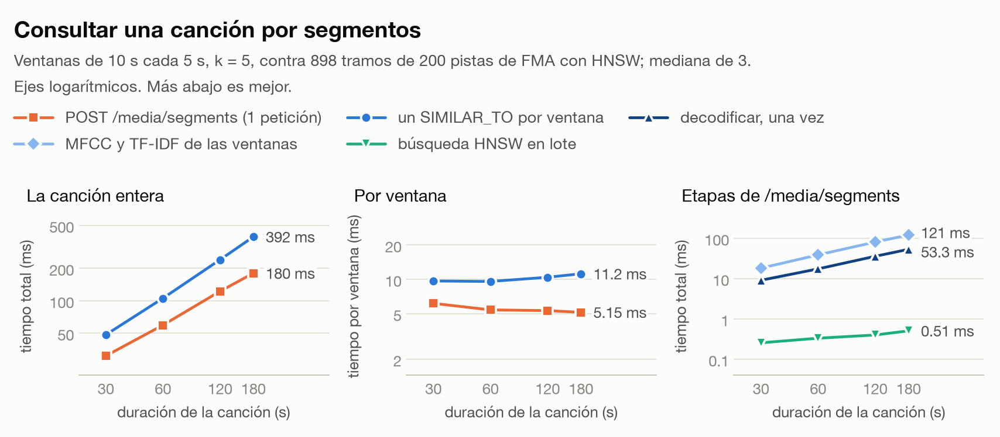

| Canción | Ventanas | `/media/segments` | por ventana | un `SIMILAR_TO` por ventana | por ventana | Más rápido | Mismos vecinos |
|---:|---:|---:|---:|---:|---:|---:|---:|
| 30 s | 5 | 30,9 ms | 6,2 ms | 48,4 ms | 9,7 ms | 1,6× | 5/5 |
| 60 s | 11 | 59,5 ms | 5,4 ms | 105,6 ms | 9,6 ms | 1,8× | 11/11 |
| 120 s | 23 | 122,5 ms | 5,3 ms | 240,3 ms | 10,4 ms | 2,0× | 23/23 |
| 180 s | 35 | **180,2 ms** | 5,2 ms | 392,4 ms | 11,2 ms | **2,2×** | 35/35 |

Dónde se va el tiempo de `/media/segments` (lo que mide el servidor):

| Canción | Decodificar (una vez) | MFCC y TF-IDF de las ventanas | Búsqueda en lote | Resto (HTTP, filas) |
|---:|---:|---:|---:|---:|
| 30 s | 9,1 ms | 18,2 ms | 0,3 ms | 3,4 ms |
| 60 s | 17,4 ms | 38,8 ms | 0,3 ms | 2,9 ms |
| 120 s | 35,8 ms | 80,7 ms | 0,4 ms | 5,6 ms |
| 180 s | 53,3 ms | 121,0 ms | 0,5 ms | 5,4 ms |

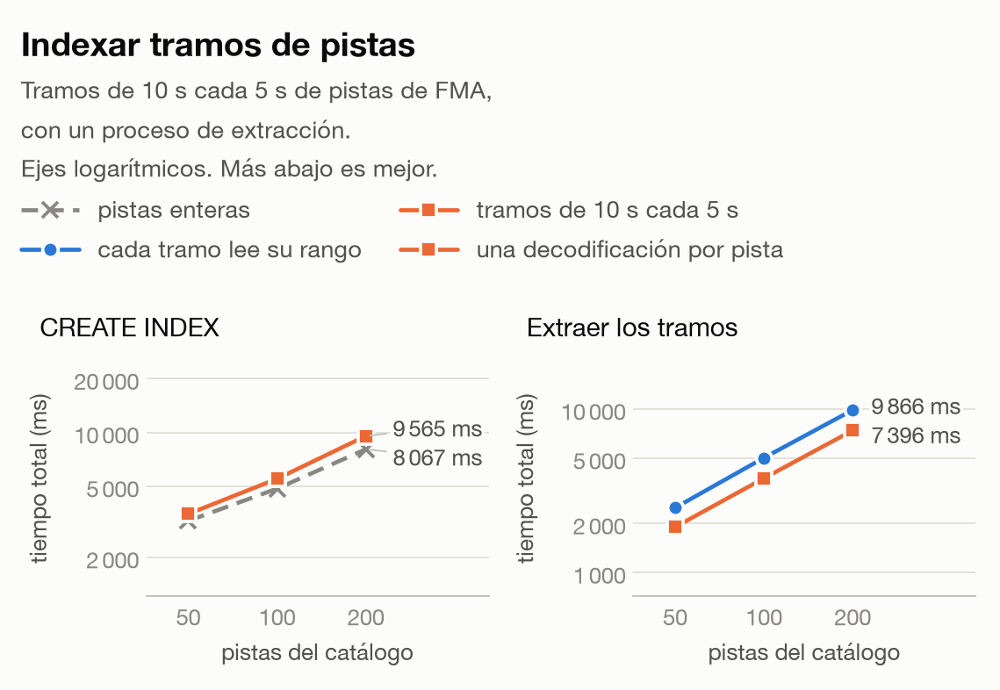

| Pistas | Tramos | `CREATE INDEX` pistas enteras | `CREATE INDEX` tramos | Extraer: cada tramo lee su rango | Extraer: una decodificación por pista | Ahorro |
|---:|---:|---:|---:|---:|---:|---:|
| 50 | 218 | 3,20 s | 3,50 s | 2,49 s | 1,90 s | 24 % |
| 100 | 445 | 4,85 s | 5,51 s | 5,03 s | 3,77 s | 25 % |
| 200 | 898 | 8,07 s | 9,57 s | 9,87 s | 7,40 s | 25 % |

### Conclusiones

- **Una canción de 3 min se consulta en 180 ms**, 2,2 veces más rápido que ventana por
  ventana (392 ms), y la ventaja crece con la canción: cada `SIMILAR_TO` suelto paga su
  petición, su análisis y planificación SQL, su lectura del tramo y su búsqueda, unos
  11 ms; dentro de `/media/segments` una ventana cuesta 5,2 ms.
- **Las dos respuestas son la misma.** En las 74 ventanas medidas, los vecinos coinciden en
  orden y la mayor diferencia de puntaje es 0: el recorte de un audio decodificado entero y
  la lectura de solo el tramo dan las mismas muestras hasta la palabra auditiva (en MP3,
  libsndfile difiere en 1e-7 tras saltar, y no cambió ninguna).
- **Lo que queda es el MFCC, no la decodificación ni la búsqueda.** De los 180 ms, decodificar
  la canción una vez son 53 ms, describir las 35 ventanas 121 ms y buscarlas todas en lote
  0,5 ms. Con ventanas que se solapan a la mitad, cada instante se describe dos veces;
  calcular los MFCC una vez para toda la canción y recortar los cuadros ahorraría casi la
  mitad, pero los bordes de cada ventana (cuadros centrados y derivadas) dejarían de ser los
  de su tramo, y la consulta ya no daría lo mismo que `SIMILAR_TO('…#t=a,b')`. Se prefirió
  la equivalencia exacta.
- **Indexar por tramos cuesta poco más que por pistas**: 4,5 veces más filas (898 frente a
  200) por un 19 % más de tiempo, porque cada pista se decodifica una vez y los tramos solo
  repiten los MFCC de la mitad solapada.
- **Decodificar una vez por pista ahorra un 25 %** de la extracción frente a que cada fila
  lea su tramo (898 lecturas con salto en el MP3 frente a 200 decodificaciones), constante
  en los tres tamaños. Es lo que hace `CREATE INDEX` al agrupar los tramos de cada archivo.

### Reproducirlo

```bash
.venv/bin/python -m faces lfw --salida data/datasets/lfw       # 172 MiB, con su SHA-256
.venv/bin/python -m faces models --salida data/models/faces    # YuNet y SFace, 37 MiB
.venv/bin/python -m benchmarks.faces_benchmark --lfw data/datasets/lfw/lfw \
    --models data/models/faces --sides 500 1000 2000 4000 --sample 500 --threads 1
.venv/bin/python -m benchmarks.plot
```

La medida publicada tardó 6 min 30 s, casi 4 de ellos en las 13 233 fotos de LFW. `--warmup`
cambia cuántas fotos de cada tamaño se procesan antes de medir (20) y `--seed`, la muestra.
.venv/bin/python -m benchmarks.segments_benchmark --tracks-directory data/datasets/fma_small/pistas
.venv/bin/python -m benchmarks.plot
```

Las pistas se bajan con [`demos/descargar_fma.py`](../demos/README.md#6-música-para-la-demo--descargar_fmapy).
`--catalogue-sizes`, `--song-seconds`, `--window`, `--hop`, `--k`, `--repetitions` y
`--workers` cambian la medida.

### La Parte 4 después del cambio

El issue toca código que mide la sección 5: la lectura del audio (ahora con libsndfile y el
mismo remuestreo de `librosa.load`, para poder leer un tramo), los lotes de la extracción en
paralelo y la búsqueda de FAISS (que ahora acepta varias consultas). Se volvió a correr la
sección 5 con 10 000 objetos, coseno, **extrayendo de nuevo** las características:

| 10 000 objetos, coseno | Publicado | Después del cambio |
|---|---:|---:|
| Descriptores extraídos, imágenes · audio | 1 683 943 · 991 200 | 1 683 943 · 991 200 |
| Extracción, imágenes · audio | 6,94 s · 3,21 s | 7,24 s · 3,29 s |
| HNSW por SQL, imágenes: p50 · Recall@10 | 4,65 ms · 0,9728 | 4,56 ms · 0,9728 |
| IVF por SQL, imágenes: p50 · Recall@10 | 4,58 ms · 0,9518 | 4,59 ms · 0,9518 |
| HNSW por SQL, audio: p50 · Recall@10 | 1,23 ms · 0,9908 | 1,25 ms · 0,9906 |
| IVF por SQL, audio: p50 · Recall@10 | 1,22 ms · 0,9780 | 1,19 ms · 0,9780 |
| `CREATE INDEX` HNSW, imágenes · audio | 9,78 s · 8,75 s | 9,80 s · 7,99 s |
| `CREATE INDEX` IVF, imágenes · audio | 9,47 s · 7,72 s | 9,78 s · 7,63 s |

Los mismos descriptores y el mismo recall (el 0,9906 del HNSW de audio es el grafo de FAISS,
que no sale idéntico entre construcciones, como se vio en la sección 6); los tiempos quedan
dentro de un ±5 %, lo que varía la medida en un equipo compartido, salvo el `CREATE INDEX`
HNSW de audio, que bajó un 9 %. Además, sobre 20 pistas de
FMA, los MFCC de la lectura nueva son idénticos bit a bit a los de `librosa.load`.

## 9. Carga masiva — NDJSON contra `INSERT` con parámetros, por HTTP

`ingest_benchmark.py` mide lo que paga un servicio de la Parte 5 que llena sus tablas en el
gestor —decenas de miles de fragmentos con su embedding de 384 dimensiones— según cómo le
mande las filas. **Contra un servidor de verdad**: uvicorn en otro proceso, arrancado con
`app_from_environment` como en Docker, y un cliente `httpx` con la conexión abierta. El
tiempo es el del cliente, de la primera petición a la última respuesta, así que incluye
convertir cada fila a JSON (unos 120 µs por fila con un vector), la red local y el servidor.
No se usa el cliente de pruebas de FastAPI: lee el cuerpo entero antes de entregarlo, y la
carga por partes no se mediría.

**Técnicas.** *INSERT, una fila por petición*: `INSERT INTO t VALUES ($1, $2, …)` con
`params`, una transacción por fila, lo que haría un servicio que no sabe de lotes (hasta
10 000 filas: más allá tarda minutos y no cambia la conclusión). *INSERT, un lote por
petición*: `VALUES ($1, …), ($4, …), …` con 1 000 filas, la mejor forma de cargar sin la ruta
nueva (el experimento sube `MINIGESTOR_MAX_REQUEST_BYTES` para que quepa: mil filas con
vector son ~8 MiB de JSON). *NDJSON*: `POST /tables/{name}/rows` con el cuerpo enviado por
partes y lotes de 1 000 filas, los mismos que el INSERT por lotes.

**Escenarios**, cada uno sobre una tabla recién creada: `filas (id INT PRIMARY KEY, nombre
VARCHAR(24), ciudad VARCHAR(16), nota FLOAT)`, las de la Parte 1; `vectores (id INT PRIMARY
KEY, parte INT, emb VECTOR(384))` con los embeddings sintéticos de la sección 6, sin índice o
con un HNSW (`metric = 'cosine'`, `M` 16) creado antes —con la tabla vacía, que la carga
NDJSON construye al final, o con una fila previa, que la obliga a mantenerlo fila a fila— o
creado después con `CREATE INDEX`; y `lugares (id INT PRIMARY KEY, lugar POINT)` con puntos
al azar en Lima y un R-Tree en los mismos tres momentos.

**Dónde corrió.** Apple M4 Pro (12 núcleos), macOS, Python 3.12, un hilo de FAISS
(`--threads 1`); una sola repetición por medida (`--repetitions`), carga media de 3 a 7
durante la medida (en el JSON). Tardó 7 min 25 s.

### Resultados medidos

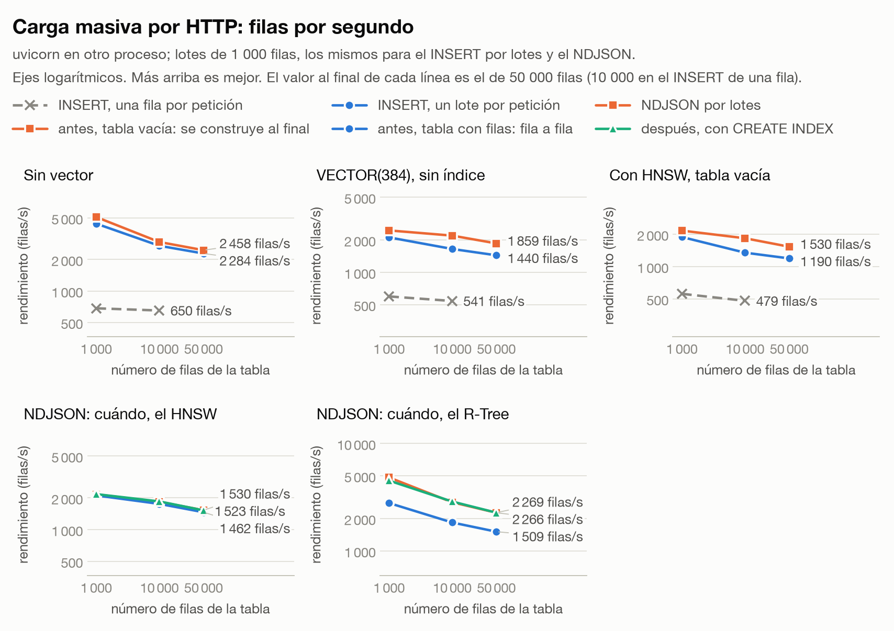

Filas por segundo (más es mejor):

| Escenario | Filas | INSERT, 1 fila/petición | INSERT, lote/petición | NDJSON |
|---|---:|---:|---:|---:|
| sin vector | 1 000 | 682 | 4 410 | **5 103** |
| sin vector | 10 000 | 650 | 2 708 | **2 942** |
| sin vector | 50 000 | — | 2 284 | **2 458** |
| VECTOR(384), sin índice | 1 000 | 596 | 2 114 | **2 455** |
| VECTOR(384), sin índice | 10 000 | 541 | 1 650 | **2 196** |
| VECTOR(384), sin índice | 50 000 | — | 1 440 | **1 859** |
| VECTOR(384), HNSW creado antes, tabla vacía | 1 000 | 557 | 1 883 | **2 161** |
| VECTOR(384), HNSW creado antes, tabla vacía | 10 000 | 479 | 1 346 | **1 834** |
| VECTOR(384), HNSW creado antes, tabla vacía | 50 000 | — | 1 190 | **1 530** |

Cuándo se construye el índice, siempre con NDJSON (filas por segundo, y en el creado
después, cuánto de las 50 000 fue cargar y cuánto el `CREATE INDEX`):

| Índice | Filas | Antes, tabla vacía (al final) | Antes, tabla con filas (fila a fila) | Después (`CREATE INDEX`) |
|---|---:|---:|---:|---:|
| HNSW | 1 000 | 2 161 | 2 111 | 2 171 |
| HNSW | 10 000 | 1 834 | 1 754 | 1 851 |
| HNSW | 50 000 | **1 530** | 1 462 | 1 523 (26,9 s + 6,0 s) |
| R-Tree | 1 000 | 4 827 | 2 790 | 4 514 |
| R-Tree | 10 000 | 2 837 | 1 838 | 2 880 |
| R-Tree | 50 000 | **2 266** | 1 509 | 2 269 (21,8 s + 0,3 s) |

### Antes de medir: convertir los vectores costaba más que guardarlos

La primera medida daba 1 694 filas/s con NDJSON y 1 432 con el INSERT por lotes (2 000
filas con vector). Medido por partes, cada vector de 384 componentes pasaba tres veces por
Python componente a componente: 68 µs al convertir el JSON en `VECTOR` y 73 µs en cada una
de las dos validaciones del registro (al comprobar la fila y al guardarla). Comprobar que
todos los componentes son `float` finitos con una pasada en C por condición
(`are_finite_floats`) los dejó en 4,6 y 8,7 µs, y la carga subió a **2 266 y 1 822 filas/s**
(+34 % y +27 %). Lo que queda, medido con `cProfile` sobre el motor: con 10 000 filas sin
vector, el **95 % del tiempo es el B+ de la clave primaria**, que se recorre dos veces por fila
—para comprobar que la clave no se repite y para insertarla— y que decodifica y vuelve a
codificar el nodo entero en cada acceso. Un B+ con construcción de abajo arriba lo
resolvería en una tabla vacía; no existe todavía y queda fuera de este issue.

### Conclusiones

- **El INSERT de una fila por petición es lo que no hay que hacer**: 650 filas/s sin vector y
  480–600 con él, porque cada fila paga una petición HTTP, analizar el SQL y una
  transacción con su escritura a disco. NDJSON es **4,5 veces más rápido con 10 000 filas sin
  vector y 4 veces con vector**: 10 000 embeddings entran en 4,6 s en vez de 18,5.
- **Frente al INSERT por lotes, NDJSON gana un 8–36 %**: los dos escriben los mismos lotes
  en las mismas transacciones, y lo que NDJSON se ahorra es analizar un SQL con miles de
  parámetros y viajar en un solo cuerpo JSON. La diferencia que importa es otra: el INSERT
  por lotes **falla entero** con una fila mala y su cuerpo tiene que caber en
  `MINIGESTOR_MAX_REQUEST_BYTES`, mientras que NDJSON rechaza solo el lote culpable, dice la
  línea, y su cuerpo no tiene tope porque nunca está entero en memoria.
- **Construir al final paga sobre todo en el R-Tree**: con la tabla vacía, la carga STR al
  terminar deja la carga **un 50 % más rápida** que insertar cada punto con Guttman (2 266
  frente a 1 509 filas/s con 50 000), y cuesta lo mismo que crear el índice después (0,3 s
  de STR para 50 000 puntos). En el **HNSW la ganancia es chica, 2–5 %**: FAISS inserta en el
  grafo de a un vector también cuando recibe todos juntos (con un hilo), así que lo único que
  se ahorra es la llamada por fila. Crear el HNSW antes, sobre la tabla vacía, y crearlo
  después cuestan lo mismo (1 530 frente a 1 523 filas/s): la migración puede declarar sus
  índices primero sin pagar de más.
- **El rendimiento baja con el tamaño** en todas las técnicas, de ~5 000 a ~2 500 filas/s sin
  vector: es el B+ de la clave primaria, cada vez más alto y con más páginas fuera del buffer
  pool (ver arriba). Es lo siguiente que habría que atacar para cargas de cientos de miles.

### Reproducirlo

```bash
.venv/bin/python -m benchmarks.ingest_benchmark --sizes 1000 10000 50000
.venv/bin/python -m benchmarks.plot
```

Sin datasets que descargar ni PostgreSQL. `--batch-rows` cambia el tamaño de lote de las dos
cargas por lotes, `--single-row-limit` hasta dónde se mide el INSERT de una fila,
`--repetitions` cuántas veces se repite cada carga (se reporta la mediana), `--threads` los
hilos de FAISS y `--dimension` y `--seed`, los datos.

## 10. Carga de la tienda — el catálogo entero con SIFT y CLIP

`shop_seed_benchmark.py` mide la carga de la tienda de la Parte 5, opción B (#80): el mismo
trabajo que se despliega, `python -m shop.seed`, contra un gestor de verdad en otro proceso
(uvicorn, como en Docker) y sobre el dataset entero de Amazon Reviews 2023, instrumentos
musicales: 24 587 productos con 24 308 fotos distintas, 57 439 usuarios, 511 836 compras,
209 tiendas de Lima y 209 000 filas de inventario. Cada tabla entra por carga masiva NDJSON;
la visual va por dos caminos para comparar después (#82): **SIFT** de la Parte 4 (`CREATE
INDEX ... USING HNSW` sobre la ruta de la foto: extraer, vocabulario, TF-IDF y HNSW dentro
del gestor) y **CLIP** ViT-B/32 en ONNX (embeddings calculados por la tienda y cargados en
una columna `VECTOR(512)` con HNSW). Cada índice que la carga construye al final se mide
además aparte, borrándolo y volviéndolo a crear sobre la tabla llena.

Apple M4 Pro (12 núcleos), macOS, Python 3.12, onnxruntime en la CPU, caché de embeddings
vacía; carga media de 8,7 al empezar (otros procesos en el equipo). Una sola ejecución.

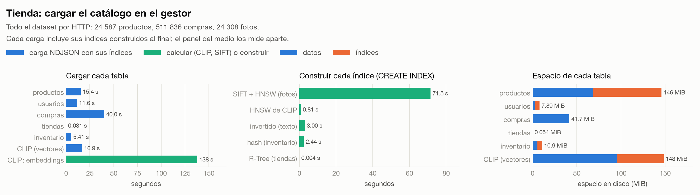

| Paso | Filas | Tiempo |
|---|---:|---:|
| `shop_productos` (invertido en inglés al final) | 24 587 | 15,4 s |
| `shop_usuarios` | 57 439 | 11,6 s |
| `shop_compras` (archivo secuencial) | 511 836 | 40,0 s |
| `shop_inventario` (hash fila a fila) | 209 000 | 5,4 s |
| `shop_tiendas` (R-Tree al final) | 209 | 0,03 s |
| SIFT: `CREATE INDEX` | 24 580 fotos | 71,5 s |
| CLIP: embeddings | 24 308 fotos | 137,8 s |
| `shop_clip` (HNSW al final) | 24 580 | 16,9 s |
| **total** | | **299,0 s** |
| segunda ejecución (no repite nada) | | 0,27 s |

| Índice, construido aparte | `CREATE INDEX` | Espacio |
|---|---:|---:|
| SIFT + HNSW (vocabulario de 256) | 71,5 s | 60,2 MiB |
| HNSW de CLIP (512 dimensiones) | 0,81 s | 51,6 MiB |
| invertido en inglés | 3,00 s | 16,4 MiB |
| hash extendible del inventario | 2,44 s | 5,3 MiB |
| R-Tree de las tiendas | 0,004 s | 0,02 MiB |

El gestor queda en **354,8 MiB**: `shop_clip` 148,4, `shop_productos` 146,0 (56,6 de textos
fuera de la fila), `shop_compras` 41,7, inventario 10,9, usuarios 7,9 y tiendas 0,05.

### Conclusiones

- **Calcular CLIP es casi la mitad de la carga** (138 de 299 s, 176 fotos/s); la caché por
  SHA-256 de la foto lo vuelve un pago único. **SIFT tarda la mitad** (71,5 s, casi todo
  extraer en 12 procesos) pero su índice ocupa más: 60 MiB contra 52 del HNSW de CLIP.
- **Construir al final paga**: 3,0 s el invertido y 0,8 s el HNSW, una vez, dentro de cargas
  de 15 y 17 s; el R-Tree de 209 puntos no se nota.
- **El secuencial carga 12 787 filas/s** porque las compras llegan en el orden de la clave
  (su posición cronológica) y cada una va al final de la última página.
- **Una fila con `VECTOR(512)` (2 KiB) llena media página de 4 KiB**: `shop_clip` ocupa
  96 MiB de heap para 48 MiB de vectores. Una página mayor lo evitaría, a cambio de cambiar
  la de todo el gestor.

Detalle, decisiones y tablas completas en [`apps/shop/README.md`](../apps/shop/README.md#medido-cargar-todo-el-dataset).

## 11. Servicio de rostros — registro, reconocimiento y conjunto abierto

`faces_service_benchmark.py` mide el API de rostros ([`apps/faces`](../apps/faces/README.md),
#90) de punta a punta: cada tiempo es una petición HTTP completa al servicio, que analiza la
foto, busca en el HNSW coseno de `face_embeddings` y escribe en el gestor por
`minigestor_client`. El gestor corre en el mismo proceso, sin red.

- Se registran **1 000 personas de LFW** con al menos dos fotos (de 1 680), elegidas al azar
  (semilla 20261118), con una sola toma de frente: se prueban sus fotos en orden hasta que
  una pasa los controles de calidad, y la última queda fuera para reconocerla después.
  Antes de cada registro, `POST /identify` con su primera foto da el mejor coseno de un
  desconocido contra la galería de ese momento: de ahí salen los **duplicados falsos**.
- Al llegar a 100, 250, 500 y 1 000 personas se miden 200 reconocimientos de fotos no
  usadas de personas registradas y 200 de personas con una sola foto en LFW (nunca
  registradas). Con cada umbral de coseno se cuenta la **FPIR** (desconocidas reconocidas
  como alguien) y la **FNIR** (registradas que no salen como ellas mismas).
- Los umbrales de duplicado del servicio se apagan para que nadie quede fuera; lo que
  habrían bloqueado se cuenta aparte.

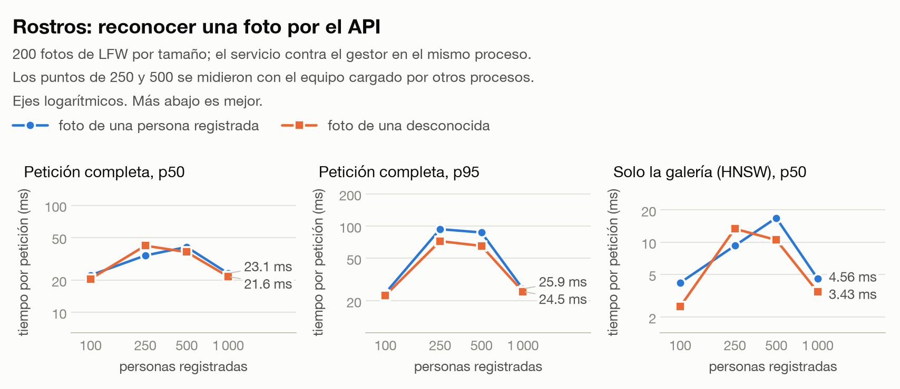

| Personas registradas | Registrada p50 / p95 | Desconocida p50 / p95 | Análisis p50 | Galería p50 (registrada / desconocida) |
|---:|---:|---:|---:|---:|
| 100 | 22,2 / 23,6 ms | 20,5 / 22,5 ms | 17,1 ms | 4,2 / 2,5 ms |
| 250 | 33,9 / 93,6 ms | 41,9 / 72,3 ms | 19,7 ms | 9,3 / 13,3 ms |
| 500 | 40,7 / 87,2 ms | 36,5 / 65,3 ms | 18,2 ms | 16,8 / 10,5 ms |
| 1 000 | 23,1 / 25,9 ms | 21,6 / 24,5 ms | 17,3 ms | 4,6 / 3,4 ms |

| Registro (1 000 personas) | Peticiones | p50 | p95 | Análisis p50 / p95 | Sesión p50 / p95 | Galería p50 / p95 | Guardar p50 / p95 |
|---|---:|---:|---:|---:|---:|---:|---:|
| toma aceptada | 1 000 | 27,7 ms | 75,8 ms | 17,2 / 23,7 ms | 5,0 / 25,6 ms | 2,4 / 10,9 ms | 2,0 / 9,7 ms |
| toma rechazada | 1 336 | 23,2 ms | 56,6 ms | 17,1 / 22,1 ms | 5,1 / 29,1 ms | — | — |
| terminar el registro | 1 000 | 17,2 ms | 93,5 ms | — | 3,3 / 17,9 ms | 2,0 / 10,3 ms | 10,9 / 62,4 ms |

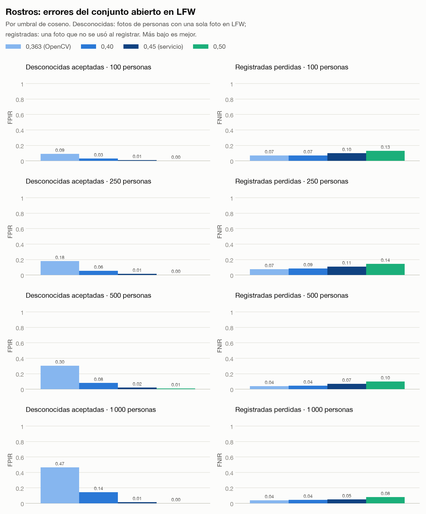

| Umbral | FPIR con 100 / 250 / 500 / 1 000 | FNIR con 100 / 250 / 500 / 1 000 | Duplicados falsos hasta 1 000 personas |
|---:|---:|---:|---:|
| 0,363 (OpenCV) | 9 / 18 / 30,5 / **46,5 %** | 7 / 7,5 / 4 / 4 % | 503 de 1 513 (33,2 %) |
| 0,40 | 3 / 5,5 / 8 / 14,5 % | 7 / 8,5 / 4,5 / 4,5 % | 160 (10,6 %) |
| **0,45** (servicio) | 1 / 1,5 / 2 / **1,5 %** | 10 / 11 / 7 / **5 %** | 17 (1,1 %) |
| 0,50 | 0 / 0 / 1 / 0 % | 13 / 14,5 / 10 / 8 % | 4 (0,26 %) |
| 0,55 | 0 / 0 / 0 / 0 % | 19 / 20 / 16,5 / 17 % | 1 (0,07 %) |

De las 2 336 tomas que se enviaron para registrar a las 1 000 personas se rechazaron 1 336:
650 por no ser de frente (el plan pedía solo esa pose) y 406 por quedar entre de frente y
girada, 170 por tener más de un rostro de tamaño parecido, 50 por rostro chico, 20 por
borrosas, 16 por giro excesivo, 16 por cabeza inclinada, 5 por mirar abajo, 2 sin rostro y 1
sobreexpuesta. Las medidas de las 2 164 tomas con un solo rostro (percentiles 0,5 / 50 / 99,5)
son la referencia de los umbrales de calidad: ancho del rostro 76 / 94 / 120 px, gris medio
74 / 130 / 186, nitidez 34 / 205 / 971, giro −44° / 1° / 35°, cabeceo −18° / 0° / 22°,
inclinación −13° / −1° / 15°.

### Conclusiones

- **El umbral de verificación no sirve para reconocer.** 0,363 es el punto de OpenCV para
  comparar dos fotos (1:1); contra una galería, un desconocido tiene N oportunidades de
  pasarlo y la FPIR crece con N: 9 % con 100 personas y 46,5 % con 1 000. Con 0,45 queda en
  1 a 2 % en todos los tamaños medidos, a cambio de una FNIR de 5 a 11 % (con 100 a 200
  consultas por tamaño, cada punto es una o dos consultas). El servicio usaba 0,45 para
  reconocer y para el aviso de «te pareces mucho», y 0,50 para decir «ya estás registrado
  como X»; la sección 18 los calibró a un FAR fijo y subió los dos primeros a 0,47.
- **Los duplicados falsos siguen la misma curva.** Bloquear desde 0,363 habría impedido
  registrarse a un tercio de las personas mientras la galería crecía a 1 000; desde 0,45, al
  1,1 %, y decir un nombre equivocado (0,50), al 0,26 %.
- **Reconocer cuesta lo mismo con 100 que con 1 000 personas** (22 y 23 ms): el análisis de
  la foto (17 ms, el pipeline de la sección 7) es tres cuartos del total y la galería —el
  HNSW y el nombre de la persona— de 2 a 5 ms. Una persona registrada cuesta 1 a 2 ms más
  que una desconocida porque su coseno pasa el umbral y se busca su nombre.
- **Una toma cuesta 28 ms en la mediana**: 17 de análisis, 5 de leer y contar la sesión en
  el gestor, 2 de buscar duplicados y 2 de guardar. Terminar el registro, una transacción
  con cuatro sentencias, 17 ms. El p95 sube a 76 y 94 ms, y lo que más sube son las
  etapas que escriben en el gestor (`sesion` y `guardar`), no el análisis.

**Lo que esta medida no dice.** El equipo estaba cargado por otros procesos (carga media
de 17 al empezar): los puntos de 250 y 500 personas lo muestran, con el análisis —que no
depende de la galería— 2 a 7 ms más lento y la galería varias veces más lenta que con 100 y
1 000; la tendencia que vale es la de 100 contra 1 000. Esta medida se tomó antes de fijar
los hilos de FAISS con `--threads`. Las fotos de LFW son de 250 px y de prensa: con fotos de
celular el análisis sube (sección 7) y las tomas giradas sí entran. La FPIR y la FNIR salen
de 200 consultas por tamaño: un punto de diferencia es una consulta.

### Reproducirlo

```bash
uv run python -m shop.dataset prepare --data-dir data/datasets
uv run python -m shop.clip models --salida data/models/shop
.venv/bin/python -m benchmarks.shop_seed_benchmark --data-dir data/datasets \
    --models data/models/shop --engine-data-dir data/tienda-gestor
.venv/bin/python -m benchmarks.plot
```

`--engine-data-dir` tiene que estar vacío (sin él, uno temporal); `--embeddings-dir` reusa una
caché (sin él, una vacía, y se miden todas las fotos).
.venv/bin/python -m faces lfw --salida data/datasets/lfw
.venv/bin/python -m faces models --salida data/models/faces
.venv/bin/python -m benchmarks.faces_service_benchmark --lfw data/datasets/lfw/lfw \
    --models data/models/faces --people 1000 --checkpoints 100 250 500 1000 --queries 200 \
    --thresholds 0.363 0.4 0.45 0.5 0.55
.venv/bin/python -m benchmarks.plot
```

Tarda de 6 a 8 minutos. Las FPIR, FNIR, duplicados falsos, rechazos y medidas no dependen
de la carga del equipo: salieron idénticos en las cuatro ejecuciones que se hicieron.

## 12. Catálogo de copyright — descargar, cargar e indexar FMA por tramos

`copyright_catalog_benchmark.py` mide el catálogo de canciones originales del servicio de
copyright (Parte 5, opción C, issue #75; ver [`apps/copyright/`](../apps/copyright/README.md)):
las pistas de `fma_small` (MP3 de 30 s) cortadas en **tramos de 5 s cada 2,5 s**
(`pista.mp3#t=a,b`), cargadas en el gestor por HTTP y con un HNSW coseno sobre sus MFCC en
bolsa de palabras. Corre **el código del trabajo de carga del servicio**
(`songcheck.seed.load_catalog`) contra un gestor nuevo por tamaño, servido por uvicorn en un
hilo del mismo proceso: así se pueden cronometrar por dentro las partes del `CREATE INDEX`
(se envuelven `Vocabulary.train`, `Vocabulary.word_counts` e `IndexedVectors.rebuild`/`save`;
la extracción de MFCC, que corre en los procesos de extracción, es el resto).

**Qué se mide.** La descarga del catálogo (`prepare_catalog`: metadatos, índice del `.zip`,
pistas por rangos verificadas con su CRC-32 y la decodificación completa de cada una); por
cada tamaño —una muestra con semilla de 1 000, 2 000 y 4 000 canciones, y el catálogo
entero—, la carga NDJSON de `cr_canciones` y `cr_segmentos`, el `CREATE INDEX` partido, una
segunda ejecución de la carga y el disco del gestor por estructura.

**Dónde corrió.** Apple M4 Pro (12 núcleos), macOS, Python 3.12, con 12 procesos de
extracción y una conexión doméstica. **La máquina estaba cargada**: otros procesos dejaron la
carga media entre 21 y 37 durante la medida (está en el JSON), así que los tiempos de carga
son cotas altas; la descarga depende sobre todo de la red.

### Resultados medidos

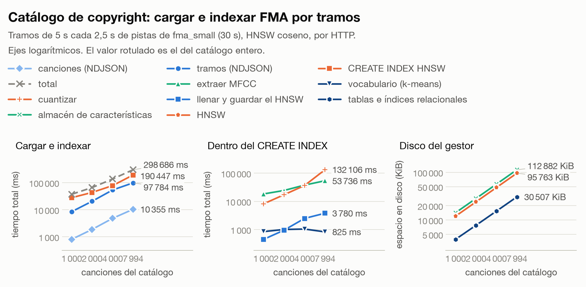

**Descarga.** De las 8 000 pistas, 2 000 ya estaban en disco (las de la demo de la Parte 4),
se verificaron por su CRC-32 y no se pidieron. Las otras **5 997 (5,58 GiB) bajaron en
909,6 s** (15,2 min, 6,6 MB/s con 8 conexiones). Quedaron fuera seis: tres sin audio (menos
de 2 KB, por el índice del `.zip`) y tres cuyo MP3 se corta a mitad (098565, 098567 y 098569:
libsndfile lee la cabecera pero no las decodifica). El catálogo son **7 994 canciones, 7,43
GiB de audio**.

| Canciones | Tramos | `cr_canciones` | `cr_segmentos` | `CREATE INDEX` | Total | Segunda ejecución | Disco del gestor |
|---:|---:|---:|---:|---:|---:|---:|---:|
| 1 000 | 10 422 | 0,80 s | 8,45 s | 27,75 s | 37,1 s | 0,13 s | 29,4 MiB |
| 2 000 | 20 823 | 1,87 s | 20,48 s | 43,41 s | 65,8 s | 0,21 s | 58,5 MiB |
| 4 000 | 41 650 | 4,79 s | 53,46 s | 77,62 s | 135,9 s | 0,46 s | 116,9 MiB |
| **7 994** | **83 290** | 10,36 s | 97,78 s | **190,45 s** | **298,7 s** | **0,75 s** | **233,6 MiB** |

Dentro del `CREATE INDEX` y en disco:

| Canciones | Extraer MFCC | Vocabulario (k-means) | Cuantizar | Llenar y guardar el HNSW | Tablas | Almacén de características | HNSW |
|---:|---:|---:|---:|---:|---:|---:|---:|
| 1 000 | 18,31 s | 0,84 s | 8,15 s | 0,45 s | 3,8 MiB | 13,8 MiB | 11,7 MiB |
| 2 000 | 24,30 s | 1,00 s | 17,16 s | 0,95 s | 7,6 MiB | 27,6 MiB | 23,4 MiB |
| 4 000 | 37,69 s | 1,04 s | 36,41 s | 2,48 s | 15,0 MiB | 55,2 MiB | 46,8 MiB |
| 7 994 | 53,74 s | 0,83 s | **132,11 s** | 3,78 s | 29,8 MiB | 110,2 MiB | 93,5 MiB |

### Conclusiones

- **El catálogo entero queda listo en 5 min sobre la descarga**: 83 290 tramos cargados e
  indexados en 298,7 s, y **una segunda ejecución tarda 0,75 s** (cuenta filas y encuentra el
  índice): el trabajo de carga se puede correr en cada despliegue.
- **Lo caro del índice ya no es extraer, es cuantizar.** La extracción corre en 12 procesos
  y crece menos que el catálogo (18 s → 54 s de 1 000 a 7 994 canciones, gracias también a
  que cada pista se decodifica una vez para sus 10 u 11 tramos); la cuantización —asignar
  cada ventana MFCC a su palabra— corre en el proceso del gestor, de a un tramo, y crece en
  proporción: con el catálogo entero es el **69 %** del `CREATE INDEX` (132 de 190 s). Llevarla
  a los procesos de extracción es la mejora siguiente; queda fuera de este issue porque es
  del motor.
- **El vocabulario y el grafo no pesan**: k-means sobre la muestra fija de 2 000 tramos tarda
  lo mismo con cualquier catálogo (≈ 1 s) y FAISS arma el HNSW de 83 290 vectores de 256
  dimensiones en 3,8 s.
- **El disco crece lineal, 2,9 KiB por tramo**: 1,15 KiB del HNSW (el vector de 256 `float32`
  más sus vecinos), 1,36 KiB del almacén de características (los conteos de palabras, la
  fuente de verdad del índice) y 0,37 KiB de las dos tablas. El catálogo de 7,43 GiB de
  audio ocupa 233,6 MiB en el gestor, un 3 %: el gestor guarda rutas, no audio.
- **Cargar las filas cuesta un tercio del total**: 83 290 tramos por NDJSON a 852 filas/s,
  por debajo de las ~1 800 de la sección 9 por la carga de la máquina y por la ruta de cada
  tramo (unos 110 caracteres). Como allí, lo que pesa es el B+ de la clave primaria.

### Reproducirlo

```bash
uv run --no-sync python -m benchmarks.copyright_catalog_benchmark \
    --data-dir data/datasets --sizes 1000 2000 4000 8000 --threads 8
uv run --no-sync python -m benchmarks.plot
```

`--data-dir` es la carpeta de datasets (el catálogo queda en `fma_small/`; si ya está, no se
baja de nuevo), `--threads` las descargas a la vez, `--seed` la muestra de cada tamaño y
`--workspace` dónde crear los gestores temporales. La medida publicada tardó unos 25 min,
15 de ellos en la descarga.

## 13. Ingesta del RAG — embeddings e5 en ONNX y carga con BM25 y HNSW

`rag_ingest_benchmark.py` mide la ingesta del RAG sobre papers (#85) en cuatro partes: la
velocidad de multilingual-e5-small en onnxruntime, **fp32 contra int8**, según los hilos
(1 000 fragmentos repartidos por el corpus, mediana de 2 pasadas) y cuánto se parecen sus
vectores; la **siembra del corpus entero** (`rag.seed`, 98 585 fragmentos de 1 495
documentos) contra un gestor en un uvicorn aparte, dos veces; **cada etapa de la carga** por
separado con 1 000, 10 000 y 98 585 fragmentos (NDJSON sin índices, `CREATE INDEX` invertido,
`CREATE INDEX` HNSW, y la carga con los índices diferidos); y diez preguntas a mano, en
español y en inglés, en los tres modos de búsqueda. Las tablas completas, el espacio en disco
y las preguntas están en el [README del servicio](../apps/rag/README.md#medidas-de-la-ingesta).

**Dónde corrió.** Apple M4 Pro (12 núcleos), macOS, Python 3.12, onnxruntime 1.32,
tokenizers 0.23; 8 hilos en la siembra. **Con contención**: otros trabajos pesados corrían
en la misma máquina (carga media 14,3 al empezar, 5,3 al terminar, picos de 51): los tiempos
son una cota inferior. Tardó 1 h 0 min.

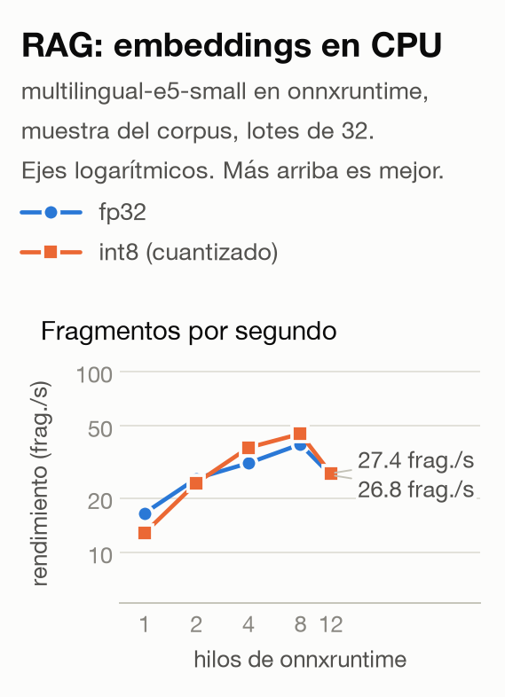
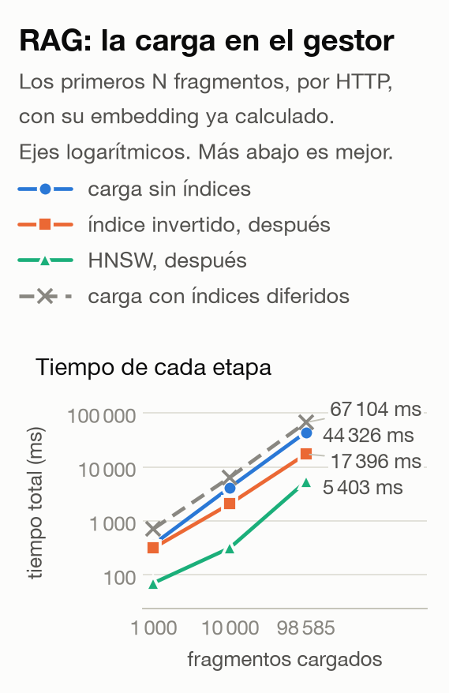

| Medida | Resultado |
|---|---|
| embeddings, fp32 / int8, 8 hilos | 39,6 / **45,3** fragmentos/s (4 hilos: 31,2 / 38,0; 1 hilo: 16,5 / 12,8) |
| int8 contra fp32 | coseno medio 0,994 (mínimo 0,977); 7,3 de 10 vecinos en común |
| siembra: embeddings (int8, 8 hilos) | 2 565,6 s, **38,4 fragmentos/s**; 12,5 % truncados a 512 tokens |
| siembra: carga con índices diferidos | 65,0 s |
| siembra: total / segunda corrida | **43,9 min** / 1,6 s |
| etapas con 98 585 fragmentos | NDJSON 44,3 s, invertido 17,4 s, HNSW 5,4 s; con los índices diferidos, 67,1 s |
| en disco | 624 MiB: tabla 354 MiB, invertido 96 MiB, HNSW 159 MiB, claves 12 MiB |
| búsqueda (cliente) | BM25 5–18 ms, vectorial 11–13 ms, híbrida 13–30 ms |

### Conclusiones

- **El 97 % de la ingesta es calcular embeddings** en CPU; la carga y los dos índices son
  65 s. La caché por huella del texto hace que volver a sembrar tarde segundos.
- **int8 es la variante del servicio**: un 14–22 % más rápido con 4 y 8 hilos, cuatro veces
  más chico y a coseno 0,99 de fp32; con 1 o 2 hilos fp32 gana, y con 12 los dos caen (núcleos
  de eficiencia y contención). Cambia el orden fino de los vecinos (7 de 10 en común), lo que
  medirá la evaluación de recuperación (#87).
- **Diferir los índices cuesta lo mismo que crearlos después** (67,1 s en los dos casos),
  como en el HNSW de la §9: la migración los declara antes sin pagar de más.
- **En español, BM25 solo encuentra los dos documentos del curso**; la búsqueda vectorial
  cruza el idioma y trae el paper en inglés que corresponde.

### Reproducirlo

```bash
uv run python -m rag.models --salida data/models/rag --variante int8 --variante fp32
.venv/bin/python -m benchmarks.rag_ingest_benchmark --data-dir data/datasets \
    --models data/models/rag --engine-dir data/engine-rag --threads 1 2 4 8 12 \
    --sample 1000 --repetitions 2 --seed-threads 8
.venv/bin/python -m benchmarks.plot
```

Necesita el corpus de `python -m rag.corpus build` (ver el README del servicio). La caché de
embeddings (`--cache-dir`, por omisión la del corpus) tiene que empezar vacía para medir el
cálculo, y `--engine-dir`, sin las tablas del RAG para medir la carga; el gestor queda
sembrado al terminar. `--sizes` cambia los tamaños de las etapas y `--search-repetitions`, las
búsquedas por pregunta.

## 14. Detección de copyright — latencia de `POST /detections` y casos de control

`copyright_detection_benchmark.py` mide la detección del servicio de copyright (#76; ver
[`apps/copyright/`](../apps/copyright/README.md#detección)): una subida se corta en ventanas
de 5 s cada 2,5 s, el gestor busca los vecinos de todas en un lote del HNSW de tramos y la
votación por desfase arma las coincidencias. El gestor es **una copia** del que dejó el
trabajo de carga con el catálogo entero, servida por uvicorn en otro proceso y en un puerto
libre; de la copia se borran los tramos de 40 canciones al azar, que pasan a ser **pistas no
catalogadas**: música real del mismo FMA que el catálogo ya no tiene. Quedan 7 954
canciones. El servicio corre en el proceso del experimento con su configuración por omisión
(10 vecinos por ventana, racha mínima de 2, umbral 0,45) y habla con el gestor por HTTP.

**Qué se mide.** (1) La **latencia** de la petición entera, medida en el cliente, para
subidas de 30, 60 y 180 s: 10 subidas distintas por duración, cada una pistas de 30 s
pegadas (una del catálogo, una no catalogada, …) en MP3 a 44,1 kHz estéreo, con sus etapas
de `Server-Timing`. (2) **Casos de control**, 20 de cada uno: una pista del catálogo entera;
un tramo de 15 s (de 6 a 21 s) pegado a los 10 s de una pista no catalogada, con un desfase
de 4 s que **no cae en la rejilla** de 2,5 s; un tramo de 7,5 s (de 10 a 17,5 s) pegado a
los 5 s, la copia más corta que llena dos ventanas; y una pista no catalogada sola. De cada
caso se guarda el puntaje de la canción copiada y el mejor de cualquier otra.

**Dónde corrió.** Apple M4 Pro (12 núcleos), macOS, Python 3.12. La carga media antes de
cada duración fue de 4,9 a 5,1 (está en el JSON): otros procesos ocupaban unos cinco
núcleos.

### Resultados medidos

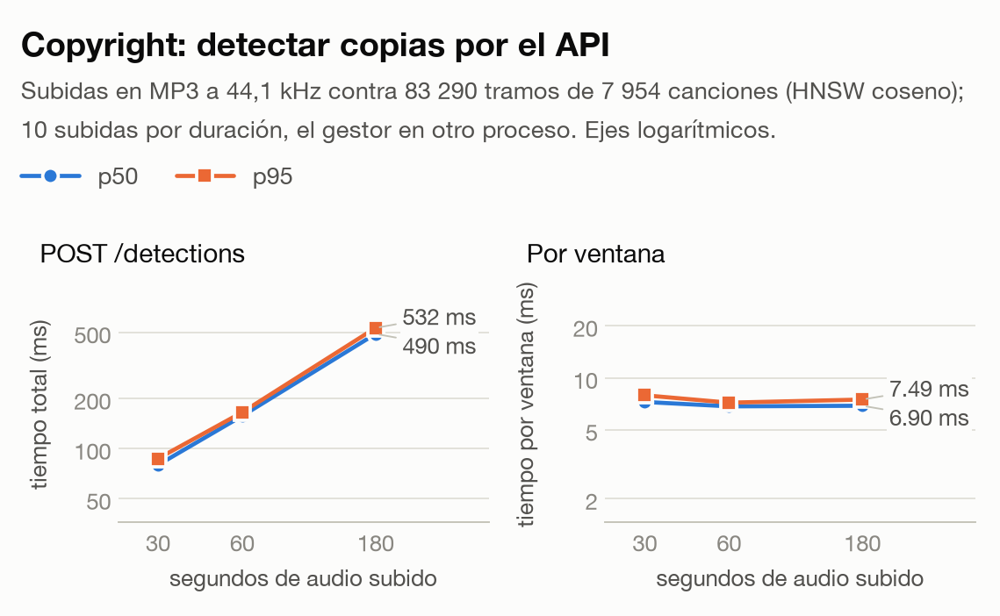

| Subida | Ventanas | p50 | p95 | p50 por ventana | Copias del catálogo encontradas con su desfase |
|---:|---:|---:|---:|---:|---:|
| 30 s | 11 | 79,8 ms | 87,2 ms | 7,26 ms | 10 de 10 |
| 60 s | 23 | 157,4 ms | 165,4 ms | 6,85 ms | 10 de 10 |
| 180 s | 71 | **489,8 ms** | **531,9 ms** | 6,90 ms | 30 de 30 |

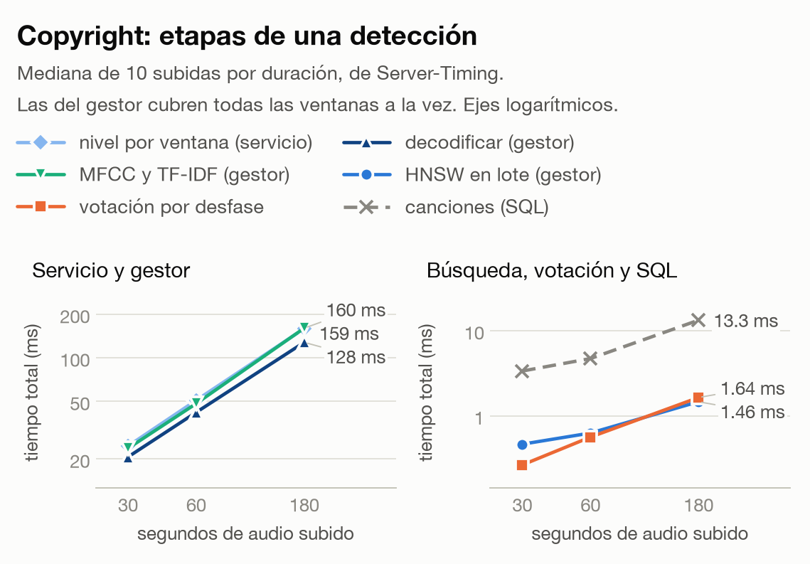

| Etapa (mediana) | 30 s | 60 s | 180 s |
|---|---:|---:|---:|
| reconocer el formato (`probe`) | 0,09 ms | 0,09 ms | 0,11 ms |
| nivel por ventana: decodificar en el servicio (`loudness`) | 24,6 ms | 50,9 ms | 159,4 ms |
| `POST /media/segments`, ida y vuelta (`segments`) | 50,0 ms | 99,1 ms | 308,3 ms |
| — decodificar en el gestor (`decode`) | 20,7 ms | 42,0 ms | 128,0 ms |
| — MFCC y TF-IDF de las ventanas (`extraction`) | 23,7 ms | 48,3 ms | 160,4 ms |
| — HNSW en lote (`search`) | 0,46 ms | 0,63 ms | 1,46 ms |
| votación por desfase (`voting`) | 0,26 ms | 0,56 ms | 1,64 ms |
| canciones candidatas por SQL (`songs`) | 3,4 ms | 4,7 ms | 13,3 ms |

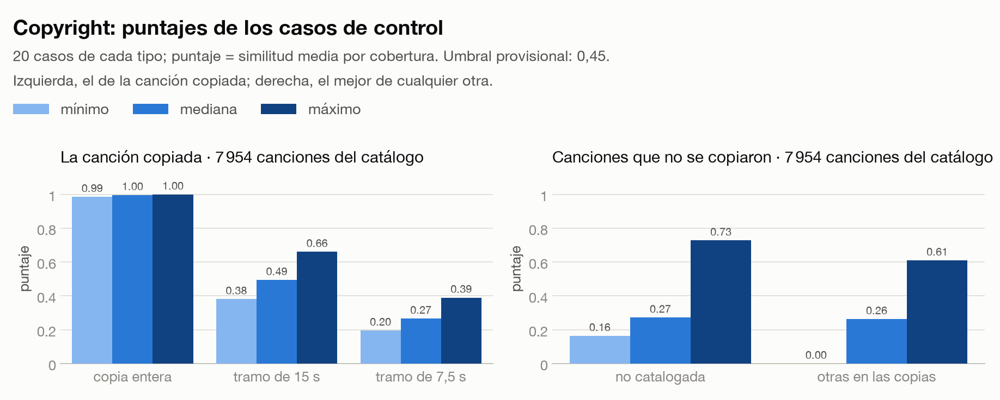

| Caso (20 de cada uno) | Puntaje de la copiada: mín. / mediana / máx. | Detectada (≥ 0,45) | Desfase informado | Otra canción ≥ 0,45 |
|---|---:|---:|---|---:|
| pista del catálogo entera | 0,986 / 0,997 / 1,000 | **20** | 0 s en las 20 | 1 |
| tramo de 15 s fuera de la rejilla (desfase real 4 s) | 0,381 / 0,494 / 0,661 | **18** | 5 s en 17, 2,5 s en 3 | 1 |
| tramo de 7,5 s | 0,196 / 0,266 / 0,390 | 0 | — | 2 |
| pista no catalogada (mejor de cualquier canción) | 0,164 / 0,272 / 0,728 | — | — | **3** |

### Conclusiones

- **Una canción de 3 min se revisa en medio segundo** (p50 de 490 ms, p95 de 532 ms) contra
  83 290 tramos, y el costo es lineal en las ventanas: unos 7 ms por ventana con cualquier
  duración. El HNSW no pesa (1,5 ms para 71 búsquedas en lote) ni la votación (1,6 ms): todo
  es **decodificar y sacar MFCC**.
- **El audio se decodifica dos veces**: el servicio lo decodifica para medir el nivel de
  cada ventana (159 ms con 3 min) y el gestor otra vez para sus MFCC (128 ms). Lo del
  servicio rechaza un cuerpo dañado antes de llegar al gestor y deja una subida en silencio
  sin consulta; correrlo a la vez que la búsqueda del gestor ahorraría cerca de un tercio de
  la latencia, a cambio de mandar al gestor también las subidas en silencio.
- **Las copias largas se separan bien; las cortas no.** Una pista copiada entera puntúa
  0,99 o más, con su desfase exacto. Un tramo de 15 s fuera de la rejilla llega a 0,38-0,66
  y se informa con el desfase del tramo del catálogo más cercano (5 o 2,5 s para un desfase
  real de 4 s: a un salto o menos). Un tramo de 7,5 s cubre dos o tres de las 11 ventanas
  que podía compartir, así que su puntaje no pasa de 0,27 por la similitud: queda donde
  quedan las canciones que no se copiaron (mediana 0,27). Es lo que da la cobertura del
  puntaje, que premia copias largas.
- **El umbral provisional es 0,45**: pasan las 20 copias enteras y 18 de los 20 tramos de
  15 s, y quedan por debajo 17 de las 20 pistas no catalogadas. Las tres que pasan
  (0,52, 0,67 y 0,73) tienen rachas de 6, 7 y 8 ventanas seguidas con otra canción del FMA
  (una de ellas, del mismo artista) en las que el original avanza con la subida: o comparten
  material (bucles, otra versión) o el descriptor no las distingue, y solo escuchándolas se
  sabe. Con 0,50
  pasarían solo 9 de los 20 tramos de 15 s y las mismas tres no catalogadas. **La curva
  ROC de la evaluación (#77) lo calibra** con muchos más casos y transformaciones del audio:
  queda en 0,43 ([§16](#16-evaluación-de-la-detección-de-copyright--remixes-con-la-verdad-conocida)).
- **La subida de 60 s no tiene la segunda copia**: tres pistas de 29,9 s dejan para la
  tercera 0,2 s, que no llena una ventana; por eso son 10 copias y no 20.

### Reproducirlo

```bash
uv run --no-sync python -m benchmarks.copyright_detection_benchmark \
    --engine-dir data/copyright-engine --data-dir data/datasets
uv run --no-sync python -m benchmarks.plot
```

`--engine-dir` es el directorio de datos de un gestor con el catálogo cargado (lo deja
`python -m songcheck.seed`; el experimento trabaja sobre una copia temporal en
`--workspace`), `--data-dir` la carpeta de datasets cuyas rutas guarda ese gestor,
`--durations`, `--repetitions`, `--cases`, `--held-out` y `--seed` lo de arriba. La medida
publicada tardó menos de 2 min.

## 15. Rostros en vivo — latencia por cuadro por WebSocket

`faces_stream_benchmark.py` mide el reconocimiento en vivo del servicio de rostros
([`apps/faces`](../apps/faces/README.md#reconocimiento-en-vivo), #91) como lo usa un celular:
un cliente WebSocket manda cuadros JPEG de 640 x 480 (unos 26 KB) con el rostro de una
persona registrada, que se corre hasta 12 px de un cuadro a otro, a 10 cuadros por segundo;
espera la respuesta de cada uno y manda el siguiente. La latencia de un cuadro va de que el
cliente lo envía a que recibe su resultado. Se mide contra el **compose** (gestor, Redis,
API y nginx en Docker, en la misma máquina) por dos caminos —**por el nginx** de la web,
como en producción, y **directo** al puerto de la API— y cada uno **con la caché de
rastros** y **sin ella** (un `hello` con `track_cache: false` en la misma conexión). Cada
pasada son 300 cuadros tras 20 de calentamiento; la galería tiene una persona (con 1 000, la
búsqueda cuesta lo mismo: sección 11).

**Dónde corrió.** Apple M4 Pro (12 núcleos), macOS, Docker Desktop; la API con dos
pipelines y la configuración del compose (`FACES_TRACK_VERIFY_SECONDS` de 2 s). La carga
media del equipo fue de 5,2 a 7,8 durante la medida (otros trabajos en la misma máquina) y
la de la máquina de Docker, de 1,2 a 2,0; cada pasada guarda las dos, antes y después.

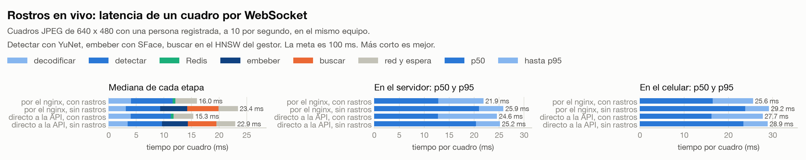

| Camino | Rastros | p50 | p95 | máx. | Decodificar | Detectar | Redis | Embeber | Buscar | Red y espera |
|---|---|---:|---:|---:|---:|---:|---:|---:|---:|---:|
| nginx | con caché | **16,4 ms** | **25,6 ms** | 40,0 ms | 4,1 | 7,5 | 0,5 | 0,0 | 0,0 | 3,9 |
| nginx | sin caché | 23,8 ms | 29,2 ms | 57,1 ms | 3,1 | 6,2 | — | 4,9 | 5,6 | 3,5 |
| directo | con caché | 16,2 ms | 27,7 ms | 136,5 ms | 4,0 | 7,3 | 0,5 | 0,0 | 0,0 | 3,6 |
| directo | sin caché | 23,4 ms | 28,9 ms | 42,1 ms | 3,5 | 6,2 | — | 4,7 | 5,2 | 3,4 |

Las etapas son medianas en milisegundos, medidas en el servidor; «red y espera» es la
latencia del cliente menos esas etapas. Con la caché, 285 de los 300 rostros salieron del
rastro: uno de cada 20 cuadros (2 s a 10 por segundo) vuelve a describirse y buscarse.
Ningún cuadro se descartó, porque el cliente espera cada respuesta.

### Conclusiones

- **La meta de 100 ms se cumple con holgura**: p50 de 16 a 24 ms y p95 de 26 a 29 ms de
  punta a punta. Un cuadro de cámara reducido a 640 px cuesta lo que una foto de LFW
  (sección 7), no lo que una foto de celular de 12 MP.
- **La caché de rastros ahorra un tercio de la mediana** (23,8 → 16,4 ms por el nginx): un
  rostro ya identificado no pasa por SFace (5 ms) ni por el HNSW y el nombre en el gestor
  (5 ms, dos viajes HTTP al contenedor del gestor), y leer y guardar sus rastros en Redis
  cuesta 0,5 ms. El p95 casi no cambia porque los cuadros que vuelven a verificar —el 5 %—
  hacen el camino completo: esa es la cola.
- **El nginx no se nota**: la diferencia entre ir por él o directo es menor que el ruido
  (0,2 a 0,4 ms en la mediana). Los 3,5 ms de «red y espera» son sobre todo el reenvío de
  puertos de Docker Desktop entre macOS y su máquina virtual, que está en los dos caminos.
- **Lo que queda es detectar**: YuNet sobre el cuadro entero (6 a 7,5 ms) y decodificarlo
  (3 a 4 ms) se pagan en cada cuadro, con o sin rastros. Bajar la resolución del cuadro o
  detectar solo alrededor de los rastros conocidos es lo siguiente que ahorraría.

**Lo que esta medida no dice.** Es la red local de una sola máquina: por Wi-Fi hasta un
celular se suma su ida y vuelta, y por el túnel, la de Internet. El máximo de 136 ms del
camino directo con caché es un solo cuadro, con el equipo cargado. La contrapresión no se
ve aquí porque el cliente espera cada respuesta; la prueba con un productor rápido está en
[`test_faces_realtime_connection.py`](../apps/faces/tests/test_faces_realtime_connection.py).
El efecto de la caché según cuánto se mueve el rostro está en la sección 18.

### Reproducirlo

```bash
python -m tools.compose_keys
FACES_WEB_PORT=127.0.0.1: FACES_WEB_TLS_PORT=127.0.0.1: docker compose -p rostros-bench \
    -f compose.yaml -f benchmarks/faces_stream.compose.yaml up -d --build --wait faces-web
docker compose -p rostros-bench port faces-web 8080     # → 127.0.0.1:<web>
docker compose -p rostros-bench port faces-api 8000     # → 127.0.0.1:<api>
.venv/bin/python -m benchmarks.faces_stream_benchmark --api-url http://127.0.0.1:<web>/api \
    --target nginx=ws://127.0.0.1:<web>/api/ws/recognize \
    --target directo=ws://127.0.0.1:<api>/ws/recognize \
    --frames 300 --warmup 20 --fps 10 --compose-project rostros-bench
.venv/bin/python -m benchmarks.plot
docker compose -p rostros-bench down --volumes
```

[`faces_stream.compose.yaml`](faces_stream.compose.yaml) publica la API solo en localhost,
pide el plan de registro de dos tomas de frente (las fotos de prueba no tienen otras poses) y
pone otro nombre a las imágenes para no reemplazar las del despliegue de siempre. Tarda unos
dos minutos más la construcción de las imágenes.

## 16. Recomendaciones de la tienda — cuatro señales y caché

`shop_recommend_benchmark.py` mide el recomendador de la tienda (#81) sobre el catálogo
entero de la sección 10, con el gestor en otro proceso (uvicorn), la tienda en este y un Redis
de verdad en Docker. Primero corre `shop.seed` sobre el gestor ya cargado, que añade
`shop_historial` y materializa `shop_compras_conjuntas` con el `GROUP BY` del gestor; después
mide las compras conjuntas de un producto **al vuelo**, con el autojoin sobre el archivo
secuencial y sobre el historial con B+, y pide `GET /productos/{id}/recomendaciones` para
100 productos al azar (semilla 81) con una ubicación en Lima: una vez con la caché fría y
otra caliente. De cada respuesta fría toma los milisegundos de cada señal.

Apple M4 Pro (12 núcleos), macOS, Python 3.12, con otros procesos en el equipo: carga media
10,2 al empezar y 7,6 al terminar. Una sola ejecución; las latencias son una cota
superior de las de un equipo libre.

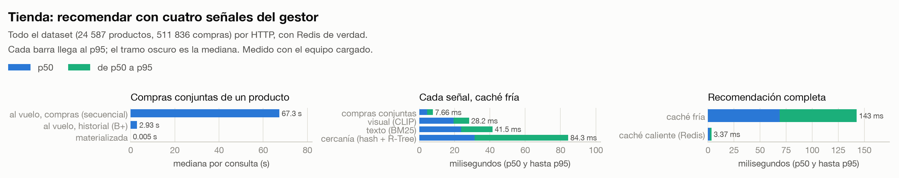

| Compras conjuntas de un producto | Consultas | p50 | p95 |
|---|---:|---:|---:|
| al vuelo sobre `shop_compras` (secuencial) | 1 | 67,3 s | 67,3 s |
| al vuelo sobre `shop_historial` (B+) | 5 | 2,9 s | 3,4 s |
| materializada (búsqueda por el B+) | 100 | 4,5 ms | 7,7 ms |
| materializar todos los pares en la carga | 70 | 793,6 s (una vez) | |

| Petición `GET /productos/{id}/recomendaciones` | Productos | p50 | p95 |
|---|---:|---:|---:|
| compras conjuntas (materializada) | 100 | 4,5 ms | 7,7 ms |
| visual, CLIP (embedding + HNSW) | 100 | 19,5 ms | 28,2 ms |
| texto, BM25 con el título | 100 | 23,6 ms | 41,5 ms |
| cercanía (hash + R-Tree, tras las otras) | 100 | 31,2 ms | 84,3 ms |
| **recomendación completa, caché fría** | 100 | 68,9 ms | 142,8 ms |
| **recomendación completa, caché caliente (Redis)** | 100 | 1,9 ms | 3,4 ms |

Conclusiones:

- **Las compras conjuntas no se pueden calcular por petición**: 67,3 s sobre el archivo
  secuencial (sin índices secundarios, y el `WHERE` se aplica después del `JOIN`) y 2,9 s
  sobre el historial con B+ (el lado derecho del `JOIN` se recorre entero). Materializadas,
  son una búsqueda por el B+ de 4,5 ms; la carga paga 793,6 s una vez (369 087 pares con
  soporte 2 y como mucho 500 por producto, en 70 consultas `GROUP BY` por lotes de
  unas 10 000 compras), unos 12 s por lote. Antes eran 47 s: `EXPLAIN ANALYZE` mostró el
  `JOIN` en 6 s y el filtro de encima en 35 s, que comparaba cada una de las 180 000 filas
  reunidas con las 747 opciones del `IN`. Un `IN` de textos literales ahora se busca en un
  conjunto, y la materialización bajó de 2 231 s (la medida anterior, con el mismo código
  salvo ese cambio) a 793,6 s.
- **El índice de los pares es un B+, no un hash.** Con el hash extendible la primera medida
  no terminó: con cientos de filas por clave, el directorio se duplicaba en cada inserción
  que caía en una cubeta llena de una misma clave (llegó a 4 GB y el gestor estuvo horas al
  97 % de CPU). Reproducido aparte: 400 claves repetidas 300 veces llevan el directorio a
  2^18 entradas.
- **La caché quita casi todo el trabajo**: la recomendación fusionada baja de 68,9 ms a
  1,9 ms de mediana con Redis.
- **Cada señal es una consulta corta del gestor**; la cercanía va después de las otras tres
  (necesita sus candidatos), así que su tiempo se suma a la más lenta de ellas.

```bash
docker run -d --name redis-medida -p 127.0.0.1:6391:6379 redis:8.8.4-alpine
uv run --no-sync python -m benchmarks.shop_recommend_benchmark --data-dir data/datasets \
    --models data/models/shop --engine-data-dir <copia del gestor de la sección 10> \
    --redis-url redis://127.0.0.1:6391/0 --products 100 --on-the-fly-products 5
```

`--engine-data-dir` se modifica (la carga añade tablas): conviene una copia.

## 16. Evaluación de la detección de copyright — remixes con la verdad conocida

`copyright_evaluation_benchmark.py` evalúa la detección del §14 (#77) con un conjunto de
prueba generado por programa, del que se sabe qué canción suena, dónde suena en la subida y
de qué parte del original sale. Como en el §14, el gestor es **una copia** del que dejó el
trabajo de carga, servida en otro proceso y en un puerto libre; de la copia se borran los
tramos de 200 canciones al azar, que pasan a ser **no catalogadas**. Quedan 7 794 canciones.
El servicio corre con su configuración por omisión.

**El conjunto de prueba** ([`remixes/`](remixes/)), con la semilla 20261120:

- **200 remixes con copias**: de 1 a 3 fragmentos de 5 a 20 s (largo al azar, uniforme)
  de canciones del catálogo, cada uno de un punto al azar de su pista y pegados con fundidos
  lineales de 1 s. Ninguna canción se repite entre remixes. Son 394 fragmentos (74 remixes de
  uno, 58 de dos y 68 de tres).
- **200 remixes sin copias**, iguales pero con canciones no catalogadas.
- Duran de 5,1 a 50,7 s (23,9 s de media) y se suben en FLAC a 44,1 kHz, mono.

**Las distorsiones**, cada una por separado sobre el mismo remix (13 versiones, 5 200
subidas): ruido blanco a 30, 20 y 10 dB de SNR sobre el remix entero; tempo ±5 % sin cambiar
el tono (vocoder de fase de librosa); tono ±1 semitono sin cambiar la duración; MP3 a
64 kbit/s constantes (LAME por libsndfile) y decodificado otra vez; un pasa bajos ideal a
4 kHz; y el volumen a −1, −3 y −12 dB. El enunciado pide ruido a 20 y 10 dB y «volumen»; el
ruido a 30 dB y los −1 y −3 dB se agregaron para ver **dónde** se rompe. Con el tempo, los
tramos de la verdad se escalan a la duración nueva.

**Qué se cuenta.** La unidad es la canción copiada dentro de una subida. Un **acierto** es
una canción de la verdad con alguna coincidencia que llega al umbral; un **fallo**, una que
no; una **falsa alarma**, cualquier otra canción que llega al umbral, en un remix con o sin
copias. La **curva ROC** barre el umbral de 0 a 1 en pasos de 0,01: su recall es la fracción
de fragmentos acertados y su tasa de falsos positivos, la de remixes sin copias con alguna
coincidencia que llega al umbral. El **umbral se elige** con la J de Youden (TPR − FPR
máxima) sobre los remixes **sin distorsión**, y todas las versiones se miden a ese umbral.
La **IoU** compara, en cada acierto, el tramo informado con el verdadero, en la subida y en
el original. La latencia es la de la petición entera, por minuto de audio subido.

**Dónde corrió.** Apple M4 Pro (12 núcleos), macOS, Python 3.12; 11 min 12 s. La carga
media fue de 6,9 a 24,4 durante la medida (está en el JSON): otros procesos ocupaban la
máquina, a ratos más que sus 12 núcleos, así que la latencia es pesimista.

### Resultados medidos

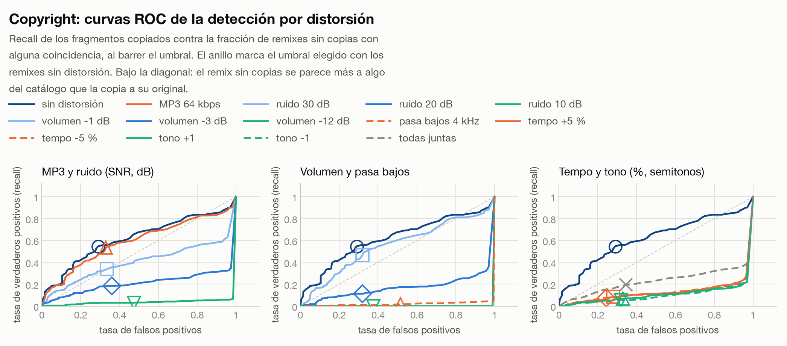

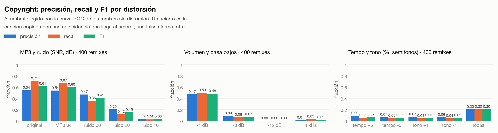

Al umbral elegido, **0,43** (sin distorsión: recall 0,546 con 29 % de remixes sin copias
marcados):

| Versión | AUC | Precisión | Recall | F1 | Aciertos / falsas alarmas / fallos | F1 a 0,45 | IoU subida | IoU original | ms por min de audio (p50 / p95) |
|---|---:|---:|---:|---:|---:|---:|---:|---:|---:|
| sin distorsión | **0,62** | 0,43 | **0,55** | **0,48** | 215 / 290 / 179 | 0,46 | 0,91 | 0,87 | 184 / 370 |
| MP3 64 kbit/s | 0,59 | 0,42 | 0,54 | 0,47 | 211 / 293 / 183 | 0,46 | 0,91 | 0,86 | 179 / 344 |
| ruido 30 dB | 0,40 | 0,31 | 0,34 | 0,32 | 133 / 300 / 261 | 0,32 | 0,90 | 0,86 | 181 / 366 |
| ruido 20 dB | 0,21 | 0,16 | 0,18 | 0,17 | 73 / 371 / 321 | 0,18 | 0,90 | 0,82 | 185 / 364 |
| ruido 10 dB | 0,04 | 0,02 | 0,03 | 0,03 | 12 / 520 / 382 | 0,03 | 0,83 | 0,56 | 187 / 376 |
| volumen −1 dB | 0,55 | 0,37 | 0,47 | 0,41 | 184 / 308 / 210 | 0,40 | 0,90 | 0,83 | 180 / 357 |
| volumen −3 dB | 0,17 | 0,11 | 0,11 | 0,11 | 44 / 355 / 350 | 0,11 | 0,89 | 0,66 | 180 / 348 |
| volumen −12 dB | 0,01 | 0,00 | **0,00** | 0,00 | 0 / 469 / 394 | 0,00 | — | — | 177 / 329 |
| pasa bajos 4 kHz | 0,02 | 0,01 | 0,01 | 0,01 | 6 / 621 / 388 | 0,01 | 0,84 | 0,74 | 170 / 352 |
| tempo +5 % | 0,13 | 0,09 | 0,08 | 0,09 | 33 / 348 / 361 | 0,07 | 0,86 | 0,54 | 181 / 373 |
| tempo −5 % | 0,13 | 0,08 | 0,08 | 0,08 | 30 / 327 / 364 | 0,08 | 0,82 | 0,66 | 180 / 375 |
| tono +1 semitono | 0,11 | 0,07 | 0,07 | 0,07 | 27 / 359 / 367 | 0,07 | 0,82 | 0,45 | 181 / 383 |
| tono −1 semitono | 0,11 | 0,06 | 0,05 | 0,06 | 21 / 354 / 373 | 0,05 | 0,85 | 0,64 | 180 / 318 |
| todas juntas | 0,23 | 0,17 | 0,19 | 0,18 | 989 / 4 915 / 4 133 | 0,17 | 0,90 | 0,83 | 181 / 364 |

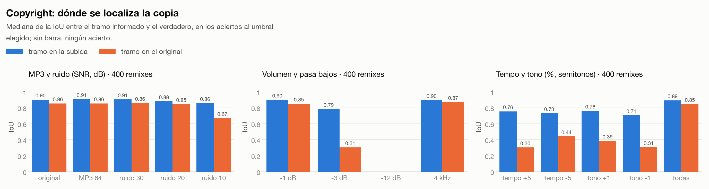

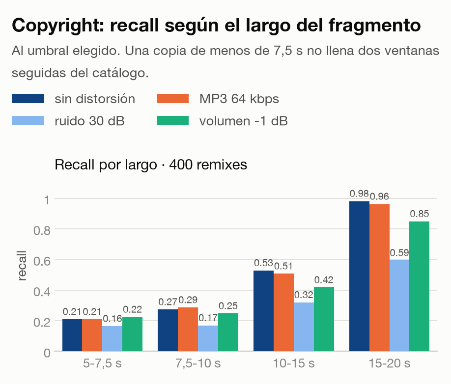

| Largo del fragmento (sin distorsión) | Fragmentos | Su canción está entre las coincidencias | Recall a 0,43 |
|---|---:|---:|---:|
| 5 a 7,5 s | 67 | 0,51 | 0,21 |
| 7,5 a 10 s | 77 | 0,92 | 0,27 |
| 10 a 15 s | 144 | **1,00** | 0,53 |
| 15 a 20 s | 106 | **1,00** | **0,98** |

| Fragmentos en el remix (sin distorsión) | Fragmentos | Recall a 0,43 |
|---|---:|---:|
| 1 | 74 | **1,00** |
| 2 | 116 | 0,58 |
| 3 | 204 | 0,36 |

Otras definiciones del puntaje, calculadas sobre **las mismas coincidencias** (ninguna está
en el servicio):

| Puntaje | AUC sin distorsión | Punto de Youden (TPR / FPR) | AUC con MP3 | AUC con −1 dB |
|---|---:|---:|---:|---:|
| similitud media × cobertura (el del servicio) | 0,62 | 0,55 / 0,29 | 0,59 | 0,55 |
| similitud media sola | 0,74 | 0,83 / 0,40 | 0,72 | 0,59 |
| ventanas de la racha / 7, si su similitud media es ≥ 0,9 | **0,78** | **0,67 / 0,22** | **0,76** | **0,65** |

### Conclusiones

- **El umbral pasa de 0,45 a 0,43**, el de máxima J de Youden sin distorsión. Es casi el
  mismo: el F1 sube de 0,46 a 0,48. Lo que dice la curva es otra cosa: **ningún umbral
  separa bien** (área bajo la curva 0,62). Con 0,43 se encuentra el 55 % de los fragmentos
  copiados, el 29 % de los remixes sin copias da alguna coincidencia y la precisión es 0,43:
  hay 290 falsas alarmas, 148 en remixes sin copias y 142 en remixes con copias.
- **Dónde falla el MFCC: el nivel, antes que el tono.** Bajar el volumen 1 dB cuesta el 15 %
  del recall (0,55 → 0,47), 3 dB lo deja en 0,11 y 12 dB en 0. El descriptor son 39 MFCC
  (con Δ y Δ²) cuantizados en una bolsa de palabras: una ganancia suma una constante a
  todas las bandas log-mel y, tras la DCT, esa constante solo mueve c0, la energía; pero el
  vocabulario cuantiza valores absolutos, así que las ventanas caen en otras palabras y la
  copia ya no se parece a su original. Lo mismo pasa con el ruido (recall 0,34 a 30 dB,
  0,18 a 20 dB y 0,03 a 10 dB) y con el pasa bajos a 4 kHz (0,01). **El cambio de tono lo
  rompe** (recall 0,05 y 0,07 con ±1 semitono) **y el de tempo también** (0,08 con ±5 %),
  pero no es una debilidad propia de ellos: un cambio de 3 dB, que no se oye como otra
  canción, rompe casi igual. Lo único que no le hace daño es el MP3 a 64 kbit/s (0,54).
- **Bajo la diagonal.** Con esas distorsiones las curvas quedan por debajo del azar: la
  copia ya no se encuentra (su canción puntúa 0), pero los remixes, con o sin copia, siguen
  dando coincidencias con otras canciones del FMA. El sistema sigue «encontrando algo»; lo
  que pierde es la copia.
- **Lo que pierde recall sin distorsión es el puntaje, no la búsqueda.** La canción copiada
  está entre las coincidencias en el 100 % de los fragmentos de 10 s o más y en el 92 % de
  los de 7,5 a 10 s, pero a 0,43 solo pasan el 53 % y el 27 %. La cobertura divide las
  ventanas de la racha por las que podían compartir subida y original (`min(subida,
  original)`): en un remix de tres fragmentos de ~35 s, cada uno cubre como mucho un tercio
  y su puntaje no pasa de ~0,3 aunque la similitud sea 0,98. Por eso el recall cae de 1,00
  con un fragmento a 0,58 con dos y 0,36 con tres. Un fragmento de 5 a 7,5 s solo se
  detecta cuando va solo (una subida de una ventana, cobertura 1), y una subida así de corta
  sin copias también puntúa alto.
- **Un puntaje mejor, propuesto y no aplicado.** Contar las ventanas de la racha (sobre las 7
  de un fragmento de 20 s) cuando su similitud media es alta no depende de cuánto duran la
  subida ni el original: sube el área bajo la curva de 0,62 a 0,78 sin distorsión y de 0,59
  a 0,76 con MP3, y su mejor punto da más recall (0,67) con menos falsas alarmas (22 %). Se
  calculó sobre las coincidencias que devolvió el servicio, que son las 10 mejores por el
  puntaje actual; con el puntaje nuevo podrían entrar otras, así que la cifra es una
  estimación por lo bajo. No se cambia aquí: cambia lo que significa el puntaje en la
  respuesta y en la interfaz (#78). Lo que más ganaría, sin embargo, es el descriptor: sin c0
  (o restando la media cepstral de cada ventana) el MFCC no cambia con el volumen, a costa de
  rehacer el vocabulario y el HNSW del catálogo (unos 3 min, §12). No está medido.
- **Cuando encuentra la copia, la ubica bien**: la mediana de la IoU es 0,91 en la subida y
  0,87 en el original sin distorsión. Lo que falta para 1 es la rejilla de 2,5 s de las
  ventanas. Con tempo o tono, en los pocos aciertos que quedan, la IoU en el original baja a
  0,45-0,66.
- **Unos 180 ms por minuto de audio** (p50; p95 de 320 a 380 ms, porque las subidas cortas
  pagan los costos fijos de la petición), igual con cualquier distorsión: el trabajo es
  decodificar y sacar MFCC (§14), no buscar. Se midió con la máquina cargada.

### Reproducirlo

```bash
uv run --no-sync python -m benchmarks.copyright_evaluation_benchmark \
    --engine-dir data/copyright-engine --data-dir data/datasets
uv run --no-sync python -m benchmarks.plot
```

`--positives`, `--negatives`, `--held-out` y `--seed` fijan el conjunto (200, 200, 200 y
20261120); `--min-fragments`, `--max-fragments`, `--min-fragment-seconds`,
`--max-fragment-seconds` y `--crossfade-seconds`, la forma de los remixes;
`--threshold-step`, el paso de la curva; `--provisional-threshold`, el umbral con que se
compara (0,45); y `--length-bins`, los largos de la tabla. Las detecciones crudas quedan en
[`results/copyright_evaluacion_casos.json`](results/copyright_evaluacion_casos.json), una
subida por línea con su verdad y sus coincidencias; con `--reuse-cases` todas las cifras se
recalculan desde ese archivo, sin gestor.

## 18. Rostros en LFW — verificación, identificación, latencia y caché

`faces_evaluation_benchmark.py` califica el reconocedor del servicio de rostros
([`apps/faces`](../apps/faces/README.md), #92) con LFW: describe las 13 233 fotos con el
pipeline del servicio (YuNet y SFace, un hilo) y, en las 1 033 en que YuNet ve más de un
rostro (sección 7), toma **el más cercano al centro**, que en LFW es la persona que nombra
la foto. En las 12 sin rostro, el par cuenta con coseno −1: se rechaza siempre (10 de los
6 000 pares del protocolo). Con esos embeddings:

- **verificación (1:1)** con el protocolo de `pairs.txt`: 10 pliegues de 300 pares de la
  misma persona y 300 de personas distintas; el umbral de cada pliegue se elige con los
  otros nueve (el que más pares clasifica bien) y se prueba con él;
- **TAR a un FAR fijo** y la ROC con esos 6 000 pares y con **todos los pares** de LFW: los
  242 000 de fotos de una misma persona y los 16,5 millones de la primera foto de cada
  persona contra la de cada otra. 3 000 pares de personas distintas no miden un FAR por
  debajo de 1/3 000; 16,5 millones llegan a 10⁻⁷;
- **identificación (1:N) en el gestor**: una tabla `VECTOR(128)` con la primera foto de
  cada una de las 1 679 personas con dos o más fotos y un HNSW coseno; cada otra foto de
  esas personas (7 481 sondas) y la única foto de las demás (4 061 desconocidas) se buscan
  con `SIMILAR_TO(embedding, $1, k = 1)` por SQL. La misma consulta con `METRIC = dot`, que
  el índice no ordena, es la búsqueda exacta del gestor; numpy, la referencia.

`faces_cache_benchmark.py` mide la caché de rastros del reconocimiento en vivo (sección 15)
según cuánto se mueve el rostro, contra el compose: un retrato que cruza cuadros de
1 280 x 720 de izquierda a derecha a `v` px por cuadro (el rostro mide 87 px de ancho, por
encima de los 80 que pide el reconocimiento), a 10 cuadros por segundo, 200 cuadros por
velocidad con la caché y sin ella. El cuadro es ancho a propósito: un rastro perdido se
recuerda 1 s, y si el rostro volviera antes por donde pasó —rebotando en un cuadro
angosto— el rastro viejo lo recogería (una primera versión con cuadros de 640 px daba un
80 % de aciertos a 160 px por cuadro por eso).

**Dónde corrió.** Apple M4 Pro (12 núcleos), macOS, OpenCV 5.0.0, un hilo de OpenCV y de
FAISS; el compose en Docker Desktop. Otros trabajos ocupaban el equipo: carga media de 9 a
11 durante la evaluación y de 4,6 a 21 durante la caché, con la máquina de Docker de 1,5 a 4,1 (cada pasada guarda
la suya).

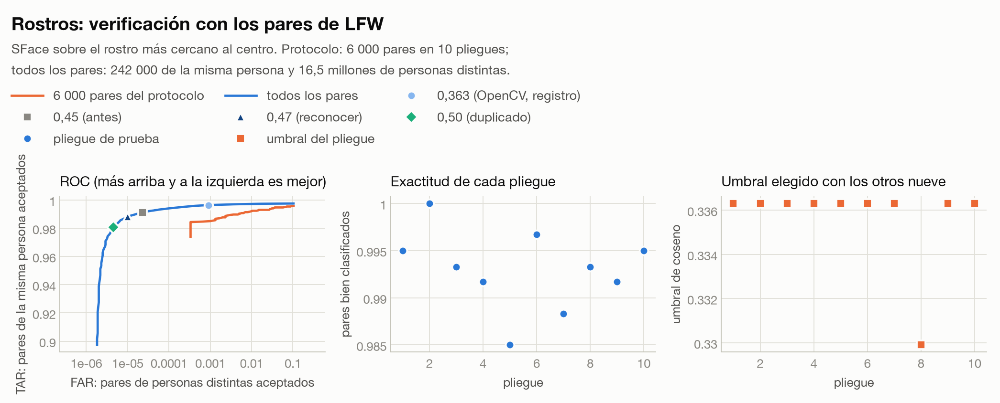

| Verificación (SFace, rostro del centro) | Valor |
|---|---:|
| exactitud, 10 pliegues | **99,30 % ± 0,40 %** (de 98,50 a 100 %) |
| umbral elegido en cada pliegue | 0,336 en nueve, 0,330 en uno |
| TAR a FAR 10⁻² (protocolo / todos los pares) | 99,23 % / 99,72 % |
| TAR a FAR 10⁻³ (protocolo / todos los pares) | **98,50 %** (umbral 0,375) / **99,64 %** (umbral 0,361) |
| TAR a FAR 10⁻⁴ (todos los pares) | 99,40 % (umbral 0,417) |
| TAR a FAR 10⁻⁵ (todos los pares) | 98,81 % (umbral 0,470) |

La desviación es la de las diez exactitudes (población). El protocolo da un TAR menor que
todos los pares porque sus pares de la misma persona se eligieron difíciles; los
umbrales, en cambio, salen de los impostores, y ahí 16,5 millones afinan lo que 3 000 no
pueden (a FAR 10⁻³ el protocolo deja pasar 3 impostores).

| Umbral | Uso en el servicio | TAR (todos los pares) | FAR (todos los pares) | Desconocidas aceptadas con 1 679 personas (FPIR) | Registradas perdidas (FNIR) |
|---:|---|---:|---:|---:|---:|
| 0,336 | máxima exactitud en los pliegues | 99,67 % | 2,5 · 10⁻³ | — | — |
| **0,363** | misma persona que las tomas anteriores (1:1) | 99,63 % | 9,1 · 10⁻⁴ | 66,5 % | 1,5 % |
| 0,45 | reconocer, **antes** de #92 | 99,12 % | 2,3 · 10⁻⁵ | 3,4 % | 3,0 % |
| **0,47** | reconocer y «te pareces mucho», **desde #92** | 98,80 % | 1,0 · 10⁻⁵ | 1,6 % | 3,7 % |
| **0,50** | «ya estás registrado como X» | 98,06 % | 4,6 · 10⁻⁶ | 0,64 % | 5,4 % |

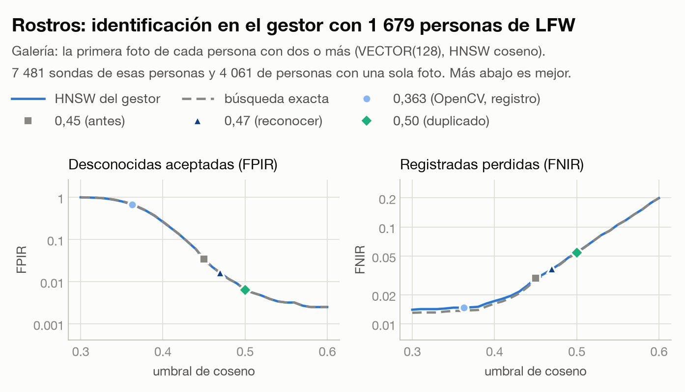

| Identificación, 1 679 personas | Rank-1 | Acuerdo con la exacta | p50 | p95 | p99 |
|---|---:|---:|---:|---:|---:|
| HNSW del gestor (por SQL) | 98,60 % | 99,83 % | 0,21 ms | 0,24 ms | 0,32 ms |
| exacta del gestor (`METRIC = dot`) | 98,72 % | 100 % | 0,20 ms | 0,23 ms | 0,34 ms |
| exacta con numpy (referencia) | 98,72 % | 100 % | — | — | — |

Construir el HNSW de 1 679 vectores tardó 79 ms. Las FPIR y FNIR de la exacta difieren de
las del HNSW en menos de 0,2 puntos desde 0,45 (la figura las superpone); a 0,363 el HNSW
acepta 1,2 puntos menos de desconocidas, porque a veces no encuentra al vecino más
parecido.

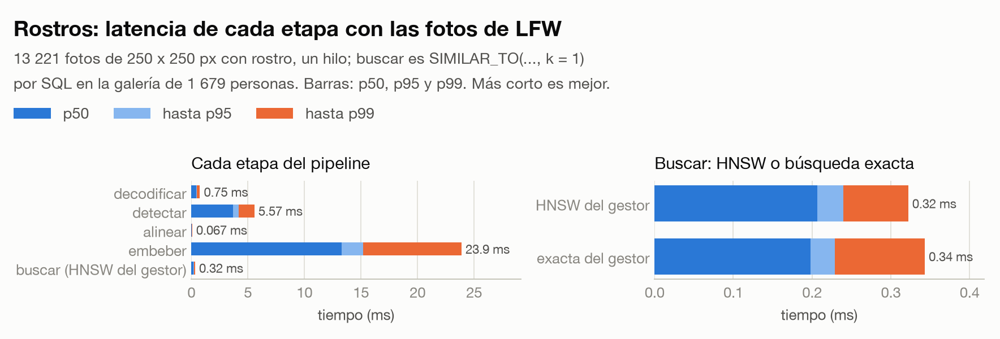

| Etapa | Medida en | p50 | p95 | p99 |
|---|---|---:|---:|---:|
| decodificar | 13 221 fotos de LFW (250 px) | 0,43 ms | 0,50 ms | 0,75 ms |
| detectar (YuNet) | ídem | 3,70 ms | 4,20 ms | 5,57 ms |
| alinear | ídem | 0,05 ms | 0,06 ms | 0,07 ms |
| embeber (SFace) | ídem | 13,31 ms | 15,19 ms | 23,89 ms |
| total del pipeline | ídem | 17,50 ms | 20,10 ms | 29,64 ms |
| buscar (HNSW por SQL, en proceso) | 11 542 búsquedas, 1 679 personas | 0,21 ms | 0,24 ms | 0,32 ms |
| red y espera (WebSocket por el nginx) | 8 pasadas sin caché, 1 600 cuadros de 1 280 x 720 | 2,7 a 3,5 ms | 4,1 a 6,2 ms | 4,8 a 11,9 ms |

La sección 7 da decodificar y detectar según el tamaño de la foto, y la 15 cada etapa de
un cuadro por WebSocket; aquí se suman el p99 y la red. «Red y espera» es la latencia del
cliente menos las etapas medidas en el servidor; de cada pasada se guardan sus percentiles,
así que se da el rango entre pasadas.

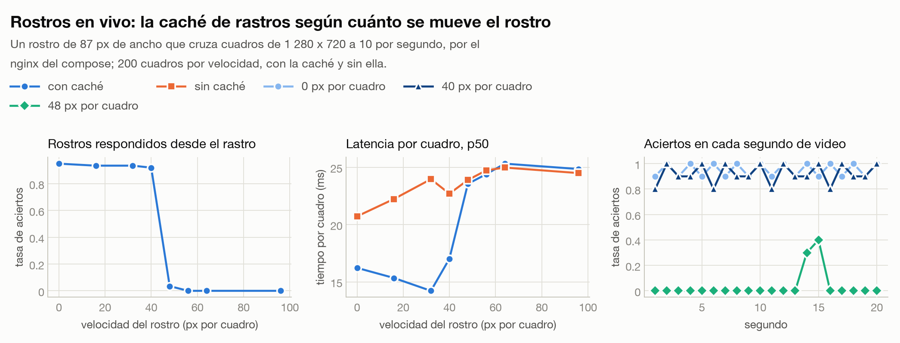

| Velocidad (px por cuadro) | Aciertos | p50 con caché | p50 sin caché | Ahorro p50 | Ahorro medio | p99 con / sin caché |
|---:|---:|---:|---:|---:|---:|---:|
| 0 | **95,0 %** | 16,2 ms | 20,7 ms | 4,5 ms | 5,9 ms | 28,8 / 33,5 ms |
| 16 | 93,5 % | 15,3 ms | 22,2 ms | 6,9 ms | 7,0 ms | 33,0 / 31,6 ms |
| 32 | 93,5 % | 14,2 ms | 24,0 ms | 9,7 ms | 8,9 ms | 27,8 / 38,5 ms |
| 40 | 92,0 % | 17,0 ms | 22,7 ms | 5,7 ms | 7,2 ms | 30,7 / 50,2 ms |
| 48 | 3,5 % | 23,6 ms | 23,9 ms | 0,3 ms | −3,8 ms | 75,5 / 29,3 ms |
| 56 | 0 % | 24,4 ms | 24,7 ms | 0,3 ms | −0,1 ms | 44,0 / 31,6 ms |
| 64 | 0 % | 25,3 ms | 25,0 ms | −0,3 ms | 2,1 ms | 32,0 / 65,8 ms |
| 96 | 0 % | 24,8 ms | 24,5 ms | −0,4 ms | −0,1 ms | 30,3 / 31,4 ms |

200 cuadros por pasada tras 20 de calentamiento. El ahorro medio es la diferencia de las
medias de las dos pasadas; con 0 % de aciertos, lo que queda es ruido de una pasada a otra
(la carga del equipo cambió de 21 a 5 durante la medida). Las tasas de aciertos salieron
idénticas en las dos ejecuciones que se hicieron.

### Conclusiones

- **SFace con el rostro del centro llega a 99,30 % ± 0,40 % en LFW**, y el umbral que
  eligen los pliegues casi no se mueve (0,336 en nueve de diez): la frontera entre
  personas está bien definida y no depende de qué pares se usen para elegirla.
- **El umbral de 1:1 (0,363) no cambia.** Lo publica OpenCV y los datos lo confirman: queda
  entre el de máxima exactitud (0,336) y el de FAR 10⁻³ (0,361 con todos los pares, 0,375
  con los 3 000 del protocolo). Con él, 9 de cada 10 000 pares de personas distintas pasan
  y el 99,6 % de los de la misma persona también: es lo que se pide para comparar una toma
  con las anteriores del mismo registro.
- **El umbral de reconocer sube de 0,45 a 0,47.** Un desconocido se compara con toda la
  galería: con N personas y una meta de 1 % de desconocidos aceptados, cada comparación
  puede aceptar a lo sumo 0,01 / N impostores. Con N = 1 000 son 10⁻⁵, y en los 16,5
  millones de pares ese FAR está en 0,470. Medido con 1 679 personas en el gestor, la FPIR
  baja de 3,4 % a 1,6 % y la FNIR sube de 3,0 % a 3,7 %. El aviso de «te pareces mucho» usa
  el mismo umbral, como antes; «ya estás registrado» se queda en 0,50 (FAR 4,6 · 10⁻⁶).
- **El HNSW del gestor responde casi como la búsqueda exacta**: coincide en el primer
  vecino en 7 468 de 7 481 sondas (99,83 %) y pierde 0,12 puntos de rank-1. Con 1 679
  vectores, las dos tardan lo mismo, 0,2 ms por SQL: el costo es analizar y planificar la
  consulta, no comparar 1 679 vectores de 128 dimensiones.
- **El umbral de verificación no sirve para reconocer**: a 0,363, el 66,5 % de las 4 061
  desconocidas sale como alguien de la galería de 1 679 (con 1 000, la sección 11 midió
  46,5 %). Y hay un piso: de 0,58 a 0,60, el más alto que se prueba, siguen aceptadas 10
  desconocidas, y no son errores del modelo: tres son la misma persona escrita de otra
  forma (*Hasan Wirayuda* y *Hassan Wirajuda*, *Sung Hong Choi* y *Choi Sung-hong*,
  *Yingfan Wang* y *Wang Yingfan*), una es la gemela de alguien de la galería (las Olsen),
  dos son hermanas y en otras la foto muestra también a la persona con que se confunde.
- **Lo que domina la latencia es SFace**: 13 de los 17,5 ms de una foto, y en el p99 sube a
  24 ms con el equipo cargado; buscar en el gestor es el 1 %. La red local y el nginx suman 3 ms en la mediana y hasta
  12 en el p99.
- **La caché de rastros acierta en el 92 a 95 % de los cuadros mientras el rostro se mueve
  hasta 40 px por cuadro** (400 px por segundo a 10 cuadros por segundo: un tercio del
  ancho de un cuadro de 720p cada segundo) y ahorra de 4,5 a 10 ms por cuadro, del 22 al
  40 % de la mediana. Lo que no acierta es un cuadro de cada 20 —se vuelve a verificar cada 2 s— y
  el que vuelve a entrar por la izquierda.
- **Pasados los 47 px el rastro se rompe de golpe**, como predice el IoU: con un rostro de
  87 px de ancho, un salto de *d* px deja un IoU de (87 − *d*) / (87 + *d*), que baja de 0,3
  en *d* = 47. A 48 px solo aciertan los cuadros en que el detector da una caja algo más
  ancha (3,5 %), y desde 56 px ninguno: cada cuadro abre un rastro nuevo y paga el camino
  completo, igual que sin caché. El umbral de IoU es lo que fija la velocidad máxima, en
  proporción al tamaño del rostro: uno más cerca de la cámara tolera saltos mayores.

**Lo que esta medida no dice.** LFW son fotos de prensa de 250 px, casi todas de frente y
bien iluminadas; con selfies de celular a contraluz el TAR será menor y los umbrales
deberían revisarse con fotos de la propia aplicación. La galería del servicio guarda tres
tomas por persona (de frente y giradas) y no una: cada desconocido hace tres comparaciones
por persona, lo que empuja la FPIR hacia arriba, y cada registrada tiene tres
oportunidades, lo que baja la FNIR. Con 4 061 desconocidas, un punto de FPIR son 41
consultas. La caché se midió con un solo rostro que se mueve en línea recta; varias
personas que se cruzan pueden intercambiar rastros.

### Reproducirlo

```bash
.venv/bin/python -m faces lfw --salida data/datasets/lfw
.venv/bin/python -m faces models --salida data/models/faces
.venv/bin/python -m benchmarks.faces_evaluation_benchmark --lfw data/datasets/lfw \
    --models data/models/faces --fars 0.01 0.001 0.0001 0.00001 \
    --thresholds 0.363 0.45 0.47 0.5 --gallery-size 1000 --target-fpir 0.01
# la caché, con el compose de la sección 15 levantado:
.venv/bin/python -m benchmarks.faces_cache_benchmark --api-url http://127.0.0.1:<web>/api \
    --url ws://127.0.0.1:<web>/api/ws/recognize --speeds 0 16 32 40 48 56 64 96 \
    --frames 200 --warmup 20 --fps 10 --compose-project rostros-bench
.venv/bin/python -m benchmarks.plot
```

La evaluación tarda unos cinco minutos, cuatro de ellos en describir las 13 233 fotos;
`--embeddings-cache archivo.npz` las guarda y las reutiliza. Las exactitudes, umbrales,
TAR, rank-1 y tasas no dependen de la carga del equipo: salieron idénticos en las tres
ejecuciones que se hicieron. La caché tarda unos siete minutos.

## 19. Evaluación del RAG — recuperación de preguntas en español y respuestas con Claude

`rag_evaluation_benchmark.py` evalúa el RAG sobre papers (#87) con un conjunto de preguntas
en español cuya respuesta correcta es un fragmento conocido del corpus. **La recuperación
está medida**; la calidad de las respuestas (fidelidad, citas, «no está en los documentos»)
necesita la clave de la API de Anthropic, que todavía no hay, y **queda pendiente**: el
código, los tests y los comandos están listos (ver abajo).

**El conjunto** ([`rag/preguntas.jsonl`](rag/preguntas.jsonl)): 63 preguntas, todas
`origin: author`, escritas a mano por el autor del proyecto.

- **45 con respuesta.** Los fragmentos salen de `python -m benchmarks.rag_questions sample`
  (semilla 87): por estrato —cs.DB de 2025 (8), cs.DB de 2026 (16), cs.IR de 2026 (16) y el
  material del curso (5), el único en español—, un fragmento de prosa por paper (sin listas de
  referencias ni tablas). Para cada uno se leyó el fragmento y se escribió una pregunta que
  él responde, como la escribiría alguien que no lo ha visto.
- **18 sin respuesta en el corpus** (cocina, deporte, geografía, trámites en el Perú, la nota
  de un examen del curso, el precio de Netflix en el Perú…): se comprobó con `grep` sobre los
  98 585 fragmentos que sus palabras clave no aparecen o no responden la pregunta.

Las preguntas generadas con la **Batch API** (`origin: batch`, unas 70 más) se suman cuando
haya clave (abajo). El archivo no guarda texto del corpus, solo la pregunta y los
identificadores del fragmento y del paper.

**Qué cuenta como acierto.** Cada pregunta tiene un solo fragmento correcto, así que
Recall@k es la fracción de preguntas cuyo fragmento aparece entre los k primeros y MRR@10 la
media de `1/puesto`. Como los fragmentos se solapan de 50 a 120 palabras, se informa también
el acierto con el **vecino** (el fragmento anterior o el siguiente del mismo paper) y con el
**paper** (cualquier fragmento del documento correcto: la cita llevaría al PDF correcto).

**Dónde corrió.** Apple M4 Pro (12 núcleos), macOS, Python 3.12, el gestor en un uvicorn
aparte sobre una copia de `data/engine-rag/` (98 585 fragmentos, vectores int8). **Con
contención**: carga media 5,7 al empezar y 5,4 al terminar. Los tres modos son los de
`POST /search` con `k = 10` después de #136: BM25 busca la pregunta sin las palabras vacías
de su idioma y el híbrido funde 50 de cada lista con RRF; la latencia es la del cliente,
embedding de la pregunta incluido. Tardó unos 15 s.

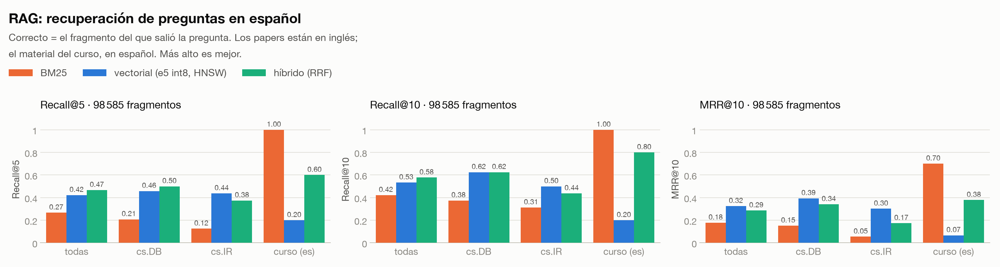
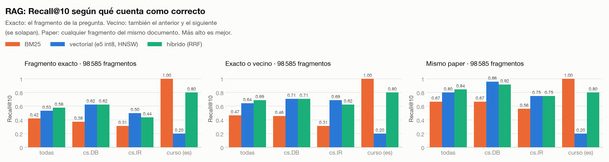

**Las 45 preguntas con respuesta:**

| Modo | Recall@5 | Recall@10 | MRR@10 | Recall@10, vecino | Recall@10, paper | Mediana (ms) | p95 (ms) |
|---|---:|---:|---:|---:|---:|---:|---:|
| BM25 | 0,267 | 0,422 | 0,178 | 0,467 | 0,667 | 9,5 | 17,2 |
| vectorial | 0,422 | 0,533 | **0,325** | 0,644 | 0,800 | 18,2 | 26,6 |
| híbrido (RRF) | **0,467** | **0,578** | 0,286 | **0,689** | **0,844** | 23,9 | 33,0 |

**Por grupo** (Recall@10 exacto / MRR@10):

| Modo | cs.DB (24) | cs.IR (16) | curso, en español (5) |
|---|---:|---:|---:|
| BM25 | 0,375 / 0,152 | 0,313 / 0,054 | **1,000 / 0,700** |
| vectorial | **0,625 / 0,394** | **0,500 / 0,302** | 0,200 / 0,067 |
| híbrido (RRF) | **0,625** / 0,341 | 0,438 / 0,174 | 0,800 / 0,379 |

Antes de #136, con la pregunta entera en BM25, BM25 no encontraba ningún fragmento de los
papers (Recall@10 0,111, solo las del curso) y el híbrido quedaba por debajo del vectorial
(0,511); los JSON de esa corrida están en la historia de git.

**int8 contra fp32.** La ingesta (#85) vio que los vectores int8 comparten 7,3 de 10 vecinos
con los fp32. Aquí se midió solo **int8**, que es lo desplegado: comparar con fp32 exige
volver a calcular los 98 585 embeddings (43,9 min en la ingesta, más con la máquina cargada)
y sembrar otro gestor, y no se hizo. Se puede repetir esta evaluación sobre un gestor
sembrado con `RAG_EMBEDDING_MODEL=fp32` con el mismo comando.

### Conclusiones

- **Quitar las palabras vacías del español hace útil a BM25.** El índice es en inglés: con la
  pregunta entera, «de», «la» o «qué» no coincidían con nada útil y BM25 solo traía los
  documentos del curso. Sin ellas le quedan los nombres y siglas que comparte con los papers
  (SHARP, InfluxDB, Iceberg…) y encuentra el fragmento en el 38 % de las preguntas de cs.DB.
- **El híbrido es ahora el mejor en Recall**: 0,58 a 10 y 0,84 a nivel de paper, contra 0,53
  y 0,80 del vectorial, y el único que funciona en los dos idiomas (0,80 en el curso, donde el
  vectorial acierta 1 de 5). El vectorial sigue con el mejor MRR (0,325 contra 0,286): cuando
  encuentra el fragmento, lo pone más arriba. En cs.IR el híbrido sigue por debajo (0,44
  contra 0,50). Con 45 preguntas, una diferencia de 0,05 son dos preguntas.
- **Contando el vecino sube a 0,69**: parte de los «fallos» son el fragmento de al lado, que
  trae el mismo pasaje.
- **Una latencia de decenas de milisegundos**: 9,5 ms BM25, 18 ms vectorial (casi todo el
  embedding de la pregunta) y 24 ms híbrido de mediana.

### Las respuestas

Con `--answers simulated` el experimento hace las 63 preguntas por el mismo camino que
`POST /answers`, con el modelo simulado: sirve para **probar el camino y medir lo que no
depende del modelo**, no la calidad. Cada pregunta recibe 12 fragmentos (`RAG_ANSWER_CHUNKS`
tras #136); **28 de las 45** con respuesta llevan su fragmento correcto entre ellos, un techo
para citarlo (con los 8 de antes eran 20). Mediana de la recuperación con la selección del
prompt, 21,2 ms (máximo 32,5); el evento `sources` sale a los 21,3 ms de preguntar. El prompt
estimado es de 7 920 tokens de media.

**Pendiente de la clave**, con su costo estimado (tokens de los prompts reales de esta
corrida por los precios de `rag.pricing`; lo esperado supone 600 tokens de salida por
respuesta y 800 por veredicto; la cota, toda la entrada al precio más caro y la salida
entera):

| Paso | Modelo | Esperado (USD) | Cota (USD) |
|---|---|---:|---:|
| 80 preguntas por la Batch API (a mitad de precio) | Claude Sonnet 5.5 | 0,15 | 0,55 |
| responder las 63 preguntas de hoy | Claude Sonnet 5.5, esfuerzo `low` | 1,38 | 3,29 |
| juzgar esas respuestas | Claude Haiku 5.5 | 0,07 | 0,23 |
| **con las ~133 preguntas del conjunto completo** | | **≈ 3,2** | ≈ 8,0 |

`--budget-usd` es un tope duro de lo gastado (respuestas y juez juntos), con el mismo tope
diario del servicio: reserva la cota de cada llamada antes de hacerla y la cambia por el
costo real al terminar.

```bash
cp -R data/engine-rag /tmp/engine-rag-copia && rm -f /tmp/engine-rag-copia/.motor.lock
# 1. preguntas de la Batch API: estimar, enviar, esperar y filtrar, revisar a mano y sumar
uv run --no-sync python -m benchmarks.rag_questions submit --data-dir data/datasets \
    --state data/rag-preguntas/lote.json --budget-usd 1 --dry-run
RAG_ANTHROPIC_API_KEY=… uv run --no-sync python -m benchmarks.rag_questions submit \
    --data-dir data/datasets --state data/rag-preguntas/lote.json --budget-usd 1
RAG_ANTHROPIC_API_KEY=… uv run --no-sync python -m benchmarks.rag_questions collect \
    --data-dir data/datasets --state data/rag-preguntas/lote.json \
    --candidates data/rag-preguntas/candidatas.jsonl
uv run --no-sync python -m benchmarks.rag_questions accept --data-dir data/datasets \
    --candidates data/rag-preguntas/candidatas.jsonl
# 2. recuperación, respuestas y juez
RAG_ANTHROPIC_API_KEY=… uv run --no-sync python -m benchmarks.rag_evaluation_benchmark \
    --engine-dir /tmp/engine-rag-copia --models data/models/rag \
    --answers anthropic --judge --budget-usd 5
# 3. validar el juez contra 20 respuestas revisadas a mano
uv run --no-sync python -m benchmarks.rag_judge_agreement sample --size 20
uv run --no-sync python -m benchmarks.rag_judge_agreement score
uv run --no-sync python -m benchmarks.plot
```

**Revisión a mano de las candidatas de la Batch API** (`review: ok` o `drop` en
`candidatas.jsonl`). El filtro automático ya descartó las que no citan el fragmento palabra
por palabra, no son preguntas en español, tienen menos de 6 o más de 40 palabras, nombran
«el fragmento» o «los autores», o repiten otra. Quien revisa marca `drop` si:

1. la cita (`evidence`) no responde de verdad la pregunta;
2. la pregunta es tan general que muchos papers la responderían (no tiene un solo fragmento
   correcto);
3. hace falta haber leído el fragmento para entenderla (un símbolo, una tabla, «el método
   propuesto» sin nombre);
4. copia una oración del fragmento casi entera (premia a BM25 sin ser una pregunta real);
5. el fragmento es una tabla, una fórmula o una lista de referencias que pasó el filtro.

**Revisión a mano del juez** (`revision_fidelidad.jsonl`): para cada pregunta de la muestra,
leer la respuesta junto a sus fragmentos (`fragmentos_enviados` en
`rag_evaluacion_respuestas.json`) y escribir `{"pregunta_id": …, "fiel": true|false}`, con
`fiel` falso si alguna afirmación no sale de los fragmentos. `score` informa la fracción de
acuerdo y la kappa de Cohen; la fidelidad del juez se publica junto con ese acuerdo.

### Reproducirlo

```bash
cp -R data/engine-rag /tmp/engine-rag-copia && rm -f /tmp/engine-rag-copia/.motor.lock
uv run --no-sync python -m benchmarks.rag_evaluation_benchmark \
    --engine-dir /tmp/engine-rag-copia --models data/models/rag --answers simulated
uv run --no-sync python -m benchmarks.plot
```

Escribe `results/rag_evaluacion.json` (por modo y grupo, y el detalle de cada pregunta: los
10 fragmentos recuperados y el puesto del correcto con cada criterio) y
`results/rag_evaluacion_respuestas.json` (por pregunta: tiempos, fragmentos enviados, citas,
tokens, costo, respuesta y, con `--judge`, el veredicto). Sin `--answers`, solo la
recuperación.

## Gráficas

`plot.py` lee los JSON de `results/` y redibuja todas las imágenes de `figures/`:

```bash
uv sync --all-packages --extra plots
.venv/bin/python -m benchmarks.plot
```

Qué se dibuja está declarado en `FIGURES`, al principio del módulo: una figura por
comparación y un panel por operación. Los colores son tres tonos comprobados para que se
distingan también con daltonismo, y cada técnica lleva además su propio marcador (círculo,
cuadrado, triángulo), así que las gráficas se leen igual impresas en gris. Los valores de
todas las gráficas están en las tablas de este documento.

## Reproducibilidad

Misma semilla ⇒ mismos datos ⇒ resultados comparables entre ejecuciones. Los benchmarks
trabajan sobre un directorio temporal que se borra al terminar, así que no ensucian los
datos del gestor. Los JSON de `results/` y las imágenes de `figures/` se versionan junto al
código: son las cifras y las gráficas que cita este documento.
